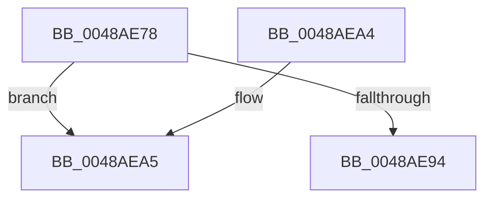

# MiDeleteControlAreaList

- RVA: `0x0048AE78`–`0x0048AEB1` (길이 `57` bytes)
- VA: `0x000000014048AE78`
- 실행 섹션: `.text`
- PDB 이름 있음: `예`; PDB Function 태그: `예`
- unwind 정보 RVA: `0x00065C48`
- 디코드: `15`개 명령, `57/57` bytes 표시
- 미해석 바이트: `0` (있으면 어셈블리에 `.byte`로 보존)

> 이 문서는 커널 이미지의 기계어와 PDB 기호를 분석해 생성했습니다. 4번과 5번은 함수 원형과 자료형을 바이너리 사용 방식에서 추정한 C 해석이며 원본 소스 복구 결과는 아닙니다.

## 1. Dependencies

- 직접 호출 지점: **0**; 고유 호출 대상: **0**
- 직접 호출자로 확인된 함수: **1**
- RIP 상대 이미지 참조: **0**

### Outgoing calls
- 직접 디코드된 call 명령이 없습니다.

### Direct callers
- [MiSegmentDereferenceWorker](../46/MiSegmentDereferenceWorker_function_00464D40.md) at `0x00464D69`
- [MiSegmentDereferenceWorker](../46/MiSegmentDereferenceWorker_function_00464D40.md) at `0x00464E2E`

### Static image references
- 디코드된 RIP-relative 메모리 참조가 없습니다.

## 2. Other-region calls and transfers

- 다른 실행 섹션으로 향하는 call: **0**
- call이 아닌 외부 분기/꼬리 이동: **1**
  - `0x0048AEAC` → [sub_006F602E](../6F/Unknown_function_006F602E.md) (`tail-transfer`)

## 3. Assembly (complete function range)

```asm
0048AE78  48 89 5C 24 08                  mov qword ptr [rsp + 8], rbx
0048AE7D  48 89 74 24 10                  mov qword ptr [rsp + 0x10], rsi
0048AE82  57                              push rdi
0048AE83  48 83 EC 20                     sub rsp, 0x20
0048AE87  48 83 B9 78 08 00 00 00         cmp qword ptr [rcx + 0x878], 0
0048AE8F  48 8B D9                        mov rbx, rcx
0048AE92  75 11                           jne 0x14048aea5
0048AE94  48 8B 5C 24 30                  mov rbx, qword ptr [rsp + 0x30]
0048AE99  48 8B 74 24 38                  mov rsi, qword ptr [rsp + 0x38]
0048AE9E  48 83 C4 20                     add rsp, 0x20
0048AEA2  5F                              pop rdi
0048AEA3  C3                              ret
0048AEA4  CC                              int3
0048AEA5  48 8D B1 C0 06 00 00            lea rsi, [rcx + 0x6c0]
0048AEAC  E9 7D B1 26 00                  jmp 0x1406f602e
```

## 4. C-style interpretation (structured pseudocode)

```c
void __fastcall MiDeleteControlAreaList(__int64 a1)
{
    __int64 v_rsp;
    unsigned __int64 v_stack_p10;
    unsigned __int64 v_stack_p8;

    v_stack_p8 = v_rbx;
    v_stack_p10 = v_rsi;
    v_rsp = (v_rsp) - (32);
    if ((*(unsigned __int64 *)(a1 + 2168)) != 0) goto loc_0048AEA5;
    v_rsp = (v_rsp) + (32);
    return;
loc_0048AEA5:
}
```

## 5. (Beta) C Style

```c
void MiDeleteControlAreaList(void *Arg1)
{
    uint8_t *arg1 = (uint8_t *)Arg1;

    int64_t local_rsp;
    uint64_t v_stack_p10;
    uint64_t v_stack_p8;

    v_stack_p8 = local_rbx;
    v_stack_p10 = local_rsi;
    local_rsp = (local_rsp) - (32);
    if ((*(uint64_t *)(arg1 + 0x878)) != 0) goto loc_0048AEA5;
    local_rsp = (local_rsp) + (32);
    return;
loc_0048AEA5:
}
```

### 관측된 메모리 오프셋

구조체 형식이 확인되지 않은 접근은 인자 기준의 오프셋으로만 기록했습니다.

| 기준 인자 | 오프셋 표현 | 폭 (bit) | 접근 |
|---|---:|---:|---|
| `Arg1` | `+ 0x6C0` | `64` | `R` |
| `Arg1` | `+ 0x878` | `64` | `R` |

## 6. Execution-region graph

[열기: 2D/3D 그래프와 함수 탐색 컨트롤 패널](../../../control-panel.html?section=text&rva=0x0048AE78&view=graph)

- 2D 그래프는 위에서 아래로 흐르고, 3D 그래프는 빈 공간을 드래그해 회전합니다. Shift+드래그는 이동, 휠은 확대·축소, 함수 노드 선택은 대상 보고서 이동입니다.

### Static fallback


