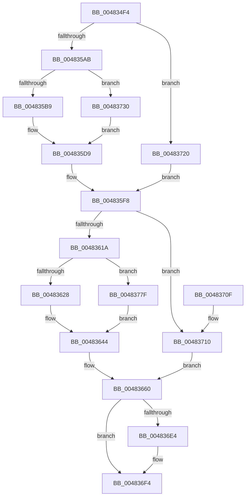

# MiDeleteEmptyPageTableCommit

- RVA: `0x004834F4`–`0x004837CD` (길이 `729` bytes)
- VA: `0x00000001404834F4`
- 실행 섹션: `.text`
- PDB 이름 있음: `예`; PDB Function 태그: `아니요`
- unwind 정보 RVA: `0x000AEF34`
- 디코드: `181`개 명령, `729/729` bytes 표시
- 미해석 바이트: `0` (있으면 어셈블리에 `.byte`로 보존)

> 이 문서는 커널 이미지의 기계어와 PDB 기호를 분석해 생성했습니다. 4번과 5번은 함수 원형과 자료형을 바이너리 사용 방식에서 추정한 C 해석이며 원본 소스 복구 결과는 아닙니다.

## 1. Dependencies

- 직접 호출 지점: **10**; 고유 호출 대상: **8**
- 직접 호출자로 확인된 함수: **1**
- RIP 상대 이미지 참조: **0**

### Outgoing calls
- `0x0048352D` → [memset](../6C/memset_function_006C6C40.md) (function, `0x006C6C40`)
- `0x0048353B` → [memset](../6C/memset_function_006C6C40.md) (function, `0x006C6C40`)
- `0x00483560` → [MiGetLeafVa](../27/MiGetLeafVa_function_0027C0A0.md) (function, `0x0027C0A0`)
- `0x00483576` → [MiGetLeafVa](../27/MiGetLeafVa_function_0027C0A0.md) (function, `0x0027C0A0`)
- `0x0048367B` → [MiLockWorkingSetShared](../27/MiLockWorkingSetShared_function_0027CBF0.md) (function, `0x0027CBF0`)
- `0x00483692` → [MiCaptureDeleteHierarchy](../27/MiCaptureDeleteHierarchy_function_0027F5F0.md) (function, `0x0027F5F0`)
- `0x004836A4` → [MiUnlockWorkingSetShared](../27/MiUnlockWorkingSetShared_function_0027D690.md) (function, `0x0027D690`)
- `0x004836CB` → [MiReturnPageTablePageCommitment](../../page/9E/MiReturnPageTablePageCommitment_function_009E5750.md) (function, `0x009E5750`)
- `0x00483713` → [MiGetNextVad](../29/MiGetNextVad_function_00297224.md) (function, `0x00297224`)
- `0x00483723` → [MiGetPreviousVad](../29/MiGetPreviousVad_function_00297268.md) (function, `0x00297268`)

### Direct callers
- [MiDeleteEmptyPageTableTail](MiDeleteEmptyPageTableTail_function_00483280.md) at `0x004833B0`

### Static image references
- 디코드된 RIP-relative 메모리 참조가 없습니다.

## 2. Other-region calls and transfers

- 다른 실행 섹션으로 향하는 call: **1**
  - `0x004836CB` → [MiReturnPageTablePageCommitment](../../page/9E/MiReturnPageTablePageCommitment_function_009E5750.md) (`.text` → `PAGE`)
- 별도 외부 분기/꼬리 이동을 확인하지 못했습니다.

## 3. Assembly (complete function range)

```asm
004834F4  48 89 5C 24 20                  mov qword ptr [rsp + 0x20], rbx
004834F9  48 89 4C 24 08                  mov qword ptr [rsp + 8], rcx
004834FE  55                              push rbp
004834FF  56                              push rsi
00483500  57                              push rdi
00483501  41 54                           push r12
00483503  41 55                           push r13
00483505  41 56                           push r14
00483507  41 57                           push r15
00483509  48 8D 6C 24 A0                  lea rbp, [rsp - 0x60]
0048350E  48 81 EC 60 01 00 00            sub rsp, 0x160
00483515  49 8B D8                        mov rbx, r8
00483518  48 8B FA                        mov rdi, rdx
0048351B  4C 8B F1                        mov r14, rcx
0048351E  BE 88 00 00 00                  mov esi, 0x88
00483523  44 8B C6                        mov r8d, esi
00483526  48 8D 4C 24 40                  lea rcx, [rsp + 0x40]
0048352B  33 D2                           xor edx, edx
0048352D  E8 0E 37 24 00                  call 0x1406c6c40
00483532  44 8B C6                        mov r8d, esi
00483535  48 8D 4D D0                     lea rcx, [rbp - 0x30]
00483539  33 D2                           xor edx, edx
0048353B  E8 00 37 24 00                  call 0x1406c6c40
00483540  49 8B 86 B8 00 00 00            mov rax, qword ptr [r14 + 0xb8]
00483547  4C 8D 0C DF                     lea r9, [rdi + rbx*8]
0048354B  83 A5 A8 00 00 00 00            and dword ptr [rbp + 0xa8], 0
00483552  48 8B CF                        mov rcx, rdi
00483555  48 89 85 B0 00 00 00            mov qword ptr [rbp + 0xb0], rax
0048355C  48 8B 70 50                     mov rsi, qword ptr [rax + 0x50]
00483560  E8 3B 8B DF FF                  call 0x14027c0a0
00483565  4C 8B E8                        mov r13, rax
00483568  49 8B C9                        mov rcx, r9
0048356B  49 8B 46 28                     mov rax, qword ptr [r14 + 0x28]
0048356F  4C 3B E8                        cmp r13, rax
00483572  4C 0F 42 E8                     cmovb r13, rax
00483576  E8 25 8B DF FF                  call 0x14027c0a0
0048357B  0F B6 4E 20                     movzx ecx, byte ptr [rsi + 0x20]
0048357F  41 B8 80 00 00 00               mov r8d, 0x80
00483585  4C 8D 60 FF                     lea r12, [rax - 1]
00483589  49 8B 46 30                     mov rax, qword ptr [r14 + 0x30]
0048358D  4C 3B E0                        cmp r12, rax
00483590  4C 0F 47 E0                     cmova r12, rax
00483594  8B 46 18                        mov eax, dword ptr [rsi + 0x18]
00483597  48 C1 E1 20                     shl rcx, 0x20
0048359B  48 0B C8                        or rcx, rax
0048359E  48 C1 E1 0C                     shl rcx, 0xc
004835A2  4C 3B E9                        cmp r13, rcx
004835A5  0F 84 75 01 00 00               je 0x140483720
004835AB  0F BA 66 30 15                  bt dword ptr [rsi + 0x30], 0x15
004835B0  0F 10 06                        movups xmm0, xmmword ptr [rsi]
004835B3  0F 83 77 01 00 00               jae 0x140483730
004835B9  0F 29 44 24 40                  movaps xmmword ptr [rsp + 0x40], xmm0
004835BE  0F 10 4E 10                     movups xmm1, xmmword ptr [rsi + 0x10]
004835C2  0F 29 4C 24 50                  movaps xmmword ptr [rsp + 0x50], xmm1
004835C7  0F 10 46 20                     movups xmm0, xmmword ptr [rsi + 0x20]
004835CB  0F 29 44 24 60                  movaps xmmword ptr [rsp + 0x60], xmm0
004835D0  0F 10 4E 30                     movups xmm1, xmmword ptr [rsi + 0x30]
004835D4  0F 29 4C 24 70                  movaps xmmword ptr [rsp + 0x70], xmm1
004835D9  49 8B C5                        mov rax, r13
004835DC  4C 8D 74 24 40                  lea r14, [rsp + 0x40]
004835E1  48 C1 E8 0C                     shr rax, 0xc
004835E5  48 FF C8                        dec rax
004835E8  89 44 24 5C                     mov dword ptr [rsp + 0x5c], eax
004835EC  48 C1 E8 20                     shr rax, 0x20
004835F0  88 44 24 61                     mov byte ptr [rsp + 0x61], al
004835F4  49 83 CE 01                     or r14, 1
004835F8  0F B6 4E 21                     movzx ecx, byte ptr [rsi + 0x21]
004835FC  8B 46 1C                        mov eax, dword ptr [rsi + 0x1c]
004835FF  48 C1 E1 20                     shl rcx, 0x20
00483603  48 0B C8                        or rcx, rax
00483606  48 C1 E1 0C                     shl rcx, 0xc
0048360A  48 81 C9 FF 0F 00 00            or rcx, 0xfff
00483611  4C 3B E1                        cmp r12, rcx
00483614  0F 84 F6 00 00 00               je 0x140483710
0048361A  0F BA 66 30 15                  bt dword ptr [rsi + 0x30], 0x15
0048361F  0F 10 06                        movups xmm0, xmmword ptr [rsi]
00483622  0F 83 57 01 00 00               jae 0x14048377f
00483628  0F 29 45 D0                     movaps xmmword ptr [rbp - 0x30], xmm0
0048362C  0F 10 4E 10                     movups xmm1, xmmword ptr [rsi + 0x10]
00483630  0F 29 4D E0                     movaps xmmword ptr [rbp - 0x20], xmm1
00483634  0F 10 46 20                     movups xmm0, xmmword ptr [rsi + 0x20]
00483638  0F 29 45 F0                     movaps xmmword ptr [rbp - 0x10], xmm0
0048363C  0F 10 4E 30                     movups xmm1, xmmword ptr [rsi + 0x30]
00483640  0F 29 4D 00                     movaps xmmword ptr [rbp], xmm1
00483644  49 8B C4                        mov rax, r12
00483647  48 8D 7D D0                     lea rdi, [rbp - 0x30]
0048364B  48 C1 E8 0C                     shr rax, 0xc
0048364F  48 FF C0                        inc rax
00483652  89 45 E8                        mov dword ptr [rbp - 0x18], eax
00483655  48 C1 E8 20                     shr rax, 0x20
00483659  88 45 F0                        mov byte ptr [rbp - 0x10], al
0048365C  48 83 CF 01                     or rdi, 1
00483660  65 48 8B 04 25 88 01 00 00      mov rax, qword ptr gs:[0x188]
00483669  48 8B 8D A0 00 00 00            mov rcx, qword ptr [rbp + 0xa0]
00483670  4C 8B B8 B8 00 00 00            mov r15, qword ptr [rax + 0xb8]
00483677  48 8B 49 20                     mov rcx, qword ptr [rcx + 0x20]
0048367B  E8 70 95 DF FF                  call 0x14027cbf0
00483680  4C 8D 8D A8 00 00 00            lea r9, [rbp + 0xa8]
00483687  44 8A C0                        mov r8b, al
0048368A  49 8B D4                        mov rdx, r12
0048368D  49 8B CD                        mov rcx, r13
00483690  8A D8                           mov bl, al
00483692  E8 59 BF DF FF                  call 0x14027f5f0
00483697  48 8B 85 A0 00 00 00            mov rax, qword ptr [rbp + 0xa0]
0048369E  8A D3                           mov dl, bl
004836A0  48 8B 48 20                     mov rcx, qword ptr [rax + 0x20]
004836A4  E8 E7 9F DF FF                  call 0x14027d690
004836A9  48 8D 85 A8 00 00 00            lea rax, [rbp + 0xa8]
004836B0  4D 8B CE                        mov r9, r14
004836B3  48 89 44 24 30                  mov qword ptr [rsp + 0x30], rax
004836B8  4D 8B C7                        mov r8, r15
004836BB  48 89 74 24 28                  mov qword ptr [rsp + 0x28], rsi
004836C0  49 8B D4                        mov rdx, r12
004836C3  49 8B CD                        mov rcx, r13
004836C6  48 89 7C 24 20                  mov qword ptr [rsp + 0x20], rdi
004836CB  E8 80 20 56 00                  call 0x1409e5750
004836D0  48 8B 85 B0 00 00 00            mov rax, qword ptr [rbp + 0xb0]
004836D7  48 8B 48 08                     mov rcx, qword ptr [rax + 8]
004836DB  48 8B 41 18                     mov rax, qword ptr [rcx + 0x18]
004836DF  48 85 C0                        test rax, rax
004836E2  74 10                           je 0x1404836f4
004836E4  48 F7 D8                        neg rax
004836E7  F0 49 01 87 88 02 00 00         lock add qword ptr [r15 + 0x288], rax
004836EF  48 83 61 18 00                  and qword ptr [rcx + 0x18], 0
004836F4  48 8B 9C 24 B8 01 00 00         mov rbx, qword ptr [rsp + 0x1b8]
004836FC  48 81 C4 60 01 00 00            add rsp, 0x160
00483703  41 5F                           pop r15
00483705  41 5E                           pop r14
00483707  41 5D                           pop r13
00483709  41 5C                           pop r12
0048370B  5F                              pop rdi
0048370C  5E                              pop rsi
0048370D  5D                              pop rbp
0048370E  C3                              ret
0048370F  CC                              int3
00483710  48 8B CE                        mov rcx, rsi
00483713  E8 0C 3B E1 FF                  call 0x140297224
00483718  48 8B F8                        mov rdi, rax
0048371B  E9 40 FF FF FF                  jmp 0x140483660
00483720  48 8B CE                        mov rcx, rsi
00483723  E8 40 3B E1 FF                  call 0x140297268
00483728  4C 8B F0                        mov r14, rax
0048372B  E9 C8 FE FF FF                  jmp 0x1404835f8
00483730  48 8D 4C 24 40                  lea rcx, [rsp + 0x40]
00483735  0F 11 01                        movups xmmword ptr [rcx], xmm0
00483738  0F 10 4E 10                     movups xmm1, xmmword ptr [rsi + 0x10]
0048373C  0F 11 49 10                     movups xmmword ptr [rcx + 0x10], xmm1
00483740  0F 10 46 20                     movups xmm0, xmmword ptr [rsi + 0x20]
00483744  0F 11 41 20                     movups xmmword ptr [rcx + 0x20], xmm0
00483748  0F 10 4E 30                     movups xmm1, xmmword ptr [rsi + 0x30]
0048374C  0F 11 49 30                     movups xmmword ptr [rcx + 0x30], xmm1
00483750  0F 10 46 40                     movups xmm0, xmmword ptr [rsi + 0x40]
00483754  0F 11 41 40                     movups xmmword ptr [rcx + 0x40], xmm0
00483758  0F 10 4E 50                     movups xmm1, xmmword ptr [rsi + 0x50]
0048375C  0F 11 49 50                     movups xmmword ptr [rcx + 0x50], xmm1
00483760  0F 10 46 60                     movups xmm0, xmmword ptr [rsi + 0x60]
00483764  0F 11 41 60                     movups xmmword ptr [rcx + 0x60], xmm0
00483768  0F 10 4E 70                     movups xmm1, xmmword ptr [rsi + 0x70]
0048376C  42 0F 11 4C 01 F0               movups xmmword ptr [rcx + r8 - 0x10], xmm1
00483772  4A 8B 04 06                     mov rax, qword ptr [rsi + r8]
00483776  4A 89 04 01                     mov qword ptr [rcx + r8], rax
0048377A  E9 5A FE FF FF                  jmp 0x1404835d9
0048377F  48 8D 4D D0                     lea rcx, [rbp - 0x30]
00483783  0F 11 01                        movups xmmword ptr [rcx], xmm0
00483786  0F 10 4E 10                     movups xmm1, xmmword ptr [rsi + 0x10]
0048378A  0F 11 49 10                     movups xmmword ptr [rcx + 0x10], xmm1
0048378E  0F 10 46 20                     movups xmm0, xmmword ptr [rsi + 0x20]
00483792  0F 11 41 20                     movups xmmword ptr [rcx + 0x20], xmm0
00483796  0F 10 4E 30                     movups xmm1, xmmword ptr [rsi + 0x30]
0048379A  0F 11 49 30                     movups xmmword ptr [rcx + 0x30], xmm1
0048379E  0F 10 46 40                     movups xmm0, xmmword ptr [rsi + 0x40]
004837A2  0F 11 41 40                     movups xmmword ptr [rcx + 0x40], xmm0
004837A6  0F 10 4E 50                     movups xmm1, xmmword ptr [rsi + 0x50]
004837AA  0F 11 49 50                     movups xmmword ptr [rcx + 0x50], xmm1
004837AE  0F 10 46 60                     movups xmm0, xmmword ptr [rsi + 0x60]
004837B2  0F 11 41 60                     movups xmmword ptr [rcx + 0x60], xmm0
004837B6  0F 10 4E 70                     movups xmm1, xmmword ptr [rsi + 0x70]
004837BA  42 0F 11 4C 01 F0               movups xmmword ptr [rcx + r8 - 0x10], xmm1
004837C0  4A 8B 04 06                     mov rax, qword ptr [rsi + r8]
004837C4  4A 89 04 01                     mov qword ptr [rcx + r8], rax
004837C8  E9 77 FE FF FF                  jmp 0x140483644
```

## 4. C-style interpretation (structured pseudocode)

```c
__int64 __fastcall MiDeleteEmptyPageTableCommit(__int64 a1, __int64 a2, __int64 a3)
{
    __int64 result;
    __int64 v_r12;
    __int64 v_r13;
    __int64 v_r14;
    __int64 v_rdi;
    __int64 v_rsp;
    unsigned __int64 v_stack_m128;
    unsigned __int8 v_stack_m137;
    unsigned __int64 v_stack_m138;
    unsigned int v_stack_m13C;
    unsigned __int64 v_stack_m148;
    unsigned __int64 v_stack_m158;
    unsigned __int64 v_stack_m168;
    unsigned __int64 v_stack_m170;
    unsigned __int64 v_stack_m178;
    unsigned __int64 v_stack_m98;
    unsigned __int64 v_stack_mA8;
    unsigned int v_stack_mB0;
    unsigned __int64 v_stack_mB8;
    unsigned __int64 v_stack_mC8;
    unsigned int v_stack_p10;
    unsigned __int64 v_stack_p18;
    unsigned __int64 v_stack_p20;
    unsigned __int64 v_stack_p40;
    unsigned __int64 v_stack_p8;

    v_stack_p20 = v_rbx;
    v_stack_p8 = a1;
    v_rsp = (v_rsp) - (352);
    a2 = 0;
    result = memset(v_stack_m158, a2, 136, a4);
    a2 = 0;
    result = memset(v_stack_mC8, a2, 136, a4);
    v_stack_p18 = *(unsigned __int64 *)(a1 + 184);
    result = MiGetLeafVa(0, a2, 136, a2 + a3 * 8);
    v_r13 = result;
    if (result < (*(unsigned __int64 *)(a1 + 40))) { v_r13 = *(unsigned __int64 *)(a1 + 40); }
    result = MiGetLeafVa(a2 + a3 * 8, a2, 136, a2 + a3 * 8);
    v_r12 = result - 1;
    if ((result - 1) > (*(unsigned __int64 *)(a1 + 48))) { v_r12 = *(unsigned __int64 *)(a1 + 48); }
    a1 = (*(unsigned __int8 *)(*(unsigned __int64 *)(*(unsigned __int64 *)(a1 + 184) + 80) + 32)) << (32);
    a1 = (a1) | ((unsigned int)(*(unsigned int *)(*(unsigned __int64 *)(*(unsigned __int64 *)(a1 + 184) + 80) + 24)));
    a1 = (a1) << (12);
    if (v_r13 == a1) goto loc_00483720;
    if (v_r13 >= a1) goto loc_00483730;
    v_stack_m158 = v_xmm0;
    v_stack_m148 = v_xmm1;
    v_stack_m138 = v_xmm0;
    v_stack_m128 = v_xmm1;
loc_004835D9:
    result = (v_r13) >> (12);
    result = (result) - 1;
    v_stack_m13C = (unsigned int)(result);
    result = (result) >> (32);
    v_stack_m137 = (unsigned __int8)(result);
    v_r14 = (v_stack_m158) | (1);
loc_004835F8:
    a1 = (*(unsigned __int8 *)(*(unsigned __int64 *)(*(unsigned __int64 *)(a1 + 184) + 80) + 33)) << (32);
    a1 = (a1) | ((unsigned int)(*(unsigned int *)(*(unsigned __int64 *)(*(unsigned __int64 *)(a1 + 184) + 80) + 28)));
    a1 = (a1) << (12);
    a1 = (a1) | (0xFFFULL);
    if (v_r12 == a1) goto loc_00483710;
    if (v_r12 >= a1) goto loc_0048377F;
    v_stack_mC8 = v_xmm0;
    v_stack_mB8 = v_xmm1;
    v_stack_mA8 = v_xmm0;
    v_stack_m98 = v_xmm1;
loc_00483644:
    result = (v_r12) >> (12);
    result = (result) + 1;
    v_stack_mB0 = (unsigned int)(result);
    result = (result) >> (32);
    v_stack_mA8 = (unsigned __int8)(result);
    v_rdi = (v_stack_mC8) | (1);
loc_00483660:
    result = MiLockWorkingSetShared(*(unsigned __int64 *)(v_stack_p8 + 32), a2, 128, a2 + a3 * 8);
    result = MiCaptureDeleteHierarchy(v_r13, v_r12, (unsigned __int8)(result), v_stack_p10);
    result = MiUnlockWorkingSetShared(*(unsigned __int64 *)(v_stack_p8 + 32), (unsigned __int8)((unsigned __int8)(result)), (unsigned __int8)(result), v_stack_p10);
    v_stack_m168 = v_stack_p10;
    v_stack_m170 = *(unsigned __int64 *)(*(unsigned __int64 *)(a1 + 184) + 80);
    v_stack_m178 = v_rdi;
    result = MiReturnPageTablePageCommitment(v_r13, v_r12, *(unsigned __int64 *)(*(unsigned __int64 *)(gs_base + (0 + 392)) + 184), v_r14);
    result = *(unsigned __int64 *)(*(unsigned __int64 *)(v_stack_p18 + 8) + 24);
    if (*(unsigned __int64 *)(*(unsigned __int64 *)(v_stack_p18 + 8) + 24) != 0) {
        result = -(*(unsigned __int64 *)(*(unsigned __int64 *)(v_stack_p18 + 8) + 24));
    }
    v_rsp = (v_rsp) + (352);
    return result;
loc_00483710:
    result = MiGetNextVad(*(unsigned __int64 *)(*(unsigned __int64 *)(a1 + 184) + 80), v_r12, *(unsigned __int64 *)(*(unsigned __int64 *)(gs_base + (0 + 392)) + 184), v_r14);
    goto loc_00483660;
loc_00483720:
    result = MiGetPreviousVad(*(unsigned __int64 *)(*(unsigned __int64 *)(a1 + 184) + 80), v_r12, *(unsigned __int64 *)(*(unsigned __int64 *)(gs_base + (0 + 392)) + 184), v_r14);
    goto loc_004835F8;
loc_00483730:
    *(unsigned __int64 *)(v_stack_p40) = v_xmm0;
    *(unsigned __int64 *)(v_stack_p40 + 16) = v_xmm1;
    *(unsigned __int64 *)(v_stack_p40 + 32) = v_xmm0;
    *(unsigned __int64 *)(v_stack_p40 + 48) = v_xmm1;
    *(unsigned __int64 *)(v_stack_p40 + 64) = v_xmm0;
    *(unsigned __int64 *)(v_stack_p40 + 80) = v_xmm1;
    *(unsigned __int64 *)(v_stack_p40 + 96) = v_xmm0;
    *(unsigned __int64 *)(v_stack_p40 + *(unsigned __int64 *)(*(unsigned __int64 *)(gs_base + (0 + 392)) + 184) * 1 - 16) = v_xmm1;
    *(unsigned __int64 *)(v_stack_p40 + *(unsigned __int64 *)(*(unsigned __int64 *)(gs_base + (0 + 392)) + 184) * 1) = *(unsigned __int64 *)(*(unsigned __int64 *)(*(unsigned __int64 *)(a1 + 184) + 80) + *(unsigned __int64 *)(*(unsigned __int64 *)(gs_base + (0 + 392)) + 184) * 1);
    goto loc_004835D9;
loc_0048377F:
    *(unsigned __int64 *)(v_stack_mC8) = v_xmm0;
    *(unsigned __int64 *)(v_stack_mC8 + 16) = v_xmm1;
    *(unsigned __int64 *)(v_stack_mC8 + 32) = v_xmm0;
    *(unsigned __int64 *)(v_stack_mC8 + 48) = v_xmm1;
    *(unsigned __int64 *)(v_stack_mC8 + 64) = v_xmm0;
    *(unsigned __int64 *)(v_stack_mC8 + 80) = v_xmm1;
    *(unsigned __int64 *)(v_stack_mC8 + 96) = v_xmm0;
    *(unsigned __int64 *)(v_stack_mC8 + *(unsigned __int64 *)(*(unsigned __int64 *)(gs_base + (0 + 392)) + 184) * 1 - 16) = v_xmm1;
    *(unsigned __int64 *)(v_stack_mC8 + *(unsigned __int64 *)(*(unsigned __int64 *)(gs_base + (0 + 392)) + 184) * 1) = *(unsigned __int64 *)(*(unsigned __int64 *)(*(unsigned __int64 *)(a1 + 184) + 80) + *(unsigned __int64 *)(*(unsigned __int64 *)(gs_base + (0 + 392)) + 184) * 1);
    goto loc_00483644;
}
```

## 5. (Beta) C Style

```c
int64_t MiDeleteEmptyPageTableCommit(void *Arg1, void *Arg2, int64_t Arg3)
{
    uint8_t *arg1 = (uint8_t *)Arg1;
    uint8_t *arg2 = (uint8_t *)Arg2;

    int64_t result;
    int64_t local_r12;
    int64_t local_r13;
    int64_t local_r14;
    int64_t local_rdi;
    int64_t local_rsp;
    uint64_t v_stack_m128;
    uint8_t v_stack_m137;
    uint64_t v_stack_m138;
    uint32_t v_stack_m13C;
    uint64_t v_stack_m148;
    uint64_t v_stack_m158;
    uint64_t v_stack_m168;
    uint64_t v_stack_m170;
    uint64_t v_stack_m178;
    uint64_t v_stack_m98;
    uint64_t v_stack_mA8;
    uint32_t v_stack_mB0;
    uint64_t v_stack_mB8;
    uint64_t v_stack_mC8;
    uint32_t v_stack_p10;
    uint64_t v_stack_p18;
    uint64_t v_stack_p20;
    uint64_t v_stack_p40;
    uint64_t v_stack_p8;

    v_stack_p20 = local_rbx;
    v_stack_p8 = Arg1;
    local_rsp = (local_rsp) - (352);
    Arg2 = 0;
    result = memset(v_stack_m158, Arg2, 136, a4);
    Arg2 = 0;
    result = memset(v_stack_mC8, Arg2, 136, a4);
    v_stack_p18 = *(uint64_t *)(arg1 + 0xB8);
    result = MiGetLeafVa(0, Arg2, 136, Arg2 + Arg3 * 8);
    local_r13 = result;
    if (result < (*(uint64_t *)(arg1 + 0x28))) { local_r13 = *(uint64_t *)(arg1 + 0x28); }
    result = MiGetLeafVa(Arg2 + Arg3 * 8, Arg2, 136, Arg2 + Arg3 * 8);
    local_r12 = result - 1;
    if ((result - 1) > (*(uint64_t *)(arg1 + 0x30))) { local_r12 = *(uint64_t *)(arg1 + 0x30); }
    Arg1 = (*(uint8_t *)(*(uint64_t *)(*(uint64_t *)(arg1 + 0xB8) + 0x50) + 0x20)) << (32);
    Arg1 = (Arg1) | ((uint32_t)(*(uint32_t *)(*(uint64_t *)(*(uint64_t *)(arg1 + 0xB8) + 0x50) + 0x18)));
    Arg1 = (Arg1) << (12);
    if (local_r13 == Arg1) goto loc_00483720;
    if (local_r13 >= Arg1) goto loc_00483730;
    v_stack_m158 = v_xmm0;
    v_stack_m148 = v_xmm1;
    v_stack_m138 = v_xmm0;
    v_stack_m128 = v_xmm1;
loc_004835D9:
    result = (local_r13) >> (12);
    result = (result) - 1;
    v_stack_m13C = (uint32_t)(result);
    result = (result) >> (32);
    v_stack_m137 = (uint8_t)(result);
    local_r14 = (v_stack_m158) | (1);
loc_004835F8:
    Arg1 = (*(uint8_t *)(*(uint64_t *)(*(uint64_t *)(arg1 + 0xB8) + 0x50) + 0x21)) << (32);
    Arg1 = (Arg1) | ((uint32_t)(*(uint32_t *)(*(uint64_t *)(*(uint64_t *)(arg1 + 0xB8) + 0x50) + 0x1C)));
    Arg1 = (Arg1) << (12);
    Arg1 = (Arg1) | (0xFFFULL);
    if (local_r12 == Arg1) goto loc_00483710;
    if (local_r12 >= Arg1) goto loc_0048377F;
    v_stack_mC8 = v_xmm0;
    v_stack_mB8 = v_xmm1;
    v_stack_mA8 = v_xmm0;
    v_stack_m98 = v_xmm1;
loc_00483644:
    result = (local_r12) >> (12);
    result = (result) + 1;
    v_stack_mB0 = (uint32_t)(result);
    result = (result) >> (32);
    v_stack_mA8 = (uint8_t)(result);
    local_rdi = (v_stack_mC8) | (1);
loc_00483660:
    result = MiLockWorkingSetShared(*(uint64_t *)(v_stack_p8 + 0x20), Arg2, 128, Arg2 + Arg3 * 8);
    result = MiCaptureDeleteHierarchy(local_r13, local_r12, (uint8_t)(result), v_stack_p10);
    result = MiUnlockWorkingSetShared(*(uint64_t *)(v_stack_p8 + 0x20), (uint8_t)((uint8_t)(result)), (uint8_t)(result), v_stack_p10);
    v_stack_m168 = v_stack_p10;
    v_stack_m170 = *(uint64_t *)(*(uint64_t *)(arg1 + 0xB8) + 0x50);
    v_stack_m178 = local_rdi;
    result = MiReturnPageTablePageCommitment(local_r13, local_r12, *(uint64_t *)(*(uint64_t *)(gs_base + (0 + 0x188)) + 0xB8), local_r14);
    result = *(uint64_t *)(*(uint64_t *)(v_stack_p18 + 0x8) + 0x18);
    if (*(uint64_t *)(*(uint64_t *)(v_stack_p18 + 0x8) + 0x18) != 0) {
        result = -(*(uint64_t *)(*(uint64_t *)(v_stack_p18 + 0x8) + 0x18));
    }
    local_rsp = (local_rsp) + (352);
    return result;
loc_00483710:
    result = MiGetNextVad(*(uint64_t *)(*(uint64_t *)(arg1 + 0xB8) + 0x50), local_r12, *(uint64_t *)(*(uint64_t *)(gs_base + (0 + 0x188)) + 0xB8), local_r14);
    goto loc_00483660;
loc_00483720:
    result = MiGetPreviousVad(*(uint64_t *)(*(uint64_t *)(arg1 + 0xB8) + 0x50), local_r12, *(uint64_t *)(*(uint64_t *)(gs_base + (0 + 0x188)) + 0xB8), local_r14);
    goto loc_004835F8;
loc_00483730:
    *(uint64_t *)(v_stack_p40) = v_xmm0;
    *(uint64_t *)(v_stack_p40 + 0x10) = v_xmm1;
    *(uint64_t *)(v_stack_p40 + 0x20) = v_xmm0;
    *(uint64_t *)(v_stack_p40 + 0x30) = v_xmm1;
    *(uint64_t *)(v_stack_p40 + 0x40) = v_xmm0;
    *(uint64_t *)(v_stack_p40 + 0x50) = v_xmm1;
    *(uint64_t *)(v_stack_p40 + 0x60) = v_xmm0;
    *(uint64_t *)(v_stack_p40 + *(uint64_t *)(*(uint64_t *)(gs_base + (0 + 0x188)) + 0xB8) * 1 - 0x10) = v_xmm1;
    *(uint64_t *)(v_stack_p40 + *(uint64_t *)(*(uint64_t *)(gs_base + (0 + 0x188)) + 0xB8) * 1) = *(uint64_t *)(*(uint64_t *)(*(uint64_t *)(arg1 + 0xB8) + 0x50) + *(uint64_t *)(*(uint64_t *)(gs_base + (0 + 0x188)) + 0xB8) * 1);
    goto loc_004835D9;
loc_0048377F:
    *(uint64_t *)(v_stack_mC8) = v_xmm0;
    *(uint64_t *)(v_stack_mC8 + 0x10) = v_xmm1;
    *(uint64_t *)(v_stack_mC8 + 0x20) = v_xmm0;
    *(uint64_t *)(v_stack_mC8 + 0x30) = v_xmm1;
    *(uint64_t *)(v_stack_mC8 + 0x40) = v_xmm0;
    *(uint64_t *)(v_stack_mC8 + 0x50) = v_xmm1;
    *(uint64_t *)(v_stack_mC8 + 0x60) = v_xmm0;
    *(uint64_t *)(v_stack_mC8 + *(uint64_t *)(*(uint64_t *)(gs_base + (0 + 0x188)) + 0xB8) * 1 - 0x10) = v_xmm1;
    *(uint64_t *)(v_stack_mC8 + *(uint64_t *)(*(uint64_t *)(gs_base + (0 + 0x188)) + 0xB8) * 1) = *(uint64_t *)(*(uint64_t *)(*(uint64_t *)(arg1 + 0xB8) + 0x50) + *(uint64_t *)(*(uint64_t *)(gs_base + (0 + 0x188)) + 0xB8) * 1);
    goto loc_00483644;
}
```

### 관측된 메모리 오프셋

구조체 형식이 확인되지 않은 접근은 인자 기준의 오프셋으로만 기록했습니다.

| 기준 인자 | 오프셋 표현 | 폭 (bit) | 접근 |
|---|---:|---:|---|
| `Arg1` | `+ 0x28` | `64` | `R` |
| `Arg1` | `+ 0x30` | `64` | `R` |
| `Arg1` | `+ 0xB8` | `64` | `R` |
| `Arg2` | `+ 0x0 + rbx*8` | `64` | `R` |

## 6. Execution-region graph

[열기: 2D/3D 그래프와 함수 탐색 컨트롤 패널](../../../control-panel.html?section=text&rva=0x004834F4&view=graph)

- 2D 그래프는 위에서 아래로 흐르고, 3D 그래프는 빈 공간을 드래그해 회전합니다. Shift+드래그는 이동, 휠은 확대·축소, 함수 노드 선택은 대상 보고서 이동입니다.

### Static fallback


