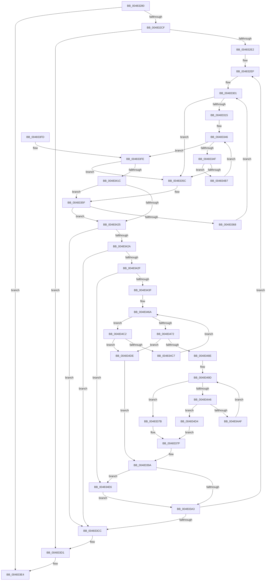

# MiDeleteEmptyPageTableTail

- RVA: `0x00483280`–`0x004834EE` (길이 `622` bytes)
- VA: `0x0000000140483280`
- 실행 섹션: `.text`
- PDB 이름 있음: `예`; PDB Function 태그: `아니요`
- unwind 정보 RVA: `0x000AEF18`
- 디코드: `174`개 명령, `622/622` bytes 표시
- 미해석 바이트: `0` (있으면 어셈블리에 `.byte`로 보존)

> 이 문서는 커널 이미지의 기계어와 PDB 기호를 분석해 생성했습니다. 4번과 5번은 함수 원형과 자료형을 바이너리 사용 방식에서 추정한 C 해석이며 원본 소스 복구 결과는 아닙니다.

## 1. Dependencies

- 직접 호출 지점: **4**; 고유 호출 대상: **4**
- 직접 호출자로 확인된 함수: **1**
- RIP 상대 이미지 참조: **0**

### Outgoing calls
- `0x004832AC` → [MiDecommitPagesTail](../27/MiDecommitPagesTail_function_002790FC.md) (function, `0x002790FC`)
- `0x004832D2` → [MiReleaseWalkLocks](../23/MiReleaseWalkLocks_function_00239FD0.md) (function, `0x00239FD0`)
- `0x004833B0` → [MiDeleteEmptyPageTableCommit](MiDeleteEmptyPageTableCommit_function_004834F4.md) (function, `0x004834F4`)
- `0x004833DF` → [memset](../6C/memset_function_006C6C40.md) (function, `0x006C6C40`)

### Direct callers
- [MiDeleteVaDirect](../27/MiDeleteVaDirect_function_00277560.md) at `0x00278894`

### Static image references
- 디코드된 RIP-relative 메모리 참조가 없습니다.

## 2. Other-region calls and transfers

- 다른 실행 섹션으로 향하는 call: **0**
- 별도 외부 분기/꼬리 이동을 확인하지 못했습니다.

## 3. Assembly (complete function range)

```asm
00483280  48 89 5C 24 18                  mov qword ptr [rsp + 0x18], rbx
00483285  48 89 6C 24 20                  mov qword ptr [rsp + 0x20], rbp
0048328A  56                              push rsi
0048328B  57                              push rdi
0048328C  41 54                           push r12
0048328E  41 56                           push r14
00483290  41 57                           push r15
00483292  48 83 EC 30                     sub rsp, 0x30
00483296  4C 8B B1 B8 00 00 00            mov r14, qword ptr [rcx + 0xb8]
0048329D  48 8B E9                        mov rbp, rcx
004832A0  4C 89 74 24 68                  mov qword ptr [rsp + 0x68], r14
004832A5  49 8B 0E                        mov rcx, qword ptr [r14]
004832A8  C6 41 2C 11                     mov byte ptr [rcx + 0x2c], 0x11
004832AC  E8 4B 5E DF FF                  call 0x1402790fc
004832B1  4D 8B 66 58                     mov r12, qword ptr [r14 + 0x58]
004832B5  4D 8D 7E 10                     lea r15, [r14 + 0x10]
004832B9  48 C7 44 24 20 00 02 00 00      mov qword ptr [rsp + 0x20], 0x200
004832C2  49 81 E4 00 F0 FF FF            and r12, 0xfffffffffffff000
004832C9  0F 84 15 01 00 00               je 0x1404833e4
004832CF  48 8B CD                        mov rcx, rbp
004832D2  E8 F9 6C DB FF                  call 0x140239fd0
004832D7  49 83 7E 50 00                  cmp qword ptr [r14 + 0x50], 0
004832DC  0F 84 EF 00 00 00               je 0x1404833d1
004832E2  45 33 C0                        xor r8d, r8d
004832E5  41 BE 00 02 00 00               mov r14d, 0x200
004832EB  48 83 CE FF                     or rsi, 0xffffffffffffffff
004832EF  4C 8B 5C 24 20                  mov r11, qword ptr [rsp + 0x20]
004832F4  4D 3B C3                        cmp r8, r11
004832F7  4D 1B D2                        sbb r10, r10
004832FA  4D 23 D0                        and r10, r8
004832FD  49 8D 53 FF                     lea rdx, [r11 - 1]
00483301  83 64 24 60 00                  and dword ptr [rsp + 0x60], 0
00483306  48 8B C2                        mov rax, rdx
00483309  49 2B C2                        sub rax, r10
0048330C  48 FF C0                        inc rax
0048330F  48 83 F8 01                     cmp rax, 1
00483313  72 47                           jb 0x14048335c
00483315  48 8B C2                        mov rax, rdx
00483318  41 8A CA                        mov cl, r10b
0048331B  48 C1 E8 06                     shr rax, 6
0048331F  80 E1 3F                        and cl, 0x3f
00483322  41 B9 01 00 00 00               mov r9d, 1
00483328  49 D3 E1                        shl r9, cl
0048332B  49 FF C9                        dec r9
0048332E  49 8D 3C C7                     lea rdi, [r15 + rax*8]
00483332  49 8B C2                        mov rax, r10
00483335  48 C1 E8 06                     shr rax, 6
00483339  49 8D 1C C7                     lea rbx, [r15 + rax*8]
0048333D  48 8B 03                        mov rax, qword ptr [rbx]
00483340  48 F7 D0                        not rax
00483343  4C 0B C8                        or r9, rax
00483346  4C 3B CE                        cmp r9, rsi
00483349  0F 85 AF 00 00 00               jne 0x1404833fe
0048334F  48 83 C3 08                     add rbx, 8
00483353  48 3B DF                        cmp rbx, rdi
00483356  0F 86 5B 01 00 00               jbe 0x1404834b7
0048335C  48 8B DE                        mov rbx, rsi
0048335F  4D 85 D2                        test r10, r10
00483362  0F 84 BD 00 00 00               je 0x140483425
00483368  49 8D 50 01                     lea rdx, [r8 + 1]
0048336C  49 3B D3                        cmp rdx, r11
0048336F  49 0F 47 D3                     cmova rdx, r11
00483373  48 FF CA                        dec rdx
00483376  45 33 D2                        xor r10d, r10d
00483379  EB 86                           jmp 0x140483301
0048337B  48 0F BC C0                     bsf rax, rax
0048337F  48 8B F2                        mov rsi, rdx
00483382  49 2B F7                        sub rsi, r15
00483385  48 C1 FE 03                     sar rsi, 3
00483389  48 C1 E6 06                     shl rsi, 6
0048338D  48 03 F0                        add rsi, rax
00483390  49 3B F6                        cmp rsi, r14
00483393  49 0F 47 F6                     cmova rsi, r14
00483397  48 2B F7                        sub rsi, rdi
0048339A  48 85 F6                        test rsi, rsi
0048339D  0F 84 43 01 00 00               je 0x1404834e6
004833A3  48 2B FB                        sub rdi, rbx
004833A6  49 8D 14 DC                     lea rdx, [r12 + rbx*8]
004833AA  4C 8B C7                        mov r8, rdi
004833AD  48 8B CD                        mov rcx, rbp
004833B0  E8 3F 01 00 00                  call 0x1404834f4
004833B5  4C 8D 04 1E                     lea r8, [rsi + rbx]
004833B9  48 C7 C6 FF FF FF FF            mov rsi, 0xffffffffffffffff
004833C0  4C 03 C7                        add r8, rdi
004833C3  4D 3B C6                        cmp r8, r14
004833C6  0F 82 23 FF FF FF               jb 0x1404832ef
004833CC  4C 8B 74 24 68                  mov r14, qword ptr [rsp + 0x68]
004833D1  49 83 66 58 00                  and qword ptr [r14 + 0x58], 0
004833D6  33 D2                           xor edx, edx
004833D8  49 8B CF                        mov rcx, r15
004833DB  44 8D 42 40                     lea r8d, [rdx + 0x40]
004833DF  E8 5C 38 24 00                  call 0x1406c6c40
004833E4  48 8B 5C 24 70                  mov rbx, qword ptr [rsp + 0x70]
004833E9  33 C0                           xor eax, eax
004833EB  48 8B 6C 24 78                  mov rbp, qword ptr [rsp + 0x78]
004833F0  48 83 C4 30                     add rsp, 0x30
004833F4  41 5F                           pop r15
004833F6  41 5E                           pop r14
004833F8  41 5C                           pop r12
004833FA  5F                              pop rdi
004833FB  5E                              pop rsi
004833FC  C3                              ret
004833FD  CC                              int3
004833FE  49 2B DF                        sub rbx, r15
00483401  49 F7 D1                        not r9
00483404  48 C1 FB 03                     sar rbx, 3
00483408  49 0F BC C1                     bsf rax, r9
0048340C  48 C1 E3 06                     shl rbx, 6
00483410  48 03 D8                        add rbx, rax
00483413  48 3B DA                        cmp rbx, rdx
00483416  0F 87 40 FF FF FF               ja 0x14048335c
0048341C  48 3B DE                        cmp rbx, rsi
0048341F  0F 84 3A FF FF FF               je 0x14048335f
00483425  49 3B D8                        cmp rbx, r8
00483428  72 A2                           jb 0x1404833cc
0048342A  48 3B DE                        cmp rbx, rsi
0048342D  74 9D                           je 0x1404833cc
0048342F  83 64 24 60 00                  and dword ptr [rsp + 0x60], 0
00483434  33 F6                           xor esi, esi
00483436  49 3B DE                        cmp rbx, r14
00483439  0F 83 A7 00 00 00               jae 0x1404834e6
0048343F  44 8D 56 01                     lea r10d, [rsi + 1]
00483443  48 8B C3                        mov rax, rbx
00483446  48 C1 E8 06                     shr rax, 6
0048344A  4D 8D 4F 38                     lea r9, [r15 + 0x38]
0048344E  8A CB                           mov cl, bl
00483450  80 E1 3F                        and cl, 0x3f
00483453  49 8D 14 C7                     lea rdx, [r15 + rax*8]
00483457  41 8B C2                        mov eax, r10d
0048345A  4C 8B 02                        mov r8, qword ptr [rdx]
0048345D  48 D3 E0                        shl rax, cl
00483460  49 2B C2                        sub rax, r10
00483463  4C 0B C0                        or r8, rax
00483466  48 8D 42 08                     lea rax, [rdx + 8]
0048346A  49 F7 D0                        not r8
0048346D  4D 85 C0                        test r8, r8
00483470  74 50                           je 0x1404834c2
00483472  49 0F BC C8                     bsf rcx, r8
00483476  48 8B FA                        mov rdi, rdx
00483479  49 2B FF                        sub rdi, r15
0048347C  8B C1                           mov eax, ecx
0048347E  48 C1 FF 03                     sar rdi, 3
00483482  48 C1 E7 06                     shl rdi, 6
00483486  48 03 F8                        add rdi, rax
00483489  49 3B FE                        cmp rdi, r14
0048348C  77 50                           ja 0x1404834de
0048348E  49 8B C2                        mov rax, r10
00483491  48 D3 E0                        shl rax, cl
00483494  49 2B C2                        sub rax, r10
00483497  49 0B C0                        or rax, r8
0048349A  48 F7 D0                        not rax
0048349D  48 85 C0                        test rax, rax
004834A0  0F 85 D5 FE FF FF               jne 0x14048337b
004834A6  48 8D 42 08                     lea rax, [rdx + 8]
004834AA  49 3B C1                        cmp rax, r9
004834AD  77 25                           ja 0x1404834d4
004834AF  48 8B D0                        mov rdx, rax
004834B2  48 8B 00                        mov rax, qword ptr [rax]
004834B5  EB E6                           jmp 0x14048349d
004834B7  4C 8B 0B                        mov r9, qword ptr [rbx]
004834BA  49 F7 D1                        not r9
004834BD  E9 84 FE FF FF                  jmp 0x140483346
004834C2  49 3B C1                        cmp rax, r9
004834C5  77 17                           ja 0x1404834de
004834C7  48 83 C2 08                     add rdx, 8
004834CB  48 83 C0 08                     add rax, 8
004834CF  4C 8B 02                        mov r8, qword ptr [rdx]
004834D2  EB 96                           jmp 0x14048346a
004834D4  B8 40 00 00 00                  mov eax, 0x40
004834D9  E9 A1 FE FF FF                  jmp 0x14048337f
004834DE  49 8B FE                        mov rdi, r14
004834E1  E9 B4 FE FF FF                  jmp 0x14048339a
004834E6  49 8B FE                        mov rdi, r14
004834E9  E9 B5 FE FF FF                  jmp 0x1404833a3
```

## 4. C-style interpretation (structured pseudocode)

```c
__int64 __fastcall MiDeleteEmptyPageTableTail(__int64 a1, __int64 a2, int a3)
{
    __int64 result;
    __int64 v_r10;
    __int64 v_r12;
    __int64 v_rbx;
    __int64 v_rdi;
    __int64 v_rsi;
    __int64 v_rsp;
    unsigned __int64 v_stack_m38;
    unsigned __int64 v_stack_p10;
    unsigned __int64 v_stack_p18;
    unsigned __int64 v_stack_p20;
    unsigned int v_stack_p60;
    unsigned int v_stack_p8;

    v_stack_p18 = v_rbx;
    v_stack_p20 = v_rbp;
    v_rsp = (v_rsp) - (48);
    v_stack_p10 = *(unsigned __int64 *)(a1 + 184);
    *(unsigned __int8 *)(*(unsigned __int64 *)(*(unsigned __int64 *)(a1 + 184)) + 44) = 17;
    result = MiDecommitPagesTail(*(unsigned __int64 *)(*(unsigned __int64 *)(a1 + 184)), a2, a3, a4);
    v_stack_m38 = 512;
    v_r12 = (*(unsigned __int64 *)(*(unsigned __int64 *)(a1 + 184) + 88)) & (0xFFFFFFFFFFFFF000ULL);
    if (condition_is_equal) goto loc_004833E4;
    result = MiReleaseWalkLocks(a1, a2, a3, a4);
    if ((*(unsigned __int64 *)(*(unsigned __int64 *)(a1 + 184) + 80)) == 0) goto loc_004833D1;
    a3 = 0;
    v_rsi = (v_rsi) | (-1);
loc_004832EF:
    v_r10 = (v_r10) & (0);
loc_00483301:
    result = (v_stack_m38 - 1) - (v_r10);
    result = (result) + 1;
    if (result < 1) goto loc_0048335C;
    result = (v_stack_m38 - 1) >> (6);
    a1 = (unsigned __int8)(((unsigned __int8)(v_r10)) & (63));
    a4 = (1) << ((unsigned __int8)(a1));
    a4 = (a4) - 1;
    result = (v_r10) >> (6);
    result = ~(*(unsigned __int64 *)(*(unsigned __int64 *)(a1 + 184) + 16 + result * 8));
    a4 = (a4) | (result);
loc_00483346:
    if (a4 != v_rsi) goto loc_004833FE;
    v_rbx = (*(unsigned __int64 *)(a1 + 184) + 16 + result * 8) + (8);
    if (v_rbx <= (*(unsigned __int64 *)(a1 + 184) + 16 + result * 8)) goto loc_004834B7;
loc_0048335C:
loc_0048335F:
    if (v_r10 == 0) goto loc_00483425;
    a2 = a3 + 1;
    if ((a3 + 1) > v_stack_m38) { a2 = v_stack_m38; }
    a2 = (a2) - 1;
    v_r10 = 0;
    goto loc_00483301;
loc_0048337B:
loc_0048337F:
    v_rsi = (a2) - (*(unsigned __int64 *)(a1 + 184) + 16);
    v_rsi = (v_rsi) >> (3);
    v_rsi = (v_rsi) << (6);
    v_rsi = (v_rsi) + (result);
    if (v_rsi > 512) { v_rsi = 512; }
    v_rsi = (v_rsi) - (*(unsigned __int64 *)(a1 + 184) + 16 + result * 8);
loc_0048339A:
    if (v_rsi == 0) goto loc_004834E6;
loc_004833A3:
    v_rdi = (*(unsigned __int64 *)(a1 + 184) + 16 + result * 8) - (v_rsi);
    result = MiDeleteEmptyPageTableCommit(a1, v_r12 + v_rsi * 8, v_rdi, a4);
    a3 = (v_rsi + v_rsi * 1) + (v_rdi);
    if (a3 < 512) goto loc_004832EF;
loc_004833CC:
loc_004833D1:
    a2 = 0;
    result = memset(*(unsigned __int64 *)(a1 + 184) + 16, a2, a2 + 64, a4);
loc_004833E4:
    result = 0;
    v_rsp = (v_rsp) + (48);
    return result;
loc_004833FE:
    v_rbx = (v_stack_p18) - (*(unsigned __int64 *)(a1 + 184) + 16);
    a4 = ~(a4);
    v_rbx = (v_rbx) >> (3);
    v_rbx = (v_rbx) << (6);
    v_rbx = (v_rbx) + (0);
    if (v_rbx > 0) goto loc_0048335C;
    if (v_rbx == -1) goto loc_0048335F;
loc_00483425:
    if (v_rbx < (a2 + 64)) goto loc_004833CC;
    if (v_rbx == -1) goto loc_004833CC;
    v_rsi = 0;
    if (v_rbx >= v_stack_p10) goto loc_004834E6;
    result = (v_rbx) >> (6);
    a1 = (unsigned __int8)(((unsigned __int8)(v_rbx)) & (63));
    result = ((unsigned int)((unsigned int)(v_rsi + 1))) << ((unsigned __int8)(a1));
    result = (result) - (v_rsi + 1);
    a3 = (*(unsigned __int64 *)(*(unsigned __int64 *)(a1 + 184) + 16 + result * 8)) | (result);
loc_0048346A:
    a3 = ~(a3);
    if (a3 == 0) goto loc_004834C2;
    v_rdi = (*(unsigned __int64 *)(a1 + 184) + 16 + result * 8) - (*(unsigned __int64 *)(a1 + 184) + 16);
    v_rdi = (v_rdi) >> (3);
    v_rdi = (v_rdi) << (6);
    v_rdi = (v_rdi) + ((unsigned int)((unsigned int)(a1)));
    if (v_rdi > v_stack_p10) goto loc_004834DE;
    result = (v_rsi + 1) << ((unsigned __int8)(a1));
    result = (result) - (v_rsi + 1);
    result = (result) | (a3);
    result = ~(result);
loc_0048349D:
    if (result != 0) goto loc_0048337B;
    if ((*(unsigned __int64 *)(a1 + 184) + 16 + result * 8 + 8) > (*(unsigned __int64 *)(a1 + 184) + 16 + 56)) goto loc_004834D4;
    goto loc_0048349D;
loc_004834B7:
    a4 = ~(*(unsigned __int64 *)(v_rbx));
    goto loc_00483346;
loc_004834C2:
    if ((*(unsigned __int64 *)(*(unsigned __int64 *)(a1 + 184) + 16 + result * 8 + 8)) > a4) goto loc_004834DE;
    a2 = (*(unsigned __int64 *)(a1 + 184) + 16 + result * 8 + 8) + (8);
    result = (*(unsigned __int64 *)(*(unsigned __int64 *)(a1 + 184) + 16 + result * 8 + 8)) + (8);
    goto loc_0048346A;
loc_004834D4:
    goto loc_0048337F;
loc_004834DE:
    goto loc_0048339A;
loc_004834E6:
    goto loc_004833A3;
}
```

## 5. (Beta) C Style

```c
int64_t MiDeleteEmptyPageTableTail(void *Arg1, int64_t Arg2, int32_t Arg3)
{
    uint8_t *arg1 = (uint8_t *)Arg1;

    int64_t result;
    int64_t local_r10;
    int64_t local_r12;
    int64_t local_rbx;
    int64_t local_rdi;
    int64_t local_rsi;
    int64_t local_rsp;
    uint64_t v_stack_m38;
    uint64_t v_stack_p10;
    uint64_t v_stack_p18;
    uint64_t v_stack_p20;
    uint32_t v_stack_p60;
    uint32_t v_stack_p8;

    v_stack_p18 = local_rbx;
    v_stack_p20 = local_rbp;
    local_rsp = (local_rsp) - (48);
    v_stack_p10 = *(uint64_t *)(arg1 + 0xB8);
    *(uint8_t *)(*(uint64_t *)(*(uint64_t *)(arg1 + 0xB8)) + 0x2C) = 17;
    result = MiDecommitPagesTail(*(uint64_t *)(*(uint64_t *)(arg1 + 0xB8)), Arg2, Arg3, a4);
    v_stack_m38 = 512;
    local_r12 = (*(uint64_t *)(*(uint64_t *)(arg1 + 0xB8) + 0x58)) & (0xFFFFFFFFFFFFF000ULL);
    if (condition_is_equal) goto loc_004833E4;
    result = MiReleaseWalkLocks(Arg1, Arg2, Arg3, a4);
    if ((*(uint64_t *)(*(uint64_t *)(arg1 + 0xB8) + 0x50)) == 0) goto loc_004833D1;
    Arg3 = 0;
    local_rsi = (local_rsi) | (-1);
loc_004832EF:
    local_r10 = (local_r10) & (0);
loc_00483301:
    result = (v_stack_m38 - 1) - (local_r10);
    result = (result) + 1;
    if (result < 1) goto loc_0048335C;
    result = (v_stack_m38 - 1) >> (6);
    Arg1 = (uint8_t)(((uint8_t)(local_r10)) & (63));
    a4 = (1) << ((uint8_t)(Arg1));
    a4 = (a4) - 1;
    result = (local_r10) >> (6);
    result = ~(*(uint64_t *)(*(uint64_t *)(arg1 + 0xB8) + 0x10 + result * 8));
    a4 = (a4) | (result);
loc_00483346:
    if (a4 != local_rsi) goto loc_004833FE;
    local_rbx = (*(uint64_t *)(arg1 + 0xB8) + 16 + result * 8) + (8);
    if (local_rbx <= (*(uint64_t *)(arg1 + 0xB8) + 16 + result * 8)) goto loc_004834B7;
loc_0048335C:
loc_0048335F:
    if (local_r10 == 0) goto loc_00483425;
    Arg2 = Arg3 + 1;
    if ((Arg3 + 1) > v_stack_m38) { Arg2 = v_stack_m38; }
    Arg2 = (Arg2) - 1;
    local_r10 = 0;
    goto loc_00483301;
loc_0048337B:
loc_0048337F:
    local_rsi = (Arg2) - (*(uint64_t *)(arg1 + 0xB8) + 16);
    local_rsi = (local_rsi) >> (3);
    local_rsi = (local_rsi) << (6);
    local_rsi = (local_rsi) + (result);
    if (local_rsi > 512) { local_rsi = 512; }
    local_rsi = (local_rsi) - (*(uint64_t *)(arg1 + 0xB8) + 16 + result * 8);
loc_0048339A:
    if (local_rsi == 0) goto loc_004834E6;
loc_004833A3:
    local_rdi = (*(uint64_t *)(arg1 + 0xB8) + 16 + result * 8) - (local_rsi);
    result = MiDeleteEmptyPageTableCommit(Arg1, local_r12 + local_rsi * 8, local_rdi, a4);
    Arg3 = (local_rsi + local_rsi * 1) + (local_rdi);
    if (Arg3 < 512) goto loc_004832EF;
loc_004833CC:
loc_004833D1:
    Arg2 = 0;
    result = memset(*(uint64_t *)(arg1 + 0xB8) + 16, Arg2, Arg2 + 64, a4);
loc_004833E4:
    result = 0;
    local_rsp = (local_rsp) + (48);
    return result;
loc_004833FE:
    local_rbx = (v_stack_p18) - (*(uint64_t *)(arg1 + 0xB8) + 16);
    a4 = ~(a4);
    local_rbx = (local_rbx) >> (3);
    local_rbx = (local_rbx) << (6);
    local_rbx = (local_rbx) + (0);
    if (local_rbx > 0) goto loc_0048335C;
    if (local_rbx == -1) goto loc_0048335F;
loc_00483425:
    if (local_rbx < (Arg2 + 64)) goto loc_004833CC;
    if (local_rbx == -1) goto loc_004833CC;
    local_rsi = 0;
    if (local_rbx >= v_stack_p10) goto loc_004834E6;
    result = (local_rbx) >> (6);
    Arg1 = (uint8_t)(((uint8_t)(local_rbx)) & (63));
    result = ((uint32_t)((uint32_t)(local_rsi + 1))) << ((uint8_t)(Arg1));
    result = (result) - (local_rsi + 1);
    Arg3 = (*(uint64_t *)(*(uint64_t *)(arg1 + 0xB8) + 0x10 + result * 8)) | (result);
loc_0048346A:
    Arg3 = ~(Arg3);
    if (Arg3 == 0) goto loc_004834C2;
    local_rdi = (*(uint64_t *)(arg1 + 0xB8) + 16 + result * 8) - (*(uint64_t *)(arg1 + 0xB8) + 16);
    local_rdi = (local_rdi) >> (3);
    local_rdi = (local_rdi) << (6);
    local_rdi = (local_rdi) + ((uint32_t)((uint32_t)(Arg1)));
    if (local_rdi > v_stack_p10) goto loc_004834DE;
    result = (local_rsi + 1) << ((uint8_t)(Arg1));
    result = (result) - (local_rsi + 1);
    result = (result) | (Arg3);
    result = ~(result);
loc_0048349D:
    if (result != 0) goto loc_0048337B;
    if ((*(uint64_t *)(arg1 + 0xB8) + 16 + result * 8 + 8) > (*(uint64_t *)(arg1 + 0xB8) + 16 + 56)) goto loc_004834D4;
    goto loc_0048349D;
loc_004834B7:
    a4 = ~(*(uint64_t *)(local_rbx));
    goto loc_00483346;
loc_004834C2:
    if ((*(uint64_t *)(*(uint64_t *)(arg1 + 0xB8) + 0x10 + result * 8 + 0x8)) > a4) goto loc_004834DE;
    Arg2 = (*(uint64_t *)(arg1 + 0xB8) + 16 + result * 8 + 8) + (8);
    result = (*(uint64_t *)(*(uint64_t *)(arg1 + 0xB8) + 0x10 + result * 8 + 0x8)) + (8);
    goto loc_0048346A;
loc_004834D4:
    goto loc_0048337F;
loc_004834DE:
    goto loc_0048339A;
loc_004834E6:
    goto loc_004833A3;
}
```

### 관측된 메모리 오프셋

구조체 형식이 확인되지 않은 접근은 인자 기준의 오프셋으로만 기록했습니다.

| 기준 인자 | 오프셋 표현 | 폭 (bit) | 접근 |
|---|---:|---:|---|
| `Arg1` | `+ 0xB8` | `64` | `R` |

## 6. Execution-region graph

[열기: 2D/3D 그래프와 함수 탐색 컨트롤 패널](../../../control-panel.html?section=text&rva=0x00483280&view=graph)

- 2D 그래프는 위에서 아래로 흐르고, 3D 그래프는 빈 공간을 드래그해 회전합니다. Shift+드래그는 이동, 휠은 확대·축소, 함수 노드 선택은 대상 보고서 이동입니다.

### Static fallback


