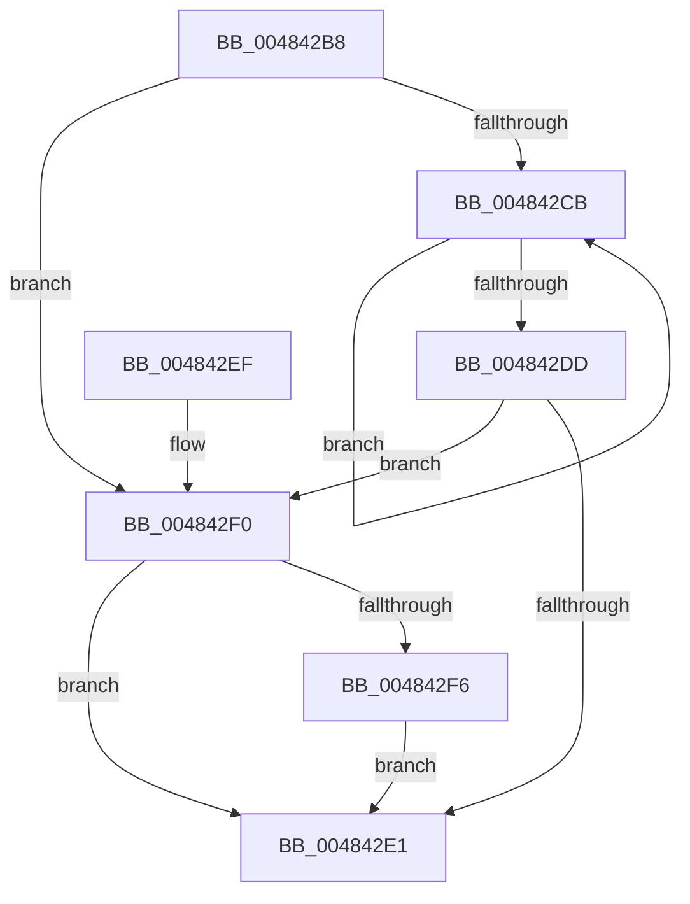

# MiDeleteEmptySubsectionProtoPool

- RVA: `0x004842B8`–`0x00484308` (길이 `80` bytes)
- VA: `0x00000001404842B8`
- 실행 섹션: `.text`
- PDB 이름 있음: `예`; PDB Function 태그: `아니요`
- unwind 정보 RVA: `0x0007EC14`
- 디코드: `28`개 명령, `80/80` bytes 표시
- 미해석 바이트: `0` (있으면 어셈블리에 `.byte`로 보존)

> 이 문서는 커널 이미지의 기계어와 PDB 기호를 분석해 생성했습니다. 4번과 5번은 함수 원형과 자료형을 바이너리 사용 방식에서 추정한 C 해석이며 원본 소스 복구 결과는 아닙니다.

## 1. Dependencies

- 직접 호출 지점: **2**; 고유 호출 대상: **2**
- 직접 호출자로 확인된 함수: **1**
- RIP 상대 이미지 참조: **1**

### Outgoing calls
- `0x004842D2` → [ExFreePoolWithTag](../../poolcode/B8/ExFreePoolWithTag_function_00B82870.md) (function, `0x00B82870`)
- `0x00484301` → [KeDelayExecutionThread](../20/KeDelayExecutionThread_function_00209550.md) (function, `0x00209550`)

### Direct callers
- [MiDeleteEmptySubsections](../4E/MiDeleteEmptySubsections_function_004ED818.md) at `0x004ED8C7`
- [MiDeleteEmptySubsections](../4E/MiDeleteEmptySubsections_function_004ED818.md) at `0x004ED95C`

### Static image references
- `0x004842F6` → RVA `0x000118B0` (`.rdata`; read)

## 2. Other-region calls and transfers

- 다른 실행 섹션으로 향하는 call: **1**
  - `0x004842D2` → [ExFreePoolWithTag](../../poolcode/B8/ExFreePoolWithTag_function_00B82870.md) (`.text` → `POOLCODE`)
- 별도 외부 분기/꼬리 이동을 확인하지 못했습니다.

## 3. Assembly (complete function range)

```asm
004842B8  48 89 5C 24 08                  mov qword ptr [rsp + 8], rbx
004842BD  57                              push rdi
004842BE  48 83 EC 20                     sub rsp, 0x20
004842C2  33 FF                           xor edi, edi
004842C4  48 8B D9                        mov rbx, rcx
004842C7  39 39                           cmp dword ptr [rcx], edi
004842C9  76 25                           jbe 0x1404842f0
004842CB  48 8B 4C FB 08                  mov rcx, qword ptr [rbx + rdi*8 + 8]
004842D0  33 D2                           xor edx, edx
004842D2  E8 99 E5 6F 00                  call 0x140b82870
004842D7  FF C7                           inc edi
004842D9  3B 3B                           cmp edi, dword ptr [rbx]
004842DB  72 EE                           jb 0x1404842cb
004842DD  85 FF                           test edi, edi
004842DF  74 0F                           je 0x1404842f0
004842E1  83 23 00                        and dword ptr [rbx], 0
004842E4  48 8B 5C 24 30                  mov rbx, qword ptr [rsp + 0x30]
004842E9  48 83 C4 20                     add rsp, 0x20
004842ED  5F                              pop rdi
004842EE  C3                              ret
004842EF  CC                              int3
004842F0  83 7B 04 00                     cmp dword ptr [rbx + 4], 0
004842F4  75 EB                           jne 0x1404842e1
004842F6  4C 8D 05 B3 D5 B8 FF            lea r8, [rip - 0x472a4d]
004842FD  33 D2                           xor edx, edx
004842FF  33 C9                           xor ecx, ecx
00484301  E8 4A 52 D8 FF                  call 0x140209550
00484306  EB D9                           jmp 0x1404842e1
```

## 4. C-style interpretation (structured pseudocode)

```c
__int64 __fastcall MiDeleteEmptySubsectionProtoPool(__int64 a1, int a2)
{
    __int64 result;
    __int64 v_rdi;
    __int64 v_rsp;
    unsigned __int64 v_stack_p8;

    v_stack_p8 = v_rbx;
    v_rsp = (v_rsp) - (32);
    v_rdi = 0;
    if ((*(unsigned int *)(a1)) <= 0) goto loc_004842F0;
loc_004842CB:
    a2 = 0;
    result = ExFreePoolWithTag(*(unsigned __int64 *)(a1 + v_rdi * 8 + 8), a2, a3, a4);
    v_rdi = (unsigned int)((v_rdi) + 1);
    if (((unsigned int)(v_rdi)) < (*(unsigned int *)(a1))) goto loc_004842CB;
    if ((unsigned int)(v_rdi) == 0) goto loc_004842F0;
loc_004842E1:
    v_rsp = (v_rsp) + (32);
    return result;
loc_004842F0:
    if ((*(unsigned int *)(v_stack_p8 + 4)) != 0) goto loc_004842E1;
    a2 = 0;
    a1 = 0;
    result = KeDelayExecutionThread(a1, a2, v_rip - 4663885, a4);
    goto loc_004842E1;
}
```

## 5. (Beta) C Style

```c
int64_t MiDeleteEmptySubsectionProtoPool(void *Arg1, int32_t Arg2)
{
    uint8_t *arg1 = (uint8_t *)Arg1;

    int64_t result;
    int64_t local_rdi;
    int64_t local_rsp;
    uint64_t v_stack_p8;

    v_stack_p8 = local_rbx;
    local_rsp = (local_rsp) - (32);
    local_rdi = 0;
    if ((*(uint32_t *)(arg1)) <= 0) goto loc_004842F0;
loc_004842CB:
    Arg2 = 0;
    result = ExFreePoolWithTag(*(uint64_t *)(arg1 + local_rdi * 8 + 0x8), Arg2, a3, a4);
    local_rdi = (uint32_t)((local_rdi) + 1);
    if (((uint32_t)(local_rdi)) < (*(uint32_t *)(arg1))) goto loc_004842CB;
    if ((uint32_t)(local_rdi) == 0) goto loc_004842F0;
loc_004842E1:
    local_rsp = (local_rsp) + (32);
    return result;
loc_004842F0:
    if ((*(uint32_t *)(v_stack_p8 + 0x4)) != 0) goto loc_004842E1;
    Arg2 = 0;
    Arg1 = 0;
    result = KeDelayExecutionThread(Arg1, Arg2, v_rip - 4663885, a4);
    goto loc_004842E1;
}
```

### 관측된 메모리 오프셋

구조체 형식이 확인되지 않은 접근은 인자 기준의 오프셋으로만 기록했습니다.

| 기준 인자 | 오프셋 표현 | 폭 (bit) | 접근 |
|---|---:|---:|---|
| `Arg1` | `+ 0x0` | `32` | `R` |
| `Arg1` | `+ 0x0` | `32` | `R/W` |
| `Arg1` | `+ 0x4` | `32` | `R` |
| `Arg1` | `+ 0x8 + rdi*8` | `64` | `R` |

## 6. Execution-region graph

[열기: 2D/3D 그래프와 함수 탐색 컨트롤 패널](../../../control-panel.html?section=text&rva=0x004842B8&view=graph)

- 2D 그래프는 위에서 아래로 흐르고, 3D 그래프는 빈 공간을 드래그해 회전합니다. Shift+드래그는 이동, 휠은 확대·축소, 함수 노드 선택은 대상 보고서 이동입니다.

### Static fallback


