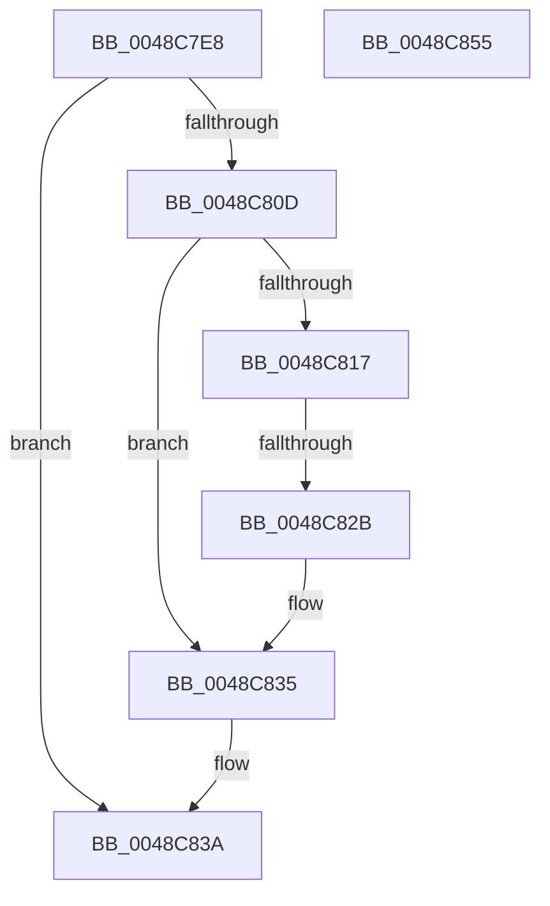

# MiDeleteWorkingSetList

- RVA: `0x0048C7E8`–`0x0048C856` (길이 `110` bytes)
- VA: `0x000000014048C7E8`
- 실행 섹션: `.text`
- PDB 이름 있음: `예`; PDB Function 태그: `예`
- unwind 정보 RVA: `0x0005E6B4`
- 디코드: `30`개 명령, `110/110` bytes 표시
- 미해석 바이트: `0` (있으면 어셈블리에 `.byte`로 보존)

> 이 문서는 커널 이미지의 기계어와 PDB 기호를 분석해 생성했습니다. 4번과 5번은 함수 원형과 자료형을 바이너리 사용 방식에서 추정한 C 해석이며 원본 소스 복구 결과는 아닙니다.

## 1. Dependencies

- 직접 호출 지점: **1**; 고유 호출 대상: **1**
- 직접 호출자로 확인된 함수: **1**
- RIP 상대 이미지 참조: **0**

### Outgoing calls
- `0x0048C830` → [ExFreePoolWithTag](../../poolcode/B8/ExFreePoolWithTag_function_00B82870.md) (function, `0x00B82870`)

### Direct callers
- [MmDeleteProcessAddressSpace](../../page/AC/MmDeleteProcessAddressSpace_function_00AC804C.md) at `0x00AC820B`

### Static image references
- 디코드된 RIP-relative 메모리 참조가 없습니다.

## 2. Other-region calls and transfers

- 다른 실행 섹션으로 향하는 call: **1**
  - `0x0048C830` → [ExFreePoolWithTag](../../poolcode/B8/ExFreePoolWithTag_function_00B82870.md) (`.text` → `POOLCODE`)
- call이 아닌 외부 분기/꼬리 이동: **1**
  - `0x0048C825` → [sub_006F64F4](../6F/Unknown_function_006F64F4.md) (`tail-transfer`)

## 3. Assembly (complete function range)

```asm
0048C7E8  48 8B C4                        mov rax, rsp
0048C7EB  48 89 58 08                     mov qword ptr [rax + 8], rbx
0048C7EF  48 89 68 10                     mov qword ptr [rax + 0x10], rbp
0048C7F3  48 89 70 18                     mov qword ptr [rax + 0x18], rsi
0048C7F7  48 89 78 20                     mov qword ptr [rax + 0x20], rdi
0048C7FB  41 56                           push r14
0048C7FD  48 83 EC 20                     sub rsp, 0x20
0048C801  48 8B 71 10                     mov rsi, qword ptr [rcx + 0x10]
0048C805  48 8B D9                        mov rbx, rcx
0048C808  48 85 F6                        test rsi, rsi
0048C80B  74 2D                           je 0x14048c83a
0048C80D  8B 81 B8 00 00 00               mov eax, dword ptr [rcx + 0xb8]
0048C813  A8 0F                           test al, 0xf
0048C815  75 1E                           jne 0x14048c835
0048C817  48 8B 41 10                     mov rax, qword ptr [rcx + 0x10]
0048C81B  48 8B B8 18 04 00 00            mov rdi, qword ptr [rax + 0x418]
0048C822  48 85 FF                        test rdi, rdi
0048C825  0F 85 C9 9C 26 00               jne 0x1406f64f4
0048C82B  33 D2                           xor edx, edx
0048C82D  48 8B CE                        mov rcx, rsi
0048C830  E8 3B 60 6F 00                  call 0x140b82870
0048C835  48 83 63 10 00                  and qword ptr [rbx + 0x10], 0
0048C83A  48 8B 5C 24 30                  mov rbx, qword ptr [rsp + 0x30]
0048C83F  48 8B 6C 24 38                  mov rbp, qword ptr [rsp + 0x38]
0048C844  48 8B 74 24 40                  mov rsi, qword ptr [rsp + 0x40]
0048C849  48 8B 7C 24 48                  mov rdi, qword ptr [rsp + 0x48]
0048C84E  48 83 C4 20                     add rsp, 0x20
0048C852  41 5E                           pop r14
0048C854  C3                              ret
0048C855  CC                              int3
```

## 4. C-style interpretation (structured pseudocode)

```c
__int64 __fastcall MiDeleteWorkingSetList(__int64 a1, int a2)
{
    __int64 result;
    __int64 v_rsp;
    unsigned __int64 v_stack_p10;
    unsigned __int64 v_stack_p18;
    unsigned __int64 v_stack_p20;
    unsigned __int64 v_stack_p8;

    *(unsigned __int64 *)(v_rsp + 8) = v_rbx;
    *(unsigned __int64 *)(v_rsp + 16) = v_rbp;
    *(unsigned __int64 *)(v_rsp + 24) = v_rsi;
    *(unsigned __int64 *)(v_rsp + 32) = v_rdi;
    v_rsp = (v_rsp) - (32);
    if (*(unsigned __int64 *)(a1 + 16) == 0) goto loc_0048C83A;
    if ((((unsigned __int8)((unsigned int)(*(unsigned int *)(a1 + 184)))) & (15)) != 0) goto loc_0048C835;
    a2 = 0;
    result = ExFreePoolWithTag(*(unsigned __int64 *)(a1 + 16), a2, a3, a4);
loc_0048C835:
loc_0048C83A:
    v_rsp = (v_rsp) + (32);
    return result;
}
```

## 5. (Beta) C Style

```c
int64_t MiDeleteWorkingSetList(void *Arg1, int32_t Arg2)
{
    uint8_t *arg1 = (uint8_t *)Arg1;

    int64_t result;
    int64_t local_rsp;
    uint64_t v_stack_p10;
    uint64_t v_stack_p18;
    uint64_t v_stack_p20;
    uint64_t v_stack_p8;

    *(uint64_t *)(local_rsp + 0x8) = local_rbx;
    *(uint64_t *)(local_rsp + 0x10) = local_rbp;
    *(uint64_t *)(local_rsp + 0x18) = local_rsi;
    *(uint64_t *)(local_rsp + 0x20) = local_rdi;
    local_rsp = (local_rsp) - (32);
    if (*(uint64_t *)(arg1 + 0x10) == 0) goto loc_0048C83A;
    if ((((uint8_t)((uint32_t)(*(uint32_t *)(arg1 + 0xB8)))) & (15)) != 0) goto loc_0048C835;
    Arg2 = 0;
    result = ExFreePoolWithTag(*(uint64_t *)(arg1 + 0x10), Arg2, a3, a4);
loc_0048C835:
loc_0048C83A:
    local_rsp = (local_rsp) + (32);
    return result;
}
```

### 관측된 메모리 오프셋

구조체 형식이 확인되지 않은 접근은 인자 기준의 오프셋으로만 기록했습니다.

| 기준 인자 | 오프셋 표현 | 폭 (bit) | 접근 |
|---|---:|---:|---|
| `Arg1` | `+ 0x10` | `64` | `R` |
| `Arg1` | `+ 0x10` | `64` | `R/W` |
| `Arg1` | `+ 0xB8` | `32` | `R` |

## 6. Execution-region graph

[열기: 2D/3D 그래프와 함수 탐색 컨트롤 패널](../../../control-panel.html?section=text&rva=0x0048C7E8&view=graph)

- 2D 그래프는 위에서 아래로 흐르고, 3D 그래프는 빈 공간을 드래그해 회전합니다. Shift+드래그는 이동, 휠은 확대·축소, 함수 노드 선택은 대상 보고서 이동입니다.

### Static fallback


