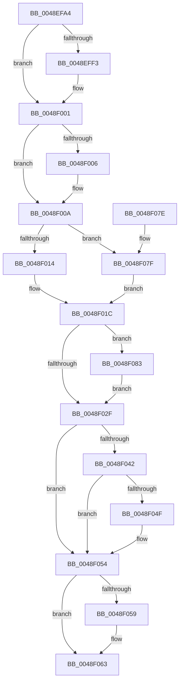

# MiDereferenceExtendInfo

- RVA: `0x0048EFA4`–`0x0048F08D` (길이 `233` bytes)
- VA: `0x000000014048EFA4`
- 실행 섹션: `.text`
- PDB 이름 있음: `예`; PDB Function 태그: `아니요`
- unwind 정보 RVA: `0x000A76B0`
- 디코드: `65`개 명령, `233/233` bytes 표시
- 미해석 바이트: `0` (있으면 어셈블리에 `.byte`로 보존)

> 이 문서는 커널 이미지의 기계어와 PDB 기호를 분석해 생성했습니다. 4번과 5번은 함수 원형과 자료형을 바이너리 사용 방식에서 추정한 C 해석이며 원본 소스 복구 결과는 아닙니다.

## 1. Dependencies

- 직접 호출 지점: **6**; 고유 호출 대상: **6**
- 직접 호출자로 확인된 함수: **2**
- RIP 상대 이미지 참조: **2**

### Outgoing calls
- `0x0048EFE3` → [KeAbPreAcquire](../21/KeAbPreAcquire_function_00210230.md) (function, `0x00210230`)
- `0x0048EFFC` → [ExfAcquirePushLockExclusiveEx](../20/ExfAcquirePushLockExclusiveEx_function_0020FC90.md) (function, `0x0020FC90`)
- `0x0048F032` → [KeAbPostRelease](../2E/KeAbPostRelease_function_002E1600.md) (function, `0x002E1600`)
- `0x0048F04F` → [KiCheckForKernelApcDelivery](../2E/KiCheckForKernelApcDelivery_function_002E2C80.md) (function, `0x002E2C80`)
- `0x0048F05E` → [ExFreePoolWithTag](../../poolcode/B8/ExFreePoolWithTag_function_00B82870.md) (function, `0x00B82870`)
- `0x0048F086` → [ExfTryToWakePushLock](../26/ExfTryToWakePushLock_function_00265DD0.md) (function, `0x00265DD0`)

### Direct callers
- [sub_00885AED](../../page/88/Unknown_function_00885AED.md) at `0x00885BC5`
- [MiDeleteVad](../../page/88/MiDeleteVad_function_00888C80.md) at `0x00889153`

### Static image references
- `0x0048EFC6` → RVA `0x00E2CD10` (`.data`; read)
- `0x0048F020` → RVA `0x00E2CD10` (`.data`; read/write)

## 2. Other-region calls and transfers

- 다른 실행 섹션으로 향하는 call: **1**
  - `0x0048F05E` → [ExFreePoolWithTag](../../poolcode/B8/ExFreePoolWithTag_function_00B82870.md) (`.text` → `POOLCODE`)
- 별도 외부 분기/꼬리 이동을 확인하지 못했습니다.

## 3. Assembly (complete function range)

```asm
0048EFA4  48 8B C4                        mov rax, rsp
0048EFA7  48 89 58 08                     mov qword ptr [rax + 8], rbx
0048EFAB  48 89 68 10                     mov qword ptr [rax + 0x10], rbp
0048EFAF  48 89 70 18                     mov qword ptr [rax + 0x18], rsi
0048EFB3  48 89 78 20                     mov qword ptr [rax + 0x20], rdi
0048EFB7  41 56                           push r14
0048EFB9  48 83 EC 20                     sub rsp, 0x20
0048EFBD  65 48 8B 3C 25 88 01 00 00      mov rdi, qword ptr gs:[0x188]
0048EFC6  4C 8D 35 43 DD 99 00            lea r14, [rip + 0x99dd43]
0048EFCD  48 8B F2                        mov rsi, rdx
0048EFD0  48 8B E9                        mov rbp, rcx
0048EFD3  45 33 C0                        xor r8d, r8d
0048EFD6  33 D2                           xor edx, edx
0048EFD8  49 8B CE                        mov rcx, r14
0048EFDB  66 FF 8F E6 01 00 00            dec word ptr [rdi + 0x1e6]
0048EFE2  90                              nop
0048EFE3  E8 48 12 D8 FF                  call 0x140210230
0048EFE8  F0 49 0F BA 2E 00               lock bts qword ptr [r14], 0
0048EFEE  48 8B D8                        mov rbx, rax
0048EFF1  73 0E                           jae 0x14048f001
0048EFF3  4D 8B C6                        mov r8, r14
0048EFF6  48 8B D0                        mov rdx, rax
0048EFF9  49 8B CE                        mov rcx, r14
0048EFFC  E8 8F 0C D8 FF                  call 0x14020fc90
0048F001  48 85 DB                        test rbx, rbx
0048F004  74 04                           je 0x14048f00a
0048F006  C6 43 0A 01                     mov byte ptr [rbx + 0xa], 1
0048F00A  48 8B 5D 78                     mov rbx, qword ptr [rbp + 0x78]
0048F00E  83 43 08 FF                     add dword ptr [rbx + 8], -1
0048F012  75 6B                           jne 0x14048f07f
0048F014  48 8B 06                        mov rax, qword ptr [rsi]
0048F017  48 83 60 20 00                  and qword ptr [rax + 0x20], 0
0048F01C  48 83 C8 FF                     or rax, 0xffffffffffffffff
0048F020  F0 48 0F C1 05 E7 DC 99 00      lock xadd qword ptr [rip + 0x99dce7], rax
0048F029  24 06                           and al, 6
0048F02B  3C 02                           cmp al, 2
0048F02D  74 54                           je 0x14048f083
0048F02F  49 8B CE                        mov rcx, r14
0048F032  E8 C9 25 E5 FF                  call 0x1402e1600
0048F037  90                              nop
0048F038  66 83 87 E6 01 00 00 01         add word ptr [rdi + 0x1e6], 1
0048F040  75 12                           jne 0x14048f054
0048F042  48 8D 87 98 00 00 00            lea rax, [rdi + 0x98]
0048F049  90                              nop
0048F04A  48 39 00                        cmp qword ptr [rax], rax
0048F04D  74 05                           je 0x14048f054
0048F04F  E8 2C 3C E5 FF                  call 0x1402e2c80
0048F054  48 85 DB                        test rbx, rbx
0048F057  74 0A                           je 0x14048f063
0048F059  33 D2                           xor edx, edx
0048F05B  48 8B CB                        mov rcx, rbx
0048F05E  E8 0D 38 6F 00                  call 0x140b82870
0048F063  48 8B 5C 24 30                  mov rbx, qword ptr [rsp + 0x30]
0048F068  48 8B 6C 24 38                  mov rbp, qword ptr [rsp + 0x38]
0048F06D  48 8B 74 24 40                  mov rsi, qword ptr [rsp + 0x40]
0048F072  48 8B 7C 24 48                  mov rdi, qword ptr [rsp + 0x48]
0048F077  48 83 C4 20                     add rsp, 0x20
0048F07B  41 5E                           pop r14
0048F07D  C3                              ret
0048F07E  CC                              int3
0048F07F  33 DB                           xor ebx, ebx
0048F081  EB 99                           jmp 0x14048f01c
0048F083  49 8B CE                        mov rcx, r14
0048F086  E8 45 6D DD FF                  call 0x140265dd0
0048F08B  EB A2                           jmp 0x14048f02f
```

## 4. C-style interpretation (structured pseudocode)

```c
__int64 __fastcall MiDereferenceExtendInfo(__int64 a1, __int64 a2, int a3)
{
    __int64 result;
    __int64 v_rbx;
    __int64 v_rsp;
    unsigned __int64 v_stack_p10;
    unsigned __int64 v_stack_p18;
    unsigned __int64 v_stack_p20;
    unsigned __int64 v_stack_p8;

    *(unsigned __int64 *)(v_rsp + 8) = v_rbx;
    *(unsigned __int64 *)(v_rsp + 16) = v_rbp;
    *(unsigned __int64 *)(v_rsp + 24) = v_rsi;
    *(unsigned __int64 *)(v_rsp + 32) = v_rdi;
    v_rsp = (v_rsp) - (32);
    a3 = 0;
    a2 = 0;
    result = KeAbPreAcquire(v_rip + 10083651, a2, a3, a4);
    if (!(condition_is_above_or_equal)) {
        a3 = v_rip + 10083651;
        a2 = result;
        a1 = v_rip + 10083651;
        result = ExfAcquirePushLockExclusiveEx(a1, a2, a3, a4);
    }
    if (result != 0) {
        *(unsigned __int8 *)(result + 10) = 1;
    }
    if (result != 0) goto loc_0048F07F;
loc_0048F01C:
    result = (*(unsigned __int64 *)(a2)) | (-1);
    result = (unsigned __int8)((result) & (6));
    if (((unsigned __int8)(result)) == 2) goto loc_0048F083;
loc_0048F02F:
    result = KeAbPostRelease(v_rip + 10083651, a2, a3, a4);
    if (((unsigned __int8)(result)) != 2) goto loc_0048F054;
    result = *(unsigned __int64 *)(gs_base + (0 + 392)) + 152;
    if ((*(unsigned __int64 *)(*(unsigned __int64 *)(gs_base + (0 + 392)) + 152)) != (*(unsigned __int64 *)(gs_base + (0 + 392)) + 152)) {
        result = KiCheckForKernelApcDelivery(v_rip + 10083651, a2, a3, a4);
    }
    if (*(unsigned __int64 *)(a1 + 120) != 0) {
        a2 = 0;
        a1 = *(unsigned __int64 *)(a1 + 120);
        result = ExFreePoolWithTag(a1, a2, a3, a4);
    }
    v_rsp = (v_rsp) + (32);
    return result;
loc_0048F07F:
    v_rbx = 0;
    goto loc_0048F01C;
loc_0048F083:
    result = ExfTryToWakePushLock(v_rip + 10083651, a2, a3, a4);
    goto loc_0048F02F;
}
```

## 5. (Beta) C Style

```c
int64_t MiDereferenceExtendInfo(void *Arg1, void *Arg2, int32_t Arg3)
{
    uint8_t *arg1 = (uint8_t *)Arg1;
    uint8_t *arg2 = (uint8_t *)Arg2;

    int64_t result;
    int64_t local_rbx;
    int64_t local_rsp;
    uint64_t v_stack_p10;
    uint64_t v_stack_p18;
    uint64_t v_stack_p20;
    uint64_t v_stack_p8;

    *(uint64_t *)(local_rsp + 0x8) = local_rbx;
    *(uint64_t *)(local_rsp + 0x10) = local_rbp;
    *(uint64_t *)(local_rsp + 0x18) = local_rsi;
    *(uint64_t *)(local_rsp + 0x20) = local_rdi;
    local_rsp = (local_rsp) - (32);
    Arg3 = 0;
    Arg2 = 0;
    result = KeAbPreAcquire(v_rip + 10083651, Arg2, Arg3, a4);
    if (!(condition_is_above_or_equal)) {
        Arg3 = v_rip + 10083651;
        Arg2 = result;
        Arg1 = v_rip + 10083651;
        result = ExfAcquirePushLockExclusiveEx(Arg1, Arg2, Arg3, a4);
    }
    if (result != 0) {
        *(uint8_t *)(result + 0xA) = 1;
    }
    if (result != 0) goto loc_0048F07F;
loc_0048F01C:
    result = (*(uint64_t *)(arg2)) | (-1);
    result = (uint8_t)((result) & (6));
    if (((uint8_t)(result)) == 2) goto loc_0048F083;
loc_0048F02F:
    result = KeAbPostRelease(v_rip + 10083651, Arg2, Arg3, a4);
    if (((uint8_t)(result)) != 2) goto loc_0048F054;
    result = *(uint64_t *)(gs_base + (0 + 0x188)) + 152;
    if ((*(uint64_t *)(*(uint64_t *)(gs_base + (0 + 0x188)) + 0x98)) != (*(uint64_t *)(gs_base + (0 + 0x188)) + 152)) {
        result = KiCheckForKernelApcDelivery(v_rip + 10083651, Arg2, Arg3, a4);
    }
    if (*(uint64_t *)(arg1 + 0x78) != 0) {
        Arg2 = 0;
        Arg1 = *(uint64_t *)(arg1 + 0x78);
        result = ExFreePoolWithTag(Arg1, Arg2, Arg3, a4);
    }
    local_rsp = (local_rsp) + (32);
    return result;
loc_0048F07F:
    local_rbx = 0;
    goto loc_0048F01C;
loc_0048F083:
    result = ExfTryToWakePushLock(v_rip + 10083651, Arg2, Arg3, a4);
    goto loc_0048F02F;
}
```

### 관측된 메모리 오프셋

구조체 형식이 확인되지 않은 접근은 인자 기준의 오프셋으로만 기록했습니다.

| 기준 인자 | 오프셋 표현 | 폭 (bit) | 접근 |
|---|---:|---:|---|
| `Arg1` | `+ 0x78` | `64` | `R` |
| `Arg2` | `+ 0x0` | `64` | `R` |

## 6. Execution-region graph

[열기: 2D/3D 그래프와 함수 탐색 컨트롤 패널](../../../control-panel.html?section=text&rva=0x0048EFA4&view=graph)

- 2D 그래프는 위에서 아래로 흐르고, 3D 그래프는 빈 공간을 드래그해 회전합니다. Shift+드래그는 이동, 휠은 확대·축소, 함수 노드 선택은 대상 보고서 이동입니다.

### Static fallback


