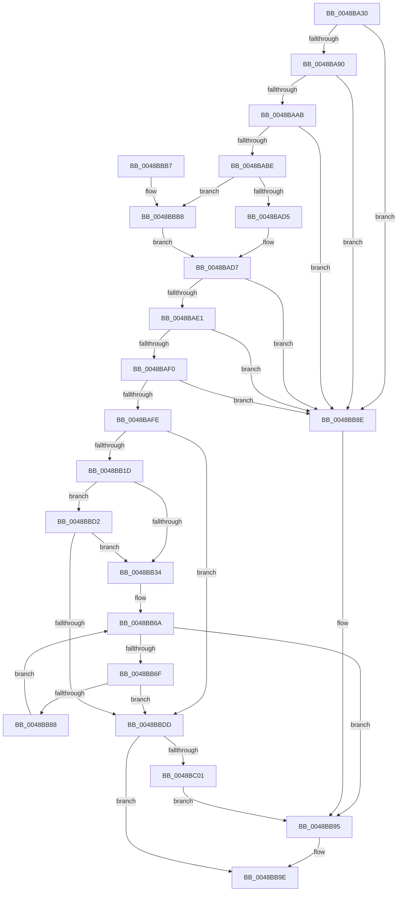

# MiDoStackCopy

- RVA: `0x0048BA30`–`0x0048BC06` (길이 `470` bytes)
- VA: `0x000000014048BA30`
- 실행 섹션: `.text`
- PDB 이름 있음: `예`; PDB Function 태그: `아니요`
- unwind 정보 RVA: `0x000B0BBC`
- 디코드: `113`개 명령, `470/470` bytes 표시
- 미해석 바이트: `0` (있으면 어셈블리에 `.byte`로 보존)

> 이 문서는 커널 이미지의 기계어와 PDB 기호를 분석해 생성했습니다. 4번과 5번은 함수 원형과 자료형을 바이너리 사용 방식에서 추정한 C 해석이며 원본 소스 복구 결과는 아닙니다.

## 1. Dependencies

- 직접 호출 지점: **4**; 고유 호출 대상: **4**
- 직접 호출자로 확인된 함수: **0**
- RIP 상대 이미지 참조: **3**

### Outgoing calls
- `0x0048BB10` → [RtlpGetStackLimits](../2F/RtlpGetStackLimits_function_002F5F50.md) (function, `0x002F5F50`)
- `0x0048BB55` → [KeGetCurrentStackPointer](../6B/KeGetCurrentStackPointer_function_006B1070.md) (function, `0x006B1070`)
- `0x0048BB99` → [MiJumpStackTarget](MiJumpStackTarget_function_0048BC10.md) (function, `0x0048BC10`)
- `0x0048BBF8` → [KeExpandKernelStackAndCalloutInternal](../2F/KeExpandKernelStackAndCalloutInternal_function_002F8450.md) (function, `0x002F8450`)

### Direct callers
- 이 함수 시작 RVA로 연결되는 직접 call은 확인되지 않았습니다. 간접 호출은 완전히 역산할 수 없습니다.

### Static image references
- `0x0048BA83` → RVA `0x00E2DCE0` (`.data`; read)
- `0x0048BBDD` → RVA `0x00FC5020` (`ALMOSTRO`; read)
- `0x0048BBEE` → RVA `0x0048BC10` (`MiJumpStackTarget`; read)

## 2. Other-region calls and transfers

- 다른 실행 섹션으로 향하는 call: **0**
- 별도 외부 분기/꼬리 이동을 확인하지 못했습니다.

## 3. Assembly (complete function range)

```asm
0048BA30  48 89 5C 24 08                  mov qword ptr [rsp + 8], rbx
0048BA35  48 89 74 24 20                  mov qword ptr [rsp + 0x20], rsi
0048BA3A  55                              push rbp
0048BA3B  57                              push rdi
0048BA3C  41 55                           push r13
0048BA3E  41 56                           push r14
0048BA40  41 57                           push r15
0048BA42  48 8B EC                        mov rbp, rsp
0048BA45  48 83 EC 50                     sub rsp, 0x50
0048BA49  48 8B 32                        mov rsi, qword ptr [rdx]
0048BA4C  48 8B FA                        mov rdi, rdx
0048BA4F  48 8D 0C 76                     lea rcx, [rsi + rsi*2]
0048BA53  48 03 C9                        add rcx, rcx
0048BA56  49 BA 00 00 00 00 00 DE FF FF   movabs r10, 0xffffde0000000000
0048BA60  48 8B 42 30                     mov rax, qword ptr [rdx + 0x30]
0048BA64  41 BD 01 00 00 00               mov r13d, 1
0048BA6A  48 89 55 E0                     mov qword ptr [rbp - 0x20], rdx
0048BA6E  48 F7 D8                        neg rax
0048BA71  4C 89 45 E8                     mov qword ptr [rbp - 0x18], r8
0048BA75  66 1B D2                        sbb dx, dx
0048BA78  4C 89 4D F0                     mov qword ptr [rbp - 0x10], r9
0048BA7C  66 F7 DA                        neg dx
0048BA7F  66 41 03 D5                     add dx, r13w
0048BA83  48 3B 35 56 22 9A 00            cmp rsi, qword ptr [rip + 0x9a2256]
0048BA8A  0F 87 FE 00 00 00               ja 0x14048bb8e
0048BA90  48 B8 28 00 00 00 00 DE FF FF   movabs rax, 0xffffde0000000028
0048BA9A  48 8B 04 C8                     mov rax, qword ptr [rax + rcx*8]
0048BA9E  48 C1 E8 36                     shr rax, 0x36
0048BAA2  41 85 C5                        test r13d, eax
0048BAA5  0F 84 E3 00 00 00               je 0x14048bb8e
0048BAAB  49 8B 44 CA 28                  mov rax, qword ptr [r10 + rcx*8 + 0x28]
0048BAB0  48 C1 E8 3C                     shr rax, 0x3c
0048BAB4  24 07                           and al, 7
0048BAB6  3C 02                           cmp al, 2
0048BAB8  0F 85 D0 00 00 00               jne 0x14048bb8e
0048BABE  49 8B 04 CA                     mov rax, qword ptr [r10 + rcx*8]
0048BAC2  49 B8 FE FF FF FF FF 0F 00 00   movabs r8, 0xffffffffffe
0048BACC  49 85 C0                        test r8, rax
0048BACF  0F 85 E3 00 00 00               jne 0x14048bbb8
0048BAD5  33 C0                           xor eax, eax
0048BAD7  48 83 F8 E0                     cmp rax, -0x20
0048BADB  0F 84 AD 00 00 00               je 0x14048bb8e
0048BAE1  41 8A 44 CA 22                  mov al, byte ptr [r10 + rcx*8 + 0x22]
0048BAE6  24 07                           and al, 7
0048BAE8  3C 06                           cmp al, 6
0048BAEA  0F 85 9E 00 00 00               jne 0x14048bb8e
0048BAF0  41 8B 44 CA 20                  mov eax, dword ptr [r10 + rcx*8 + 0x20]
0048BAF5  66 3B C2                        cmp ax, dx
0048BAF8  0F 85 90 00 00 00               jne 0x14048bb8e
0048BAFE  48 83 65 38 00                  and qword ptr [rbp + 0x38], 0
0048BB03  48 8D 55 40                     lea rdx, [rbp + 0x40]
0048BB07  48 83 65 40 00                  and qword ptr [rbp + 0x40], 0
0048BB0C  48 8D 4D 38                     lea rcx, [rbp + 0x38]
0048BB10  E8 3B A4 E6 FF                  call 0x1402f5f50
0048BB15  84 C0                           test al, al
0048BB17  0F 84 C0 00 00 00               je 0x14048bbdd
0048BB1D  48 8B 5D 38                     mov rbx, qword ptr [rbp + 0x38]
0048BB21  48 B8 00 00 00 00 00 80 FF FF   movabs rax, 0xffff800000000000
0048BB2B  48 3B D8                        cmp rbx, rax
0048BB2E  0F 84 9E 00 00 00               je 0x14048bbd2
0048BB34  48 C1 EB 09                     shr rbx, 9
0048BB38  49 BF F8 FF FF FF 7F 00 00 00   movabs r15, 0x7ffffffff8
0048BB42  49 23 DF                        and rbx, r15
0048BB45  49 BE 00 00 00 00 80 F6 FF FF   movabs r14, 0xfffff68000000000
0048BB4F  49 8B C6                        mov rax, r14
0048BB52  48 03 D8                        add rbx, rax
0048BB55  E8 16 55 22 00                  call 0x1406b1070
0048BB5A  48 8B D0                        mov rdx, rax
0048BB5D  48 C1 EA 09                     shr rdx, 9
0048BB61  49 23 D7                        and rdx, r15
0048BB64  49 8B CE                        mov rcx, r14
0048BB67  48 03 D1                        add rdx, rcx
0048BB6A  48 3B DA                        cmp rbx, rdx
0048BB6D  77 26                           ja 0x14048bb95
0048BB6F  48 8B 03                        mov rax, qword ptr [rbx]
0048BB72  48 B9 FF FF FF FF FF 00 00 00   movabs rcx, 0xffffffffff
0048BB7C  48 C1 E8 0C                     shr rax, 0xc
0048BB80  48 23 C1                        and rax, rcx
0048BB83  48 3B C6                        cmp rax, rsi
0048BB86  74 55                           je 0x14048bbdd
0048BB88  48 83 C3 08                     add rbx, 8
0048BB8C  EB DC                           jmp 0x14048bb6a
0048BB8E  C7 47 20 34 04 00 C0            mov dword ptr [rdi + 0x20], 0xc0000434
0048BB95  48 8D 4D E0                     lea rcx, [rbp - 0x20]
0048BB99  E8 72 00 00 00                  call 0x14048bc10
0048BB9E  4C 8D 5C 24 50                  lea r11, [rsp + 0x50]
0048BBA3  49 8B 5B 30                     mov rbx, qword ptr [r11 + 0x30]
0048BBA7  49 8B 73 48                     mov rsi, qword ptr [r11 + 0x48]
0048BBAB  49 8B E3                        mov rsp, r11
0048BBAE  41 5F                           pop r15
0048BBB0  41 5E                           pop r14
0048BBB2  41 5D                           pop r13
0048BBB4  5F                              pop rdi
0048BBB5  5D                              pop rbp
0048BBB6  C3                              ret
0048BBB7  CC                              int3
0048BBB8  48 83 E0 FE                     and rax, 0xfffffffffffffffe
0048BBBC  49 B8 00 00 00 00 00 F0 FF FF   movabs r8, 0xfffff00000000000
0048BBC6  49 0B C0                        or rax, r8
0048BBC9  48 C1 E0 03                     shl rax, 3
0048BBCD  E9 05 FF FF FF                  jmp 0x14048bad7
0048BBD2  48 83 7D 40 FF                  cmp qword ptr [rbp + 0x40], -1
0048BBD7  0F 85 57 FF FF FF               jne 0x14048bb34
0048BBDD  44 8B 05 3C 94 B3 00            mov r8d, dword ptr [rip + 0xb3943c]
0048BBE4  48 8D 55 E0                     lea rdx, [rbp - 0x20]
0048BBE8  48 83 64 24 20 00               and qword ptr [rsp + 0x20], 0
0048BBEE  48 8D 0D 1B 00 00 00            lea rcx, [rip + 0x1b]
0048BBF5  45 8B CD                        mov r9d, r13d
0048BBF8  E8 53 C8 E6 FF                  call 0x1402f8450
0048BBFD  85 C0                           test eax, eax
0048BBFF  79 9D                           jns 0x14048bb9e
0048BC01  89 47 20                        mov dword ptr [rdi + 0x20], eax
0048BC04  EB 8F                           jmp 0x14048bb95
```

## 4. C-style interpretation (structured pseudocode)

```c
__int64 __fastcall MiDoStackCopy(__int64 a1, __int64 a2, __int64 a3, __int64 a4)
{
    __int64 result;
    __int64 v_rbx;
    __int64 v_rsp;
    unsigned __int64 v_stack_m28;
    unsigned __int64 v_stack_m30;
    unsigned __int64 v_stack_m38;
    unsigned __int64 v_stack_m40;
    unsigned __int64 v_stack_m48;
    unsigned __int64 v_stack_p10;
    unsigned __int64 v_stack_p18;
    unsigned __int64 v_stack_p20;
    unsigned __int64 v_stack_p8;

    v_stack_p8 = v_rbx;
    v_stack_p20 = v_rsi;
    v_rsp = (v_rsp) - (80);
    a1 = (*(unsigned __int64 *)(a2) + *(unsigned __int64 *)(a2) * 2) + (*(unsigned __int64 *)(a2) + *(unsigned __int64 *)(a2) * 2);
    v_stack_m48 = a2;
    result = -(*(unsigned __int64 *)(a2 + 48));
    v_stack_m40 = a3;
    v_stack_m38 = a4;
    a2 = (unsigned __int16)(-(a2));
    a2 = (unsigned __int16)((a2) + (1));
    if ((*(unsigned __int64 *)(a2)) > (*(unsigned __int64 *)(v_rip + 10101334))) goto loc_0048BB8E;
    result = (*(unsigned __int64 *)(result + a1 * 8)) >> (54);
    if (((1) & ((unsigned int)(result))) == 0) goto loc_0048BB8E;
    result = (*(unsigned __int64 *)(v_r10 + a1 * 8 + 40)) >> (60);
    result = (unsigned __int8)((result) & (7));
    if (((unsigned __int8)(result)) != 2) goto loc_0048BB8E;
    if (((a3) & (*(unsigned __int64 *)(v_r10 + a1 * 8))) != 0) goto loc_0048BBB8;
    result = 0;
loc_0048BAD7:
    if (0 == -32) goto loc_0048BB8E;
    result = (unsigned __int8)((*(unsigned __int8 *)(v_r10 + a1 * 8 + 34)) & (7));
    if (((unsigned __int8)(result)) != 6) goto loc_0048BB8E;
    if (((unsigned __int16)((unsigned int)(*(unsigned int *)(v_r10 + a1 * 8 + 32)))) != ((unsigned __int16)(a2))) goto loc_0048BB8E;
    result = RtlpGetStackLimits(v_stack_p10, v_stack_p18, a3, a4);
    if ((unsigned __int8)(result) == 0) goto loc_0048BBDD;
    if (v_stack_p10 == result) goto loc_0048BBD2;
loc_0048BB34:
    v_rbx = (v_stack_p10) >> (9);
    v_rbx = (v_rbx) & (v_r15);
    v_rbx = (v_rbx) + (v_r14);
    result = KeGetCurrentStackPointer(v_stack_p10, v_stack_p18, a3, a4);
    a2 = (result) >> (9);
    a2 = (a2) & (v_r15);
    a2 = (a2) + (v_r14);
loc_0048BB6A:
    if (v_rbx > a2) goto loc_0048BB95;
    result = (*(unsigned __int64 *)(v_rbx)) >> (12);
    result = (result) & (v_r14);
    if (result == (*(unsigned __int64 *)(a2))) goto loc_0048BBDD;
    v_rbx = (v_rbx) + (8);
    goto loc_0048BB6A;
loc_0048BB8E:
    *(unsigned int *)(a2 + 32) = 0xC0000434ULL;
loc_0048BB95:
    result = MiJumpStackTarget(v_stack_m48, a2, a3, a4);
loc_0048BB9E:
    return result;
loc_0048BBB8:
    result = (result) & (-2);
    result = (result) | (a3);
    result = (result) << (3);
    goto loc_0048BAD7;
loc_0048BBD2:
    if (v_stack_p18 != -1) goto loc_0048BB34;
loc_0048BBDD:
    result = KeExpandKernelStackAndCalloutInternal(v_rip + 27, v_stack_m48, (unsigned int)(*(unsigned int *)(v_rip + 11768892)), 1);
    if (!sign_flag) goto loc_0048BB9E;
    *(unsigned int *)(a2 + 32) = (unsigned int)(result);
    goto loc_0048BB95;
}
```

## 5. (Beta) C Style

```c
int64_t MiDoStackCopy(int64_t Arg1, void *Arg2, int64_t Arg3, int64_t Arg4)
{
    uint8_t *arg2 = (uint8_t *)Arg2;

    int64_t result;
    int64_t local_rbx;
    int64_t local_rsp;
    uint64_t v_stack_m28;
    uint64_t v_stack_m30;
    uint64_t v_stack_m38;
    uint64_t v_stack_m40;
    uint64_t v_stack_m48;
    uint64_t v_stack_p10;
    uint64_t v_stack_p18;
    uint64_t v_stack_p20;
    uint64_t v_stack_p8;

    v_stack_p8 = local_rbx;
    v_stack_p20 = local_rsi;
    local_rsp = (local_rsp) - (80);
    Arg1 = (*(uint64_t *)(arg2) + *(uint64_t *)(arg2) * 2) + (*(uint64_t *)(arg2) + *(uint64_t *)(arg2) * 2);
    v_stack_m48 = Arg2;
    result = -(*(uint64_t *)(arg2 + 0x30));
    v_stack_m40 = Arg3;
    v_stack_m38 = Arg4;
    Arg2 = (uint16_t)(-(Arg2));
    Arg2 = (uint16_t)((Arg2) + (1));
    if ((*(uint64_t *)(arg2)) > (*(uint64_t *)(v_rip + 0x9A2256))) goto loc_0048BB8E;
    result = (*(uint64_t *)(result + Arg1 * 8)) >> (54);
    if (((1) & ((uint32_t)(result))) == 0) goto loc_0048BB8E;
    result = (*(uint64_t *)(local_r10 + Arg1 * 8 + 0x28)) >> (60);
    result = (uint8_t)((result) & (7));
    if (((uint8_t)(result)) != 2) goto loc_0048BB8E;
    if (((Arg3) & (*(uint64_t *)(local_r10 + Arg1 * 8))) != 0) goto loc_0048BBB8;
    result = 0;
loc_0048BAD7:
    if (0 == -32) goto loc_0048BB8E;
    result = (uint8_t)((*(uint8_t *)(local_r10 + Arg1 * 8 + 0x22)) & (7));
    if (((uint8_t)(result)) != 6) goto loc_0048BB8E;
    if (((uint16_t)((uint32_t)(*(uint32_t *)(local_r10 + Arg1 * 8 + 0x20)))) != ((uint16_t)(Arg2))) goto loc_0048BB8E;
    result = RtlpGetStackLimits(v_stack_p10, v_stack_p18, Arg3, Arg4);
    if ((uint8_t)(result) == 0) goto loc_0048BBDD;
    if (v_stack_p10 == result) goto loc_0048BBD2;
loc_0048BB34:
    local_rbx = (v_stack_p10) >> (9);
    local_rbx = (local_rbx) & (local_r15);
    local_rbx = (local_rbx) + (local_r14);
    result = KeGetCurrentStackPointer(v_stack_p10, v_stack_p18, Arg3, Arg4);
    Arg2 = (result) >> (9);
    Arg2 = (Arg2) & (local_r15);
    Arg2 = (Arg2) + (local_r14);
loc_0048BB6A:
    if (local_rbx > Arg2) goto loc_0048BB95;
    result = (*(uint64_t *)(local_rbx)) >> (12);
    result = (result) & (local_r14);
    if (result == (*(uint64_t *)(arg2))) goto loc_0048BBDD;
    local_rbx = (local_rbx) + (8);
    goto loc_0048BB6A;
loc_0048BB8E:
    *(uint32_t *)(arg2 + 0x20) = 0xC0000434ULL;
loc_0048BB95:
    result = MiJumpStackTarget(v_stack_m48, Arg2, Arg3, Arg4);
loc_0048BB9E:
    return result;
loc_0048BBB8:
    result = (result) & (-2);
    result = (result) | (Arg3);
    result = (result) << (3);
    goto loc_0048BAD7;
loc_0048BBD2:
    if (v_stack_p18 != -1) goto loc_0048BB34;
loc_0048BBDD:
    result = KeExpandKernelStackAndCalloutInternal(v_rip + 27, v_stack_m48, (uint32_t)(*(uint32_t *)(v_rip + 0xB3943C)), 1);
    if (!sign_flag) goto loc_0048BB9E;
    *(uint32_t *)(arg2 + 0x20) = (uint32_t)(result);
    goto loc_0048BB95;
}
```

### 관측된 메모리 오프셋

구조체 형식이 확인되지 않은 접근은 인자 기준의 오프셋으로만 기록했습니다.

| 기준 인자 | 오프셋 표현 | 폭 (bit) | 접근 |
|---|---:|---:|---|
| `Arg2` | `+ 0x0` | `64` | `R` |
| `Arg2` | `+ 0x20` | `32` | `W` |
| `Arg2` | `+ 0x30` | `64` | `R` |

## 6. Execution-region graph

[열기: 2D/3D 그래프와 함수 탐색 컨트롤 패널](../../../control-panel.html?section=text&rva=0x0048BA30&view=graph)

- 2D 그래프는 위에서 아래로 흐르고, 3D 그래프는 빈 공간을 드래그해 회전합니다. Shift+드래그는 이동, 휠은 확대·축소, 함수 노드 선택은 대상 보고서 이동입니다.

### Static fallback


