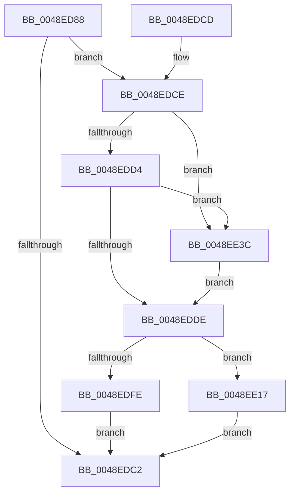

# MiFlushDataSection

- RVA: `0x0048ED88`–`0x0048EE44` (길이 `188` bytes)
- VA: `0x000000014048ED88`
- 실행 섹션: `.text`
- PDB 이름 있음: `예`; PDB Function 태그: `아니요`
- unwind 정보 RVA: `0x000B298C`
- 디코드: `52`개 명령, `188/188` bytes 표시
- 미해석 바이트: `0` (있으면 어셈블리에 `.byte`로 보존)

> 이 문서는 커널 이미지의 기계어와 PDB 기호를 분석해 생성했습니다. 4번과 5번은 함수 원형과 자료형을 바이너리 사용 방식에서 추정한 C 해석이며 원본 소스 복구 결과는 아닙니다.

## 1. Dependencies

- 직접 호출 지점: **4**; 고유 호출 대상: **4**
- 직접 호출자로 확인된 함수: **1**
- RIP 상대 이미지 참조: **1**

### Outgoing calls
- `0x0048EDB5` → [MiLockSectionControlArea](../2B/MiLockSectionControlArea_function_002BC930.md) (function, `0x002BC930`)
- `0x0048EDE9` → [MiReleaseSpinLockExclusive](../24/MiReleaseSpinLockExclusive_function_002482C0.md) (function, `0x002482C0`)
- `0x0048EE10` → [MmFlushSection](../23/MmFlushSection_function_002375E4.md) (function, `0x002375E4`)
- `0x0048EE31` → [CcFlushCachePriv](../35/CcFlushCachePriv_function_0035B040.md) (function, `0x0035B040`)

### Direct callers
- [MiCreateImageFileMap](../../page/98/MiCreateImageFileMap_function_00986830.md) at `0x00986933`

### Static image references
- `0x0048EE1D` → RVA `0x00F8F4F8` (`.data`; read)

## 2. Other-region calls and transfers

- 다른 실행 섹션으로 향하는 call: **0**
- 별도 외부 분기/꼬리 이동을 확인하지 못했습니다.

## 3. Assembly (complete function range)

```asm
0048ED88  48 8B C4                        mov rax, rsp
0048ED8B  48 89 58 10                     mov qword ptr [rax + 0x10], rbx
0048ED8F  57                              push rdi
0048ED90  48 83 EC 50                     sub rsp, 0x50
0048ED94  83 22 00                        and dword ptr [rdx], 0
0048ED97  4C 8D 40 08                     lea r8, [rax + 8]
0048ED9B  48 8B DA                        mov rbx, rdx
0048ED9E  C6 40 08 00                     mov byte ptr [rax + 8], 0
0048EDA2  48 8B F9                        mov rdi, rcx
0048EDA5  0F 57 C0                        xorps xmm0, xmm0
0048EDA8  48 8B 49 28                     mov rcx, qword ptr [rcx + 0x28]
0048EDAC  BA 01 00 00 00                  mov edx, 1
0048EDB1  0F 11 40 E8                     movups xmmword ptr [rax - 0x18], xmm0
0048EDB5  E8 76 DB E2 FF                  call 0x1402bc930
0048EDBA  48 8B C8                        mov rcx, rax
0048EDBD  48 85 C0                        test rax, rax
0048EDC0  75 0C                           jne 0x14048edce
0048EDC2  48 8B 5C 24 68                  mov rbx, qword ptr [rsp + 0x68]
0048EDC7  48 83 C4 50                     add rsp, 0x50
0048EDCB  5F                              pop rdi
0048EDCC  C3                              ret
0048EDCD  CC                              int3
0048EDCE  83 78 5C 00                     cmp dword ptr [rax + 0x5c], 0
0048EDD2  75 68                           jne 0x14048ee3c
0048EDD4  48 8B 40 70                     mov rax, qword ptr [rax + 0x70]
0048EDD8  48 83 F8 01                     cmp rax, 1
0048EDDC  77 5E                           ja 0x14048ee3c
0048EDDE  8B 59 58                        mov ebx, dword ptr [rcx + 0x58]
0048EDE1  48 83 C1 48                     add rcx, 0x48
0048EDE5  8A 54 24 60                     mov dl, byte ptr [rsp + 0x60]
0048EDE9  E8 D2 94 DB FF                  call 0x1402482c0
0048EDEE  48 8B 4F 28                     mov rcx, qword ptr [rdi + 0x28]
0048EDF2  48 8D 44 24 40                  lea rax, [rsp + 0x40]
0048EDF7  45 33 C9                        xor r9d, r9d
0048EDFA  85 DB                           test ebx, ebx
0048EDFC  75 19                           jne 0x14048ee17
0048EDFE  C7 44 24 28 01 00 00 00         mov dword ptr [rsp + 0x28], 1
0048EE06  45 33 C0                        xor r8d, r8d
0048EE09  33 D2                           xor edx, edx
0048EE0B  48 89 44 24 20                  mov qword ptr [rsp + 0x20], rax
0048EE10  E8 CF 87 DA FF                  call 0x1402375e4
0048EE15  EB AB                           jmp 0x14048edc2
0048EE17  48 83 64 24 30 00               and qword ptr [rsp + 0x30], 0
0048EE1D  48 8D 15 D4 06 B0 00            lea rdx, [rip + 0xb006d4]
0048EE24  48 89 44 24 28                  mov qword ptr [rsp + 0x28], rax
0048EE29  45 33 C0                        xor r8d, r8d
0048EE2C  C6 44 24 20 00                  mov byte ptr [rsp + 0x20], 0
0048EE31  E8 0A C2 EC FF                  call 0x14035b040
0048EE36  8B 44 24 40                     mov eax, dword ptr [rsp + 0x40]
0048EE3A  EB 86                           jmp 0x14048edc2
0048EE3C  C7 03 01 00 00 00               mov dword ptr [rbx], 1
0048EE42  EB 9A                           jmp 0x14048edde
```

## 4. C-style interpretation (structured pseudocode)

```c
__int64 __fastcall MiFlushDataSection(__int64 a1, __int64 a2, __int64 a3, int a4)
{
    __int64 result;
    __int64 v_rsp;
    unsigned __int64 v_stack_p10;
    unsigned __int64 v_stack_p20;
    unsigned int v_stack_p28;
    unsigned __int64 v_stack_p30;
    unsigned __int64 v_stack_p40;
    unsigned __int8 v_stack_p60;

    *(unsigned __int64 *)(v_rsp + 16) = v_rbx;
    v_rsp = (v_rsp) - (80);
    *(unsigned __int8 *)(v_rsp + 8) = 0;
    *(unsigned __int64 *)(v_rsp - 24) = v_xmm0;
    result = MiLockSectionControlArea(*(unsigned __int64 *)(a1 + 40), 1, v_rsp + 8, a4);
    if (result != 0) goto loc_0048EDCE;
loc_0048EDC2:
    v_rsp = (v_rsp) + (80);
    return result;
loc_0048EDCE:
    if ((*(unsigned int *)(result + 92)) != 0) goto loc_0048EE3C;
    if ((*(unsigned __int64 *)(result + 112)) > 1) goto loc_0048EE3C;
loc_0048EDDE:
    a1 = (result) + (72);
    result = MiReleaseSpinLockExclusive(a1, v_stack_p60, v_rsp + 8, a4);
    a4 = 0;
    if ((unsigned int)((unsigned int)(*(unsigned int *)(result + 88))) != 0) goto loc_0048EE17;
    v_stack_p28 = 1;
    a3 = 0;
    a2 = 0;
    v_stack_p20 = v_stack_p40;
    result = MmFlushSection(*(unsigned __int64 *)(a1 + 40), a2, a3, a4);
    goto loc_0048EDC2;
loc_0048EE17:
    v_stack_p28 = result;
    a3 = 0;
    v_stack_p20 = 0;
    result = CcFlushCachePriv(*(unsigned __int64 *)(a1 + 40), v_rip + 11536084, a3, a4);
    goto loc_0048EDC2;
loc_0048EE3C:
    *(unsigned int *)((unsigned int)(*(unsigned int *)(result + 88))) = 1;
    goto loc_0048EDDE;
}
```

## 5. (Beta) C Style

```c
int64_t MiFlushDataSection(void *Arg1, void *Arg2, int64_t Arg3, int32_t Arg4)
{
    uint8_t *arg1 = (uint8_t *)Arg1;
    uint8_t *arg2 = (uint8_t *)Arg2;

    int64_t result;
    int64_t local_rsp;
    uint64_t v_stack_p10;
    uint64_t v_stack_p20;
    uint32_t v_stack_p28;
    uint64_t v_stack_p30;
    uint64_t v_stack_p40;
    uint8_t v_stack_p60;

    *(uint64_t *)(local_rsp + 0x10) = local_rbx;
    local_rsp = (local_rsp) - (80);
    *(uint8_t *)(local_rsp + 0x8) = 0;
    *(uint64_t *)(local_rsp - 0x18) = v_xmm0;
    result = MiLockSectionControlArea(*(uint64_t *)(arg1 + 0x28), 1, local_rsp + 8, Arg4);
    if (result != 0) goto loc_0048EDCE;
loc_0048EDC2:
    local_rsp = (local_rsp) + (80);
    return result;
loc_0048EDCE:
    if ((*(uint32_t *)(result + 0x5C)) != 0) goto loc_0048EE3C;
    if ((*(uint64_t *)(result + 0x70)) > 1) goto loc_0048EE3C;
loc_0048EDDE:
    Arg1 = (result) + (72);
    result = MiReleaseSpinLockExclusive(Arg1, v_stack_p60, local_rsp + 8, Arg4);
    Arg4 = 0;
    if ((uint32_t)((uint32_t)(*(uint32_t *)(result + 0x58))) != 0) goto loc_0048EE17;
    v_stack_p28 = 1;
    Arg3 = 0;
    Arg2 = 0;
    v_stack_p20 = v_stack_p40;
    result = MmFlushSection(*(uint64_t *)(arg1 + 0x28), Arg2, Arg3, Arg4);
    goto loc_0048EDC2;
loc_0048EE17:
    v_stack_p28 = result;
    Arg3 = 0;
    v_stack_p20 = 0;
    result = CcFlushCachePriv(*(uint64_t *)(arg1 + 0x28), v_rip + 11536084, Arg3, Arg4);
    goto loc_0048EDC2;
loc_0048EE3C:
    *(uint32_t *)((uint32_t)(*(uint32_t *)(result + 0x58))) = 1;
    goto loc_0048EDDE;
}
```

### 관측된 메모리 오프셋

구조체 형식이 확인되지 않은 접근은 인자 기준의 오프셋으로만 기록했습니다.

| 기준 인자 | 오프셋 표현 | 폭 (bit) | 접근 |
|---|---:|---:|---|
| `Arg1` | `+ 0x28` | `64` | `R` |
| `Arg2` | `+ 0x0` | `32` | `R/W` |
| `Arg2` | `+ 0x0` | `32` | `W` |

## 6. Execution-region graph

[열기: 2D/3D 그래프와 함수 탐색 컨트롤 패널](../../../control-panel.html?section=text&rva=0x0048ED88&view=graph)

- 2D 그래프는 위에서 아래로 흐르고, 3D 그래프는 빈 공간을 드래그해 회전합니다. Shift+드래그는 이동, 휠은 확대·축소, 함수 노드 선택은 대상 보고서 이동입니다.

### Static fallback


