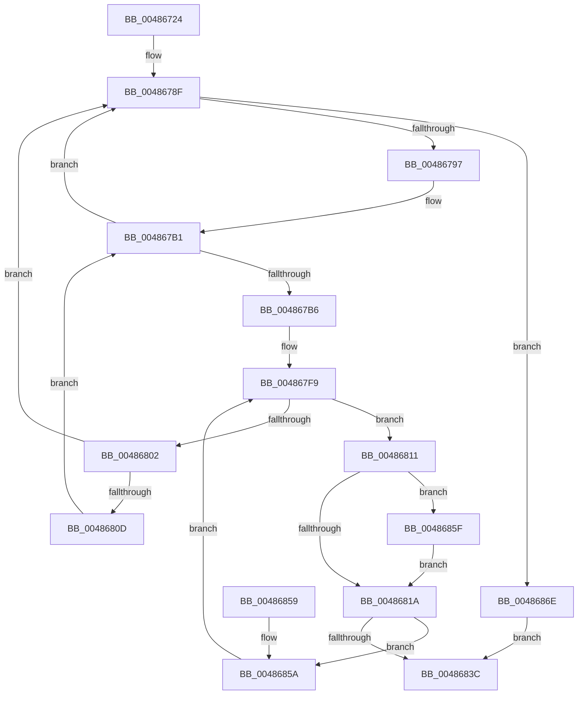

# MiGetSinglePageToZero

- RVA: `0x00486724`–`0x00486872` (길이 `334` bytes)
- VA: `0x0000000140486724`
- 실행 섹션: `.text`
- PDB 이름 있음: `예`; PDB Function 태그: `아니요`
- unwind 정보 RVA: `0x000AF8B4`
- 디코드: `101`개 명령, `334/334` bytes 표시
- 미해석 바이트: `0` (있으면 어셈블리에 `.byte`로 보존)

> 이 문서는 커널 이미지의 기계어와 PDB 기호를 분석해 생성했습니다. 4번과 5번은 함수 원형과 자료형을 바이너리 사용 방식에서 추정한 C 해석이며 원본 소스 복구 결과는 아닙니다.

## 1. Dependencies

- 직접 호출 지점: **3**; 고유 호출 대상: **3**
- 직접 호출자로 확인된 함수: **1**
- RIP 상대 이미지 참조: **2**

### Outgoing calls
- `0x00486780` → [MiInitializePageColorBase](../32/MiInitializePageColorBase_function_00320410.md) (function, `0x00320410`)
- `0x00486832` → [MiGetBestPageToZero](../32/MiGetBestPageToZero_function_003200A0.md) (function, `0x003200A0`)
- `0x00486867` → [MiAssignDefaultChannel](../31/MiAssignDefaultChannel_function_0031E5B0.md) (function, `0x0031E5B0`)

### Direct callers
- [MiGetBackgroundHugePageToZero](../31/MiGetBackgroundHugePageToZero_function_0031DD8C.md) at `0x0031DE82`

### Static image references
- `0x004867D8` → RVA `0x00E2DCC0` (`.data`; read)
- `0x004867F9` → RVA `0x00FC5002` (`ALMOSTRO`; read)

## 2. Other-region calls and transfers

- 다른 실행 섹션으로 향하는 call: **0**
- 별도 외부 분기/꼬리 이동을 확인하지 못했습니다.

## 3. Assembly (complete function range)

```asm
00486724  48 8B C4                        mov rax, rsp
00486727  48 89 58 08                     mov qword ptr [rax + 8], rbx
0048672B  48 89 68 10                     mov qword ptr [rax + 0x10], rbp
0048672F  48 89 70 18                     mov qword ptr [rax + 0x18], rsi
00486733  57                              push rdi
00486734  41 54                           push r12
00486736  41 55                           push r13
00486738  41 56                           push r14
0048673A  41 57                           push r15
0048673C  48 83 EC 30                     sub rsp, 0x30
00486740  4D 8B E8                        mov r13, r8
00486743  45 8B F1                        mov r14d, r9d
00486746  4C 8B C2                        mov r8, rdx
00486749  4C 8D 4C 24 20                  lea r9, [rsp + 0x20]
0048674E  4C 8B FA                        mov r15, rdx
00486751  4C 8B E1                        mov r12, rcx
00486754  0F 57 C0                        xorps xmm0, xmm0
00486757  33 C9                           xor ecx, ecx
00486759  0F 11 40 C8                     movups xmmword ptr [rax - 0x38], xmm0
0048675D  48 8B 82 88 3A 00 00            mov rax, qword ptr [rdx + 0x3a88]
00486764  41 8B D6                        mov edx, r14d
00486767  4C 2B 40 10                     sub r8, qword ptr [rax + 0x10]
0048676B  48 B8 3F EE A0 D9 7C 5A 1E F5   movabs rax, 0xf51e5a7cd9a0ee3f
00486775  49 C1 F8 07                     sar r8, 7
00486779  4C 0F AF C0                     imul r8, rax
0048677D  41 FF C0                        inc r8d
00486780  E8 8B 9C E9 FF                  call 0x140320410
00486785  44 8B 44 24 28                  mov r8d, dword ptr [rsp + 0x28]
0048678A  BD 03 00 00 00                  mov ebp, 3
0048678F  85 ED                           test ebp, ebp
00486791  0F 84 D7 00 00 00               je 0x14048686e
00486797  41 8B C0                        mov eax, r8d
0048679A  FF CD                           dec ebp
0048679C  25 FF FF F3 FF                  and eax, 0xfff3ffff
004867A1  8B CD                           mov ecx, ebp
004867A3  83 E1 03                        and ecx, 3
004867A6  C1 E1 12                        shl ecx, 0x12
004867A9  44 8B C1                        mov r8d, ecx
004867AC  44 0B C0                        or r8d, eax
004867AF  33 F6                           xor esi, esi
004867B1  83 FE 01                        cmp esi, 1
004867B4  7F D9                           jg 0x14048678f
004867B6  8B C6                           mov eax, esi
004867B8  C1 E0 0F                        shl eax, 0xf
004867BB  41 33 C0                        xor eax, r8d
004867BE  25 00 80 00 00                  and eax, 0x8000
004867C3  44 33 C0                        xor r8d, eax
004867C6  B8 01 00 00 00                  mov eax, 1
004867CB  44 89 44 24 28                  mov dword ptr [rsp + 0x28], r8d
004867D0  F0 41 0F C1 45 00               lock xadd dword ptr [r13], eax
004867D6  33 D2                           xor edx, edx
004867D8  4C 8D 0D E1 74 9A 00            lea r9, [rip + 0x9a74e1]
004867DF  41 8B C8                        mov ecx, r8d
004867E2  48 C1 E9 10                     shr rcx, 0x10
004867E6  83 E1 03                        and ecx, 3
004867E9  41 F7 34 89                     div dword ptr [r9 + rcx*4]
004867ED  41 33 D0                        xor edx, r8d
004867F0  0F B6 DA                        movzx ebx, dl
004867F3  41 33 D8                        xor ebx, r8d
004867F6  40 32 FF                        xor dil, dil
004867F9  40 3A 3D 02 E8 B3 00            cmp dil, byte ptr [rip + 0xb3e802]
00486800  72 0F                           jb 0x140486811
00486802  44 8B 44 24 28                  mov r8d, dword ptr [rsp + 0x28]
00486807  41 83 FE 03                     cmp r14d, 3
0048680B  74 82                           je 0x14048678f
0048680D  FF C6                           inc esi
0048680F  EB A0                           jmp 0x1404867b1
00486811  40 8A C7                        mov al, dil
00486814  40 80 FF 02                     cmp dil, 2
00486818  74 45                           je 0x14048685f
0048681A  0F B6 C0                        movzx eax, al
0048681D  49 8B D7                        mov rdx, r15
00486820  C1 E0 08                        shl eax, 8
00486823  49 8B CC                        mov rcx, r12
00486826  33 C3                           xor eax, ebx
00486828  25 00 01 00 00                  and eax, 0x100
0048682D  33 D8                           xor ebx, eax
0048682F  44 8B C3                        mov r8d, ebx
00486832  E8 69 98 E9 FF                  call 0x1403200a0
00486837  48 85 C0                        test rax, rax
0048683A  74 1E                           je 0x14048685a
0048683C  48 8B 5C 24 60                  mov rbx, qword ptr [rsp + 0x60]
00486841  48 8B 6C 24 68                  mov rbp, qword ptr [rsp + 0x68]
00486846  48 8B 74 24 70                  mov rsi, qword ptr [rsp + 0x70]
0048684B  48 83 C4 30                     add rsp, 0x30
0048684F  41 5F                           pop r15
00486851  41 5E                           pop r14
00486853  41 5D                           pop r13
00486855  41 5C                           pop r12
00486857  5F                              pop rdi
00486858  C3                              ret
00486859  CC                              int3
0048685A  40 FE C7                        inc dil
0048685D  EB 9A                           jmp 0x1404867f9
0048685F  8B CB                           mov ecx, ebx
00486861  C1 E9 09                        shr ecx, 9
00486864  83 E1 3F                        and ecx, 0x3f
00486867  E8 44 7D E9 FF                  call 0x14031e5b0
0048686C  EB AC                           jmp 0x14048681a
0048686E  33 C0                           xor eax, eax
00486870  EB CA                           jmp 0x14048683c
```

## 4. C-style interpretation (structured pseudocode)

```c
__int64 __fastcall MiGetSinglePageToZero(__int64 a1, __int64 a2, __int64 a3, int a4)
{
    __int64 result;
    __int64 v_rbp;
    __int64 v_rbx;
    __int64 v_rdi;
    __int64 v_rsi;
    __int64 v_rsp;
    unsigned int v_stack_m30;
    unsigned __int64 v_stack_m38;
    unsigned __int64 v_stack_p10;
    unsigned __int64 v_stack_p18;
    unsigned __int64 v_stack_p8;

    *(unsigned __int64 *)(v_rsp + 8) = v_rbx;
    *(unsigned __int64 *)(v_rsp + 16) = v_rbp;
    *(unsigned __int64 *)(v_rsp + 24) = v_rsi;
    v_rsp = (v_rsp) - (48);
    a1 = 0;
    *(unsigned __int64 *)(v_rsp - 56) = v_xmm0;
    a3 = (a2) - (*(unsigned __int64 *)(*(unsigned __int64 *)(a2 + 14984) + 16));
    a3 = (a3) >> (7);
    a3 = (a3) * (*(unsigned __int64 *)(a2 + 14984));
    a3 = (unsigned int)((a3) + 1);
    result = MiInitializePageColorBase(a1, (unsigned int)((unsigned int)((unsigned int)(a4))), a3, v_stack_m38);
loc_0048678F:
    if (3 == 0) goto loc_0048686E;
    v_rbp = (unsigned int)((3) - 1);
    result = (unsigned int)(((unsigned int)((unsigned int)((unsigned int)(v_stack_m30)))) & (0xFFF3FFFFULL));
    a1 = (unsigned int)(((unsigned int)((unsigned int)(v_rbp))) & (3));
    a1 = (unsigned int)((a1) << (18));
    a3 = (unsigned int)(((unsigned int)((unsigned int)(a1))) | ((unsigned int)(result)));
    v_rsi = 0;
loc_004867B1:
    if (0 > 1) goto loc_0048678F;
    result = (unsigned int)((0) << (15));
    result = (unsigned int)((result) ^ ((unsigned int)(a3)));
    result = (unsigned int)((result) & (0x8000ULL));
    a3 = (unsigned int)((a3) ^ ((unsigned int)(result)));
    v_stack_m30 = (unsigned int)(a3);
    a2 = 0;
    a1 = ((unsigned int)((unsigned int)(a3))) >> (16);
    a1 = (unsigned int)((a1) & (3));
    a2 = (unsigned int)((a2) ^ ((unsigned int)(a3)));
    v_rbx = (unsigned int)(((unsigned __int8)(a2)) ^ ((unsigned int)(a3)));
    v_rdi = 0;
loc_004867F9:
    if (0 < (*(unsigned __int8 *)(v_rip + 11790338))) goto loc_00486811;
    if (((unsigned int)((unsigned int)(a4))) == 3) goto loc_0048678F;
    v_rsi = (unsigned int)((v_rsi) + 1);
    goto loc_004867B1;
loc_00486811:
    if (0 == 2) goto loc_0048685F;
loc_0048681A:
    result = (unsigned int)((0) << (8));
    result = (unsigned int)((result) ^ ((unsigned int)(v_rbx)));
    result = (unsigned int)((result) & (256));
    v_rbx = (unsigned int)((v_rbx) ^ ((unsigned int)(result)));
    result = MiGetBestPageToZero(a1, a2, (unsigned int)((unsigned int)(v_rbx)), v_rip + 10122465);
    if (result == 0) goto loc_0048685A;
loc_0048683C:
    v_rsp = (v_rsp) + (48);
    return result;
loc_0048685A:
    v_rdi = (unsigned __int8)((v_rdi) + 1);
    goto loc_004867F9;
loc_0048685F:
    a1 = (unsigned int)(((unsigned int)((unsigned int)(v_stack_p8))) >> (9));
    a1 = (unsigned int)((a1) & (63));
    result = MiAssignDefaultChannel(a1, a2, (unsigned int)((unsigned int)(v_rbx)), v_rip + 10122465);
    goto loc_0048681A;
loc_0048686E:
    result = 0;
    goto loc_0048683C;
}
```

## 5. (Beta) C Style

```c
int64_t MiGetSinglePageToZero(int64_t Arg1, void *Arg2, void *Arg3, int32_t Arg4)
{
    uint8_t *arg2 = (uint8_t *)Arg2;
    uint8_t *arg3 = (uint8_t *)Arg3;

    int64_t result;
    int64_t local_rbp;
    int64_t local_rbx;
    int64_t local_rdi;
    int64_t local_rsi;
    int64_t local_rsp;
    uint32_t v_stack_m30;
    uint64_t v_stack_m38;
    uint64_t v_stack_p10;
    uint64_t v_stack_p18;
    uint64_t v_stack_p8;

    *(uint64_t *)(local_rsp + 0x8) = local_rbx;
    *(uint64_t *)(local_rsp + 0x10) = local_rbp;
    *(uint64_t *)(local_rsp + 0x18) = local_rsi;
    local_rsp = (local_rsp) - (48);
    Arg1 = 0;
    *(uint64_t *)(local_rsp - 0x38) = v_xmm0;
    Arg3 = (Arg2) - (*(uint64_t *)(*(uint64_t *)(arg2 + 0x3A88) + 0x10));
    Arg3 = (Arg3) >> (7);
    Arg3 = (Arg3) * (*(uint64_t *)(arg2 + 0x3A88));
    Arg3 = (uint32_t)((Arg3) + 1);
    result = MiInitializePageColorBase(Arg1, (uint32_t)((uint32_t)((uint32_t)(Arg4))), Arg3, v_stack_m38);
loc_0048678F:
    if (3 == 0) goto loc_0048686E;
    local_rbp = (uint32_t)((3) - 1);
    result = (uint32_t)(((uint32_t)((uint32_t)((uint32_t)(v_stack_m30)))) & (0xFFF3FFFFULL));
    Arg1 = (uint32_t)(((uint32_t)((uint32_t)(local_rbp))) & (3));
    Arg1 = (uint32_t)((Arg1) << (18));
    Arg3 = (uint32_t)(((uint32_t)((uint32_t)(Arg1))) | ((uint32_t)(result)));
    local_rsi = 0;
loc_004867B1:
    if (0 > 1) goto loc_0048678F;
    result = (uint32_t)((0) << (15));
    result = (uint32_t)((result) ^ ((uint32_t)(Arg3)));
    result = (uint32_t)((result) & (0x8000ULL));
    Arg3 = (uint32_t)((Arg3) ^ ((uint32_t)(result)));
    v_stack_m30 = (uint32_t)(Arg3);
    Arg2 = 0;
    Arg1 = ((uint32_t)((uint32_t)(Arg3))) >> (16);
    Arg1 = (uint32_t)((Arg1) & (3));
    Arg2 = (uint32_t)((Arg2) ^ ((uint32_t)(Arg3)));
    local_rbx = (uint32_t)(((uint8_t)(Arg2)) ^ ((uint32_t)(Arg3)));
    local_rdi = 0;
loc_004867F9:
    if (0 < (*(uint8_t *)(v_rip + 0xB3E802))) goto loc_00486811;
    if (((uint32_t)((uint32_t)(Arg4))) == 3) goto loc_0048678F;
    local_rsi = (uint32_t)((local_rsi) + 1);
    goto loc_004867B1;
loc_00486811:
    if (0 == 2) goto loc_0048685F;
loc_0048681A:
    result = (uint32_t)((0) << (8));
    result = (uint32_t)((result) ^ ((uint32_t)(local_rbx)));
    result = (uint32_t)((result) & (256));
    local_rbx = (uint32_t)((local_rbx) ^ ((uint32_t)(result)));
    result = MiGetBestPageToZero(Arg1, Arg2, (uint32_t)((uint32_t)(local_rbx)), v_rip + 10122465);
    if (result == 0) goto loc_0048685A;
loc_0048683C:
    local_rsp = (local_rsp) + (48);
    return result;
loc_0048685A:
    local_rdi = (uint8_t)((local_rdi) + 1);
    goto loc_004867F9;
loc_0048685F:
    Arg1 = (uint32_t)(((uint32_t)((uint32_t)(v_stack_p8))) >> (9));
    Arg1 = (uint32_t)((Arg1) & (63));
    result = MiAssignDefaultChannel(Arg1, Arg2, (uint32_t)((uint32_t)(local_rbx)), v_rip + 10122465);
    goto loc_0048681A;
loc_0048686E:
    result = 0;
    goto loc_0048683C;
}
```

### 관측된 메모리 오프셋

구조체 형식이 확인되지 않은 접근은 인자 기준의 오프셋으로만 기록했습니다.

| 기준 인자 | 오프셋 표현 | 폭 (bit) | 접근 |
|---|---:|---:|---|
| `Arg2` | `+ 0x3A88` | `64` | `R` |
| `Arg3` | `+ 0x0` | `32` | `R/W` |

## 6. Execution-region graph

[열기: 2D/3D 그래프와 함수 탐색 컨트롤 패널](../../../control-panel.html?section=text&rva=0x00486724&view=graph)

- 2D 그래프는 위에서 아래로 흐르고, 3D 그래프는 빈 공간을 드래그해 회전합니다. Shift+드래그는 이동, 휠은 확대·축소, 함수 노드 선택은 대상 보고서 이동입니다.

### Static fallback


