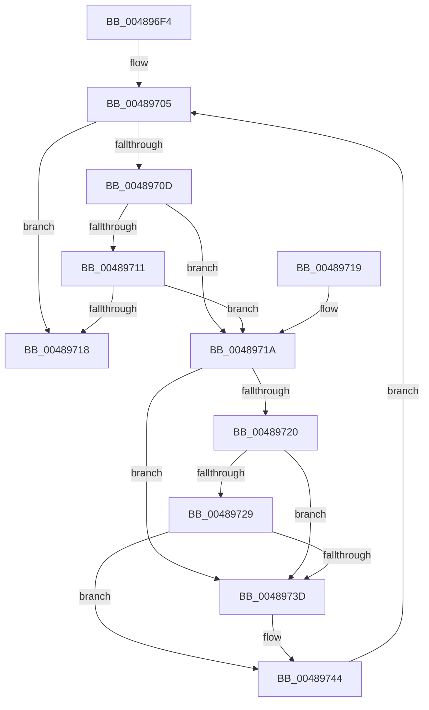

# MiGetSystemCacheRegionsToFree

- RVA: `0x004896F4`–`0x00489754` (길이 `96` bytes)
- VA: `0x00000001404896F4`
- 실행 섹션: `.text`
- PDB 이름 있음: `예`; PDB Function 태그: `아니요`
- unwind 정보 RVA: `0x000DB714`
- 디코드: `31`개 명령, `96/96` bytes 표시
- 미해석 바이트: `0` (있으면 어셈블리에 `.byte`로 보존)

> 이 문서는 커널 이미지의 기계어와 PDB 기호를 분석해 생성했습니다. 4번과 5번은 함수 원형과 자료형을 바이너리 사용 방식에서 추정한 C 해석이며 원본 소스 복구 결과는 아닙니다.

## 1. Dependencies

- 직접 호출 지점: **0**; 고유 호출 대상: **0**
- 직접 호출자로 확인된 함수: **2**
- RIP 상대 이미지 참조: **0**

### Outgoing calls
- 직접 디코드된 call 명령이 없습니다.

### Direct callers
- [MiReleaseSystemCacheView](../29/MiReleaseSystemCacheView_function_00294CE0.md) at `0x00294DC4`
- [MiDeleteUnmappedSystemCacheViews](../67/MiDeleteUnmappedSystemCacheViews_function_0067C9A0.md) at `0x0067CA22`

### Static image references
- 디코드된 RIP-relative 메모리 참조가 없습니다.

## 2. Other-region calls and transfers

- 다른 실행 섹션으로 향하는 call: **0**
- 별도 외부 분기/꼬리 이동을 확인하지 못했습니다.

## 3. Assembly (complete function range)

```asm
004896F4  8B 41 04                        mov eax, dword ptr [rcx + 4]
004896F7  4C 8D 81 20 09 00 00            lea r8, [rcx + 0x920]
004896FE  48 89 52 08                     mov qword ptr [rdx + 8], rdx
00489702  48 89 12                        mov qword ptr [rdx], rdx
00489705  49 8B 08                        mov rcx, qword ptr [r8]
00489708  49 3B C8                        cmp rcx, r8
0048970B  74 0B                           je 0x140489718
0048970D  A8 01                           test al, 1
0048970F  75 09                           jne 0x14048971a
00489711  49 83 78 10 20                  cmp qword ptr [r8 + 0x10], 0x20
00489716  77 02                           ja 0x14048971a
00489718  C3                              ret
00489719  CC                              int3
0048971A  4C 39 41 08                     cmp qword ptr [rcx + 8], r8
0048971E  75 1D                           jne 0x14048973d
00489720  4C 8B 11                        mov r10, qword ptr [rcx]
00489723  49 39 4A 08                     cmp qword ptr [r10 + 8], rcx
00489727  75 14                           jne 0x14048973d
00489729  4D 89 10                        mov qword ptr [r8], r10
0048972C  4D 89 42 08                     mov qword ptr [r10 + 8], r8
00489730  49 FF 48 10                     dec qword ptr [r8 + 0x10]
00489734  4C 8B 52 08                     mov r10, qword ptr [rdx + 8]
00489738  49 39 12                        cmp qword ptr [r10], rdx
0048973B  74 07                           je 0x140489744
0048973D  B9 03 00 00 00                  mov ecx, 3
00489742  CD 29                           int 0x29
00489744  48 89 11                        mov qword ptr [rcx], rdx
00489747  4C 89 51 08                     mov qword ptr [rcx + 8], r10
0048974B  49 89 0A                        mov qword ptr [r10], rcx
0048974E  48 89 4A 08                     mov qword ptr [rdx + 8], rcx
00489752  EB B1                           jmp 0x140489705
```

## 4. C-style interpretation (structured pseudocode)

```c
__int64 __fastcall MiGetSystemCacheRegionsToFree(__int64 a1, __int64 a2)
{
    *(unsigned __int64 *)(a2 + 8) = a2;
    *(unsigned __int64 *)(a2) = a2;
loc_00489705:
    if ((*(unsigned __int64 *)(a1 + 2336)) == (a1 + 2336)) goto loc_00489718;
    if ((((unsigned __int8)((unsigned int)(*(unsigned int *)(a1 + 4)))) & (1)) != 0) goto loc_0048971A;
    if ((*(unsigned __int64 *)(a1 + 2336 + 16)) > 32) goto loc_0048971A;
loc_00489718:
    return (unsigned int)(*(unsigned int *)(a1 + 4));
loc_0048971A:
    if ((*(unsigned __int64 *)(*(unsigned __int64 *)(a1 + 2336) + 8)) != (a1 + 2336)) goto loc_0048973D;
    if ((*(unsigned __int64 *)(*(unsigned __int64 *)(*(unsigned __int64 *)(a1 + 2336)) + 8)) != (*(unsigned __int64 *)(a1 + 2336))) goto loc_0048973D;
    *(unsigned __int64 *)(a1 + 2336) = *(unsigned __int64 *)(*(unsigned __int64 *)(a1 + 2336));
    *(unsigned __int64 *)(*(unsigned __int64 *)(*(unsigned __int64 *)(a1 + 2336)) + 8) = a1 + 2336;
    if ((*(unsigned __int64 *)(*(unsigned __int64 *)(a2 + 8))) != a2) {
        a1 = 3;
    }
    *(unsigned __int64 *)(a1) = a2;
    *(unsigned __int64 *)(a1 + 8) = *(unsigned __int64 *)(a2 + 8);
    *(unsigned __int64 *)(*(unsigned __int64 *)(a2 + 8)) = a1;
    *(unsigned __int64 *)(a2 + 8) = a1;
    goto loc_00489705;
}
```

## 5. (Beta) C Style

```c
int64_t MiGetSystemCacheRegionsToFree(void *Arg1, void *Arg2)
{
    uint8_t *arg1 = (uint8_t *)Arg1;
    uint8_t *arg2 = (uint8_t *)Arg2;

    *(void **)(arg2 + 0x8) = Arg2;
    *(void **)(arg2) = Arg2;
loc_00489705:
    if ((*(uint64_t *)(arg1 + 0x920)) == (Arg1 + 2336)) goto loc_00489718;
    if ((((uint8_t)((uint32_t)(*(uint32_t *)(arg1 + 0x4)))) & (1)) != 0) goto loc_0048971A;
    if ((*(uint64_t *)(arg1 + 0x920 + 0x10)) > 32) goto loc_0048971A;
loc_00489718:
    return (uint32_t)(*(uint32_t *)(arg1 + 0x4));
loc_0048971A:
    if ((*(uint64_t *)(*(uint64_t *)(arg1 + 0x920) + 0x8)) != (Arg1 + 2336)) goto loc_0048973D;
    if ((*(uint64_t *)(*(uint64_t *)(*(uint64_t *)(arg1 + 0x920)) + 0x8)) != (*(uint64_t *)(arg1 + 0x920))) goto loc_0048973D;
    *(uint64_t *)(arg1 + 0x920) = *(uint64_t *)(*(uint64_t *)(arg1 + 0x920));
    *(void **)(*(uint64_t *)(*(uint64_t *)(arg1 + 0x920)) + 0x8) = Arg1 + 2336;
    if ((*(uint64_t *)(*(uint64_t *)(arg2 + 0x8))) != Arg2) {
        Arg1 = 3;
    }
    *(void **)(arg1) = Arg2;
    *(uint64_t *)(arg1 + 0x8) = *(uint64_t *)(arg2 + 0x8);
    *(void **)(*(uint64_t *)(arg2 + 0x8)) = Arg1;
    *(void **)(arg2 + 0x8) = Arg1;
    goto loc_00489705;
}
```

### 관측된 메모리 오프셋

구조체 형식이 확인되지 않은 접근은 인자 기준의 오프셋으로만 기록했습니다.

| 기준 인자 | 오프셋 표현 | 폭 (bit) | 접근 |
|---|---:|---:|---|
| `Arg1` | `+ 0x0` | `64` | `R` |
| `Arg1` | `+ 0x0` | `64` | `W` |
| `Arg1` | `+ 0x4` | `32` | `R` |
| `Arg1` | `+ 0x10` | `64` | `R` |
| `Arg1` | `+ 0x10` | `64` | `R/W` |
| `Arg1` | `+ 0x920` | `64` | `R` |
| `Arg2` | `+ 0x0` | `64` | `W` |
| `Arg2` | `+ 0x8` | `64` | `R` |
| `Arg2` | `+ 0x8` | `64` | `W` |

## 6. Execution-region graph

[열기: 2D/3D 그래프와 함수 탐색 컨트롤 패널](../../../control-panel.html?section=text&rva=0x004896F4&view=graph)

- 2D 그래프는 위에서 아래로 흐르고, 3D 그래프는 빈 공간을 드래그해 회전합니다. Shift+드래그는 이동, 휠은 확대·축소, 함수 노드 선택은 대상 보고서 이동입니다.

### Static fallback


