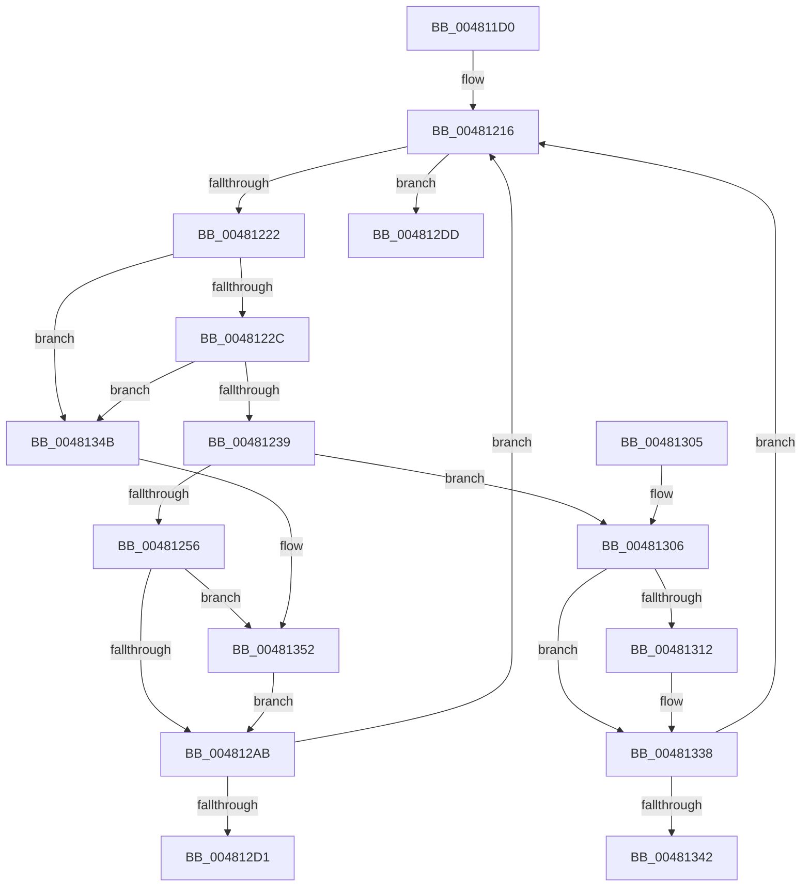

# MiHandlePageFileSizeChanges

- RVA: `0x004811D0`–`0x00481369` (길이 `409` bytes)
- VA: `0x00000001404811D0`
- 실행 섹션: `.text`
- PDB 이름 있음: `예`; PDB Function 태그: `예`
- unwind 정보 RVA: `0x000AEC54`
- 디코드: `100`개 명령, `409/409` bytes 표시
- 미해석 바이트: `0` (있으면 어셈블리에 `.byte`로 보존)

> 이 문서는 커널 이미지의 기계어와 PDB 기호를 분석해 생성했습니다. 4번과 5번은 함수 원형과 자료형을 바이너리 사용 방식에서 추정한 C 해석이며 원본 소스 복구 결과는 아닙니다.

## 1. Dependencies

- 직접 호출 지점: **13**; 고유 호출 대상: **8**
- 직접 호출자로 확인된 함수: **1**
- RIP 상대 이미지 참조: **0**

### Outgoing calls
- `0x004811F8` → [memset](../6C/memset_function_006C6C40.md) (function, `0x006C6C40`)
- `0x0048120E` → [ExAcquireSpinLockExclusive](../24/ExAcquireSpinLockExclusive_function_00248690.md) (function, `0x00248690`)
- `0x00481296` → [MiReleaseSpinLockExclusive](../24/MiReleaseSpinLockExclusive_function_002482C0.md) (function, `0x002482C0`)
- `0x0048129E` → [ExAcquireRundownProtection](../21/ExAcquireRundownProtection_function_00216620.md) (function, `0x00216620`)
- `0x004812B6` → [MiProcessingPageExtendComplete](MiProcessingPageExtendComplete_function_00481370.md) (function, `0x00481370`)
- `0x004812E3` → [MiReleaseSpinLockExclusive](../24/MiReleaseSpinLockExclusive_function_002482C0.md) (function, `0x002482C0`)
- `0x00481309` → [ExAcquireRundownProtection](../21/ExAcquireRundownProtection_function_00216620.md) (function, `0x00216620`)
- `0x00481318` → [MiReleaseSpinLockExclusive](../24/MiReleaseSpinLockExclusive_function_002482C0.md) (function, `0x002482C0`)
- `0x00481320` → [MiAttemptPageFileReduction](MiAttemptPageFileReduction_function_004813E4.md) (function, `0x004813E4`)
- `0x00481328` → [ExReleaseRundownProtection](../34/ExReleaseRundownProtection_function_00349E80.md) (function, `0x00349E80`)
- `0x00481330` → [ExAcquireSpinLockExclusive](../24/ExAcquireSpinLockExclusive_function_00248690.md) (function, `0x00248690`)
- `0x00481357` → [MiExtendPagingFiles](../../page/7F/MiExtendPagingFiles_function_007FFDD8.md) (function, `0x007FFDD8`)
- `0x0048135F` → [ExReleaseRundownProtection](../34/ExReleaseRundownProtection_function_00349E80.md) (function, `0x00349E80`)

### Direct callers
- [MiSegmentDereferenceWorker](../46/MiSegmentDereferenceWorker_function_00464D40.md) at `0x00464DDE`

### Static image references
- 디코드된 RIP-relative 메모리 참조가 없습니다.

## 2. Other-region calls and transfers

- 다른 실행 섹션으로 향하는 call: **1**
  - `0x00481357` → [MiExtendPagingFiles](../../page/7F/MiExtendPagingFiles_function_007FFDD8.md) (`.text` → `PAGE`)
- call이 아닌 외부 분기/꼬리 이동: **2**
  - `0x004812D8` → [sub_006F502A](../6F/Unknown_function_006F502A.md) (`tail-transfer`)
  - `0x00481346` → [sub_006F502A](../6F/Unknown_function_006F502A.md) (`tail-transfer`)

## 3. Assembly (complete function range)

```asm
004811D0  48 8B C4                        mov rax, rsp
004811D3  48 89 58 08                     mov qword ptr [rax + 8], rbx
004811D7  48 89 68 10                     mov qword ptr [rax + 0x10], rbp
004811DB  48 89 70 18                     mov qword ptr [rax + 0x18], rsi
004811DF  57                              push rdi
004811E0  41 56                           push r14
004811E2  41 57                           push r15
004811E4  48 81 EC 80 00 00 00            sub rsp, 0x80
004811EB  33 D2                           xor edx, edx
004811ED  48 8B F9                        mov rdi, rcx
004811F0  48 8D 48 88                     lea rcx, [rax - 0x78]
004811F4  44 8D 42 58                     lea r8d, [rdx + 0x58]
004811F8  E8 43 5A 24 00                  call 0x1406c6c40
004811FD  4C 8D B7 C0 06 00 00            lea r14, [rdi + 0x6c0]
00481204  49 8B CE                        mov rcx, r14
00481207  48 8D B7 A8 07 00 00            lea rsi, [rdi + 0x7a8]
0048120E  E8 7D 74 DC FF                  call 0x140248690
00481213  40 8A E8                        mov bpl, al
00481216  48 8B 1E                        mov rbx, qword ptr [rsi]
00481219  48 3B DE                        cmp rbx, rsi
0048121C  0F 84 BB 00 00 00               je 0x1404812dd
00481222  48 39 73 08                     cmp qword ptr [rbx + 8], rsi
00481226  0F 85 1F 01 00 00               jne 0x14048134b
0048122C  48 8B 03                        mov rax, qword ptr [rbx]
0048122F  48 39 58 08                     cmp qword ptr [rax + 8], rbx
00481233  0F 85 12 01 00 00               jne 0x14048134b
00481239  48 89 06                        mov qword ptr [rsi], rax
0048123C  4C 8D BF E8 03 00 00            lea r15, [rdi + 0x3e8]
00481243  48 83 C3 F8                     add rbx, -8
00481247  48 89 70 08                     mov qword ptr [rax + 8], rsi
0048124B  48 83 7B 20 FF                  cmp qword ptr [rbx + 0x20], -1
00481250  0F 84 B0 00 00 00               je 0x140481306
00481256  0F 10 03                        movups xmm0, xmmword ptr [rbx]
00481259  48 8D 44 24 20                  lea rax, [rsp + 0x20]
0048125E  40 8A D5                        mov dl, bpl
00481261  49 8B CE                        mov rcx, r14
00481264  0F 29 44 24 20                  movaps xmmword ptr [rsp + 0x20], xmm0
00481269  0F 10 4B 10                     movups xmm1, xmmword ptr [rbx + 0x10]
0048126D  0F 29 4C 24 30                  movaps xmmword ptr [rsp + 0x30], xmm1
00481272  0F 10 43 20                     movups xmm0, xmmword ptr [rbx + 0x20]
00481276  0F 29 44 24 40                  movaps xmmword ptr [rsp + 0x40], xmm0
0048127B  0F 10 4B 30                     movups xmm1, xmmword ptr [rbx + 0x30]
0048127F  0F 29 4C 24 50                  movaps xmmword ptr [rsp + 0x50], xmm1
00481284  0F 10 43 40                     movups xmm0, xmmword ptr [rbx + 0x40]
00481288  48 89 5C 24 70                  mov qword ptr [rsp + 0x70], rbx
0048128D  0F 29 44 24 60                  movaps xmmword ptr [rsp + 0x60], xmm0
00481292  48 89 43 50                     mov qword ptr [rbx + 0x50], rax
00481296  E8 25 70 DC FF                  call 0x1402482c0
0048129B  49 8B CF                        mov rcx, r15
0048129E  E8 7D 53 D9 FF                  call 0x140216620
004812A3  84 C0                           test al, al
004812A5  0F 85 A7 00 00 00               jne 0x140481352
004812AB  4C 8B C7                        mov r8, rdi
004812AE  48 8D 4C 24 20                  lea rcx, [rsp + 0x20]
004812B3  48 8B D3                        mov rdx, rbx
004812B6  E8 B5 00 00 00                  call 0x140481370
004812BB  FF 8F 9C 09 00 00               dec dword ptr [rdi + 0x99c]
004812C1  40 8A E8                        mov bpl, al
004812C4  83 BF 98 09 00 00 00            cmp dword ptr [rdi + 0x998], 0
004812CB  0F 84 45 FF FF FF               je 0x140481216
004812D1  48 8D 8F A0 09 00 00            lea rcx, [rdi + 0x9a0]
004812D8  E9 4D 3D 27 00                  jmp 0x1406f502a
004812DD  40 8A D5                        mov dl, bpl
004812E0  49 8B CE                        mov rcx, r14
004812E3  E8 D8 6F DC FF                  call 0x1402482c0
004812E8  4C 8D 9C 24 80 00 00 00         lea r11, [rsp + 0x80]
004812F0  49 8B 5B 20                     mov rbx, qword ptr [r11 + 0x20]
004812F4  49 8B 6B 28                     mov rbp, qword ptr [r11 + 0x28]
004812F8  49 8B 73 30                     mov rsi, qword ptr [r11 + 0x30]
004812FC  49 8B E3                        mov rsp, r11
004812FF  41 5F                           pop r15
00481301  41 5E                           pop r14
00481303  5F                              pop rdi
00481304  C3                              ret
00481305  CC                              int3
00481306  49 8B CF                        mov rcx, r15
00481309  E8 12 53 D9 FF                  call 0x140216620
0048130E  84 C0                           test al, al
00481310  74 26                           je 0x140481338
00481312  40 8A D5                        mov dl, bpl
00481315  49 8B CE                        mov rcx, r14
00481318  E8 A3 6F DC FF                  call 0x1402482c0
0048131D  48 8B CB                        mov rcx, rbx
00481320  E8 BF 00 00 00                  call 0x1404813e4
00481325  49 8B CF                        mov rcx, r15
00481328  E8 53 8B EC FF                  call 0x140349e80
0048132D  49 8B CE                        mov rcx, r14
00481330  E8 5B 73 DC FF                  call 0x140248690
00481335  40 8A E8                        mov bpl, al
00481338  F6 43 4F 10                     test byte ptr [rbx + 0x4f], 0x10
0048133C  0F 85 D4 FE FF FF               jne 0x140481216
00481342  48 8D 4B 30                     lea rcx, [rbx + 0x30]
00481346  E9 DF 3C 27 00                  jmp 0x1406f502a
0048134B  B9 03 00 00 00                  mov ecx, 3
00481350  CD 29                           int 0x29
00481352  48 8D 4C 24 20                  lea rcx, [rsp + 0x20]
00481357  E8 7C EA 37 00                  call 0x1407ffdd8
0048135C  49 8B CF                        mov rcx, r15
0048135F  E8 1C 8B EC FF                  call 0x140349e80
00481364  E9 42 FF FF FF                  jmp 0x1404812ab
```

## 4. C-style interpretation (structured pseudocode)

```c
__int64 __fastcall MiHandlePageFileSizeChanges(__int64 a1, int a2)
{
    __int64 result;
    __int64 v_rbp;
    __int64 v_rbx;
    __int64 v_rsp;
    unsigned __int64 v_stack_m18;
    unsigned __int64 v_stack_m28;
    unsigned __int64 v_stack_m38;
    unsigned __int64 v_stack_m48;
    unsigned __int64 v_stack_m58;
    unsigned __int64 v_stack_m60;
    unsigned __int64 v_stack_m68;
    unsigned __int64 v_stack_m78;

    *(unsigned __int64 *)(v_rsp + 8) = v_rbx;
    *(unsigned __int64 *)(v_rsp + 16) = v_rbp;
    *(unsigned __int64 *)(v_rsp + 24) = v_rsi;
    v_rsp = (v_rsp) - (128);
    a2 = 0;
    result = memset(v_rsp - 120, a2, a2 + 88, a4);
    result = ExAcquireSpinLockExclusive(a1 + 1728, a2, a2 + 88, a4);
loc_00481216:
    if ((*(unsigned __int64 *)(a1 + 1960)) == (a1 + 1960)) goto loc_004812DD;
    if ((*(unsigned __int64 *)(*(unsigned __int64 *)(a1 + 1960) + 8)) != (a1 + 1960)) goto loc_0048134B;
    if ((*(unsigned __int64 *)(*(unsigned __int64 *)(*(unsigned __int64 *)(a1 + 1960)) + 8)) != (*(unsigned __int64 *)(a1 + 1960))) goto loc_0048134B;
    *(unsigned __int64 *)(a1 + 1960) = *(unsigned __int64 *)(*(unsigned __int64 *)(a1 + 1960));
    v_rbx = (*(unsigned __int64 *)(a1 + 1960)) + (-8);
    *(unsigned __int64 *)(*(unsigned __int64 *)(*(unsigned __int64 *)(a1 + 1960)) + 8) = a1 + 1960;
    if ((*(unsigned __int64 *)(v_rbx + 32)) == -1) goto loc_00481306;
    v_stack_m78 = v_xmm0;
    v_stack_m68 = v_xmm1;
    v_stack_m58 = v_xmm0;
    v_stack_m48 = v_xmm1;
    v_stack_m28 = v_rbx;
    v_stack_m38 = v_xmm0;
    *(unsigned __int64 *)(v_rbx + 80) = v_stack_m78;
    result = MiReleaseSpinLockExclusive(a1 + 1728, (unsigned __int8)((unsigned __int8)(result)), a2 + 88, a4);
    result = ExAcquireRundownProtection(a1 + 1000, (unsigned __int8)((unsigned __int8)(result)), a2 + 88, a4);
    if ((unsigned __int8)(result) != 0) goto loc_00481352;
loc_004812AB:
    result = MiProcessingPageExtendComplete(v_stack_m78, v_rbx, a1, a4);
    if ((*(unsigned int *)(a1 + 2456)) == 0) goto loc_00481216;
loc_004812DD:
    result = MiReleaseSpinLockExclusive(a1 + 1728, (unsigned __int8)((unsigned __int8)(result)), a1, a4);
    return result;
loc_00481306:
    result = ExAcquireRundownProtection(a1 + 1000, (unsigned __int8)((unsigned __int8)(result)), a1, a4);
    v_rbp = *(unsigned __int64 *)(v_stack_m18 + 40);
    if ((unsigned __int8)(result) != 0) {
        a2 = (unsigned __int8)(*(unsigned __int64 *)(v_stack_m18 + 40));
        a1 = a1 + 1728;
        result = MiReleaseSpinLockExclusive(a1, a2, a1, a4);
        a1 = *(unsigned __int64 *)(v_stack_m18 + 32);
        result = MiAttemptPageFileReduction(a1, a2, a1, a4);
        a1 = a1 + 1000;
        result = ExReleaseRundownProtection(a1, a2, a1, a4);
        a1 = a1 + 1728;
        result = ExAcquireSpinLockExclusive(a1, a2, a1, a4);
        v_rbp = (unsigned __int8)(result);
    }
    if (((*(unsigned __int8 *)(*(unsigned __int64 *)(v_stack_m18 + 32) + 79)) & (16)) != 0) goto loc_00481216;
loc_0048134B:
loc_00481352:
    result = MiExtendPagingFiles(v_stack_m60, a2, a1, a4);
    result = ExReleaseRundownProtection(a1 + 1000, a2, a1, a4);
    goto loc_004812AB;
}
```

## 5. (Beta) C Style

```c
int64_t MiHandlePageFileSizeChanges(void *Arg1, int32_t Arg2)
{
    uint8_t *arg1 = (uint8_t *)Arg1;

    int64_t result;
    int64_t local_rbp;
    int64_t local_rbx;
    int64_t local_rsp;
    uint64_t v_stack_m18;
    uint64_t v_stack_m28;
    uint64_t v_stack_m38;
    uint64_t v_stack_m48;
    uint64_t v_stack_m58;
    uint64_t v_stack_m60;
    uint64_t v_stack_m68;
    uint64_t v_stack_m78;

    *(uint64_t *)(local_rsp + 0x8) = local_rbx;
    *(uint64_t *)(local_rsp + 0x10) = local_rbp;
    *(uint64_t *)(local_rsp + 0x18) = local_rsi;
    local_rsp = (local_rsp) - (128);
    Arg2 = 0;
    result = memset(local_rsp - 120, Arg2, Arg2 + 88, a4);
    result = ExAcquireSpinLockExclusive(Arg1 + 1728, Arg2, Arg2 + 88, a4);
loc_00481216:
    if ((*(uint64_t *)(arg1 + 0x7A8)) == (Arg1 + 1960)) goto loc_004812DD;
    if ((*(uint64_t *)(*(uint64_t *)(arg1 + 0x7A8) + 0x8)) != (Arg1 + 1960)) goto loc_0048134B;
    if ((*(uint64_t *)(*(uint64_t *)(*(uint64_t *)(arg1 + 0x7A8)) + 0x8)) != (*(uint64_t *)(arg1 + 0x7A8))) goto loc_0048134B;
    *(uint64_t *)(arg1 + 0x7A8) = *(uint64_t *)(*(uint64_t *)(arg1 + 0x7A8));
    local_rbx = (*(uint64_t *)(arg1 + 0x7A8)) + (-8);
    *(void **)(*(uint64_t *)(*(uint64_t *)(arg1 + 0x7A8)) + 0x8) = Arg1 + 1960;
    if ((*(uint64_t *)(local_rbx + 0x20)) == -1) goto loc_00481306;
    v_stack_m78 = v_xmm0;
    v_stack_m68 = v_xmm1;
    v_stack_m58 = v_xmm0;
    v_stack_m48 = v_xmm1;
    v_stack_m28 = local_rbx;
    v_stack_m38 = v_xmm0;
    *(uint64_t *)(local_rbx + 0x50) = v_stack_m78;
    result = MiReleaseSpinLockExclusive(Arg1 + 1728, (uint8_t)((uint8_t)(result)), Arg2 + 88, a4);
    result = ExAcquireRundownProtection(Arg1 + 1000, (uint8_t)((uint8_t)(result)), Arg2 + 88, a4);
    if ((uint8_t)(result) != 0) goto loc_00481352;
loc_004812AB:
    result = MiProcessingPageExtendComplete(v_stack_m78, local_rbx, Arg1, a4);
    if ((*(uint32_t *)(arg1 + 0x998)) == 0) goto loc_00481216;
loc_004812DD:
    result = MiReleaseSpinLockExclusive(Arg1 + 1728, (uint8_t)((uint8_t)(result)), Arg1, a4);
    return result;
loc_00481306:
    result = ExAcquireRundownProtection(Arg1 + 1000, (uint8_t)((uint8_t)(result)), Arg1, a4);
    local_rbp = *(uint64_t *)(v_stack_m18 + 0x28);
    if ((uint8_t)(result) != 0) {
        Arg2 = (uint8_t)(*(uint64_t *)(v_stack_m18 + 0x28));
        Arg1 = Arg1 + 1728;
        result = MiReleaseSpinLockExclusive(Arg1, Arg2, Arg1, a4);
        Arg1 = *(uint64_t *)(v_stack_m18 + 0x20);
        result = MiAttemptPageFileReduction(Arg1, Arg2, Arg1, a4);
        Arg1 = Arg1 + 1000;
        result = ExReleaseRundownProtection(Arg1, Arg2, Arg1, a4);
        Arg1 = Arg1 + 1728;
        result = ExAcquireSpinLockExclusive(Arg1, Arg2, Arg1, a4);
        local_rbp = (uint8_t)(result);
    }
    if (((*(uint8_t *)(*(uint64_t *)(v_stack_m18 + 0x20) + 0x4F)) & (16)) != 0) goto loc_00481216;
loc_0048134B:
loc_00481352:
    result = MiExtendPagingFiles(v_stack_m60, Arg2, Arg1, a4);
    result = ExReleaseRundownProtection(Arg1 + 1000, Arg2, Arg1, a4);
    goto loc_004812AB;
}
```

### 관측된 메모리 오프셋

구조체 형식이 확인되지 않은 접근은 인자 기준의 오프셋으로만 기록했습니다.

| 기준 인자 | 오프셋 표현 | 폭 (bit) | 접근 |
|---|---:|---:|---|
| `Arg1` | `+ 0x0` | `64` | `R` |
| `Arg1` | `+ 0x0` | `64` | `W` |
| `Arg1` | `+ 0x3E8` | `64` | `R` |
| `Arg1` | `+ 0x6C0` | `64` | `R` |
| `Arg1` | `+ 0x7A8` | `64` | `R` |
| `Arg1` | `+ 0x998` | `32` | `R` |
| `Arg1` | `+ 0x99C` | `32` | `R/W` |
| `Arg1` | `+ 0x9A0` | `64` | `R` |

## 6. Execution-region graph

[열기: 2D/3D 그래프와 함수 탐색 컨트롤 패널](../../../control-panel.html?section=text&rva=0x004811D0&view=graph)

- 2D 그래프는 위에서 아래로 흐르고, 3D 그래프는 빈 공간을 드래그해 회전합니다. Shift+드래그는 이동, 휠은 확대·축소, 함수 노드 선택은 대상 보고서 이동입니다.

### Static fallback


