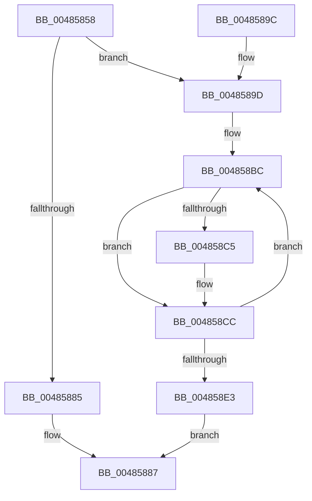

# MiInsertNewCombineBlocks

- RVA: `0x00485858`–`0x004858F3` (길이 `155` bytes)
- VA: `0x0000000140485858`
- 실행 섹션: `.text`
- PDB 이름 있음: `예`; PDB Function 태그: `아니요`
- unwind 정보 RVA: `0x0007AA1C`
- 디코드: `46`개 명령, `155/155` bytes 표시
- 미해석 바이트: `0` (있으면 어셈블리에 `.byte`로 보존)

> 이 문서는 커널 이미지의 기계어와 PDB 기호를 분석해 생성했습니다. 4번과 5번은 함수 원형과 자료형을 바이너리 사용 방식에서 추정한 C 해석이며 원본 소스 복구 결과는 아닙니다.

## 1. Dependencies

- 직접 호출 지점: **4**; 고유 호출 대상: **4**
- 직접 호출자로 확인된 함수: **1**
- RIP 상대 이미지 참조: **0**

### Outgoing calls
- `0x0048587C` → [MiLockPagedRange](../../page/A6/MiLockPagedRange_function_00A6C8C0.md) (function, `0x00A6C8C0`)
- `0x004858A5` → [memset](../6C/memset_function_006C6C40.md) (function, `0x006C6C40`)
- `0x004858B3` → [ExAcquireSpinLockExclusive](../24/ExAcquireSpinLockExclusive_function_00248690.md) (function, `0x00248690`)
- `0x004858E9` → [MiReleaseSpinLockExclusive](../24/MiReleaseSpinLockExclusive_function_002482C0.md) (function, `0x002482C0`)

### Direct callers
- [MiAllocateCombineBlock](../31/MiAllocateCombineBlock_function_00317294.md) at `0x00317344`

### Static image references
- 디코드된 RIP-relative 메모리 참조가 없습니다.

## 2. Other-region calls and transfers

- 다른 실행 섹션으로 향하는 call: **1**
  - `0x0048587C` → [MiLockPagedRange](../../page/A6/MiLockPagedRange_function_00A6C8C0.md) (`.text` → `PAGE`)
- 별도 외부 분기/꼬리 이동을 확인하지 못했습니다.

## 3. Assembly (complete function range)

```asm
00485858  48 89 5C 24 08                  mov qword ptr [rsp + 8], rbx
0048585D  48 89 6C 24 10                  mov qword ptr [rsp + 0x10], rbp
00485862  48 89 74 24 18                  mov qword ptr [rsp + 0x18], rsi
00485867  57                              push rdi
00485868  48 83 EC 20                     sub rsp, 0x20
0048586C  48 8B DA                        mov rbx, rdx
0048586F  48 8B E9                        mov rbp, rcx
00485872  BF 78 0F 00 00                  mov edi, 0xf78
00485877  48 8B CB                        mov rcx, rbx
0048587A  8B D7                           mov edx, edi
0048587C  E8 3F 70 5E 00                  call 0x140a6c8c0
00485881  85 C0                           test eax, eax
00485883  75 18                           jne 0x14048589d
00485885  33 C0                           xor eax, eax
00485887  48 8B 5C 24 30                  mov rbx, qword ptr [rsp + 0x30]
0048588C  48 8B 6C 24 38                  mov rbp, qword ptr [rsp + 0x38]
00485891  48 8B 74 24 40                  mov rsi, qword ptr [rsp + 0x40]
00485896  48 83 C4 20                     add rsp, 0x20
0048589A  5F                              pop rdi
0048589B  C3                              ret
0048589C  CC                              int3
0048589D  4C 8B C7                        mov r8, rdi
004858A0  33 D2                           xor edx, edx
004858A2  48 8B CB                        mov rcx, rbx
004858A5  E8 96 13 24 00                  call 0x1406c6c40
004858AA  48 8D 4D 58                     lea rcx, [rbp + 0x58]
004858AE  BF 36 00 00 00                  mov edi, 0x36
004858B3  E8 D8 2D DC FF                  call 0x140248690
004858B8  48 8D 55 48                     lea rdx, [rbp + 0x48]
004858BC  4C 8B 02                        mov r8, qword ptr [rdx]
004858BF  49 39 50 08                     cmp qword ptr [r8 + 8], rdx
004858C3  74 07                           je 0x1404858cc
004858C5  B9 03 00 00 00                  mov ecx, 3
004858CA  CD 29                           int 0x29
004858CC  4C 89 03                        mov qword ptr [rbx], r8
004858CF  48 89 53 08                     mov qword ptr [rbx + 8], rdx
004858D3  49 89 58 08                     mov qword ptr [r8 + 8], rbx
004858D7  48 89 1A                        mov qword ptr [rdx], rbx
004858DA  48 83 C3 48                     add rbx, 0x48
004858DE  83 C7 FF                        add edi, -1
004858E1  75 D9                           jne 0x1404858bc
004858E3  8A D0                           mov dl, al
004858E5  48 8D 4D 58                     lea rcx, [rbp + 0x58]
004858E9  E8 D2 29 DC FF                  call 0x1402482c0
004858EE  48 8B C3                        mov rax, rbx
004858F1  EB 94                           jmp 0x140485887
```

## 4. C-style interpretation (structured pseudocode)

```c
__int64 __fastcall MiInsertNewCombineBlocks(__int64 a1, __int64 a2)
{
    __int64 result;
    __int64 v_rbx;
    __int64 v_rdi;
    __int64 v_rsp;
    unsigned __int64 v_stack_p10;
    unsigned __int64 v_stack_p18;
    unsigned __int64 v_stack_p8;

    v_stack_p8 = v_rbx;
    v_stack_p10 = v_rbp;
    v_stack_p18 = v_rsi;
    v_rsp = (v_rsp) - (32);
    result = MiLockPagedRange(a2, (unsigned int)((unsigned int)((unsigned int)(0xF78ULL))), a3, a4);
    if ((unsigned int)(result) != 0) goto loc_0048589D;
    result = 0;
loc_00485887:
    v_rsp = (v_rsp) + (32);
    return result;
loc_0048589D:
    a2 = 0;
    result = memset(v_stack_p8, a2, (unsigned int)(0xF78ULL), a4);
    result = ExAcquireSpinLockExclusive(v_stack_p10 + 88, a2, (unsigned int)(0xF78ULL), a4);
loc_004858BC:
    if ((*(unsigned __int64 *)(*(unsigned __int64 *)(v_stack_p10 + 72) + 8)) != (v_stack_p10 + 72)) {
        a1 = 3;
    }
    *(unsigned __int64 *)(v_stack_p8) = *(unsigned __int64 *)(v_stack_p10 + 72);
    *(unsigned __int64 *)(v_stack_p8 + 8) = v_stack_p10 + 72;
    *(unsigned __int64 *)(*(unsigned __int64 *)(v_stack_p10 + 72) + 8) = v_stack_p8;
    *(unsigned __int64 *)(v_stack_p10 + 72) = v_stack_p8;
    v_rbx = (v_stack_p8) + (72);
    v_rdi = (unsigned int)((54) + (-1));
    if (condition_is_not_equal) goto loc_004858BC;
    result = MiReleaseSpinLockExclusive(v_stack_p10 + 88, (unsigned __int8)(result), *(unsigned __int64 *)(v_stack_p10 + 72), a4);
    goto loc_00485887;
}
```

## 5. (Beta) C Style

```c
int64_t MiInsertNewCombineBlocks(void *Arg1, void *Arg2)
{
    uint8_t *arg1 = (uint8_t *)Arg1;
    uint8_t *arg2 = (uint8_t *)Arg2;

    int64_t result;
    int64_t local_rbx;
    int64_t local_rdi;
    int64_t local_rsp;
    uint64_t v_stack_p10;
    uint64_t v_stack_p18;
    uint64_t v_stack_p8;

    v_stack_p8 = local_rbx;
    v_stack_p10 = local_rbp;
    v_stack_p18 = local_rsi;
    local_rsp = (local_rsp) - (32);
    result = MiLockPagedRange(Arg2, (uint32_t)((uint32_t)((uint32_t)(0xF78ULL))), a3, a4);
    if ((uint32_t)(result) != 0) goto loc_0048589D;
    result = 0;
loc_00485887:
    local_rsp = (local_rsp) + (32);
    return result;
loc_0048589D:
    Arg2 = 0;
    result = memset(v_stack_p8, Arg2, (uint32_t)(0xF78ULL), a4);
    result = ExAcquireSpinLockExclusive(v_stack_p10 + 88, Arg2, (uint32_t)(0xF78ULL), a4);
loc_004858BC:
    if ((*(uint64_t *)(*(uint64_t *)(v_stack_p10 + 0x48) + 0x8)) != (v_stack_p10 + 72)) {
        Arg1 = 3;
    }
    *(uint64_t *)(v_stack_p8) = *(uint64_t *)(v_stack_p10 + 0x48);
    *(uint64_t *)(v_stack_p8 + 0x8) = v_stack_p10 + 72;
    *(uint64_t *)(*(uint64_t *)(v_stack_p10 + 0x48) + 0x8) = v_stack_p8;
    *(uint64_t *)(v_stack_p10 + 0x48) = v_stack_p8;
    local_rbx = (v_stack_p8) + (72);
    local_rdi = (uint32_t)((54) + (-1));
    if (condition_is_not_equal) goto loc_004858BC;
    result = MiReleaseSpinLockExclusive(v_stack_p10 + 88, (uint8_t)(result), *(uint64_t *)(v_stack_p10 + 0x48), a4);
    goto loc_00485887;
}
```

### 관측된 메모리 오프셋

구조체 형식이 확인되지 않은 접근은 인자 기준의 오프셋으로만 기록했습니다.

| 기준 인자 | 오프셋 표현 | 폭 (bit) | 접근 |
|---|---:|---:|---|
| `Arg1` | `+ 0x0` | `64` | `R` |
| `Arg1` | `+ 0x0` | `64` | `W` |
| `Arg1` | `+ 0x48` | `64` | `R` |
| `Arg1` | `+ 0x58` | `64` | `R` |
| `Arg2` | `+ 0x0` | `64` | `W` |
| `Arg2` | `+ 0x8` | `64` | `W` |

## 6. Execution-region graph

[열기: 2D/3D 그래프와 함수 탐색 컨트롤 패널](../../../control-panel.html?section=text&rva=0x00485858&view=graph)

- 2D 그래프는 위에서 아래로 흐르고, 3D 그래프는 빈 공간을 드래그해 회전합니다. Shift+드래그는 이동, 휠은 확대·축소, 함수 노드 선택은 대상 보고서 이동입니다.

### Static fallback


