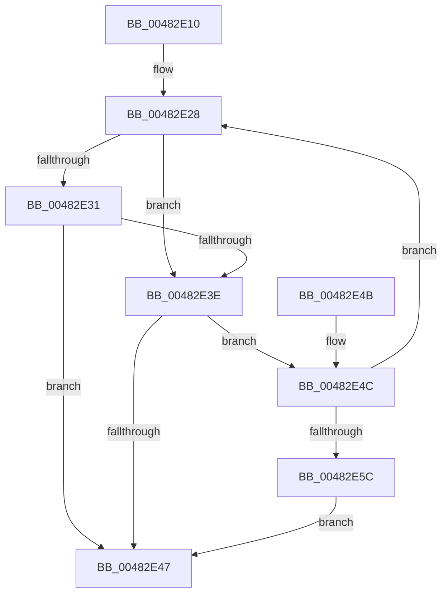

# MiIoPagesInRun

- RVA: `0x00482E10`–`0x00482E5E` (길이 `78` bytes)
- VA: `0x0000000140482E10`
- 실행 섹션: `.text`
- PDB 이름 있음: `예`; PDB Function 태그: `아니요`
- unwind 정보 RVA: `0x000DB714`
- 디코드: `22`개 명령, `78/78` bytes 표시
- 미해석 바이트: `0` (있으면 어셈블리에 `.byte`로 보존)

> 이 문서는 커널 이미지의 기계어와 PDB 기호를 분석해 생성했습니다. 4번과 5번은 함수 원형과 자료형을 바이너리 사용 방식에서 추정한 C 해석이며 원본 소스 복구 결과는 아닙니다.

## 1. Dependencies

- 직접 호출 지점: **0**; 고유 호출 대상: **0**
- 직접 호출자로 확인된 함수: **1**
- RIP 상대 이미지 참조: **1**

### Outgoing calls
- 직접 디코드된 call 명령이 없습니다.

### Direct callers
- [MiFillSystemPtes](../31/MiFillSystemPtes_function_00319850.md) at `0x0031A0E7`

### Static image references
- `0x00482E28` → RVA `0x00E2DCE0` (`.data`; read)

## 2. Other-region calls and transfers

- 다른 실행 섹션으로 향하는 call: **0**
- 별도 외부 분기/꼬리 이동을 확인하지 못했습니다.

## 3. Assembly (complete function range)

```asm
00482E10  4C 8D 04 49                     lea r8, [rcx + rcx*2]
00482E14  45 33 C9                        xor r9d, r9d
00482E17  49 C1 E0 04                     shl r8, 4
00482E1B  48 B8 28 00 00 00 00 DE FF FF   movabs rax, 0xffffde0000000028
00482E25  4C 03 C0                        add r8, rax
00482E28  48 3B 0D B1 AE 9A 00            cmp rcx, qword ptr [rip + 0x9aaeb1]
00482E2F  77 0D                           ja 0x140482e3e
00482E31  49 8B 00                        mov rax, qword ptr [r8]
00482E34  48 C1 E8 36                     shr rax, 0x36
00482E38  0F BA E0 00                     bt eax, 0
00482E3C  72 09                           jb 0x140482e47
00482E3E  49 FF C1                        inc r9
00482E41  48 83 EA 01                     sub rdx, 1
00482E45  75 05                           jne 0x140482e4c
00482E47  49 8B C1                        mov rax, r9
00482E4A  C3                              ret
00482E4B  CC                              int3
00482E4C  48 FF C1                        inc rcx
00482E4F  49 83 C0 30                     add r8, 0x30
00482E53  48 F7 C1 FF 01 00 00            test rcx, 0x1ff
00482E5A  75 CC                           jne 0x140482e28
00482E5C  EB E9                           jmp 0x140482e47
```

## 4. C-style interpretation (structured pseudocode)

```c
__int64 __fastcall MiIoPagesInRun(__int64 a1, __int64 a2, __int64 a3, int a4)
{
    __int64 result;

    a4 = 0;
    a3 = (a1 + a1 * 2) << (4);
    a3 = (a3) + (result);
loc_00482E28:
    if (a1 > (*(unsigned __int64 *)(v_rip + 10137265))) goto loc_00482E3E;
    result = (*(unsigned __int64 *)(a3)) >> (54);
    if (condition_is_below) goto loc_00482E47;
loc_00482E3E:
    a4 = (a4) + 1;
    a2 = (a2) - (1);
    if (condition_is_not_equal) goto loc_00482E4C;
loc_00482E47:
    return a4;
loc_00482E4C:
    a1 = (a1) + 1;
    a3 = (a3) + (48);
    if (((a1) & (511)) != 0) goto loc_00482E28;
    goto loc_00482E47;
}
```

## 5. (Beta) C Style

```c
int64_t MiIoPagesInRun(void *Arg1, int64_t Arg2, int64_t Arg3, int32_t Arg4)
{
    uint8_t *arg1 = (uint8_t *)Arg1;

    int64_t result;

    Arg4 = 0;
    Arg3 = (Arg1 + Arg1 * 2) << (4);
    Arg3 = (Arg3) + (result);
loc_00482E28:
    if (Arg1 > (*(uint64_t *)(v_rip + 0x9AAEB1))) goto loc_00482E3E;
    result = (*(uint64_t *)(Arg3)) >> (54);
    if (condition_is_below) goto loc_00482E47;
loc_00482E3E:
    Arg4 = (Arg4) + 1;
    Arg2 = (Arg2) - (1);
    if (condition_is_not_equal) goto loc_00482E4C;
loc_00482E47:
    return Arg4;
loc_00482E4C:
    Arg1 = (Arg1) + 1;
    Arg3 = (Arg3) + (48);
    if (((Arg1) & (511)) != 0) goto loc_00482E28;
    goto loc_00482E47;
}
```

### 관측된 메모리 오프셋

구조체 형식이 확인되지 않은 접근은 인자 기준의 오프셋으로만 기록했습니다.

| 기준 인자 | 오프셋 표현 | 폭 (bit) | 접근 |
|---|---:|---:|---|
| `Arg1` | `+ 0x0 + rcx*2` | `64` | `R` |

## 6. Execution-region graph

[열기: 2D/3D 그래프와 함수 탐색 컨트롤 패널](../../../control-panel.html?section=text&rva=0x00482E10&view=graph)

- 2D 그래프는 위에서 아래로 흐르고, 3D 그래프는 빈 공간을 드래그해 회전합니다. Shift+드래그는 이동, 휠은 확대·축소, 함수 노드 선택은 대상 보고서 이동입니다.

### Static fallback


