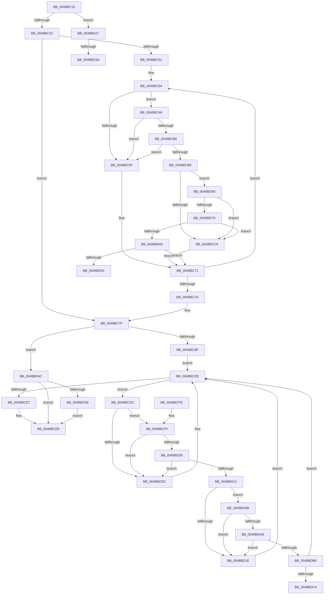

# MiJumpStackTarget

- RVA: `0x0048BC10`–`0x0048BDCE` (길이 `446` bytes)
- VA: `0x000000014048BC10`
- 실행 섹션: `.text`
- PDB 이름 있음: `예`; PDB Function 태그: `예`
- unwind 정보 RVA: `0x000B0BD8`
- 디코드: `139`개 명령, `446/446` bytes 표시
- 미해석 바이트: `0` (있으면 어셈블리에 `.byte`로 보존)

> 이 문서는 커널 이미지의 기계어와 PDB 기호를 분석해 생성했습니다. 4번과 5번은 함수 원형과 자료형을 바이너리 사용 방식에서 추정한 C 해석이며 원본 소스 복구 결과는 아닙니다.

## 1. Dependencies

- 직접 호출 지점: **8**; 고유 호출 대상: **4**
- 직접 호출자로 확인된 함수: **1**
- RIP 상대 이미지 참조: **3**

### Outgoing calls
- `0x0048BCB0` → [KiCheckVpBackingLongSpinWaitHypercall](../30/KiCheckVpBackingLongSpinWaitHypercall_function_0030F490.md) (function, `0x0030F490`)
- `0x0048BCBC` → [KeCanUseHaltOnAddress](../4F/KeCanUseHaltOnAddress_function_004FC22C.md) (function, `0x004FC22C`)
- `0x0048BCCB` → [HvlNotifyLongSpinWait](../30/HvlNotifyLongSpinWait_function_0030F460.md) (function, `0x0030F460`)
- `0x0048BD09` → [KiCheckVpBackingLongSpinWaitHypercall](../30/KiCheckVpBackingLongSpinWaitHypercall_function_0030F490.md) (function, `0x0030F490`)
- `0x0048BD15` → [KeCanUseHaltOnAddress](../4F/KeCanUseHaltOnAddress_function_004FC22C.md) (function, `0x004FC22C`)
- `0x0048BD20` → [HvlNotifyLongSpinWait](../30/HvlNotifyLongSpinWait_function_0030F460.md) (function, `0x0030F460`)
- `0x0048BD3D` → [KeWakeAddressAll](../21/KeWakeAddressAll_function_00217C20.md) (function, `0x00217C20`)
- `0x0048BD61` → [KeWakeAddressAll](../21/KeWakeAddressAll_function_00217C20.md) (function, `0x00217C20`)

### Direct callers
- [MiDoStackCopy](MiDoStackCopy_function_0048BA30.md) at `0x0048BB99`

### Static image references
- `0x0048BC67` → RVA `0x00FC52AC` (`ALMOSTRO`; reference)
- `0x0048BCA6` → RVA `0x00FC6AB8` (`ALMOSTRO`; read)
- `0x0048BD68` → RVA `0x00FC6B38` (`ALMOSTRO`; read)

## 2. Other-region calls and transfers

- 다른 실행 섹션으로 향하는 call: **0**
- call이 아닌 외부 분기/꼬리 이동: **4**
  - `0x0048BD34` → [sub_006F60F8](../6F/Unknown_function_006F60F8.md) (`tail-transfer`)
  - `0x0048BD47` → [sub_006F60F8](../6F/Unknown_function_006F60F8.md) (`tail-transfer`)
  - `0x0048BD96` → [sub_006F60F8 + 0x1E9](../6F/Unknown_function_006F60F8.md) (`tail-transfer`)
  - `0x0048BDC9` → [sub_006F60F8 + 0x22C](../6F/Unknown_function_006F60F8.md) (`tail-transfer`)

## 3. Assembly (complete function range)

```asm
0048BC10  48 89 4C 24 08                  mov qword ptr [rsp + 8], rcx
0048BC15  53                              push rbx
0048BC16  55                              push rbp
0048BC17  56                              push rsi
0048BC18  57                              push rdi
0048BC19  41 54                           push r12
0048BC1B  41 56                           push r14
0048BC1D  41 57                           push r15
0048BC1F  48 83 EC 30                     sub rsp, 0x30
0048BC23  48 8B 31                        mov rsi, qword ptr [rcx]
0048BC26  4C 8B F9                        mov r15, rcx
0048BC29  48 8B 79 10                     mov rdi, qword ptr [rcx + 0x10]
0048BC2D  83 C8 FF                        or eax, 0xffffffff
0048BC30  F0 0F C1 07                     lock xadd dword ptr [rdi], eax
0048BC34  FF C8                           dec eax
0048BC36  41 BC 00 00 00 80               mov r12d, 0x80000000
0048BC3C  8B D8                           mov ebx, eax
0048BC3E  BA 01 00 00 00                  mov edx, 1
0048BC43  F7 D3                           not ebx
0048BC45  41 23 DC                        and ebx, r12d
0048BC48  A9 FF FF FF 3F                  test eax, 0x3fffffff
0048BC4D  0F 84 D4 00 00 00               je 0x14048bd27
0048BC53  8B 07                           mov eax, dword ptr [rdi]
0048BC55  33 F6                           xor esi, esi
0048BC57  41 23 C4                        and eax, r12d
0048BC5A  45 33 F6                        xor r14d, r14d
0048BC5D  3B C3                           cmp eax, ebx
0048BC5F  74 1E                           je 0x14048bc7f
0048BC61  44 8B FA                        mov r15d, edx
0048BC64  41 03 F7                        add esi, r15d
0048BC67  85 35 3F 96 B3 00               test dword ptr [rip + 0xb3963f], esi
0048BC6D  74 37                           je 0x14048bca6
0048BC6F  F3 90                           pause
0048BC71  8B 07                           mov eax, dword ptr [rdi]
0048BC73  41 23 C4                        and eax, r12d
0048BC76  3B C3                           cmp eax, ebx
0048BC78  75 EA                           jne 0x14048bc64
0048BC7A  4C 8B 7C 24 70                  mov r15, qword ptr [rsp + 0x70]
0048BC7F  90                              nop
0048BC80  49 8B 7F 10                     mov rdi, qword ptr [r15 + 0x10]
0048BC84  83 C8 FF                        or eax, 0xffffffff
0048BC87  F0 0F C1 07                     lock xadd dword ptr [rdi], eax
0048BC8B  FF C8                           dec eax
0048BC8D  8B D8                           mov ebx, eax
0048BC8F  F7 D3                           not ebx
0048BC91  41 23 DC                        and ebx, r12d
0048BC94  A9 FF FF FF 3F                  test eax, 0x3fffffff
0048BC99  0F 84 AD 00 00 00               je 0x14048bd4c
0048BC9F  33 F6                           xor esi, esi
0048BCA1  45 33 F6                        xor r14d, r14d
0048BCA4  EB 38                           jmp 0x14048bcde
0048BCA6  8B 05 0C AE B3 00               mov eax, dword ptr [rip + 0xb3ae0c]
0048BCAC  A8 40                           test al, 0x40
0048BCAE  74 BF                           je 0x14048bc6f
0048BCB0  E8 DB 37 E8 FF                  call 0x14030f490
0048BCB5  84 C0                           test al, al
0048BCB7  74 B6                           je 0x14048bc6f
0048BCB9  45 03 F7                        add r14d, r15d
0048BCBC  E8 6B 05 07 00                  call 0x1404fc22c
0048BCC1  84 C0                           test al, al
0048BCC3  0F 85 9F 00 00 00               jne 0x14048bd68
0048BCC9  8B CE                           mov ecx, esi
0048BCCB  E8 90 37 E8 FF                  call 0x14030f460
0048BCD0  EB 9F                           jmp 0x14048bc71
0048BCD2  FF C6                           inc esi
0048BCD4  85 35 D2 95 B3 00               test dword ptr [rip + 0xb395d2], esi
0048BCDA  74 23                           je 0x14048bcff
0048BCDC  F3 90                           pause
0048BCDE  8B 07                           mov eax, dword ptr [rdi]
0048BCE0  41 23 C4                        and eax, r12d
0048BCE3  3B C3                           cmp eax, ebx
0048BCE5  75 EB                           jne 0x14048bcd2
0048BCE7  90                              nop
0048BCE8  49 8B 47 08                     mov rax, qword ptr [r15 + 8]
0048BCEC  F0 FF 08                        lock dec dword ptr [rax]
0048BCEF  48 83 C4 30                     add rsp, 0x30
0048BCF3  41 5F                           pop r15
0048BCF5  41 5E                           pop r14
0048BCF7  41 5C                           pop r12
0048BCF9  5F                              pop rdi
0048BCFA  5E                              pop rsi
0048BCFB  5D                              pop rbp
0048BCFC  5B                              pop rbx
0048BCFD  C3                              ret
0048BCFE  CC                              int3
0048BCFF  8B 05 B3 AD B3 00               mov eax, dword ptr [rip + 0xb3adb3]
0048BD05  A8 40                           test al, 0x40
0048BD07  74 D3                           je 0x14048bcdc
0048BD09  E8 82 37 E8 FF                  call 0x14030f490
0048BD0E  84 C0                           test al, al
0048BD10  74 CA                           je 0x14048bcdc
0048BD12  41 FF C6                        inc r14d
0048BD15  E8 12 05 07 00                  call 0x1404fc22c
0048BD1A  84 C0                           test al, al
0048BD1C  75 7D                           jne 0x14048bd9b
0048BD1E  8B CE                           mov ecx, esi
0048BD20  E8 3B 37 E8 FF                  call 0x14030f460
0048BD25  EB B7                           jmp 0x14048bcde
0048BD27  0B 5F 04                        or ebx, dword ptr [rdi + 4]
0048BD2A  87 1F                           xchg dword ptr [rdi], ebx
0048BD2C  89 5C 24 78                     mov dword ptr [rsp + 0x78], ebx
0048BD30  0F BA E3 1E                     bt ebx, 0x1e
0048BD34  0F 83 BE A3 26 00               jae 0x1406f60f8
0048BD3A  48 8B CF                        mov rcx, rdi
0048BD3D  E8 DE BE D8 FF                  call 0x140217c20
0048BD42  BA 01 00 00 00                  mov edx, 1
0048BD47  E9 AC A3 26 00                  jmp 0x1406f60f8
0048BD4C  0B 5F 04                        or ebx, dword ptr [rdi + 4]
0048BD4F  87 1F                           xchg dword ptr [rdi], ebx
0048BD51  89 9C 24 80 00 00 00            mov dword ptr [rsp + 0x80], ebx
0048BD58  0F BA E3 1E                     bt ebx, 0x1e
0048BD5C  73 8A                           jae 0x14048bce8
0048BD5E  48 8B CF                        mov rcx, rdi
0048BD61  E8 BA BE D8 FF                  call 0x140217c20
0048BD66  EB 80                           jmp 0x14048bce8
0048BD68  F7 05 C6 AD B3 00 00 00 02 00   test dword ptr [rip + 0xb3adc6], 0x20000
0048BD72  0F 84 51 FF FF FF               je 0x14048bcc9
0048BD78  41 F6 C6 07                     test r14b, 7
0048BD7C  0F 85 47 FF FF FF               jne 0x14048bcc9
0048BD82  8B 0F                           mov ecx, dword ptr [rdi]
0048BD84  8B C1                           mov eax, ecx
0048BD86  41 23 C4                        and eax, r12d
0048BD89  3B C3                           cmp eax, ebx
0048BD8B  0F 84 E0 FE FF FF               je 0x14048bc71
0048BD91  8B D1                           mov edx, ecx
0048BD93  44 8B C1                        mov r8d, ecx
0048BD96  E9 46 A5 26 00                  jmp 0x1406f62e1
0048BD9B  F7 05 93 AD B3 00 00 00 02 00   test dword ptr [rip + 0xb3ad93], 0x20000
0048BDA5  0F 84 73 FF FF FF               je 0x14048bd1e
0048BDAB  41 F6 C6 07                     test r14b, 7
0048BDAF  0F 85 69 FF FF FF               jne 0x14048bd1e
0048BDB5  8B 0F                           mov ecx, dword ptr [rdi]
0048BDB7  8B C1                           mov eax, ecx
0048BDB9  41 23 C4                        and eax, r12d
0048BDBC  3B C3                           cmp eax, ebx
0048BDBE  0F 84 1A FF FF FF               je 0x14048bcde
0048BDC4  8B D1                           mov edx, ecx
0048BDC6  44 8B C1                        mov r8d, ecx
0048BDC9  E9 56 A5 26 00                  jmp 0x1406f6324
```

## 4. C-style interpretation (structured pseudocode)

```c
__int64 __fastcall MiJumpStackTarget(__int64 a1)
{
    __int64 result;
    __int64 v_r14;
    __int64 v_rbx;
    __int64 v_rsi;
    __int64 v_rsp;
    unsigned int v_stack_p78;
    unsigned __int64 v_stack_p8;
    unsigned int v_stack_p80;

    v_stack_p8 = a1;
    v_rsp = (v_rsp) - (48);
    result = (unsigned int)((result) | (0xFFFFFFFFULL));
    result = (unsigned int)((result) - 1);
    v_rbx = (unsigned int)(~((unsigned int)((unsigned int)(result))));
    v_rbx = (unsigned int)((v_rbx) & ((unsigned int)((unsigned int)(0x80000000ULL))));
    if ((((unsigned int)(result)) & (0x3FFFFFFFULL)) == 0) goto loc_0048BD27;
    v_rsi = 0;
    result = (unsigned int)(((unsigned int)(*(unsigned int *)(*(unsigned __int64 *)(a1 + 16)))) & ((unsigned int)((unsigned int)(0x80000000ULL))));
    v_r14 = 0;
    if (((unsigned int)(result)) == ((unsigned int)(v_rbx))) goto loc_0048BC7F;
loc_0048BC64:
    v_rsi = (unsigned int)((v_rsi) + (1));
    if (((*(unsigned int *)(v_rip + 11769407)) & ((unsigned int)(v_rsi))) == 0) goto loc_0048BCA6;
loc_0048BC6F:
loc_0048BC71:
    result = (unsigned int)(((unsigned int)(*(unsigned int *)(*(unsigned __int64 *)(a1 + 16)))) & ((unsigned int)((unsigned int)(0x80000000ULL))));
    if (((unsigned int)(result)) != ((unsigned int)(v_rbx))) goto loc_0048BC64;
loc_0048BC7F:
    result = (unsigned int)((result) | (0xFFFFFFFFULL));
    result = (unsigned int)((result) - 1);
    v_rbx = (unsigned int)(~((unsigned int)((unsigned int)(result))));
    v_rbx = (unsigned int)((v_rbx) & ((unsigned int)((unsigned int)(0x80000000ULL))));
    if ((((unsigned int)(result)) & (0x3FFFFFFFULL)) == 0) goto loc_0048BD4C;
    v_rsi = 0;
    v_r14 = 0;
    goto loc_0048BCDE;
loc_0048BCA6:
    if ((((unsigned __int8)((unsigned int)(*(unsigned int *)(v_rip + 11775500)))) & (64)) == 0) goto loc_0048BC6F;
    result = KiCheckVpBackingLongSpinWaitHypercall(a1, 1, a3, a4);
    if ((unsigned __int8)(result) == 0) goto loc_0048BC6F;
    v_r14 = (unsigned int)((v_r14) + ((unsigned int)(v_stack_p8)));
    result = KeCanUseHaltOnAddress(a1, 1, a3, a4);
    if ((unsigned __int8)(result) != 0) goto loc_0048BD68;
loc_0048BCC9:
    result = HvlNotifyLongSpinWait(0, 1, a3, a4);
    goto loc_0048BC71;
loc_0048BCD2:
    v_rsi = (unsigned int)((v_rsi) + 1);
    if (((*(unsigned int *)(v_rip + 11769298)) & ((unsigned int)(v_rsi))) == 0) goto loc_0048BCFF;
loc_0048BCDC:
loc_0048BCDE:
    result = (unsigned int)(((unsigned int)(*(unsigned int *)(*(unsigned __int64 *)(v_stack_p8 + 16)))) & ((unsigned int)((unsigned int)(0x80000000ULL))));
    if (((unsigned int)(result)) != ((unsigned int)(v_rbx))) goto loc_0048BCD2;
loc_0048BCE8:
    v_rsp = (v_rsp) + (48);
    return *(unsigned __int64 *)(v_stack_p8 + 8);
loc_0048BCFF:
    if ((((unsigned __int8)((unsigned int)(*(unsigned int *)(v_rip + 11775411)))) & (64)) == 0) goto loc_0048BCDC;
    result = KiCheckVpBackingLongSpinWaitHypercall(0, 1, a3, a4);
    if ((unsigned __int8)(result) == 0) goto loc_0048BCDC;
    v_r14 = (unsigned int)((v_r14) + 1);
    result = KeCanUseHaltOnAddress(0, 1, a3, a4);
    if ((unsigned __int8)(result) != 0) goto loc_0048BD9B;
loc_0048BD1E:
    result = HvlNotifyLongSpinWait((unsigned int)((unsigned int)(v_rsi)), 1, a3, a4);
    goto loc_0048BCDE;
loc_0048BD27:
    v_rbx = (unsigned int)((v_rbx) | (*(unsigned int *)(*(unsigned __int64 *)(v_stack_p8 + 16) + 4)));
    v_stack_p78 = (unsigned int)(v_rbx);
    result = KeWakeAddressAll(*(unsigned __int64 *)(v_stack_p8 + 16), 1, a3, a4);
loc_0048BD4C:
    v_rbx = (unsigned int)((v_rbx) | (*(unsigned int *)(*(unsigned __int64 *)(v_stack_p8 + 16) + 4)));
    v_stack_p80 = (unsigned int)(v_rbx);
    if (condition_is_above_or_equal) goto loc_0048BCE8;
    result = KeWakeAddressAll(*(unsigned __int64 *)(v_stack_p8 + 16), 1, a3, a4);
    goto loc_0048BCE8;
loc_0048BD68:
    if (((*(unsigned int *)(v_rip + 11775430)) & (0x20000ULL)) == 0) goto loc_0048BCC9;
    if ((((unsigned __int8)(v_r14)) & (7)) != 0) goto loc_0048BCC9;
    result = (unsigned int)(((unsigned int)((unsigned int)((unsigned int)(*(unsigned int *)(*(unsigned __int64 *)(v_stack_p8 + 16)))))) & ((unsigned int)((unsigned int)(0x80000000ULL))));
    if (((unsigned int)(result)) == ((unsigned int)(v_rbx))) goto loc_0048BC71;
loc_0048BD9B:
    if (((*(unsigned int *)(v_rip + 11775379)) & (0x20000ULL)) == 0) goto loc_0048BD1E;
    if ((((unsigned __int8)(v_r14)) & (7)) != 0) goto loc_0048BD1E;
    result = (unsigned int)(((unsigned int)((unsigned int)((unsigned int)(*(unsigned int *)(*(unsigned __int64 *)(v_stack_p8 + 16)))))) & ((unsigned int)((unsigned int)(0x80000000ULL))));
    if (((unsigned int)(result)) == ((unsigned int)(v_rbx))) goto loc_0048BCDE;
}
```

## 5. (Beta) C Style

```c
int64_t MiJumpStackTarget(void *Arg1)
{
    uint8_t *arg1 = (uint8_t *)Arg1;

    int64_t result;
    int64_t local_r14;
    int64_t local_rbx;
    int64_t local_rsi;
    int64_t local_rsp;
    uint32_t v_stack_p78;
    uint64_t v_stack_p8;
    uint32_t v_stack_p80;

    v_stack_p8 = Arg1;
    local_rsp = (local_rsp) - (48);
    result = (uint32_t)((result) | (0xFFFFFFFFULL));
    result = (uint32_t)((result) - 1);
    local_rbx = (uint32_t)(~((uint32_t)((uint32_t)(result))));
    local_rbx = (uint32_t)((local_rbx) & ((uint32_t)((uint32_t)(0x80000000ULL))));
    if ((((uint32_t)(result)) & (0x3FFFFFFFULL)) == 0) goto loc_0048BD27;
    local_rsi = 0;
    result = (uint32_t)(((uint32_t)(*(uint32_t *)(*(uint64_t *)(arg1 + 0x10)))) & ((uint32_t)((uint32_t)(0x80000000ULL))));
    local_r14 = 0;
    if (((uint32_t)(result)) == ((uint32_t)(local_rbx))) goto loc_0048BC7F;
loc_0048BC64:
    local_rsi = (uint32_t)((local_rsi) + (1));
    if (((*(uint32_t *)(v_rip + 0xB3963F)) & ((uint32_t)(local_rsi))) == 0) goto loc_0048BCA6;
loc_0048BC6F:
loc_0048BC71:
    result = (uint32_t)(((uint32_t)(*(uint32_t *)(*(uint64_t *)(arg1 + 0x10)))) & ((uint32_t)((uint32_t)(0x80000000ULL))));
    if (((uint32_t)(result)) != ((uint32_t)(local_rbx))) goto loc_0048BC64;
loc_0048BC7F:
    result = (uint32_t)((result) | (0xFFFFFFFFULL));
    result = (uint32_t)((result) - 1);
    local_rbx = (uint32_t)(~((uint32_t)((uint32_t)(result))));
    local_rbx = (uint32_t)((local_rbx) & ((uint32_t)((uint32_t)(0x80000000ULL))));
    if ((((uint32_t)(result)) & (0x3FFFFFFFULL)) == 0) goto loc_0048BD4C;
    local_rsi = 0;
    local_r14 = 0;
    goto loc_0048BCDE;
loc_0048BCA6:
    if ((((uint8_t)((uint32_t)(*(uint32_t *)(v_rip + 0xB3AE0C)))) & (64)) == 0) goto loc_0048BC6F;
    result = KiCheckVpBackingLongSpinWaitHypercall(Arg1, 1, a3, a4);
    if ((uint8_t)(result) == 0) goto loc_0048BC6F;
    local_r14 = (uint32_t)((local_r14) + ((uint32_t)(v_stack_p8)));
    result = KeCanUseHaltOnAddress(Arg1, 1, a3, a4);
    if ((uint8_t)(result) != 0) goto loc_0048BD68;
loc_0048BCC9:
    result = HvlNotifyLongSpinWait(0, 1, a3, a4);
    goto loc_0048BC71;
loc_0048BCD2:
    local_rsi = (uint32_t)((local_rsi) + 1);
    if (((*(uint32_t *)(v_rip + 0xB395D2)) & ((uint32_t)(local_rsi))) == 0) goto loc_0048BCFF;
loc_0048BCDC:
loc_0048BCDE:
    result = (uint32_t)(((uint32_t)(*(uint32_t *)(*(uint64_t *)(v_stack_p8 + 0x10)))) & ((uint32_t)((uint32_t)(0x80000000ULL))));
    if (((uint32_t)(result)) != ((uint32_t)(local_rbx))) goto loc_0048BCD2;
loc_0048BCE8:
    local_rsp = (local_rsp) + (48);
    return *(uint64_t *)(v_stack_p8 + 0x8);
loc_0048BCFF:
    if ((((uint8_t)((uint32_t)(*(uint32_t *)(v_rip + 0xB3ADB3)))) & (64)) == 0) goto loc_0048BCDC;
    result = KiCheckVpBackingLongSpinWaitHypercall(0, 1, a3, a4);
    if ((uint8_t)(result) == 0) goto loc_0048BCDC;
    local_r14 = (uint32_t)((local_r14) + 1);
    result = KeCanUseHaltOnAddress(0, 1, a3, a4);
    if ((uint8_t)(result) != 0) goto loc_0048BD9B;
loc_0048BD1E:
    result = HvlNotifyLongSpinWait((uint32_t)((uint32_t)(local_rsi)), 1, a3, a4);
    goto loc_0048BCDE;
loc_0048BD27:
    local_rbx = (uint32_t)((local_rbx) | (*(uint32_t *)(*(uint64_t *)(v_stack_p8 + 0x10) + 0x4)));
    v_stack_p78 = (uint32_t)(local_rbx);
    result = KeWakeAddressAll(*(uint64_t *)(v_stack_p8 + 0x10), 1, a3, a4);
loc_0048BD4C:
    local_rbx = (uint32_t)((local_rbx) | (*(uint32_t *)(*(uint64_t *)(v_stack_p8 + 0x10) + 0x4)));
    v_stack_p80 = (uint32_t)(local_rbx);
    if (condition_is_above_or_equal) goto loc_0048BCE8;
    result = KeWakeAddressAll(*(uint64_t *)(v_stack_p8 + 0x10), 1, a3, a4);
    goto loc_0048BCE8;
loc_0048BD68:
    if (((*(uint32_t *)(v_rip + 0xB3ADC6)) & (0x20000ULL)) == 0) goto loc_0048BCC9;
    if ((((uint8_t)(local_r14)) & (7)) != 0) goto loc_0048BCC9;
    result = (uint32_t)(((uint32_t)((uint32_t)((uint32_t)(*(uint32_t *)(*(uint64_t *)(v_stack_p8 + 0x10)))))) & ((uint32_t)((uint32_t)(0x80000000ULL))));
    if (((uint32_t)(result)) == ((uint32_t)(local_rbx))) goto loc_0048BC71;
loc_0048BD9B:
    if (((*(uint32_t *)(v_rip + 0xB3AD93)) & (0x20000ULL)) == 0) goto loc_0048BD1E;
    if ((((uint8_t)(local_r14)) & (7)) != 0) goto loc_0048BD1E;
    result = (uint32_t)(((uint32_t)((uint32_t)((uint32_t)(*(uint32_t *)(*(uint64_t *)(v_stack_p8 + 0x10)))))) & ((uint32_t)((uint32_t)(0x80000000ULL))));
    if (((uint32_t)(result)) == ((uint32_t)(local_rbx))) goto loc_0048BCDE;
}
```

### 관측된 메모리 오프셋

구조체 형식이 확인되지 않은 접근은 인자 기준의 오프셋으로만 기록했습니다.

| 기준 인자 | 오프셋 표현 | 폭 (bit) | 접근 |
|---|---:|---:|---|
| `Arg1` | `+ 0x0` | `64` | `R` |
| `Arg1` | `+ 0x10` | `64` | `R` |

## 6. Execution-region graph

[열기: 2D/3D 그래프와 함수 탐색 컨트롤 패널](../../../control-panel.html?section=text&rva=0x0048BC10&view=graph)

- 2D 그래프는 위에서 아래로 흐르고, 3D 그래프는 빈 공간을 드래그해 회전합니다. Shift+드래그는 이동, 휠은 확대·축소, 함수 노드 선택은 대상 보고서 이동입니다.

### Static fallback


