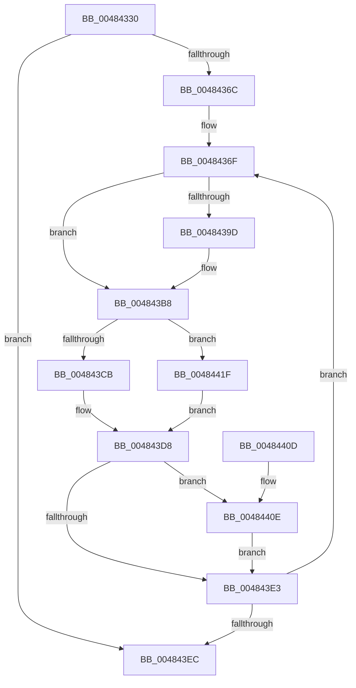

# MiKernelShadowStackIdealForCaching

- RVA: `0x00484330`–`0x00484432` (길이 `258` bytes)
- VA: `0x0000000140484330`
- 실행 섹션: `.text`
- PDB 이름 있음: `예`; PDB Function 태그: `아니요`
- unwind 정보 RVA: `0x000AF1B4`
- 디코드: `72`개 명령, `258/258` bytes 표시
- 미해석 바이트: `0` (있으면 어셈블리에 `.byte`로 보존)

> 이 문서는 커널 이미지의 기계어와 PDB 기호를 분석해 생성했습니다. 4번과 5번은 함수 원형과 자료형을 바이너리 사용 방식에서 추정한 C 해석이며 원본 소스 복구 결과는 아닙니다.

## 1. Dependencies

- 직접 호출 지점: **4**; 고유 호출 대상: **3**
- 직접 호출자로 확인된 함수: **2**
- RIP 상대 이미지 참조: **1**

### Outgoing calls
- `0x004843BE` → [MiValidateKernelShadowStackPage](../33/MiValidateKernelShadowStackPage_function_00338D98.md) (function, `0x00338D98`)
- `0x004843CB` → [MiPageToNode](../33/MiPageToNode_function_00338CD0.md) (function, `0x00338CD0`)
- `0x00484411` → [MiGetPfnSlabType](../28/MiGetPfnSlabType_function_0028E2D0.md) (function, `0x0028E2D0`)
- `0x0048441F` → [MiPageToNode](../33/MiPageToNode_function_00338CD0.md) (function, `0x00338CD0`)

### Direct callers
- [MmDeleteKernelStack](../33/MmDeleteKernelStack_function_0033A960.md) at `0x0033AF06`
- [MiRemoveNonIdealCachedStacks](../68/MiRemoveNonIdealCachedStacks_function_00686620.md) at `0x00686680`

### Static image references
- `0x004843A1` → RVA `0x00E30088` (`.data`; read)

## 2. Other-region calls and transfers

- 다른 실행 섹션으로 향하는 call: **0**
- 별도 외부 분기/꼬리 이동을 확인하지 못했습니다.

## 3. Assembly (complete function range)

```asm
00484330  48 8B C4                        mov rax, rsp
00484333  48 89 58 08                     mov qword ptr [rax + 8], rbx
00484337  48 89 68 10                     mov qword ptr [rax + 0x10], rbp
0048433B  48 89 70 18                     mov qword ptr [rax + 0x18], rsi
0048433F  48 89 78 20                     mov qword ptr [rax + 0x20], rdi
00484343  41 54                           push r12
00484345  41 56                           push r14
00484347  41 57                           push r15
00484349  48 83 EC 20                     sub rsp, 0x20
0048434D  49 83 20 00                     and qword ptr [r8], 0
00484351  33 DB                           xor ebx, ebx
00484353  41 83 09 FF                     or dword ptr [r9], 0xffffffff
00484357  49 8B F1                        mov rsi, r9
0048435A  4D 8B F8                        mov r15, r8
0048435D  4C 8B E2                        mov r12, rdx
00484360  48 8B F9                        mov rdi, rcx
00484363  48 3B CA                        cmp rcx, rdx
00484366  0F 83 80 00 00 00               jae 0x1404843ec
0048436C  45 33 C9                        xor r9d, r9d
0048436F  4C 8B 37                        mov r14, qword ptr [rdi]
00484372  48 B8 FF FF FF FF FF 00 00 00   movabs rax, 0xffffffffff
0048437C  49 C1 EE 0C                     shr r14, 0xc
00484380  4C 23 F0                        and r14, rax
00484383  4B 8D 2C 76                     lea rbp, [r14 + r14*2]
00484387  48 C1 E5 04                     shl rbp, 4
0048438B  48 B8 00 00 00 00 00 DE FF FF   movabs rax, 0xffffde0000000000
00484395  48 03 E8                        add rbp, rax
00484398  4D 85 C9                        test r9, r9
0048439B  75 1B                           jne 0x1404843b8
0048439D  48 8B 45 28                     mov rax, qword ptr [rbp + 0x28]
004843A1  48 8B 15 E0 BC 9A 00            mov rdx, qword ptr [rip + 0x9abce0]
004843A8  48 C1 E8 2B                     shr rax, 0x2b
004843AC  25 FF 03 00 00                  and eax, 0x3ff
004843B1  4C 8B 04 C2                     mov r8, qword ptr [rdx + rax*8]
004843B5  4D 89 07                        mov qword ptr [r15], r8
004843B8  48 8B D5                        mov rdx, rbp
004843BB  48 8B CF                        mov rcx, rdi
004843BE  E8 D5 49 EB FF                  call 0x140338d98
004843C3  83 3E FF                        cmp dword ptr [rsi], -1
004843C6  49 8B CE                        mov rcx, r14
004843C9  75 54                           jne 0x14048441f
004843CB  E8 00 49 EB FF                  call 0x140338cd0
004843D0  89 06                           mov dword ptr [rsi], eax
004843D2  41 B8 01 00 00 00               mov r8d, 1
004843D8  4D 8B 0F                        mov r9, qword ptr [r15]
004843DB  41 8B 41 04                     mov eax, dword ptr [r9 + 4]
004843DF  A8 08                           test al, 8
004843E1  75 2B                           jne 0x14048440e
004843E3  48 83 C7 08                     add rdi, 8
004843E7  49 3B FC                        cmp rdi, r12
004843EA  72 83                           jb 0x14048436f
004843EC  48 8B 6C 24 48                  mov rbp, qword ptr [rsp + 0x48]
004843F1  8B C3                           mov eax, ebx
004843F3  48 8B 5C 24 40                  mov rbx, qword ptr [rsp + 0x40]
004843F8  48 8B 74 24 50                  mov rsi, qword ptr [rsp + 0x50]
004843FD  48 8B 7C 24 58                  mov rdi, qword ptr [rsp + 0x58]
00484402  48 83 C4 20                     add rsp, 0x20
00484406  41 5F                           pop r15
00484408  41 5E                           pop r14
0048440A  41 5C                           pop r12
0048440C  C3                              ret
0048440D  CC                              int3
0048440E  48 8B CD                        mov rcx, rbp
00484411  E8 BA 9E E0 FF                  call 0x14028e2d0
00484416  83 F8 09                        cmp eax, 9
00484419  41 0F 44 D8                     cmove ebx, r8d
0048441D  EB C4                           jmp 0x1404843e3
0048441F  E8 AC 48 EB FF                  call 0x140338cd0
00484424  39 06                           cmp dword ptr [rsi], eax
00484426  41 B8 01 00 00 00               mov r8d, 1
0048442C  41 0F 45 D8                     cmovne ebx, r8d
00484430  EB A6                           jmp 0x1404843d8
```

## 4. C-style interpretation (structured pseudocode)

```c
__int64 __fastcall MiKernelShadowStackIdealForCaching(__int64 a1, __int64 a2, __int64 a3, __int64 a4)
{
    __int64 result;
    __int64 v_r14;
    __int64 v_rbp;
    __int64 v_rbx;
    __int64 v_rdi;
    __int64 v_rsp;
    unsigned __int64 v_stack_p10;
    unsigned __int64 v_stack_p18;
    unsigned __int64 v_stack_p20;
    unsigned __int64 v_stack_p8;

    *(unsigned __int64 *)(v_rsp + 8) = v_rbx;
    *(unsigned __int64 *)(v_rsp + 16) = v_rbp;
    *(unsigned __int64 *)(v_rsp + 24) = v_rsi;
    *(unsigned __int64 *)(v_rsp + 32) = v_rdi;
    v_rsp = (v_rsp) - (32);
    v_rbx = 0;
    if (a1 >= a2) goto loc_004843EC;
    a4 = 0;
loc_0048436F:
    v_r14 = (*(unsigned __int64 *)(a1)) >> (12);
    v_r14 = (v_r14) & (v_rsp);
    v_rbp = (v_r14 + v_r14 * 2) << (4);
    v_rbp = (v_rbp) + (v_rsp);
    result = v_rsp;
    if (0 == 0) {
        result = *(unsigned __int64 *)(v_rbp + 40);
        a2 = *(unsigned __int64 *)(v_rip + 10140896);
        result = (result) >> (43);
        result = (unsigned int)((result) & (0x3FFULL));
        a3 = *(unsigned __int64 *)(a2 + result * 8);
        *(unsigned __int64 *)(a3) = a3;
    }
    result = MiValidateKernelShadowStackPage(a1, v_rbp, a3, a4);
    if ((*(unsigned int *)(a4)) != -1) goto loc_0048441F;
    result = MiPageToNode(v_r14, v_rbp, a3, a4);
    *(unsigned int *)(a4) = (unsigned int)(result);
loc_004843D8:
    if ((((unsigned __int8)((unsigned int)(*(unsigned int *)(*(unsigned __int64 *)(a3) + 4)))) & (8)) != 0) goto loc_0048440E;
loc_004843E3:
    v_rdi = (a1) + (8);
    if (v_rdi < a2) goto loc_0048436F;
loc_004843EC:
    v_rsp = (v_rsp) + (32);
    return 0;
loc_0048440E:
    result = MiGetPfnSlabType(v_stack_p10, v_rbp, 1, *(unsigned __int64 *)(a3));
    v_rbx = v_stack_p8;
    if (((unsigned int)(result)) == 9) { v_rbx = 1; }
    goto loc_004843E3;
loc_0048441F:
    result = MiPageToNode(v_stack_p10, v_rbp, 1, *(unsigned __int64 *)(a3));
    if ((*(unsigned int *)(v_stack_p18)) != ((unsigned int)(result))) { v_rbx = 1; }
    goto loc_004843D8;
}
```

## 5. (Beta) C Style

```c
int64_t MiKernelShadowStackIdealForCaching(int64_t Arg1, int64_t Arg2, void *Arg3, void *Arg4)
{
    uint8_t *arg3 = (uint8_t *)Arg3;
    uint8_t *arg4 = (uint8_t *)Arg4;

    int64_t result;
    int64_t local_r14;
    int64_t local_rbp;
    int64_t local_rbx;
    int64_t local_rdi;
    int64_t local_rsp;
    uint64_t v_stack_p10;
    uint64_t v_stack_p18;
    uint64_t v_stack_p20;
    uint64_t v_stack_p8;

    *(uint64_t *)(local_rsp + 0x8) = local_rbx;
    *(uint64_t *)(local_rsp + 0x10) = local_rbp;
    *(uint64_t *)(local_rsp + 0x18) = local_rsi;
    *(uint64_t *)(local_rsp + 0x20) = local_rdi;
    local_rsp = (local_rsp) - (32);
    local_rbx = 0;
    if (Arg1 >= Arg2) goto loc_004843EC;
    Arg4 = 0;
loc_0048436F:
    local_r14 = (*(uint64_t *)(Arg1)) >> (12);
    local_r14 = (local_r14) & (local_rsp);
    local_rbp = (local_r14 + local_r14 * 2) << (4);
    local_rbp = (local_rbp) + (local_rsp);
    result = local_rsp;
    if (0 == 0) {
        result = *(uint64_t *)(local_rbp + 0x28);
        Arg2 = *(uint64_t *)(v_rip + 0x9ABCE0);
        result = (result) >> (43);
        result = (uint32_t)((result) & (0x3FFULL));
        Arg3 = *(uint64_t *)(Arg2 + result * 8);
        *(void **)(arg3) = Arg3;
    }
    result = MiValidateKernelShadowStackPage(Arg1, local_rbp, Arg3, Arg4);
    if ((*(uint32_t *)(arg4)) != -1) goto loc_0048441F;
    result = MiPageToNode(local_r14, local_rbp, Arg3, Arg4);
    *(uint32_t *)(arg4) = (uint32_t)(result);
loc_004843D8:
    if ((((uint8_t)((uint32_t)(*(uint32_t *)(*(uint64_t *)(arg3) + 0x4)))) & (8)) != 0) goto loc_0048440E;
loc_004843E3:
    local_rdi = (Arg1) + (8);
    if (local_rdi < Arg2) goto loc_0048436F;
loc_004843EC:
    local_rsp = (local_rsp) + (32);
    return 0;
loc_0048440E:
    result = MiGetPfnSlabType(v_stack_p10, local_rbp, 1, *(uint64_t *)(arg3));
    local_rbx = v_stack_p8;
    if (((uint32_t)(result)) == 9) { local_rbx = 1; }
    goto loc_004843E3;
loc_0048441F:
    result = MiPageToNode(v_stack_p10, local_rbp, 1, *(uint64_t *)(arg3));
    if ((*(uint32_t *)(v_stack_p18)) != ((uint32_t)(result))) { local_rbx = 1; }
    goto loc_004843D8;
}
```

### 관측된 메모리 오프셋

구조체 형식이 확인되지 않은 접근은 인자 기준의 오프셋으로만 기록했습니다.

| 기준 인자 | 오프셋 표현 | 폭 (bit) | 접근 |
|---|---:|---:|---|
| `Arg3` | `+ 0x0` | `64` | `R` |
| `Arg3` | `+ 0x0` | `64` | `R/W` |
| `Arg3` | `+ 0x0` | `64` | `W` |
| `Arg4` | `+ 0x0` | `32` | `R` |
| `Arg4` | `+ 0x0` | `32` | `R/W` |
| `Arg4` | `+ 0x0` | `32` | `W` |

## 6. Execution-region graph

[열기: 2D/3D 그래프와 함수 탐색 컨트롤 패널](../../../control-panel.html?section=text&rva=0x00484330&view=graph)

- 2D 그래프는 위에서 아래로 흐르고, 3D 그래프는 빈 공간을 드래그해 회전합니다. Shift+드래그는 이동, 휠은 확대·축소, 함수 노드 선택은 대상 보고서 이동입니다.

### Static fallback


