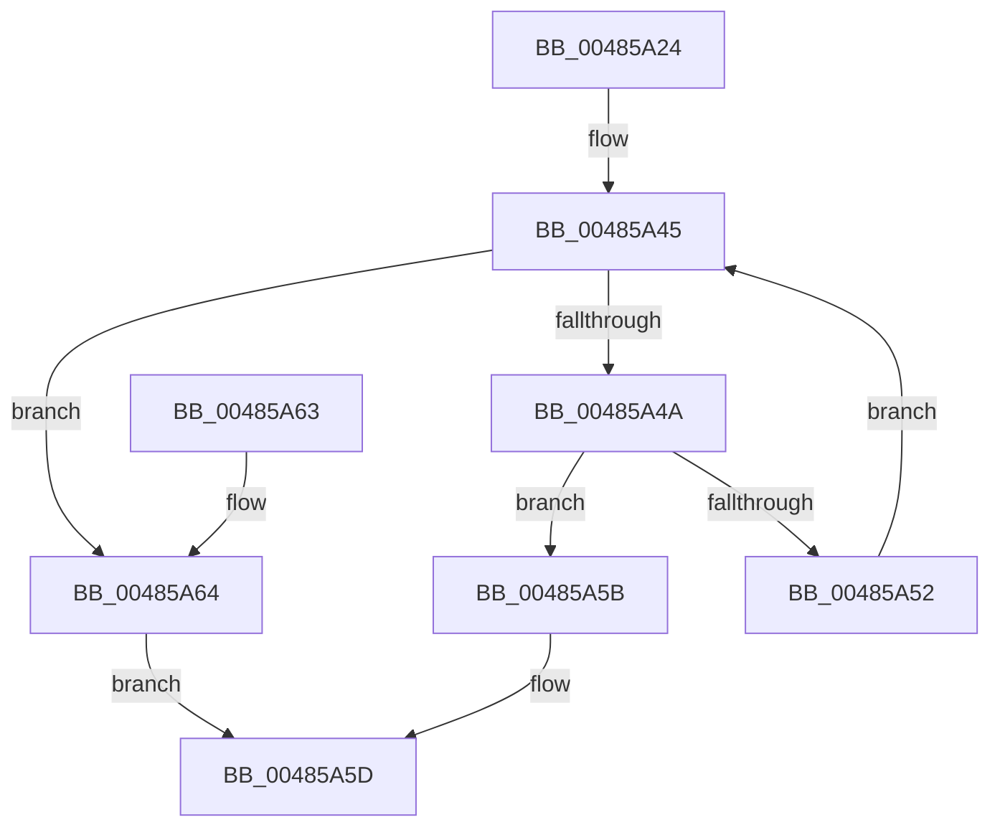

# MiLargePageHasNoDanglingReferences

- RVA: `0x00485A24`–`0x00485A6B` (길이 `71` bytes)
- VA: `0x0000000140485A24`
- 실행 섹션: `.text`
- PDB 이름 있음: `예`; PDB Function 태그: `아니요`
- unwind 정보 RVA: `0x0005DAC8`
- 디코드: `24`개 명령, `71/71` bytes 표시
- 미해석 바이트: `0` (있으면 어셈블리에 `.byte`로 보존)

> 이 문서는 커널 이미지의 기계어와 PDB 기호를 분석해 생성했습니다. 4번과 5번은 함수 원형과 자료형을 바이너리 사용 방식에서 추정한 C 해석이며 원본 소스 복구 결과는 아닙니다.

## 1. Dependencies

- 직접 호출 지점: **1**; 고유 호출 대상: **1**
- 직접 호출자로 확인된 함수: **2**
- RIP 상대 이미지 참조: **1**

### Outgoing calls
- `0x00485A2D` → [MiGetPfnPageSizeIndex](../31/MiGetPfnPageSizeIndex_function_0031C710.md) (function, `0x0031C710`)

### Direct callers
- [MiFreeLargePages](../2A/MiFreeLargePages_function_002A99D0.md) at `0x002A9C7D`
- [MiReadyLargePageToFree](../37/MiReadyLargePageToFree_function_00377A68.md) at `0x00377AAF`

### Static image references
- `0x00485A34` → RVA `0x00011C60` (`.rdata`; read)

## 2. Other-region calls and transfers

- 다른 실행 섹션으로 향하는 call: **0**
- 별도 외부 분기/꼬리 이동을 확인하지 못했습니다.

## 3. Assembly (complete function range)

```asm
00485A24  40 53                           push rbx
00485A26  48 83 EC 20                     sub rsp, 0x20
00485A2A  48 8B D9                        mov rbx, rcx
00485A2D  E8 DE 6C E9 FF                  call 0x14031c710
00485A32  8B D0                           mov edx, eax
00485A34  4C 8D 05 25 C2 B8 FF            lea r8, [rip - 0x473ddb]
00485A3B  33 C9                           xor ecx, ecx
00485A3D  48 83 C3 20                     add rbx, 0x20
00485A41  4D 8B 04 D0                     mov r8, qword ptr [r8 + rdx*8]
00485A45  49 3B C8                        cmp rcx, r8
00485A48  73 1A                           jae 0x140485a64
00485A4A  8B 03                           mov eax, dword ptr [rbx]
00485A4C  66 83 F8 02                     cmp ax, 2
00485A50  75 09                           jne 0x140485a5b
00485A52  48 83 C3 30                     add rbx, 0x30
00485A56  48 FF C1                        inc rcx
00485A59  EB EA                           jmp 0x140485a45
00485A5B  33 C0                           xor eax, eax
00485A5D  48 83 C4 20                     add rsp, 0x20
00485A61  5B                              pop rbx
00485A62  C3                              ret
00485A63  CC                              int3
00485A64  B8 01 00 00 00                  mov eax, 1
00485A69  EB F2                           jmp 0x140485a5d
```

## 4. C-style interpretation (structured pseudocode)

```c
__int64 __fastcall MiLargePageHasNoDanglingReferences(__int64 a1)
{
    __int64 result;
    __int64 v_rbx;
    __int64 v_rsp;

    v_rsp = (v_rsp) - (32);
    result = MiGetPfnPageSizeIndex(a1, a2, a3, a4);
    a1 = 0;
    v_rbx = (a1) + (32);
loc_00485A45:
    if (0 >= (*(unsigned __int64 *)(v_rip - 4668891 + (unsigned int)((unsigned int)(result)) * 8))) goto loc_00485A64;
    if (((unsigned __int16)((unsigned int)(*(unsigned int *)(v_rbx)))) != 2) goto loc_00485A5B;
    v_rbx = (v_rbx) + (48);
    a1 = (a1) + 1;
    goto loc_00485A45;
loc_00485A5B:
    result = 0;
loc_00485A5D:
    v_rsp = (v_rsp) + (32);
    return result;
loc_00485A64:
    goto loc_00485A5D;
}
```

## 5. (Beta) C Style

```c
int64_t MiLargePageHasNoDanglingReferences(void *Arg1)
{
    uint8_t *arg1 = (uint8_t *)Arg1;

    int64_t result;
    int64_t local_rbx;
    int64_t local_rsp;

    local_rsp = (local_rsp) - (32);
    result = MiGetPfnPageSizeIndex(Arg1, a2, a3, a4);
    Arg1 = 0;
    local_rbx = (Arg1) + (32);
loc_00485A45:
    if (0 >= (*(uint64_t *)(v_rip - 0x473DDB + (uint32_t)((uint32_t)(result)) * 8))) goto loc_00485A64;
    if (((uint16_t)((uint32_t)(*(uint32_t *)(local_rbx)))) != 2) goto loc_00485A5B;
    local_rbx = (local_rbx) + (48);
    Arg1 = (Arg1) + 1;
    goto loc_00485A45;
loc_00485A5B:
    result = 0;
loc_00485A5D:
    local_rsp = (local_rsp) + (32);
    return result;
loc_00485A64:
    goto loc_00485A5D;
}
```

### 관측된 메모리 오프셋

구조체 형식이 확인되지 않은 접근은 인자 기준의 오프셋으로만 기록했습니다.

| 기준 인자 | 오프셋 표현 | 폭 (bit) | 접근 |
|---|---:|---:|---|
| `Arg1` | `+ 0x0` | `32` | `R` |

## 6. Execution-region graph

[열기: 2D/3D 그래프와 함수 탐색 컨트롤 패널](../../../control-panel.html?section=text&rva=0x00485A24&view=graph)

- 2D 그래프는 위에서 아래로 흐르고, 3D 그래프는 빈 공간을 드래그해 회전합니다. Shift+드래그는 이동, 휠은 확대·축소, 함수 노드 선택은 대상 보고서 이동입니다.

### Static fallback


