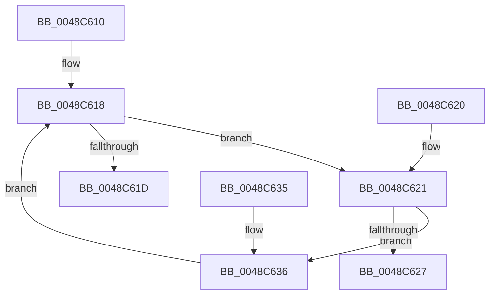

# MiLocateExclusiveSecure

- RVA: `0x0048C610`–`0x0048C63B` (길이 `43` bytes)
- VA: `0x000000014048C610`
- 실행 섹션: `.text`
- PDB 이름 있음: `예`; PDB Function 태그: `아니요`
- unwind 정보 RVA: `0x000DB714`
- 디코드: `18`개 명령, `43/43` bytes 표시
- 미해석 바이트: `0` (있으면 어셈블리에 `.byte`로 보존)

> 이 문서는 커널 이미지의 기계어와 PDB 기호를 분석해 생성했습니다. 4번과 5번은 함수 원형과 자료형을 바이너리 사용 방식에서 추정한 C 해석이며 원본 소스 복구 결과는 아닙니다.

## 1. Dependencies

- 직접 호출 지점: **0**; 고유 호출 대상: **0**
- 직접 호출자로 확인된 함수: **3**
- RIP 상대 이미지 참조: **0**

### Outgoing calls
- 직접 디코드된 call 명령이 없습니다.

### Direct callers
- [sub_00885634](../../page/88/Unknown_function_00885634.md) at `0x00885637`
- [MiAddSecureEntry](../../page/98/MiAddSecureEntry_function_00980250.md) at `0x00980379`
- [MiSecureVad](../../page/9F/MiSecureVad_function_009F5788.md) at `0x009F58EE`

### Static image references
- 디코드된 RIP-relative 메모리 참조가 없습니다.

## 2. Other-region calls and transfers

- 다른 실행 섹션으로 향하는 call: **0**
- 별도 외부 분기/꼬리 이동을 확인하지 못했습니다.

## 3. Assembly (complete function range)

```asm
0048C610  48 8B 51 38                     mov rdx, qword ptr [rcx + 0x38]
0048C614  48 83 E2 F0                     and rdx, 0xfffffffffffffff0
0048C618  48 85 D2                        test rdx, rdx
0048C61B  75 04                           jne 0x14048c621
0048C61D  33 C0                           xor eax, eax
0048C61F  C3                              ret
0048C620  CC                              int3
0048C621  83 7A 50 02                     cmp dword ptr [rdx + 0x50], 2
0048C625  75 0F                           jne 0x14048c636
0048C627  8B 42 08                        mov eax, dword ptr [rdx + 8]
0048C62A  24 20                           and al, 0x20
0048C62C  F6 D8                           neg al
0048C62E  48 1B C0                        sbb rax, rax
0048C631  48 23 C2                        and rax, rdx
0048C634  C3                              ret
0048C635  CC                              int3
0048C636  48 8B 12                        mov rdx, qword ptr [rdx]
0048C639  EB DD                           jmp 0x14048c618
```

## 4. C-style interpretation (structured pseudocode)

```c
__int64 __fastcall MiLocateExclusiveSecure(__int64 a1)
{
    __int64 result;

    a2 = (*(unsigned __int64 *)(a1 + 56)) & (-16);
loc_0048C618:
    if (a2 != 0) goto loc_0048C621;
    result = 0;
    return result;
loc_0048C621:
    if ((*(unsigned int *)(a2 + 80)) != 2) goto loc_0048C636;
    result = (unsigned __int8)(((unsigned int)(*(unsigned int *)(a2 + 8))) & (32));
    result = (unsigned __int8)(-(result));
    result = (result) & (a2);
    return result;
loc_0048C636:
    goto loc_0048C618;
}
```

## 5. (Beta) C Style

```c
int64_t MiLocateExclusiveSecure(void *Arg1)
{
    uint8_t *arg1 = (uint8_t *)Arg1;

    int64_t result;

    a2 = (*(uint64_t *)(arg1 + 0x38)) & (-16);
loc_0048C618:
    if (a2 != 0) goto loc_0048C621;
    result = 0;
    return result;
loc_0048C621:
    if ((*(uint32_t *)(a2 + 0x50)) != 2) goto loc_0048C636;
    result = (uint8_t)(((uint32_t)(*(uint32_t *)(a2 + 0x8))) & (32));
    result = (uint8_t)(-(result));
    result = (result) & (a2);
    return result;
loc_0048C636:
    goto loc_0048C618;
}
```

### 관측된 메모리 오프셋

구조체 형식이 확인되지 않은 접근은 인자 기준의 오프셋으로만 기록했습니다.

| 기준 인자 | 오프셋 표현 | 폭 (bit) | 접근 |
|---|---:|---:|---|
| `Arg1` | `+ 0x38` | `64` | `R` |

## 6. Execution-region graph

[열기: 2D/3D 그래프와 함수 탐색 컨트롤 패널](../../../control-panel.html?section=text&rva=0x0048C610&view=graph)

- 2D 그래프는 위에서 아래로 흐르고, 3D 그래프는 빈 공간을 드래그해 회전합니다. Shift+드래그는 이동, 휠은 확대·축소, 함수 노드 선택은 대상 보고서 이동입니다.

### Static fallback


