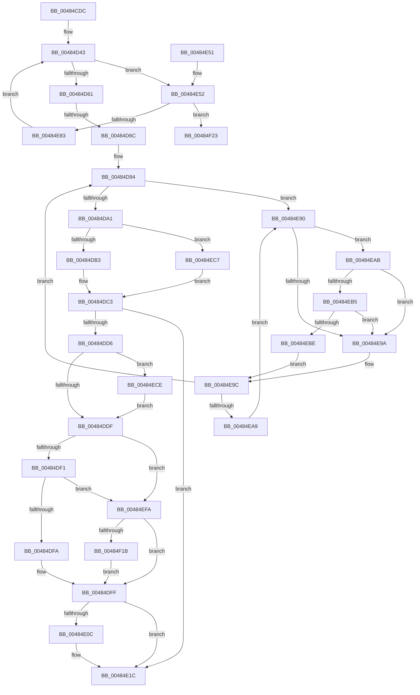

# MiLockPagedAddress

- RVA: `0x00484CDC`–`0x00484F45` (길이 `617` bytes)
- VA: `0x0000000140484CDC`
- 실행 섹션: `.text`
- PDB 이름 있음: `예`; PDB Function 태그: `예`
- unwind 정보 RVA: `0x000AF3A8`
- 디코드: `159`개 명령, `617/617` bytes 표시
- 미해석 바이트: `0` (있으면 어셈블리에 `.byte`로 보존)

> 이 문서는 커널 이미지의 기계어와 PDB 기호를 분석해 생성했습니다. 4번과 5번은 함수 원형과 자료형을 바이너리 사용 방식에서 추정한 C 해석이며 원본 소스 복구 결과는 아닙니다.

## 1. Dependencies

- 직접 호출 지점: **17**; 고유 호출 대상: **14**
- 직접 호출자로 확인된 함수: **1**
- RIP 상대 이미지 참조: **5**

### Outgoing calls
- `0x00484D3B` → [MiLockWorkingSetShared](../27/MiLockWorkingSetShared_function_0027CBF0.md) (function, `0x0027CBF0`)
- `0x00484D51` → [MiMakeSystemAddressValid](../27/MiMakeSystemAddressValid_function_0027FF70.md) (function, `0x0027FF70`)
- `0x00484DA6` → [MiAddLockedPageCharge](../28/MiAddLockedPageCharge_function_0028B550.md) (function, `0x0028B550`)
- `0x00484DBB` → [MiCaptureDirtyBitToPfn](../37/MiCaptureDirtyBitToPfn_function_00370DD0.md) (function, `0x00370DD0`)
- `0x00484E17` → [MiFlushSingleTbEntry](../28/MiFlushSingleTbEntry_function_0028E730.md) (function, `0x0028E730`)
- `0x00484E22` → [MiUnlockPageTable](../21/MiUnlockPageTable_function_00216EC0.md) (function, `0x00216EC0`)
- `0x00484E2D` → [MiUnlockWorkingSetShared](../27/MiUnlockWorkingSetShared_function_0027D690.md) (function, `0x0027D690`)
- `0x00484E58` → [MiUnlockPageTable](../21/MiUnlockPageTable_function_00216EC0.md) (function, `0x00216EC0`)
- `0x00484E63` → [MiUnlockWorkingSetShared](../27/MiUnlockWorkingSetShared_function_0027D690.md) (function, `0x0027D690`)
- `0x00484E73` → [MmAccessFault](../27/MmAccessFault_function_0027EE80.md) (function, `0x0027EE80`)
- `0x00484E86` → [MiLockWorkingSetShared](../27/MiLockWorkingSetShared_function_0027CBF0.md) (function, `0x0027CBF0`)
- `0x00484EB5` → [KiCheckVpBackingLongSpinWaitHypercall](../30/KiCheckVpBackingLongSpinWaitHypercall_function_0030F490.md) (function, `0x0030F490`)
- `0x00484EC0` → [HvlNotifyLongSpinWait](../30/HvlNotifyLongSpinWait_function_0030F460.md) (function, `0x0030F460`)
- `0x00484EF0` → [MiReleasePageFileInfo](../28/MiReleasePageFileInfo_function_00283FD0.md) (function, `0x00283FD0`)
- `0x00484F04` → [MiWriteValidPteVolatile](../29/MiWriteValidPteVolatile_function_00292B60.md) (function, `0x00292B60`)
- `0x00484F28` → [MiFlushAllFilesystemPages](../4E/MiFlushAllFilesystemPages_function_004E141C.md) (function, `0x004E141C`)
- `0x00484F3F` → [KeBugCheckEx](../4F/KeBugCheckEx_function_004FD660.md) (function, `0x004FD660`)

### Direct callers
- [MiLockPagedRange](../../page/A6/MiLockPagedRange_function_00A6C8C0.md) at `0x00A6C8E0`

### Static image references
- `0x00484D2E` → RVA `0x00E380C0` (`.data`; read)
- `0x00484DFF` → RVA `0x00FC6A88` (`ALMOSTRO`; read)
- `0x00484E92` → RVA `0x00FC52AC` (`ALMOSTRO`; reference)
- `0x00484EAB` → RVA `0x00FC6AB8` (`ALMOSTRO`; read)
- `0x00484ED8` → RVA `0x00E30088` (`.data`; read)

## 2. Other-region calls and transfers

- 다른 실행 섹션으로 향하는 call: **0**
- call이 아닌 외부 분기/꼬리 이동: **1**
  - `0x00484D66` → [sub_006F541A](../6F/Unknown_function_006F541A.md) (`tail-transfer`)

## 3. Assembly (complete function range)

```asm
00484CDC  48 89 5C 24 08                  mov qword ptr [rsp + 8], rbx
00484CE1  48 89 6C 24 10                  mov qword ptr [rsp + 0x10], rbp
00484CE6  48 89 74 24 18                  mov qword ptr [rsp + 0x18], rsi
00484CEB  57                              push rdi
00484CEC  41 54                           push r12
00484CEE  41 55                           push r13
00484CF0  41 56                           push r14
00484CF2  41 57                           push r15
00484CF4  48 83 EC 30                     sub rsp, 0x30
00484CF8  4C 8B F1                        mov r14, rcx
00484CFB  48 BE 00 00 00 00 80 F6 FF FF   movabs rsi, 0xfffff68000000000
00484D05  4C 8B E1                        mov r12, rcx
00484D08  49 C1 EE 09                     shr r14, 9
00484D0C  48 B9 F8 FF FF FF 7F 00 00 00   movabs rcx, 0x7ffffffff8
00484D16  4C 23 F1                        and r14, rcx
00484D19  48 8B C6                        mov rax, rsi
00484D1C  4C 03 F0                        add r14, rax
00484D1F  33 DB                           xor ebx, ebx
00484D21  49 8B EE                        mov rbp, r14
00484D24  48 C1 ED 09                     shr rbp, 9
00484D28  48 23 E9                        and rbp, rcx
00484D2B  48 8B C6                        mov rax, rsi
00484D2E  4C 8D 2D 8B 33 9B 00            lea r13, [rip + 0x9b338b]
00484D35  48 03 E8                        add rbp, rax
00484D38  49 8B CD                        mov rcx, r13
00484D3B  E8 B0 7E DF FF                  call 0x14027cbf0
00484D40  44 8A F8                        mov r15b, al
00484D43  41 B9 04 00 00 00               mov r9d, 4
00484D49  45 8A C7                        mov r8b, r15b
00484D4C  33 D2                           xor edx, edx
00484D4E  49 8B CE                        mov rcx, r14
00484D51  E8 1A B2 DF FF                  call 0x14027ff70
00484D56  49 8B 06                        mov rax, qword ptr [r14]
00484D59  A8 01                           test al, 1
00484D5B  0F 84 F1 00 00 00               je 0x140484e52
00484D61  48 0F BA E0 09                  bt rax, 9
00484D66  0F 82 AE 06 27 00               jb 0x1406f541a
00484D6C  48 C1 E8 0C                     shr rax, 0xc
00484D70  48 B9 FF FF FF FF FF 00 00 00   movabs rcx, 0xffffffffff
00484D7A  48 23 C1                        and rax, rcx
00484D7D  48 8D 3C 40                     lea rdi, [rax + rax*2]
00484D81  48 C1 E7 04                     shl rdi, 4
00484D85  48 B8 00 00 00 00 00 DE FF FF   movabs rax, 0xffffde0000000000
00484D8F  48 03 F8                        add rdi, rax
00484D92  33 F6                           xor esi, esi
00484D94  F0 48 0F BA 6F 18 3F            lock bts qword ptr [rdi + 0x18], 0x3f
00484D9B  0F 82 EF 00 00 00               jb 0x140484e90
00484DA1  33 D2                           xor edx, edx
00484DA3  48 8B CF                        mov rcx, rdi
00484DA6  E8 A5 67 E0 FF                  call 0x14028b550
00484DAB  85 C0                           test eax, eax
00484DAD  0F 84 14 01 00 00               je 0x140484ec7
00484DB3  48 8B CF                        mov rcx, rdi
00484DB6  BE 01 00 00 00                  mov esi, 1
00484DBB  E8 10 C0 EE FF                  call 0x140370dd0
00484DC0  48 8B D8                        mov rbx, rax
00484DC3  48 B8 FF FF FF FF FF FF FF 7F   movabs rax, 0x7fffffffffffffff
00484DCD  F0 48 21 47 18                  lock and qword ptr [rdi + 0x18], rax
00484DD2  85 F6                           test esi, esi
00484DD4  74 46                           je 0x140484e1c
00484DD6  48 85 DB                        test rbx, rbx
00484DD9  0F 85 EF 00 00 00               jne 0x140484ece
00484DDF  49 8B 1E                        mov rbx, qword ptr [r14]
00484DE2  48 8B FB                        mov rdi, rbx
00484DE5  83 E7 42                        and edi, 0x42
00484DE8  F6 C3 20                        test bl, 0x20
00484DEB  0F 84 09 01 00 00               je 0x140484efa
00484DF1  48 85 FF                        test rdi, rdi
00484DF4  0F 84 00 01 00 00               je 0x140484efa
00484DFA  BB 80 00 00 00                  mov ebx, 0x80
00484DFF  48 F7 05 7E 1C B4 00 00 01 00 00  test qword ptr [rip + 0xb41c7e], 0x100
00484E0A  75 10                           jne 0x140484e1c
00484E0C  44 8B C3                        mov r8d, ebx
00484E0F  BA 02 00 00 00                  mov edx, 2
00484E14  49 8B CC                        mov rcx, r12
00484E17  E8 14 99 E0 FF                  call 0x14028e730
00484E1C  48 8B D5                        mov rdx, rbp
00484E1F  49 8B CD                        mov rcx, r13
00484E22  E8 99 20 D9 FF                  call 0x140216ec0
00484E27  41 8A D7                        mov dl, r15b
00484E2A  49 8B CD                        mov rcx, r13
00484E2D  E8 5E 88 DF FF                  call 0x14027d690
00484E32  48 8B 5C 24 60                  mov rbx, qword ptr [rsp + 0x60]
00484E37  8B C6                           mov eax, esi
00484E39  48 8B 74 24 70                  mov rsi, qword ptr [rsp + 0x70]
00484E3E  48 8B 6C 24 68                  mov rbp, qword ptr [rsp + 0x68]
00484E43  48 83 C4 30                     add rsp, 0x30
00484E47  41 5F                           pop r15
00484E49  41 5E                           pop r14
00484E4B  41 5D                           pop r13
00484E4D  41 5C                           pop r12
00484E4F  5F                              pop rdi
00484E50  C3                              ret
00484E51  CC                              int3
00484E52  48 8B D5                        mov rdx, rbp
00484E55  49 8B CD                        mov rcx, r13
00484E58  E8 63 20 D9 FF                  call 0x140216ec0
00484E5D  41 8A D7                        mov dl, r15b
00484E60  49 8B CD                        mov rcx, r13
00484E63  E8 28 88 DF FF                  call 0x14027d690
00484E68  45 33 C9                        xor r9d, r9d
00484E6B  45 33 C0                        xor r8d, r8d
00484E6E  49 8B D4                        mov rdx, r12
00484E71  33 C9                           xor ecx, ecx
00484E73  E8 08 A0 DF FF                  call 0x14027ee80
00484E78  48 63 F8                        movsxd rdi, eax
00484E7B  85 C0                           test eax, eax
00484E7D  0F 88 A0 00 00 00               js 0x140484f23
00484E83  49 8B CD                        mov rcx, r13
00484E86  E8 65 7D DF FF                  call 0x14027cbf0
00484E8B  E9 B3 FE FF FF                  jmp 0x140484d43
00484E90  FF C6                           inc esi
00484E92  85 35 14 04 B4 00               test dword ptr [rip + 0xb40414], esi
00484E98  74 11                           je 0x140484eab
00484E9A  F3 90                           pause
00484E9C  48 8B 47 18                     mov rax, qword ptr [rdi + 0x18]
00484EA0  48 85 C0                        test rax, rax
00484EA3  0F 89 EB FE FF FF               jns 0x140484d94
00484EA9  EB E5                           jmp 0x140484e90
00484EAB  8B 05 07 1C B4 00               mov eax, dword ptr [rip + 0xb41c07]
00484EB1  A8 40                           test al, 0x40
00484EB3  74 E5                           je 0x140484e9a
00484EB5  E8 D6 A5 E8 FF                  call 0x14030f490
00484EBA  84 C0                           test al, al
00484EBC  74 DC                           je 0x140484e9a
00484EBE  8B CE                           mov ecx, esi
00484EC0  E8 9B A5 E8 FF                  call 0x14030f460
00484EC5  EB D5                           jmp 0x140484e9c
00484EC7  33 F6                           xor esi, esi
00484EC9  E9 F5 FE FF FF                  jmp 0x140484dc3
00484ECE  48 8B 4F 28                     mov rcx, qword ptr [rdi + 0x28]
00484ED2  41 B8 01 00 00 00               mov r8d, 1
00484ED8  48 8B 05 A9 B1 9A 00            mov rax, qword ptr [rip + 0x9ab1a9]
00484EDF  48 8B D3                        mov rdx, rbx
00484EE2  48 C1 E9 2B                     shr rcx, 0x2b
00484EE6  81 E1 FF 03 00 00               and ecx, 0x3ff
00484EEC  48 8B 0C C8                     mov rcx, qword ptr [rax + rcx*8]
00484EF0  E8 DB F0 DF FF                  call 0x140283fd0
00484EF5  E9 E5 FE FF FF                  jmp 0x140484ddf
00484EFA  45 33 C0                        xor r8d, r8d
00484EFD  49 8B CE                        mov rcx, r14
00484F00  41 8D 50 03                     lea edx, [r8 + 3]
00484F04  E8 57 DC E0 FF                  call 0x140292b60
00484F09  48 C1 EB 03                     shr rbx, 3
00484F0D  F7 D3                           not ebx
00484F0F  83 E3 04                        and ebx, 4
00484F12  48 85 FF                        test rdi, rdi
00484F15  0F 85 E4 FE FF FF               jne 0x140484dff
00484F1B  83 CB 10                        or ebx, 0x10
00484F1E  E9 DC FE FF FF                  jmp 0x140484dff
00484F23  B9 01 00 00 00                  mov ecx, 1
00484F28  E8 EF C4 05 00                  call 0x1404e141c
00484F2D  45 33 C9                        xor r9d, r9d
00484F30  4C 89 64 24 20                  mov qword ptr [rsp + 0x20], r12
00484F35  4C 8B C7                        mov r8, rdi
00484F38  41 8D 51 02                     lea edx, [r9 + 2]
00484F3C  8D 4A 78                        lea ecx, [rdx + 0x78]
00484F3F  E8 1C 87 07 00                  call 0x1404fd660
00484F44  CC                              int3
```

## 4. C-style interpretation (structured pseudocode)

```c
__int64 __fastcall MiLockPagedAddress(__int64 a1, int a2)
{
    __int64 result;
    __int64 v_r14;
    __int64 v_rbp;
    __int64 v_rbx;
    __int64 v_rdi;
    __int64 v_rsi;
    __int64 v_rsp;
    unsigned __int64 v_stack_p10;
    unsigned __int64 v_stack_p18;
    unsigned __int64 v_stack_p20;
    unsigned __int64 v_stack_p8;

    v_stack_p8 = v_rbx;
    v_stack_p10 = v_rbp;
    v_stack_p18 = v_rsi;
    v_rsp = (v_rsp) - (48);
    v_r14 = (a1) >> (9);
    v_r14 = (v_r14) & (a1);
    v_r14 = (v_r14) + (v_rsi);
    v_rbx = 0;
    v_rbp = (v_r14) >> (9);
    v_rbp = (v_rbp) & (a1);
    v_rbp = (v_rbp) + (v_rsi);
    result = MiLockWorkingSetShared(v_rip + 10171275, a2, a3, a4);
loc_00484D43:
    a2 = 0;
    result = MiMakeSystemAddressValid(v_r14, a2, (unsigned __int8)((unsigned __int8)(result)), 4);
    if ((((unsigned __int8)(*(unsigned __int64 *)(v_r14))) & (1)) == 0) goto loc_00484E52;
    result = (*(unsigned __int64 *)(v_r14)) >> (12);
    result = (result) & (v_r14);
    v_rdi = (result + result * 2) << (4);
    v_rdi = (v_rdi) + (result);
    v_rsi = 0;
loc_00484D94:
    if (condition_is_below) goto loc_00484E90;
    a2 = 0;
    result = MiAddLockedPageCharge(v_rdi, a2, (unsigned __int8)((unsigned __int8)(result)), 4);
    if ((unsigned int)(result) == 0) goto loc_00484EC7;
    result = MiCaptureDirtyBitToPfn(v_rdi, a2, (unsigned __int8)((unsigned __int8)(result)), 4);
loc_00484DC3:
    if (1 == 0) goto loc_00484E1C;
    if (result != 0) goto loc_00484ECE;
loc_00484DDF:
    v_rdi = (unsigned int)((*(unsigned __int64 *)(v_r14)) & (66));
    if ((((unsigned __int8)(*(unsigned __int64 *)(v_r14))) & (32)) == 0) goto loc_00484EFA;
    if (v_rdi == 0) goto loc_00484EFA;
loc_00484DFF:
    if (((*(unsigned __int64 *)(v_rip + 11803774)) & (256)) == 0) {
        a3 = 128;
        a2 = 2;
        a1 = a1;
        result = MiFlushSingleTbEntry(a1, a2, a3, 4);
    }
    result = MiUnlockPageTable(v_rip + 10171275, v_rbp, a3, 4);
    result = MiUnlockWorkingSetShared(v_rip + 10171275, (unsigned __int8)((unsigned __int8)(result)), a3, 4);
    v_rsp = (v_rsp) + (48);
    return 1;
loc_00484E52:
    result = MiUnlockPageTable(v_rip + 10171275, v_stack_p10, a3, 4);
    result = MiUnlockWorkingSetShared(v_rip + 10171275, (unsigned __int8)((unsigned __int8)(result)), a3, 4);
    a4 = 0;
    a3 = 0;
    a1 = 0;
    result = MmAccessFault(a1, a1, a3, a4);
    if (sign_flag) goto loc_00484F23;
    result = MiLockWorkingSetShared(v_rip + 10171275, a1, a3, a4);
    goto loc_00484D43;
loc_00484E90:
    v_rsi = (unsigned int)((v_stack_p18) + 1);
    if (((*(unsigned int *)(v_rip + 11797524)) & ((unsigned int)(v_rsi))) == 0) goto loc_00484EAB;
loc_00484E9A:
loc_00484E9C:
    if (!sign_flag) goto loc_00484D94;
    goto loc_00484E90;
loc_00484EAB:
    if ((((unsigned __int8)((unsigned int)(*(unsigned int *)(v_rip + 11803655)))) & (64)) == 0) goto loc_00484E9A;
    result = KiCheckVpBackingLongSpinWaitHypercall(v_rip + 10171275, a1, a3, a4);
    if ((unsigned __int8)(result) == 0) goto loc_00484E9A;
    result = HvlNotifyLongSpinWait((unsigned int)((unsigned int)(v_rsi)), a1, a3, a4);
    goto loc_00484E9C;
loc_00484EC7:
    v_rsi = 0;
    goto loc_00484DC3;
loc_00484ECE:
    a1 = (*(unsigned __int64 *)((int)((unsigned int)(result)) + 40)) >> (43);
    a1 = (unsigned int)((a1) & (0x3FFULL));
    result = MiReleasePageFileInfo(*(unsigned __int64 *)(*(unsigned __int64 *)(v_rip + 10138025) + a1 * 8), v_stack_p8, 1, a4);
    goto loc_00484DDF;
loc_00484EFA:
    a3 = 0;
    result = MiWriteValidPteVolatile(v_r14, a3 + 3, a3, a4);
    v_rbx = (v_stack_p8) >> (3);
    v_rbx = (unsigned int)(~(v_rbx));
    v_rbx = (unsigned int)((v_rbx) & (4));
    if ((int)((unsigned int)(result)) != 0) goto loc_00484DFF;
    v_rbx = (unsigned int)((v_rbx) | (16));
    goto loc_00484DFF;
loc_00484F23:
    result = MiFlushAllFilesystemPages(1, a3 + 3, a3, a4);
    a4 = 0;
    v_stack_p20 = a1;
    result = KeBugCheckEx(a4 + 2 + 120, a4 + 2, (int)((unsigned int)(result)), a4);
    return result;
}
```

## 5. (Beta) C Style

```c
int64_t MiLockPagedAddress(int64_t Arg1, int32_t Arg2)
{
    int64_t result;
    int64_t local_r14;
    int64_t local_rbp;
    int64_t local_rbx;
    int64_t local_rdi;
    int64_t local_rsi;
    int64_t local_rsp;
    uint64_t v_stack_p10;
    uint64_t v_stack_p18;
    uint64_t v_stack_p20;
    uint64_t v_stack_p8;

    v_stack_p8 = local_rbx;
    v_stack_p10 = local_rbp;
    v_stack_p18 = local_rsi;
    local_rsp = (local_rsp) - (48);
    local_r14 = (Arg1) >> (9);
    local_r14 = (local_r14) & (Arg1);
    local_r14 = (local_r14) + (local_rsi);
    local_rbx = 0;
    local_rbp = (local_r14) >> (9);
    local_rbp = (local_rbp) & (Arg1);
    local_rbp = (local_rbp) + (local_rsi);
    result = MiLockWorkingSetShared(v_rip + 10171275, Arg2, a3, a4);
loc_00484D43:
    Arg2 = 0;
    result = MiMakeSystemAddressValid(local_r14, Arg2, (uint8_t)((uint8_t)(result)), 4);
    if ((((uint8_t)(*(uint64_t *)(local_r14))) & (1)) == 0) goto loc_00484E52;
    result = (*(uint64_t *)(local_r14)) >> (12);
    result = (result) & (local_r14);
    local_rdi = (result + result * 2) << (4);
    local_rdi = (local_rdi) + (result);
    local_rsi = 0;
loc_00484D94:
    if (condition_is_below) goto loc_00484E90;
    Arg2 = 0;
    result = MiAddLockedPageCharge(local_rdi, Arg2, (uint8_t)((uint8_t)(result)), 4);
    if ((uint32_t)(result) == 0) goto loc_00484EC7;
    result = MiCaptureDirtyBitToPfn(local_rdi, Arg2, (uint8_t)((uint8_t)(result)), 4);
loc_00484DC3:
    if (1 == 0) goto loc_00484E1C;
    if (result != 0) goto loc_00484ECE;
loc_00484DDF:
    local_rdi = (uint32_t)((*(uint64_t *)(local_r14)) & (66));
    if ((((uint8_t)(*(uint64_t *)(local_r14))) & (32)) == 0) goto loc_00484EFA;
    if (local_rdi == 0) goto loc_00484EFA;
loc_00484DFF:
    if (((*(uint64_t *)(v_rip + 0xB41C7E)) & (256)) == 0) {
        a3 = 128;
        Arg2 = 2;
        Arg1 = Arg1;
        result = MiFlushSingleTbEntry(Arg1, Arg2, a3, 4);
    }
    result = MiUnlockPageTable(v_rip + 10171275, local_rbp, a3, 4);
    result = MiUnlockWorkingSetShared(v_rip + 10171275, (uint8_t)((uint8_t)(result)), a3, 4);
    local_rsp = (local_rsp) + (48);
    return 1;
loc_00484E52:
    result = MiUnlockPageTable(v_rip + 10171275, v_stack_p10, a3, 4);
    result = MiUnlockWorkingSetShared(v_rip + 10171275, (uint8_t)((uint8_t)(result)), a3, 4);
    a4 = 0;
    a3 = 0;
    Arg1 = 0;
    result = MmAccessFault(Arg1, Arg1, a3, a4);
    if (sign_flag) goto loc_00484F23;
    result = MiLockWorkingSetShared(v_rip + 10171275, Arg1, a3, a4);
    goto loc_00484D43;
loc_00484E90:
    local_rsi = (uint32_t)((v_stack_p18) + 1);
    if (((*(uint32_t *)(v_rip + 0xB40414)) & ((uint32_t)(local_rsi))) == 0) goto loc_00484EAB;
loc_00484E9A:
loc_00484E9C:
    if (!sign_flag) goto loc_00484D94;
    goto loc_00484E90;
loc_00484EAB:
    if ((((uint8_t)((uint32_t)(*(uint32_t *)(v_rip + 0xB41C07)))) & (64)) == 0) goto loc_00484E9A;
    result = KiCheckVpBackingLongSpinWaitHypercall(v_rip + 10171275, Arg1, a3, a4);
    if ((uint8_t)(result) == 0) goto loc_00484E9A;
    result = HvlNotifyLongSpinWait((uint32_t)((uint32_t)(local_rsi)), Arg1, a3, a4);
    goto loc_00484E9C;
loc_00484EC7:
    local_rsi = 0;
    goto loc_00484DC3;
loc_00484ECE:
    Arg1 = (*(uint64_t *)((int32_t)((uint32_t)(result)) + 0x28)) >> (43);
    Arg1 = (uint32_t)((Arg1) & (0x3FFULL));
    result = MiReleasePageFileInfo(*(uint64_t *)(*(uint64_t *)(v_rip + 0x9AB1A9) + Arg1 * 8), v_stack_p8, 1, a4);
    goto loc_00484DDF;
loc_00484EFA:
    a3 = 0;
    result = MiWriteValidPteVolatile(local_r14, a3 + 3, a3, a4);
    local_rbx = (v_stack_p8) >> (3);
    local_rbx = (uint32_t)(~(local_rbx));
    local_rbx = (uint32_t)((local_rbx) & (4));
    if ((int32_t)((uint32_t)(result)) != 0) goto loc_00484DFF;
    local_rbx = (uint32_t)((local_rbx) | (16));
    goto loc_00484DFF;
loc_00484F23:
    result = MiFlushAllFilesystemPages(1, a3 + 3, a3, a4);
    a4 = 0;
    v_stack_p20 = Arg1;
    result = KeBugCheckEx(a4 + 2 + 120, a4 + 2, (int32_t)((uint32_t)(result)), a4);
    return result;
}
```

## 6. Execution-region graph

[열기: 2D/3D 그래프와 함수 탐색 컨트롤 패널](../../../control-panel.html?section=text&rva=0x00484CDC&view=graph)

- 2D 그래프는 위에서 아래로 흐르고, 3D 그래프는 빈 공간을 드래그해 회전합니다. Shift+드래그는 이동, 휠은 확대·축소, 함수 노드 선택은 대상 보고서 이동입니다.

### Static fallback


