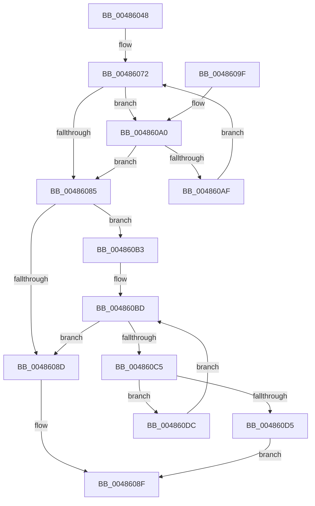

# MiLockedPageTableHasActiveLargeEntries

- RVA: `0x00486048`–`0x004860E4` (길이 `156` bytes)
- VA: `0x0000000140486048`
- 실행 섹션: `.text`
- PDB 이름 있음: `예`; PDB Function 태그: `아니요`
- unwind 정보 RVA: `0x000A8408`
- 디코드: `45`개 명령, `156/156` bytes 표시
- 미해석 바이트: `0` (있으면 어셈블리에 `.byte`로 보존)

> 이 문서는 커널 이미지의 기계어와 PDB 기호를 분석해 생성했습니다. 4번과 5번은 함수 원형과 자료형을 바이너리 사용 방식에서 추정한 C 해석이며 원본 소스 복구 결과는 아닙니다.

## 1. Dependencies

- 직접 호출 지점: **1**; 고유 호출 대상: **1**
- 직접 호출자로 확인된 함수: **1**
- RIP 상대 이미지 참조: **0**

### Outgoing calls
- `0x004860C8` → [MI_READ_PTE_LOCK_FREE](../28/MI_READ_PTE_LOCK_FREE_function_002828A0.md) (function, `0x002828A0`)

### Direct callers
- [MiWsleFlush](../23/MiWsleFlush_function_0023FB30.md) at `0x0023FE4A`

### Static image references
- 디코드된 RIP-relative 메모리 참조가 없습니다.

## 2. Other-region calls and transfers

- 다른 실행 섹션으로 향하는 call: **0**
- 별도 외부 분기/꼬리 이동을 확인하지 못했습니다.

## 3. Assembly (complete function range)

```asm
00486048  48 89 5C 24 08                  mov qword ptr [rsp + 8], rbx
0048604D  48 89 6C 24 10                  mov qword ptr [rsp + 0x10], rbp
00486052  57                              push rdi
00486053  48 83 EC 20                     sub rsp, 0x20
00486057  33 DB                           xor ebx, ebx
00486059  49 B9 00 00 00 00 80 F6 FF FF   movabs r9, 0xfffff68000000000
00486063  48 8B F9                        mov rdi, rcx
00486066  8B CB                           mov ecx, ebx
00486068  4D 8B C1                        mov r8, r9
0048606B  49 C1 E0 19                     shl r8, 0x19
0048606F  48 8B D7                        mov rdx, rdi
00486072  48 C1 E2 19                     shl rdx, 0x19
00486076  49 2B D0                        sub rdx, r8
00486079  48 C1 FA 10                     sar rdx, 0x10
0048607D  49 8B C1                        mov rax, r9
00486080  48 3B D0                        cmp rdx, rax
00486083  73 1B                           jae 0x1404860a0
00486085  8D 41 FF                        lea eax, [rcx - 1]
00486088  83 F8 01                        cmp eax, 1
0048608B  76 26                           jbe 0x1404860b3
0048608D  33 C0                           xor eax, eax
0048608F  48 8B 5C 24 30                  mov rbx, qword ptr [rsp + 0x30]
00486094  48 8B 6C 24 38                  mov rbp, qword ptr [rsp + 0x38]
00486099  48 83 C4 20                     add rsp, 0x20
0048609D  5F                              pop rdi
0048609E  C3                              ret
0048609F  CC                              int3
004860A0  48 B8 FF FF FF FF FF F6 FF FF   movabs rax, 0xfffff6ffffffffff
004860AA  48 3B D0                        cmp rdx, rax
004860AD  77 D6                           ja 0x140486085
004860AF  FF C1                           inc ecx
004860B1  EB BF                           jmp 0x140486072
004860B3  48 BD 81 00 00 00 00 00 00 10   movabs rbp, 0x1000000000000081
004860BD  81 FB 00 02 00 00               cmp ebx, 0x200
004860C3  73 C8                           jae 0x14048608d
004860C5  48 8B CF                        mov rcx, rdi
004860C8  E8 D3 C7 DF FF                  call 0x1402828a0
004860CD  48 23 C5                        and rax, rbp
004860D0  48 3B C5                        cmp rax, rbp
004860D3  75 07                           jne 0x1404860dc
004860D5  B8 01 00 00 00                  mov eax, 1
004860DA  EB B3                           jmp 0x14048608f
004860DC  48 83 C7 08                     add rdi, 8
004860E0  FF C3                           inc ebx
004860E2  EB D9                           jmp 0x1404860bd
```

## 4. C-style interpretation (structured pseudocode)

```c
__int64 __fastcall MiLockedPageTableHasActiveLargeEntries(__int64 a1)
{
    __int64 result;
    __int64 v_rbx;
    __int64 v_rdi;
    __int64 v_rsp;
    unsigned __int64 v_stack_p10;
    unsigned __int64 v_stack_p8;

    v_stack_p8 = v_rbx;
    v_stack_p10 = v_rbp;
    v_rsp = (v_rsp) - (32);
    v_rbx = 0;
    a3 = (a4) << (25);
loc_00486072:
    a2 = (a1) << (25);
    a2 = (a2) - (a3);
    a2 = (a2) >> (16);
    if (a2 >= a4) goto loc_004860A0;
loc_00486085:
    if (((unsigned int)(0 - 1)) <= 1) goto loc_004860B3;
loc_0048608D:
    result = 0;
loc_0048608F:
    v_rsp = (v_rsp) + (32);
    return result;
loc_004860A0:
    if (a2 > 0) goto loc_00486085;
    a1 = (unsigned int)((0) + 1);
    goto loc_00486072;
loc_004860B3:
loc_004860BD:
    if (((unsigned int)(v_stack_p8)) >= 512) goto loc_0048608D;
    result = MI_READ_PTE_LOCK_FREE(a1, a2, a3, a4);
    result = (result) & (v_stack_p10);
    if (result != v_stack_p10) goto loc_004860DC;
    goto loc_0048608F;
loc_004860DC:
    v_rdi = (a1) + (8);
    v_rbx = (unsigned int)((v_stack_p8) + 1);
    goto loc_004860BD;
}
```

## 5. (Beta) C Style

```c
int64_t MiLockedPageTableHasActiveLargeEntries(int64_t Arg1)
{
    int64_t result;
    int64_t local_rbx;
    int64_t local_rdi;
    int64_t local_rsp;
    uint64_t v_stack_p10;
    uint64_t v_stack_p8;

    v_stack_p8 = local_rbx;
    v_stack_p10 = local_rbp;
    local_rsp = (local_rsp) - (32);
    local_rbx = 0;
    a3 = (a4) << (25);
loc_00486072:
    a2 = (Arg1) << (25);
    a2 = (a2) - (a3);
    a2 = (a2) >> (16);
    if (a2 >= a4) goto loc_004860A0;
loc_00486085:
    if (((uint32_t)(0 - 1)) <= 1) goto loc_004860B3;
loc_0048608D:
    result = 0;
loc_0048608F:
    local_rsp = (local_rsp) + (32);
    return result;
loc_004860A0:
    if (a2 > 0) goto loc_00486085;
    Arg1 = (uint32_t)((0) + 1);
    goto loc_00486072;
loc_004860B3:
loc_004860BD:
    if (((uint32_t)(v_stack_p8)) >= 512) goto loc_0048608D;
    result = MI_READ_PTE_LOCK_FREE(Arg1, a2, a3, a4);
    result = (result) & (v_stack_p10);
    if (result != v_stack_p10) goto loc_004860DC;
    goto loc_0048608F;
loc_004860DC:
    local_rdi = (Arg1) + (8);
    local_rbx = (uint32_t)((v_stack_p8) + 1);
    goto loc_004860BD;
}
```

## 6. Execution-region graph

[열기: 2D/3D 그래프와 함수 탐색 컨트롤 패널](../../../control-panel.html?section=text&rva=0x00486048&view=graph)

- 2D 그래프는 위에서 아래로 흐르고, 3D 그래프는 빈 공간을 드래그해 회전합니다. Shift+드래그는 이동, 휠은 확대·축소, 함수 노드 선택은 대상 보고서 이동입니다.

### Static fallback


