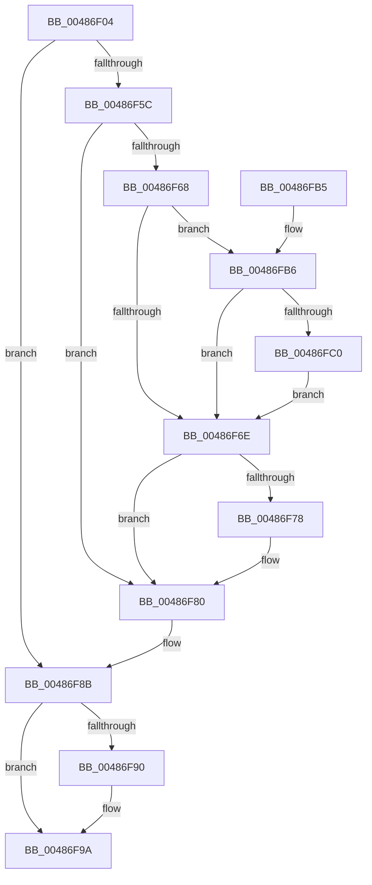

# MiMakePageBad

- RVA: `0x00486F04`–`0x0048700A` (길이 `262` bytes)
- VA: `0x0000000140486F04`
- 실행 섹션: `.text`
- PDB 이름 있음: `예`; PDB Function 태그: `아니요`
- unwind 정보 RVA: `0x000A7D30`
- 디코드: `71`개 명령, `262/262` bytes 표시
- 미해석 바이트: `0` (있으면 어셈블리에 `.byte`로 보존)

> 이 문서는 커널 이미지의 기계어와 PDB 기호를 분석해 생성했습니다. 4번과 5번은 함수 원형과 자료형을 바이너리 사용 방식에서 추정한 C 해석이며 원본 소스 복구 결과는 아닙니다.

## 1. Dependencies

- 직접 호출 지점: **8**; 고유 호출 대상: **8**
- 직접 호출자로 확인된 함수: **2**
- RIP 상대 이미지 참조: **2**

### Outgoing calls
- `0x00486F45` → [MiAllocatePool](../35/MiAllocatePool_function_0035B540.md) (function, `0x0035B540`)
- `0x00486F50` → [MiSafeLockPage](../32/MiSafeLockPage_function_00321620.md) (function, `0x00321620`)
- `0x00486F5F` → [MiIsPageOnBadList](../2B/MiIsPageOnBadList_function_002B1018.md) (function, `0x002B1018`)
- `0x00486F7B` → [MiInsertPageInFreeOrZeroedList](../33/MiInsertPageInFreeOrZeroedList_function_00334D20.md) (function, `0x00334D20`)
- `0x00486F86` → [MiUnlockPage](../31/MiUnlockPage_function_0031A3E0.md) (function, `0x0031A3E0`)
- `0x00486F95` → [ExFreePoolWithTag](../../poolcode/B8/ExFreePoolWithTag_function_00B82870.md) (function, `0x00B82870`)
- `0x00486FE5` → [MiAcquireNonPagedResources](../28/MiAcquireNonPagedResources_function_00286C60.md) (function, `0x00286C60`)
- `0x00486FF7` → [MiSetPfnRemovalRequested](../67/MiSetPfnRemovalRequested_function_0067A4D0.md) (function, `0x0067A4D0`)

### Direct callers
- [MiScrubLargeMappedPage](../69/MiScrubLargeMappedPage_function_00693E2C.md) at `0x00694181`
- [MiScrubNode](../../page/A4/MiScrubNode_function_00A46098.md) at `0x00A4625A`

### Static image references
- `0x00486FCA` → RVA `0x00E30088` (`.data`; read)
- `0x00486FFE` → RVA `0x00E302A4` (`.data`; read/write)

## 2. Other-region calls and transfers

- 다른 실행 섹션으로 향하는 call: **1**
  - `0x00486F95` → [ExFreePoolWithTag](../../poolcode/B8/ExFreePoolWithTag_function_00B82870.md) (`.text` → `POOLCODE`)
- 별도 외부 분기/꼬리 이동을 확인하지 못했습니다.

## 3. Assembly (complete function range)

```asm
00486F04  48 8B C4                        mov rax, rsp
00486F07  48 89 58 08                     mov qword ptr [rax + 8], rbx
00486F0B  48 89 68 10                     mov qword ptr [rax + 0x10], rbp
00486F0F  48 89 70 18                     mov qword ptr [rax + 0x18], rsi
00486F13  48 89 78 20                     mov qword ptr [rax + 0x20], rdi
00486F17  41 56                           push r14
00486F19  48 83 EC 20                     sub rsp, 0x20
00486F1D  48 8D 3C 49                     lea rdi, [rcx + rcx*2]
00486F21  8B EA                           mov ebp, edx
00486F23  48 C1 E7 04                     shl rdi, 4
00486F27  4C 8B F1                        mov r14, rcx
00486F2A  48 B8 00 00 00 00 00 DE FF FF   movabs rax, 0xffffde0000000000
00486F34  BA 20 00 00 00                  mov edx, 0x20
00486F39  41 B8 4D 69 42 6C               mov r8d, 0x6c42694d
00486F3F  48 03 F8                        add rdi, rax
00486F42  8D 4A 20                        lea ecx, [rdx + 0x20]
00486F45  E8 F6 45 ED FF                  call 0x14035b540
00486F4A  49 8B CE                        mov rcx, r14
00486F4D  48 8B D8                        mov rbx, rax
00486F50  E8 CB A6 E9 FF                  call 0x140321620
00486F55  40 8A F0                        mov sil, al
00486F58  3C 11                           cmp al, 0x11
00486F5A  74 2F                           je 0x140486f8b
00486F5C  48 8B CF                        mov rcx, rdi
00486F5F  E8 B4 A0 E2 FF                  call 0x1402b1018
00486F64  85 C0                           test eax, eax
00486F66  75 18                           jne 0x140486f80
00486F68  40 F6 C5 01                     test bpl, 1
00486F6C  75 48                           jne 0x140486fb6
00486F6E  BA 02 00 00 00                  mov edx, 2
00486F73  40 84 EA                        test dl, bpl
00486F76  74 08                           je 0x140486f80
00486F78  49 8B CE                        mov rcx, r14
00486F7B  E8 A0 DD EA FF                  call 0x140334d20
00486F80  40 8A D6                        mov dl, sil
00486F83  48 8B CF                        mov rcx, rdi
00486F86  E8 55 34 E9 FF                  call 0x14031a3e0
00486F8B  48 85 DB                        test rbx, rbx
00486F8E  74 0A                           je 0x140486f9a
00486F90  33 D2                           xor edx, edx
00486F92  48 8B CB                        mov rcx, rbx
00486F95  E8 D6 B8 6F 00                  call 0x140b82870
00486F9A  48 8B 5C 24 30                  mov rbx, qword ptr [rsp + 0x30]
00486F9F  48 8B 6C 24 38                  mov rbp, qword ptr [rsp + 0x38]
00486FA4  48 8B 74 24 40                  mov rsi, qword ptr [rsp + 0x40]
00486FA9  48 8B 7C 24 48                  mov rdi, qword ptr [rsp + 0x48]
00486FAE  48 83 C4 20                     add rsp, 0x20
00486FB2  41 5E                           pop r14
00486FB4  C3                              ret
00486FB5  CC                              int3
00486FB6  8B 47 20                        mov eax, dword ptr [rdi + 0x20]
00486FB9  C1 E8 18                        shr eax, 0x18
00486FBC  A8 40                           test al, 0x40
00486FBE  75 AE                           jne 0x140486f6e
00486FC0  48 8B 4F 28                     mov rcx, qword ptr [rdi + 0x28]
00486FC4  41 B9 01 00 00 00               mov r9d, 1
00486FCA  48 8B 05 B7 90 9A 00            mov rax, qword ptr [rip + 0x9a90b7]
00486FD1  45 33 C0                        xor r8d, r8d
00486FD4  48 C1 E9 2B                     shr rcx, 0x2b
00486FD8  41 8B D1                        mov edx, r9d
00486FDB  81 E1 FF 03 00 00               and ecx, 0x3ff
00486FE1  48 8B 0C C8                     mov rcx, qword ptr [rax + rcx*8]
00486FE5  E8 76 FC DF FF                  call 0x140286c60
00486FEA  45 33 C0                        xor r8d, r8d
00486FED  4C 8B CB                        mov r9, rbx
00486FF0  48 8B CF                        mov rcx, rdi
00486FF3  41 8D 50 01                     lea edx, [r8 + 1]
00486FF7  E8 D4 34 1F 00                  call 0x14067a4d0
00486FFC  33 DB                           xor ebx, ebx
00486FFE  F0 FF 05 9F 92 9A 00            lock inc dword ptr [rip + 0x9a929f]
00487005  E9 64 FF FF FF                  jmp 0x140486f6e
```

## 4. C-style interpretation (structured pseudocode)

```c
__int64 __fastcall MiMakePageBad(__int64 a1, int a2)
{
    __int64 result;
    __int64 v_rbx;
    __int64 v_rdi;
    __int64 v_rsp;
    unsigned __int64 v_stack_p10;
    unsigned __int64 v_stack_p18;
    unsigned __int64 v_stack_p20;
    unsigned __int64 v_stack_p8;

    *(unsigned __int64 *)(v_rsp + 8) = v_rbx;
    *(unsigned __int64 *)(v_rsp + 16) = v_rbp;
    *(unsigned __int64 *)(v_rsp + 24) = v_rsi;
    *(unsigned __int64 *)(v_rsp + 32) = v_rdi;
    v_rsp = (v_rsp) - (32);
    v_rdi = (a1 + a1 * 2) << (4);
    v_rdi = (v_rdi) + (v_rsp);
    result = MiAllocatePool(32 + 32, 32, (unsigned int)(0x6C42694DULL), a4);
    result = MiSafeLockPage(a1, 32, (unsigned int)(0x6C42694DULL), a4);
    if (((unsigned __int8)(result)) == 17) goto loc_00486F8B;
    result = MiIsPageOnBadList(v_rdi, 32, (unsigned int)(0x6C42694DULL), a4);
    if ((unsigned int)(result) != 0) goto loc_00486F80;
    if ((((unsigned __int8)((unsigned int)(a2))) & (1)) != 0) goto loc_00486FB6;
loc_00486F6E:
    if (((2) & ((unsigned __int8)((unsigned int)(a2)))) != 0) {
        a1 = a1;
        result = MiInsertPageInFreeOrZeroedList(a1, 2, (unsigned int)(0x6C42694DULL), a4);
    }
    result = MiUnlockPage(v_rdi, (unsigned __int8)((unsigned __int8)(result)), (unsigned int)(0x6C42694DULL), a4);
loc_00486F8B:
    if (result != 0) {
        a2 = 0;
        a1 = result;
        result = ExFreePoolWithTag(a1, a2, (unsigned int)(0x6C42694DULL), a4);
    }
    v_rsp = (v_rsp) + (32);
    return result;
loc_00486FB6:
    result = (unsigned int)(((unsigned int)(*(unsigned int *)(v_stack_p20 + 32))) >> (24));
    if ((((unsigned __int8)(result)) & (64)) != 0) goto loc_00486F6E;
    a3 = 0;
    a1 = (*(unsigned __int64 *)(v_stack_p20 + 40)) >> (43);
    a1 = (unsigned int)((a1) & (0x3FFULL));
    result = MiAcquireNonPagedResources(*(unsigned __int64 *)(*(unsigned __int64 *)(v_rip + 10129591) + a1 * 8), 1, a3, 1);
    a3 = 0;
    result = MiSetPfnRemovalRequested(v_stack_p20, a3 + 1, a3, v_stack_p8);
    v_rbx = 0;
    goto loc_00486F6E;
}
```

## 5. (Beta) C Style

```c
int64_t MiMakePageBad(void *Arg1, int32_t Arg2)
{
    uint8_t *arg1 = (uint8_t *)Arg1;

    int64_t result;
    int64_t local_rbx;
    int64_t local_rdi;
    int64_t local_rsp;
    uint64_t v_stack_p10;
    uint64_t v_stack_p18;
    uint64_t v_stack_p20;
    uint64_t v_stack_p8;

    *(uint64_t *)(local_rsp + 0x8) = local_rbx;
    *(uint64_t *)(local_rsp + 0x10) = local_rbp;
    *(uint64_t *)(local_rsp + 0x18) = local_rsi;
    *(uint64_t *)(local_rsp + 0x20) = local_rdi;
    local_rsp = (local_rsp) - (32);
    local_rdi = (Arg1 + Arg1 * 2) << (4);
    local_rdi = (local_rdi) + (local_rsp);
    result = MiAllocatePool(32 + 32, 32, (uint32_t)(0x6C42694DULL), a4);
    result = MiSafeLockPage(Arg1, 32, (uint32_t)(0x6C42694DULL), a4);
    if (((uint8_t)(result)) == 17) goto loc_00486F8B;
    result = MiIsPageOnBadList(local_rdi, 32, (uint32_t)(0x6C42694DULL), a4);
    if ((uint32_t)(result) != 0) goto loc_00486F80;
    if ((((uint8_t)((uint32_t)(Arg2))) & (1)) != 0) goto loc_00486FB6;
loc_00486F6E:
    if (((2) & ((uint8_t)((uint32_t)(Arg2)))) != 0) {
        Arg1 = Arg1;
        result = MiInsertPageInFreeOrZeroedList(Arg1, 2, (uint32_t)(0x6C42694DULL), a4);
    }
    result = MiUnlockPage(local_rdi, (uint8_t)((uint8_t)(result)), (uint32_t)(0x6C42694DULL), a4);
loc_00486F8B:
    if (result != 0) {
        Arg2 = 0;
        Arg1 = result;
        result = ExFreePoolWithTag(Arg1, Arg2, (uint32_t)(0x6C42694DULL), a4);
    }
    local_rsp = (local_rsp) + (32);
    return result;
loc_00486FB6:
    result = (uint32_t)(((uint32_t)(*(uint32_t *)(v_stack_p20 + 0x20))) >> (24));
    if ((((uint8_t)(result)) & (64)) != 0) goto loc_00486F6E;
    a3 = 0;
    Arg1 = (*(uint64_t *)(v_stack_p20 + 0x28)) >> (43);
    Arg1 = (uint32_t)((Arg1) & (0x3FFULL));
    result = MiAcquireNonPagedResources(*(uint64_t *)(*(uint64_t *)(v_rip + 0x9A90B7) + arg1 * 8), 1, a3, 1);
    a3 = 0;
    result = MiSetPfnRemovalRequested(v_stack_p20, a3 + 1, a3, v_stack_p8);
    local_rbx = 0;
    goto loc_00486F6E;
}
```

### 관측된 메모리 오프셋

구조체 형식이 확인되지 않은 접근은 인자 기준의 오프셋으로만 기록했습니다.

| 기준 인자 | 오프셋 표현 | 폭 (bit) | 접근 |
|---|---:|---:|---|
| `Arg1` | `+ 0x0 + rcx*2` | `64` | `R` |

## 6. Execution-region graph

[열기: 2D/3D 그래프와 함수 탐색 컨트롤 패널](../../../control-panel.html?section=text&rva=0x00486F04&view=graph)

- 2D 그래프는 위에서 아래로 흐르고, 3D 그래프는 빈 공간을 드래그해 회전합니다. Shift+드래그는 이동, 휠은 확대·축소, 함수 노드 선택은 대상 보고서 이동입니다.

### Static fallback


