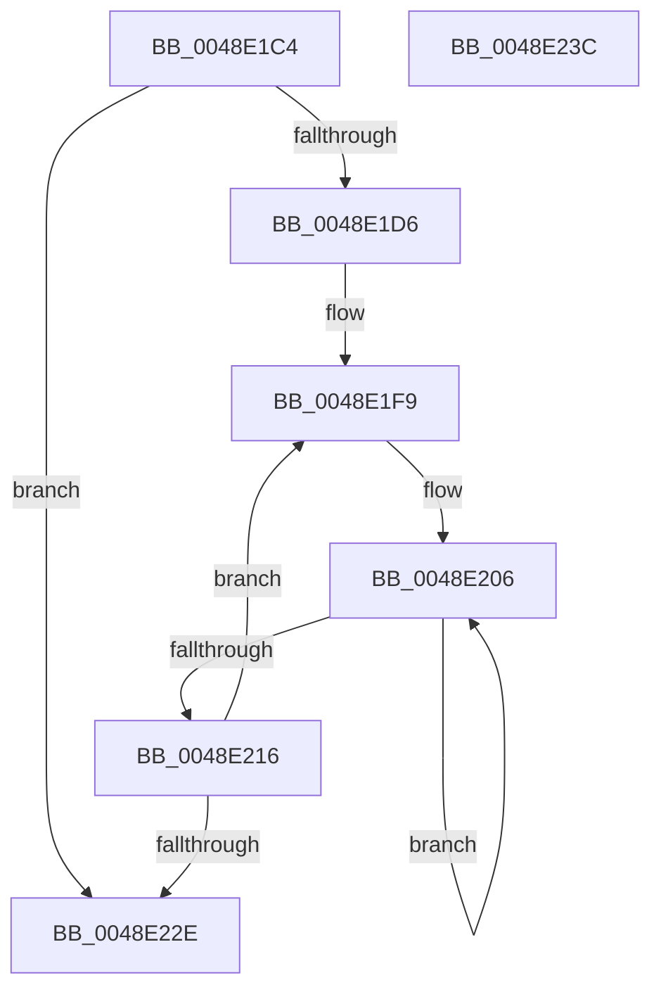

# MiNodeLargeFreeZeroPagesRange

- RVA: `0x0048E1C4`–`0x0048E23D` (길이 `121` bytes)
- VA: `0x000000014048E1C4`
- 실행 섹션: `.text`
- PDB 이름 있음: `예`; PDB Function 태그: `아니요`
- unwind 정보 RVA: `0x000950EC`
- 디코드: `34`개 명령, `121/121` bytes 표시
- 미해석 바이트: `0` (있으면 어셈블리에 `.byte`로 보존)

> 이 문서는 커널 이미지의 기계어와 PDB 기호를 분석해 생성했습니다. 4번과 5번은 함수 원형과 자료형을 바이너리 사용 방식에서 추정한 C 해석이며 원본 소스 복구 결과는 아닙니다.

## 1. Dependencies

- 직접 호출 지점: **0**; 고유 호출 대상: **0**
- 직접 호출자로 확인된 함수: **1**
- RIP 상대 이미지 참조: **1**

### Outgoing calls
- 직접 디코드된 call 명령이 없습니다.

### Direct callers
- [MiRebuildLargePage](../3B/MiRebuildLargePage_function_003BBAEC.md) at `0x003BBF44`

### Static image references
- `0x0048E1D9` → RVA `0x00011C60` (`.rdata`; read)

## 2. Other-region calls and transfers

- 다른 실행 섹션으로 향하는 call: **0**
- 별도 외부 분기/꼬리 이동을 확인하지 못했습니다.

## 3. Assembly (complete function range)

```asm
0048E1C4  48 89 5C 24 08                  mov qword ptr [rsp + 8], rbx
0048E1C9  48 89 7C 24 10                  mov qword ptr [rsp + 0x10], rdi
0048E1CE  33 D2                           xor edx, edx
0048E1D0  41 83 F8 02                     cmp r8d, 2
0048E1D4  77 58                           ja 0x14048e22e
0048E1D6  41 8B C0                        mov eax, r8d
0048E1D9  4C 8D 0D 80 3A B8 FF            lea r9, [rip - 0x47c580]
0048E1E0  8D 7A 03                        lea edi, [rdx + 3]
0048E1E3  4C 8D 1C 80                     lea r11, [rax + rax*4]
0048E1E7  49 C1 E3 08                     shl r11, 8
0048E1EB  4D 8D 14 C1                     lea r10, [r9 + rax*8]
0048E1EF  49 83 C3 08                     add r11, 8
0048E1F3  4C 03 D9                        add r11, rcx
0048E1F6  41 2B F8                        sub edi, r8d
0048E1F9  49 8B 0A                        mov rcx, qword ptr [r10]
0048E1FC  45 33 C0                        xor r8d, r8d
0048E1FF  4D 8B CB                        mov r9, r11
0048E202  41 8D 58 02                     lea ebx, [r8 + 2]
0048E206  49 8B 01                        mov rax, qword ptr [r9]
0048E209  4D 8D 49 08                     lea r9, [r9 + 8]
0048E20D  4C 03 C0                        add r8, rax
0048E210  48 83 EB 01                     sub rbx, 1
0048E214  75 F0                           jne 0x14048e206
0048E216  49 0F AF C8                     imul rcx, r8
0048E21A  49 83 C2 08                     add r10, 8
0048E21E  49 81 C3 00 05 00 00            add r11, 0x500
0048E225  48 03 D1                        add rdx, rcx
0048E228  48 83 EF 01                     sub rdi, 1
0048E22C  75 CB                           jne 0x14048e1f9
0048E22E  48 8B 5C 24 08                  mov rbx, qword ptr [rsp + 8]
0048E233  48 8B C2                        mov rax, rdx
0048E236  48 8B 7C 24 10                  mov rdi, qword ptr [rsp + 0x10]
0048E23B  C3                              ret
0048E23C  CC                              int3
```

## 4. C-style interpretation (structured pseudocode)

```c
__int64 __fastcall MiNodeLargeFreeZeroPagesRange(__int64 a1, int a2, int a3)
{
    __int64 v_r10;
    __int64 v_r11;
    __int64 v_rbx;
    __int64 v_rdi;
    unsigned __int64 v_stack_p10;
    unsigned __int64 v_stack_p8;

    v_stack_p8 = v_rbx;
    v_stack_p10 = v_rdi;
    a2 = 0;
    if (a3 > 2) goto loc_0048E22E;
    v_r11 = ((unsigned int)(a3) + (unsigned int)(a3) * 4) << (8);
    v_r11 = (v_r11) + (8);
    v_r11 = (v_r11) + (a1);
    v_rdi = (unsigned int)((a2 + 3) - (a3));
loc_0048E1F9:
    a3 = 0;
loc_0048E206:
    a3 = (a3) + (*(unsigned __int64 *)(v_r11));
    v_rbx = (a3 + 2) - (1);
    if (condition_is_not_equal) goto loc_0048E206;
    a1 = (*(unsigned __int64 *)(v_rip - 4703616 + (unsigned int)(a3) * 8)) * (a3);
    v_r10 = (v_rip - 4703616 + (unsigned int)(a3) * 8) + (8);
    v_r11 = (v_r11) + (0x500ULL);
    a2 = (a2) + (a1);
    v_rdi = (v_rdi) - (1);
    if (condition_is_not_equal) goto loc_0048E1F9;
loc_0048E22E:
    return a2;
}
```

## 5. (Beta) C Style

```c
int64_t MiNodeLargeFreeZeroPagesRange(int64_t Arg1, int32_t Arg2, int32_t Arg3)
{
    int64_t local_r10;
    int64_t local_r11;
    int64_t local_rbx;
    int64_t local_rdi;
    uint64_t v_stack_p10;
    uint64_t v_stack_p8;

    v_stack_p8 = local_rbx;
    v_stack_p10 = local_rdi;
    Arg2 = 0;
    if (Arg3 > 2) goto loc_0048E22E;
    local_r11 = ((uint32_t)(Arg3) + (uint32_t)(Arg3) * 4) << (8);
    local_r11 = (local_r11) + (8);
    local_r11 = (local_r11) + (Arg1);
    local_rdi = (uint32_t)((Arg2 + 3) - (Arg3));
loc_0048E1F9:
    Arg3 = 0;
loc_0048E206:
    Arg3 = (Arg3) + (*(uint64_t *)(local_r11));
    local_rbx = (Arg3 + 2) - (1);
    if (condition_is_not_equal) goto loc_0048E206;
    Arg1 = (*(uint64_t *)(v_rip - 0x47C580 + (uint32_t)(Arg3) * 8)) * (Arg3);
    local_r10 = (v_rip - 4703616 + (uint32_t)(Arg3) * 8) + (8);
    local_r11 = (local_r11) + (0x500ULL);
    Arg2 = (Arg2) + (Arg1);
    local_rdi = (local_rdi) - (1);
    if (condition_is_not_equal) goto loc_0048E1F9;
loc_0048E22E:
    return Arg2;
}
```

## 6. Execution-region graph

[열기: 2D/3D 그래프와 함수 탐색 컨트롤 패널](../../../control-panel.html?section=text&rva=0x0048E1C4&view=graph)

- 2D 그래프는 위에서 아래로 흐르고, 3D 그래프는 빈 공간을 드래그해 회전합니다. Shift+드래그는 이동, 휠은 확대·축소, 함수 노드 선택은 대상 보고서 이동입니다.

### Static fallback


