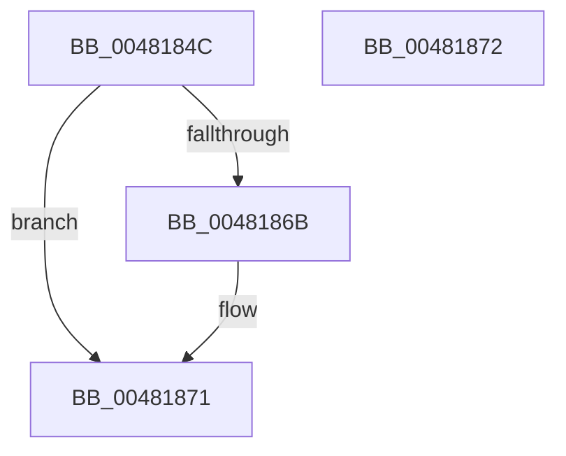

# MiOkToShrinkPageFiles

- RVA: `0x0048184C`–`0x00481873` (길이 `39` bytes)
- VA: `0x000000014048184C`
- 실행 섹션: `.text`
- PDB 이름 있음: `예`; PDB Function 태그: `아니요`
- unwind 정보 RVA: `0x000DB714`
- 디코드: `11`개 명령, `39/39` bytes 표시
- 미해석 바이트: `0` (있으면 어셈블리에 `.byte`로 보존)

> 이 문서는 커널 이미지의 기계어와 PDB 기호를 분석해 생성했습니다. 4번과 5번은 함수 원형과 자료형을 바이너리 사용 방식에서 추정한 C 해석이며 원본 소스 복구 결과는 아닙니다.

## 1. Dependencies

- 직접 호출 지점: **0**; 고유 호출 대상: **0**
- 직접 호출자로 확인된 함수: **3**
- RIP 상대 이미지 참조: **0**

### Outgoing calls
- 직접 디코드된 call 명령이 없습니다.

### Direct callers
- [MiAttemptPageFileReduction](MiAttemptPageFileReduction_function_004813E4.md) at `0x0048148F`
- [MiAttemptPageFileReductionApc](MiAttemptPageFileReductionApc_function_004815A0.md) at `0x00481603`
- [MiContractPagingFiles](MiContractPagingFiles_function_0048177C.md) at `0x0048179C`

### Static image references
- 디코드된 RIP-relative 메모리 참조가 없습니다.

## 2. Other-region calls and transfers

- 다른 실행 섹션으로 향하는 call: **0**
- 별도 외부 분기/꼬리 이동을 확인하지 못했습니다.

## 3. Assembly (complete function range)

```asm
0048184C  48 B8 CD CC CC CC CC CC CC CC   movabs rax, 0xcccccccccccccccd
00481856  4C 8D 81 00 80 00 00            lea r8, [rcx + 0x8000]
0048185D  48 F7 E2                        mul rdx
00481860  33 C0                           xor eax, eax
00481862  48 83 E2 F8                     and rdx, 0xfffffffffffffff8
00481866  4C 3B C2                        cmp r8, rdx
00481869  73 06                           jae 0x140481871
0048186B  4C 3B C1                        cmp r8, rcx
0048186E  0F 97 C0                        seta al
00481871  C3                              ret
00481872  CC                              int3
```

## 4. C-style interpretation (structured pseudocode)

```c
__int64 __fastcall MiOkToShrinkPageFiles(__int64 a1, __int64 a2)
{
    __int64 result;

    result = 0;
    a2 = (a2) & (-8);
    if ((a1 + 32768) < a2) {
        result = ((a1 + 32768) > a1) ? 1 : 0;
    }
    return result;
}
```

## 5. (Beta) C Style

```c
int64_t MiOkToShrinkPageFiles(void *Arg1, int64_t Arg2)
{
    uint8_t *arg1 = (uint8_t *)Arg1;

    int64_t result;

    result = 0;
    Arg2 = (Arg2) & (-8);
    if ((Arg1 + 32768) < Arg2) {
        result = ((Arg1 + 32768) > Arg1) ? 1 : 0;
    }
    return result;
}
```

### 관측된 메모리 오프셋

구조체 형식이 확인되지 않은 접근은 인자 기준의 오프셋으로만 기록했습니다.

| 기준 인자 | 오프셋 표현 | 폭 (bit) | 접근 |
|---|---:|---:|---|
| `Arg1` | `+ 0x8000` | `64` | `R` |

## 6. Execution-region graph

[열기: 2D/3D 그래프와 함수 탐색 컨트롤 패널](../../../control-panel.html?section=text&rva=0x0048184C&view=graph)

- 2D 그래프는 위에서 아래로 흐르고, 3D 그래프는 빈 공간을 드래그해 회전합니다. Shift+드래그는 이동, 휠은 확대·축소, 함수 노드 선택은 대상 보고서 이동입니다.

### Static fallback


