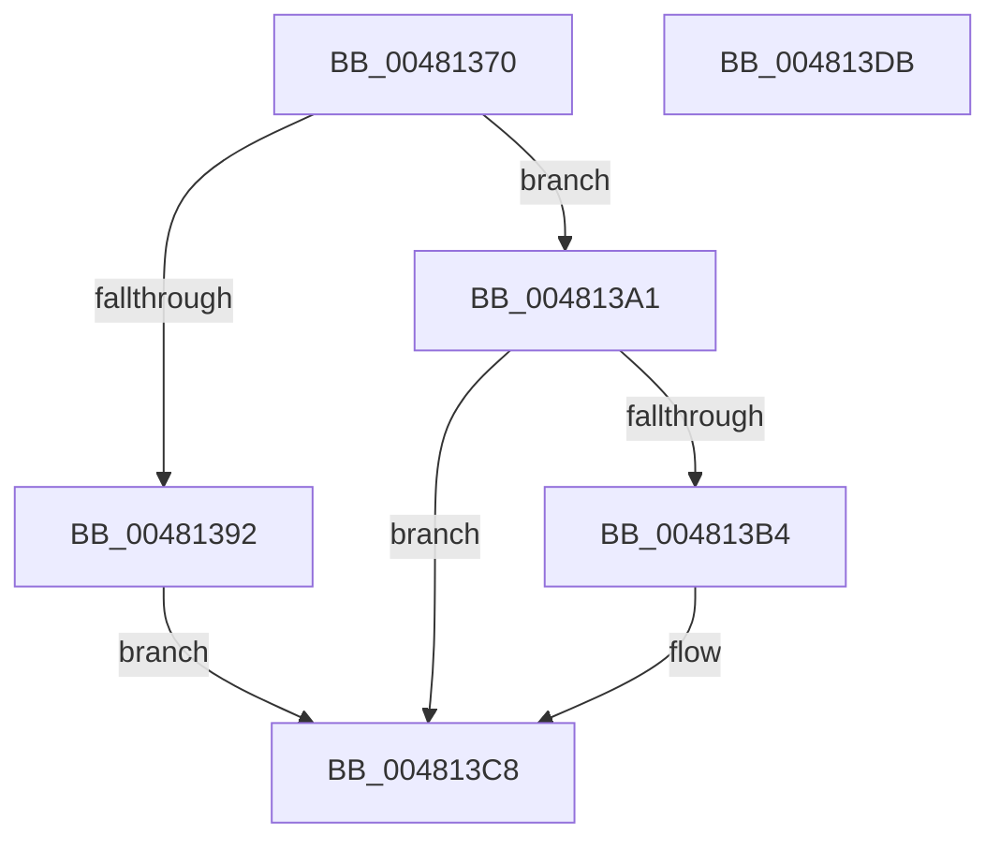

# MiProcessingPageExtendComplete

- RVA: `0x00481370`–`0x004813DC` (길이 `108` bytes)
- VA: `0x0000000140481370`
- 실행 섹션: `.text`
- PDB 이름 있음: `예`; PDB Function 태그: `아니요`
- unwind 정보 RVA: `0x00060BC4`
- 디코드: `32`개 명령, `108/108` bytes 표시
- 미해석 바이트: `0` (있으면 어셈블리에 `.byte`로 보존)

> 이 문서는 커널 이미지의 기계어와 PDB 기호를 분석해 생성했습니다. 4번과 5번은 함수 원형과 자료형을 바이너리 사용 방식에서 추정한 C 해석이며 원본 소스 복구 결과는 아닙니다.

## 1. Dependencies

- 직접 호출 지점: **3**; 고유 호출 대상: **2**
- 직접 호출자로 확인된 함수: **1**
- RIP 상대 이미지 참조: **0**

### Outgoing calls
- `0x00481397` → [ExAcquireSpinLockExclusive](../24/ExAcquireSpinLockExclusive_function_00248690.md) (function, `0x00248690`)
- `0x004813A1` → [ExAcquireSpinLockExclusive](../24/ExAcquireSpinLockExclusive_function_00248690.md) (function, `0x00248690`)
- `0x004813C3` → [KeSetEvent](../33/KeSetEvent_function_0033F310.md) (function, `0x0033F310`)

### Direct callers
- [MiHandlePageFileSizeChanges](MiHandlePageFileSizeChanges_function_004811D0.md) at `0x004812B6`

### Static image references
- 디코드된 RIP-relative 메모리 참조가 없습니다.

## 2. Other-region calls and transfers

- 다른 실행 섹션으로 향하는 call: **0**
- 별도 외부 분기/꼬리 이동을 확인하지 못했습니다.

## 3. Assembly (complete function range)

```asm
00481370  48 89 5C 24 08                  mov qword ptr [rsp + 8], rbx
00481375  48 89 74 24 10                  mov qword ptr [rsp + 0x10], rsi
0048137A  57                              push rdi
0048137B  48 83 EC 20                     sub rsp, 0x20
0048137F  48 8B F1                        mov rsi, rcx
00481382  48 8B DA                        mov rbx, rdx
00481385  49 8D 88 C0 06 00 00            lea rcx, [r8 + 0x6c0]
0048138C  F6 46 4F 04                     test byte ptr [rsi + 0x4f], 4
00481390  74 0F                           je 0x1404813a1
00481392  33 D2                           xor edx, edx
00481394  87 53 48                        xchg dword ptr [rbx + 0x48], edx
00481397  E8 F4 72 DC FF                  call 0x140248690
0048139C  40 8A F8                        mov dil, al
0048139F  EB 27                           jmp 0x1404813c8
004813A1  E8 EA 72 DC FF                  call 0x140248690
004813A6  40 8A F8                        mov dil, al
004813A9  33 D2                           xor edx, edx
004813AB  48 8B 46 50                     mov rax, qword ptr [rsi + 0x50]
004813AF  48 85 C0                        test rax, rax
004813B2  74 14                           je 0x1404813c8
004813B4  48 8B 46 28                     mov rax, qword ptr [rsi + 0x28]
004813B8  48 8D 4B 30                     lea rcx, [rbx + 0x30]
004813BC  45 33 C0                        xor r8d, r8d
004813BF  48 89 43 28                     mov qword ptr [rbx + 0x28], rax
004813C3  E8 48 DF EB FF                  call 0x14033f310
004813C8  48 8B 5C 24 30                  mov rbx, qword ptr [rsp + 0x30]
004813CD  40 8A C7                        mov al, dil
004813D0  48 8B 74 24 38                  mov rsi, qword ptr [rsp + 0x38]
004813D5  48 83 C4 20                     add rsp, 0x20
004813D9  5F                              pop rdi
004813DA  C3                              ret
004813DB  CC                              int3
```

## 4. C-style interpretation (structured pseudocode)

```c
__int64 __fastcall MiProcessingPageExtendComplete(__int64 a1, __int64 a2, __int64 a3)
{
    __int64 result;
    __int64 v_rsp;
    unsigned __int64 v_stack_p10;
    unsigned __int64 v_stack_p8;

    v_stack_p8 = v_rbx;
    v_stack_p10 = v_rsi;
    v_rsp = (v_rsp) - (32);
    if (((*(unsigned __int8 *)(a1 + 79)) & (4)) == 0) goto loc_004813A1;
    a2 = 0;
    result = ExAcquireSpinLockExclusive(a3 + 1728, a2, a3, a4);
    goto loc_004813C8;
loc_004813A1:
    result = ExAcquireSpinLockExclusive(a3 + 1728, a2, a3, a4);
    a2 = 0;
    result = *(unsigned __int64 *)(a1 + 80);
    if (*(unsigned __int64 *)(a1 + 80) != 0) {
        result = *(unsigned __int64 *)(a1 + 40);
        a1 = a2 + 48;
        a3 = 0;
        *(unsigned __int64 *)(a2 + 40) = result;
        result = KeSetEvent(a1, a2, a3, a4);
    }
    v_rsp = (v_rsp) + (32);
    return (unsigned __int8)((unsigned __int8)(result));
}
```

## 5. (Beta) C Style

```c
int64_t MiProcessingPageExtendComplete(void *Arg1, void *Arg2, void *Arg3)
{
    uint8_t *arg1 = (uint8_t *)Arg1;
    uint8_t *arg2 = (uint8_t *)Arg2;
    uint8_t *arg3 = (uint8_t *)Arg3;

    int64_t result;
    int64_t local_rsp;
    uint64_t v_stack_p10;
    uint64_t v_stack_p8;

    v_stack_p8 = local_rbx;
    v_stack_p10 = local_rsi;
    local_rsp = (local_rsp) - (32);
    if (((*(uint8_t *)(arg1 + 0x4F)) & (4)) == 0) goto loc_004813A1;
    Arg2 = 0;
    result = ExAcquireSpinLockExclusive(Arg3 + 1728, Arg2, Arg3, a4);
    goto loc_004813C8;
loc_004813A1:
    result = ExAcquireSpinLockExclusive(Arg3 + 1728, Arg2, Arg3, a4);
    Arg2 = 0;
    result = *(uint64_t *)(arg1 + 0x50);
    if (*(uint64_t *)(arg1 + 0x50) != 0) {
        result = *(uint64_t *)(arg1 + 0x28);
        Arg1 = Arg2 + 48;
        Arg3 = 0;
        *(uint64_t *)(arg2 + 0x28) = result;
        result = KeSetEvent(Arg1, Arg2, Arg3, a4);
    }
    local_rsp = (local_rsp) + (32);
    return (uint8_t)((uint8_t)(result));
}
```

### 관측된 메모리 오프셋

구조체 형식이 확인되지 않은 접근은 인자 기준의 오프셋으로만 기록했습니다.

| 기준 인자 | 오프셋 표현 | 폭 (bit) | 접근 |
|---|---:|---:|---|
| `Arg1` | `+ 0x28` | `64` | `R` |
| `Arg1` | `+ 0x4F` | `8` | `R` |
| `Arg1` | `+ 0x50` | `64` | `R` |
| `Arg2` | `+ 0x28` | `64` | `W` |
| `Arg2` | `+ 0x30` | `64` | `R` |
| `Arg2` | `+ 0x48` | `32` | `R/W` |
| `Arg3` | `+ 0x6C0` | `64` | `R` |

## 6. Execution-region graph

[열기: 2D/3D 그래프와 함수 탐색 컨트롤 패널](../../../control-panel.html?section=text&rva=0x00481370&view=graph)

- 2D 그래프는 위에서 아래로 흐르고, 3D 그래프는 빈 공간을 드래그해 회전합니다. Shift+드래그는 이동, 휠은 확대·축소, 함수 노드 선택은 대상 보고서 이동입니다.

### Static fallback


