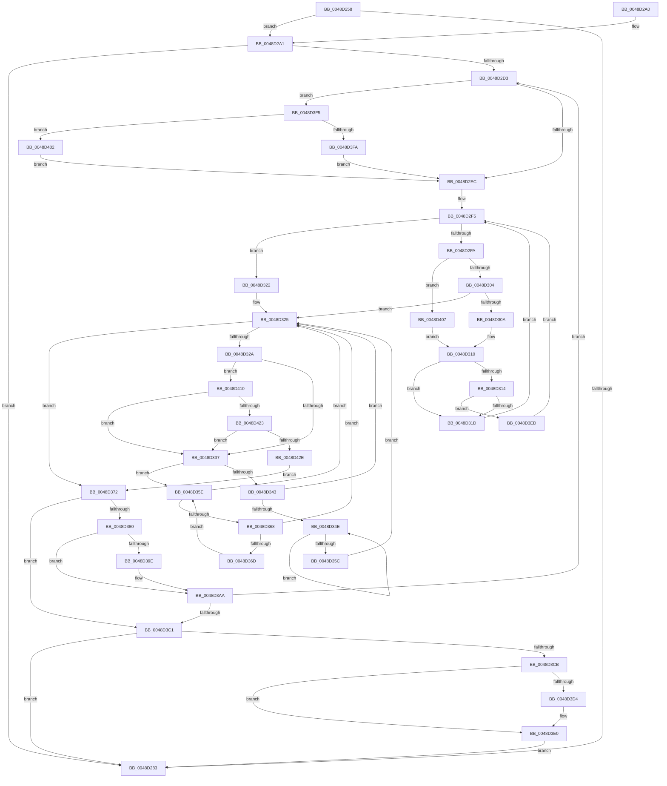

# MiPurgeSlabEntries

- RVA: `0x0048D258`–`0x0048D43B` (길이 `483` bytes)
- VA: `0x000000014048D258`
- 실행 섹션: `.text`
- PDB 이름 있음: `예`; PDB Function 태그: `아니요`
- unwind 정보 RVA: `0x000B1404`
- 디코드: `140`개 명령, `483/483` bytes 표시
- 미해석 바이트: `0` (있으면 어셈블리에 `.byte`로 보존)

> 이 문서는 커널 이미지의 기계어와 PDB 기호를 분석해 생성했습니다. 4번과 5번은 함수 원형과 자료형을 바이너리 사용 방식에서 추정한 C 해석이며 원본 소스 복구 결과는 아닙니다.

## 1. Dependencies

- 직접 호출 지점: **5**; 고유 호출 대상: **4**
- 직접 호출자로 확인된 함수: **1**
- RIP 상대 이미지 참조: **2**

### Outgoing calls
- `0x0048D2D7` → [ExAcquireSpinLockShared](../24/ExAcquireSpinLockShared_function_0024DCE0.md) (function, `0x0024DCE0`)
- `0x0048D376` → [ExReleaseSpinLockSharedFromDpcLevel](../24/ExReleaseSpinLockSharedFromDpcLevel_function_0024A590.md) (function, `0x0024A590`)
- `0x0048D38C` → [MiPurgeSlabEntry](MiPurgeSlabEntry_function_0048D444.md) (function, `0x0048D444`)
- `0x0048D3A5` → [KiLowerIrqlProcessIrqlFlags](../4F/KiLowerIrqlProcessIrqlFlags_function_004F5698.md) (function, `0x004F5698`)
- `0x0048D3DB` → [KiLowerIrqlProcessIrqlFlags](../4F/KiLowerIrqlProcessIrqlFlags_function_004F5698.md) (function, `0x004F5698`)

### Direct callers
- [MiFreeSlabEntries](../2D/MiFreeSlabEntries_function_002DAFC0.md) at `0x002DB087`

### Static image references
- `0x0048D2AD` → RVA `0x00011C60` (`.rdata`; read)
- `0x0048D391` → RVA `0x00FC6D20` (`ALMOSTRO`; read)

## 2. Other-region calls and transfers

- 다른 실행 섹션으로 향하는 call: **0**
- 별도 외부 분기/꼬리 이동을 확인하지 못했습니다.

## 3. Assembly (complete function range)

```asm
0048D258  48 89 5C 24 10                  mov qword ptr [rsp + 0x10], rbx
0048D25D  48 89 6C 24 18                  mov qword ptr [rsp + 0x18], rbp
0048D262  48 89 74 24 20                  mov qword ptr [rsp + 0x20], rsi
0048D267  57                              push rdi
0048D268  41 54                           push r12
0048D26A  41 55                           push r13
0048D26C  41 56                           push r14
0048D26E  41 57                           push r15
0048D270  48 83 EC 20                     sub rsp, 0x20
0048D274  48 8B 41 50                     mov rax, qword ptr [rcx + 0x50]
0048D278  48 8B F9                        mov rdi, rcx
0048D27B  48 8B 10                        mov rdx, qword ptr [rax]
0048D27E  48 85 D2                        test rdx, rdx
0048D281  75 1E                           jne 0x14048d2a1
0048D283  48 8B 5C 24 58                  mov rbx, qword ptr [rsp + 0x58]
0048D288  48 8B 6C 24 60                  mov rbp, qword ptr [rsp + 0x60]
0048D28D  48 8B 74 24 68                  mov rsi, qword ptr [rsp + 0x68]
0048D292  48 83 C4 20                     add rsp, 0x20
0048D296  41 5F                           pop r15
0048D298  41 5E                           pop r14
0048D29A  41 5D                           pop r13
0048D29C  41 5C                           pop r12
0048D29E  5F                              pop rdi
0048D29F  C3                              ret
0048D2A0  CC                              int3
0048D2A1  8B 81 88 00 00 00               mov eax, dword ptr [rcx + 0x88]
0048D2A7  33 ED                           xor ebp, ebp
0048D2A9  48 C1 E8 04                     shr rax, 4
0048D2AD  48 8D 0D AC 49 B8 FF            lea rcx, [rip - 0x47b654]
0048D2B4  83 E0 03                        and eax, 3
0048D2B7  45 33 ED                        xor r13d, r13d
0048D2BA  45 33 FF                        xor r15d, r15d
0048D2BD  45 33 F6                        xor r14d, r14d
0048D2C0  8B 04 C1                        mov eax, dword ptr [rcx + rax*8]
0048D2C3  89 44 24 50                     mov dword ptr [rsp + 0x50], eax
0048D2C7  48 8B 47 50                     mov rax, qword ptr [rdi + 0x50]
0048D2CB  48 8B 08                        mov rcx, qword ptr [rax]
0048D2CE  48 85 C9                        test rcx, rcx
0048D2D1  74 B0                           je 0x14048d283
0048D2D3  48 8D 4F 10                     lea rcx, [rdi + 0x10]
0048D2D7  E8 04 0A DC FF                  call 0x14024dce0
0048D2DC  F6 47 08 01                     test byte ptr [rdi + 8], 1
0048D2E0  48 8B 1F                        mov rbx, qword ptr [rdi]
0048D2E3  0F B6 F0                        movzx esi, al
0048D2E6  0F 85 09 01 00 00               jne 0x14048d3f5
0048D2EC  0F B6 4F 08                     movzx ecx, byte ptr [rdi + 8]
0048D2F0  83 E1 01                        and ecx, 1
0048D2F3  33 D2                           xor edx, edx
0048D2F5  48 85 DB                        test rbx, rbx
0048D2F8  74 28                           je 0x14048d322
0048D2FA  48 3B 6B 30                     cmp rbp, qword ptr [rbx + 0x30]
0048D2FE  0F 87 03 01 00 00               ja 0x14048d407
0048D304  48 3B 6B 28                     cmp rbp, qword ptr [rbx + 0x28]
0048D308  73 1B                           jae 0x14048d325
0048D30A  48 8B 03                        mov rax, qword ptr [rbx]
0048D30D  48 8B D3                        mov rdx, rbx
0048D310  85 C9                           test ecx, ecx
0048D312  74 09                           je 0x14048d31d
0048D314  48 85 C0                        test rax, rax
0048D317  0F 85 D0 00 00 00               jne 0x14048d3ed
0048D31D  48 8B D8                        mov rbx, rax
0048D320  EB D3                           jmp 0x14048d2f5
0048D322  48 8B DA                        mov rbx, rdx
0048D325  48 85 DB                        test rbx, rbx
0048D328  74 48                           je 0x14048d372
0048D32A  44 8B 73 58                     mov r14d, dword ptr [rbx + 0x58]
0048D32E  4D 85 F6                        test r14, r14
0048D331  0F 85 D9 00 00 00               jne 0x14048d410
0048D337  48 8B 43 08                     mov rax, qword ptr [rbx + 8]
0048D33B  48 8B CB                        mov rcx, rbx
0048D33E  48 85 C0                        test rax, rax
0048D341  74 1B                           je 0x14048d35e
0048D343  48 8B 08                        mov rcx, qword ptr [rax]
0048D346  48 8B D8                        mov rbx, rax
0048D349  48 85 C9                        test rcx, rcx
0048D34C  74 D7                           je 0x14048d325
0048D34E  48 8B 01                        mov rax, qword ptr [rcx]
0048D351  48 8B D9                        mov rbx, rcx
0048D354  48 8B C8                        mov rcx, rax
0048D357  48 85 C0                        test rax, rax
0048D35A  75 F2                           jne 0x14048d34e
0048D35C  EB C7                           jmp 0x14048d325
0048D35E  48 8B 5B 10                     mov rbx, qword ptr [rbx + 0x10]
0048D362  48 83 E3 FC                     and rbx, 0xfffffffffffffffc
0048D366  74 BD                           je 0x14048d325
0048D368  48 39 0B                        cmp qword ptr [rbx], rcx
0048D36B  74 B8                           je 0x14048d325
0048D36D  48 8B CB                        mov rcx, rbx
0048D370  EB EC                           jmp 0x14048d35e
0048D372  48 8D 4F 10                     lea rcx, [rdi + 0x10]
0048D376  E8 15 D2 DB FF                  call 0x14024a590
0048D37B  48 85 DB                        test rbx, rbx
0048D37E  74 41                           je 0x14048d3c1
0048D380  45 33 C9                        xor r9d, r9d
0048D383  4D 8B C6                        mov r8, r14
0048D386  49 8B D7                        mov rdx, r15
0048D389  49 8B CD                        mov rcx, r13
0048D38C  E8 B3 00 00 00                  call 0x14048d444
0048D391  83 3D 88 99 B3 00 00            cmp dword ptr [rip + 0xb39988], 0
0048D398  49 8D 6F 01                     lea rbp, [r15 + 1]
0048D39C  74 0C                           je 0x14048d3aa
0048D39E  44 0F 20 C1                     mov rcx, cr8
0048D3A2  40 8A D6                        mov dl, sil
0048D3A5  E8 EE 82 06 00                  call 0x1404f5698
0048D3AA  44 0F 22 C6                     mov cr8, rsi
0048D3AE  48 8B 47 50                     mov rax, qword ptr [rdi + 0x50]
0048D3B2  40 B6 11                        mov sil, 0x11
0048D3B5  48 8B 08                        mov rcx, qword ptr [rax]
0048D3B8  48 85 C9                        test rcx, rcx
0048D3BB  0F 85 12 FF FF FF               jne 0x14048d2d3
0048D3C1  40 80 FE 11                     cmp sil, 0x11
0048D3C5  0F 84 B8 FE FF FF               je 0x14048d283
0048D3CB  83 3D 4E 99 B3 00 00            cmp dword ptr [rip + 0xb3994e], 0
0048D3D2  74 0C                           je 0x14048d3e0
0048D3D4  44 0F 20 C1                     mov rcx, cr8
0048D3D8  40 8A D6                        mov dl, sil
0048D3DB  E8 B8 82 06 00                  call 0x1404f5698
0048D3E0  40 0F B6 C6                     movzx eax, sil
0048D3E4  44 0F 22 C0                     mov cr8, rax
0048D3E8  E9 96 FE FF FF                  jmp 0x14048d283
0048D3ED  48 33 D8                        xor rbx, rax
0048D3F0  E9 00 FF FF FF                  jmp 0x14048d2f5
0048D3F5  48 85 DB                        test rbx, rbx
0048D3F8  74 08                           je 0x14048d402
0048D3FA  48 33 DF                        xor rbx, rdi
0048D3FD  E9 EA FE FF FF                  jmp 0x14048d2ec
0048D402  E9 E5 FE FF FF                  jmp 0x14048d2ec
0048D407  48 8B 43 08                     mov rax, qword ptr [rbx + 8]
0048D40B  E9 00 FF FF FF                  jmp 0x14048d310
0048D410  8B 4B 54                        mov ecx, dword ptr [rbx + 0x54]
0048D413  8B 44 24 50                     mov eax, dword ptr [rsp + 0x50]
0048D417  49 03 CE                        add rcx, r14
0048D41A  48 3B C8                        cmp rcx, rax
0048D41D  0F 82 14 FF FF FF               jb 0x14048d337
0048D423  8B 43 5C                        mov eax, dword ptr [rbx + 0x5c]
0048D426  A8 01                           test al, 1
0048D428  0F 85 09 FF FF FF               jne 0x14048d337
0048D42E  4C 8B 6B 28                     mov r13, qword ptr [rbx + 0x28]
0048D432  4C 8B 7B 30                     mov r15, qword ptr [rbx + 0x30]
0048D436  E9 37 FF FF FF                  jmp 0x14048d372
```

## 4. C-style interpretation (structured pseudocode)

```c
__int64 __fastcall MiPurgeSlabEntries(__int64 a1, __int64 a2, __int64 a3, int a4)
{
    __int64 result;
    __int64 v_r13;
    __int64 v_r14;
    __int64 v_r15;
    __int64 v_rbp;
    __int64 v_rbx;
    __int64 v_rsp;
    unsigned __int64 v_stack_p10;
    unsigned __int64 v_stack_p18;
    unsigned __int64 v_stack_p20;
    unsigned int v_stack_p50;

    v_stack_p10 = v_rbx;
    v_stack_p18 = v_rbp;
    v_stack_p20 = v_rsi;
    v_rsp = (v_rsp) - (32);
    if (*(unsigned __int64 *)(*(unsigned __int64 *)(a1 + 80)) != 0) goto loc_0048D2A1;
loc_0048D283:
    v_rsp = (v_rsp) + (32);
    return *(unsigned __int64 *)(a1 + 80);
loc_0048D2A1:
    v_rbp = 0;
    result = ((unsigned int)(*(unsigned int *)(a1 + 136))) >> (4);
    result = (unsigned int)((result) & (3));
    v_r13 = 0;
    v_r15 = 0;
    v_r14 = 0;
    v_stack_p50 = (unsigned int)((unsigned int)(*(unsigned int *)(v_rip - 4699732 + result * 8)));
    if (*(unsigned __int64 *)(*(unsigned __int64 *)(a1 + 80)) == 0) goto loc_0048D283;
loc_0048D2D3:
    result = ExAcquireSpinLockShared(a1 + 16, *(unsigned __int64 *)(*(unsigned __int64 *)(a1 + 80)), a3, a4);
    if (((*(unsigned __int8 *)(a1 + 8)) & (1)) != 0) goto loc_0048D3F5;
loc_0048D2EC:
    a1 = (unsigned int)((*(unsigned __int8 *)(a1 + 8)) & (1));
    a2 = 0;
loc_0048D2F5:
    if (*(unsigned __int64 *)(a1) == 0) goto loc_0048D322;
    if (0 > (*(unsigned __int64 *)(*(unsigned __int64 *)(a1) + 48))) goto loc_0048D407;
    if (0 >= (*(unsigned __int64 *)(*(unsigned __int64 *)(a1) + 40))) goto loc_0048D325;
loc_0048D310:
    if ((unsigned int)(a1) == 0) goto loc_0048D31D;
    if (*(unsigned __int64 *)(*(unsigned __int64 *)(a1)) != 0) goto loc_0048D3ED;
loc_0048D31D:
    goto loc_0048D2F5;
loc_0048D322:
loc_0048D325:
    if (*(unsigned __int64 *)(a1) == 0) goto loc_0048D372;
    if ((unsigned int)(*(unsigned int *)(*(unsigned __int64 *)(a1) + 88)) != 0) goto loc_0048D410;
loc_0048D337:
    if (*(unsigned __int64 *)(*(unsigned __int64 *)(a1) + 8) == 0) goto loc_0048D35E;
    if (*(unsigned __int64 *)(*(unsigned __int64 *)(*(unsigned __int64 *)(a1) + 8)) == 0) goto loc_0048D325;
loc_0048D34E:
    if (*(unsigned __int64 *)(*(unsigned __int64 *)(*(unsigned __int64 *)(*(unsigned __int64 *)(a1) + 8))) != 0) goto loc_0048D34E;
    goto loc_0048D325;
loc_0048D35E:
    v_rbx = (*(unsigned __int64 *)(*(unsigned __int64 *)(*(unsigned __int64 *)(*(unsigned __int64 *)(a1) + 8)) + 16)) & (-4);
    if (condition_is_equal) goto loc_0048D325;
    if ((*(unsigned __int64 *)(v_rbx)) == (*(unsigned __int64 *)(*(unsigned __int64 *)(*(unsigned __int64 *)(*(unsigned __int64 *)(a1) + 8))))) goto loc_0048D325;
    goto loc_0048D35E;
loc_0048D372:
    result = ExReleaseSpinLockSharedFromDpcLevel(a1 + 16, *(unsigned __int64 *)(a1), a3, a4);
    if (v_rbx == 0) goto loc_0048D3C1;
    a4 = 0;
    result = MiPurgeSlabEntry(0, 0, (unsigned int)(*(unsigned int *)(*(unsigned __int64 *)(a1) + 88)), a4);
    if ((*(unsigned int *)(v_rip + 11770248)) != 0) {
        a1 = v_cr8;
        a2 = (unsigned __int8)((unsigned __int8)(result));
        result = KiLowerIrqlProcessIrqlFlags(a1, a2, (unsigned int)(*(unsigned int *)(*(unsigned __int64 *)(a1) + 88)), a4);
    }
    if (*(unsigned __int64 *)(*(unsigned __int64 *)(a1 + 80)) != 0) goto loc_0048D2D3;
loc_0048D3C1:
    if (17 == 17) goto loc_0048D283;
    result = *(unsigned __int64 *)(a1 + 80);
    if ((*(unsigned int *)(v_rip + 11770190)) != 0) {
        a1 = (unsigned __int8)(result);
        a2 = 17;
        result = KiLowerIrqlProcessIrqlFlags(a1, a2, (unsigned int)(*(unsigned int *)(*(unsigned __int64 *)(a1) + 88)), a4);
    }
    goto loc_0048D283;
loc_0048D3ED:
    v_rbx = (v_rbx) ^ (17);
    goto loc_0048D2F5;
loc_0048D3F5:
    if (v_rbx == 0) goto loc_0048D402;
    v_rbx = (v_rbx) ^ (a1);
    goto loc_0048D2EC;
loc_0048D402:
    goto loc_0048D2EC;
loc_0048D407:
    goto loc_0048D310;
loc_0048D410:
    a1 = ((unsigned int)(*(unsigned int *)(v_rbx + 84))) + ((unsigned int)(*(unsigned int *)(*(unsigned __int64 *)(a1) + 88)));
    if (a1 < ((unsigned int)(v_stack_p50))) goto loc_0048D337;
    if ((((unsigned __int8)((unsigned int)(*(unsigned int *)(v_rbx + 92)))) & (1)) != 0) goto loc_0048D337;
    goto loc_0048D372;
}
```

## 5. (Beta) C Style

```c
int64_t MiPurgeSlabEntries(void *Arg1, int64_t Arg2, int64_t Arg3, int32_t Arg4)
{
    uint8_t *arg1 = (uint8_t *)Arg1;

    int64_t result;
    int64_t local_r13;
    int64_t local_r14;
    int64_t local_r15;
    int64_t local_rbp;
    int64_t local_rbx;
    int64_t local_rsp;
    uint64_t v_stack_p10;
    uint64_t v_stack_p18;
    uint64_t v_stack_p20;
    uint32_t v_stack_p50;

    v_stack_p10 = local_rbx;
    v_stack_p18 = local_rbp;
    v_stack_p20 = local_rsi;
    local_rsp = (local_rsp) - (32);
    if (*(uint64_t *)(*(uint64_t *)(arg1 + 0x50)) != 0) goto loc_0048D2A1;
loc_0048D283:
    local_rsp = (local_rsp) + (32);
    return *(uint64_t *)(arg1 + 0x50);
loc_0048D2A1:
    local_rbp = 0;
    result = ((uint32_t)(*(uint32_t *)(arg1 + 0x88))) >> (4);
    result = (uint32_t)((result) & (3));
    local_r13 = 0;
    local_r15 = 0;
    local_r14 = 0;
    v_stack_p50 = (uint32_t)((uint32_t)(*(uint32_t *)(v_rip - 0x47B654 + result * 8)));
    if (*(uint64_t *)(*(uint64_t *)(arg1 + 0x50)) == 0) goto loc_0048D283;
loc_0048D2D3:
    result = ExAcquireSpinLockShared(Arg1 + 16, *(uint64_t *)(*(uint64_t *)(arg1 + 0x50)), Arg3, Arg4);
    if (((*(uint8_t *)(arg1 + 0x8)) & (1)) != 0) goto loc_0048D3F5;
loc_0048D2EC:
    Arg1 = (uint32_t)((*(uint8_t *)(arg1 + 0x8)) & (1));
    Arg2 = 0;
loc_0048D2F5:
    if (*(uint64_t *)(arg1) == 0) goto loc_0048D322;
    if (0 > (*(uint64_t *)(*(uint64_t *)(arg1) + 0x30))) goto loc_0048D407;
    if (0 >= (*(uint64_t *)(*(uint64_t *)(arg1) + 0x28))) goto loc_0048D325;
loc_0048D310:
    if ((uint32_t)(Arg1) == 0) goto loc_0048D31D;
    if (*(uint64_t *)(*(uint64_t *)(arg1)) != 0) goto loc_0048D3ED;
loc_0048D31D:
    goto loc_0048D2F5;
loc_0048D322:
loc_0048D325:
    if (*(uint64_t *)(arg1) == 0) goto loc_0048D372;
    if ((uint32_t)(*(uint32_t *)(*(uint64_t *)(arg1) + 0x58)) != 0) goto loc_0048D410;
loc_0048D337:
    if (*(uint64_t *)(*(uint64_t *)(arg1) + 0x8) == 0) goto loc_0048D35E;
    if (*(uint64_t *)(*(uint64_t *)(*(uint64_t *)(arg1) + 0x8)) == 0) goto loc_0048D325;
loc_0048D34E:
    if (*(uint64_t *)(*(uint64_t *)(*(uint64_t *)(*(uint64_t *)(arg1) + 0x8))) != 0) goto loc_0048D34E;
    goto loc_0048D325;
loc_0048D35E:
    local_rbx = (*(uint64_t *)(*(uint64_t *)(*(uint64_t *)(*(uint64_t *)(arg1) + 0x8)) + 0x10)) & (-4);
    if (condition_is_equal) goto loc_0048D325;
    if ((*(uint64_t *)(local_rbx)) == (*(uint64_t *)(*(uint64_t *)(*(uint64_t *)(*(uint64_t *)(arg1) + 0x8))))) goto loc_0048D325;
    goto loc_0048D35E;
loc_0048D372:
    result = ExReleaseSpinLockSharedFromDpcLevel(Arg1 + 16, *(uint64_t *)(arg1), Arg3, Arg4);
    if (local_rbx == 0) goto loc_0048D3C1;
    Arg4 = 0;
    result = MiPurgeSlabEntry(0, 0, (uint32_t)(*(uint32_t *)(*(uint64_t *)(arg1) + 0x58)), Arg4);
    if ((*(uint32_t *)(v_rip + 0xB39988)) != 0) {
        Arg1 = v_cr8;
        Arg2 = (uint8_t)((uint8_t)(result));
        result = KiLowerIrqlProcessIrqlFlags(Arg1, Arg2, (uint32_t)(*(uint32_t *)(*(uint64_t *)(arg1) + 0x58)), Arg4);
    }
    if (*(uint64_t *)(*(uint64_t *)(arg1 + 0x50)) != 0) goto loc_0048D2D3;
loc_0048D3C1:
    if (17 == 17) goto loc_0048D283;
    result = *(uint64_t *)(arg1 + 0x50);
    if ((*(uint32_t *)(v_rip + 0xB3994E)) != 0) {
        Arg1 = (uint8_t)(result);
        Arg2 = 17;
        result = KiLowerIrqlProcessIrqlFlags(Arg1, Arg2, (uint32_t)(*(uint32_t *)(*(uint64_t *)(arg1) + 0x58)), Arg4);
    }
    goto loc_0048D283;
loc_0048D3ED:
    local_rbx = (local_rbx) ^ (17);
    goto loc_0048D2F5;
loc_0048D3F5:
    if (local_rbx == 0) goto loc_0048D402;
    local_rbx = (local_rbx) ^ (Arg1);
    goto loc_0048D2EC;
loc_0048D402:
    goto loc_0048D2EC;
loc_0048D407:
    goto loc_0048D310;
loc_0048D410:
    Arg1 = ((uint32_t)(*(uint32_t *)(local_rbx + 0x54))) + ((uint32_t)(*(uint32_t *)(*(uint64_t *)(arg1) + 0x58)));
    if (Arg1 < ((uint32_t)(v_stack_p50))) goto loc_0048D337;
    if ((((uint8_t)((uint32_t)(*(uint32_t *)(local_rbx + 0x5C)))) & (1)) != 0) goto loc_0048D337;
    goto loc_0048D372;
}
```

### 관측된 메모리 오프셋

구조체 형식이 확인되지 않은 접근은 인자 기준의 오프셋으로만 기록했습니다.

| 기준 인자 | 오프셋 표현 | 폭 (bit) | 접근 |
|---|---:|---:|---|
| `Arg1` | `+ 0x0` | `64` | `R` |
| `Arg1` | `+ 0x8` | `8` | `R` |
| `Arg1` | `+ 0x10` | `64` | `R` |
| `Arg1` | `+ 0x50` | `64` | `R` |
| `Arg1` | `+ 0x88` | `32` | `R` |

## 6. Execution-region graph

[열기: 2D/3D 그래프와 함수 탐색 컨트롤 패널](../../../control-panel.html?section=text&rva=0x0048D258&view=graph)

- 2D 그래프는 위에서 아래로 흐르고, 3D 그래프는 빈 공간을 드래그해 회전합니다. Shift+드래그는 이동, 휠은 확대·축소, 함수 노드 선택은 대상 보고서 이동입니다.

### Static fallback


