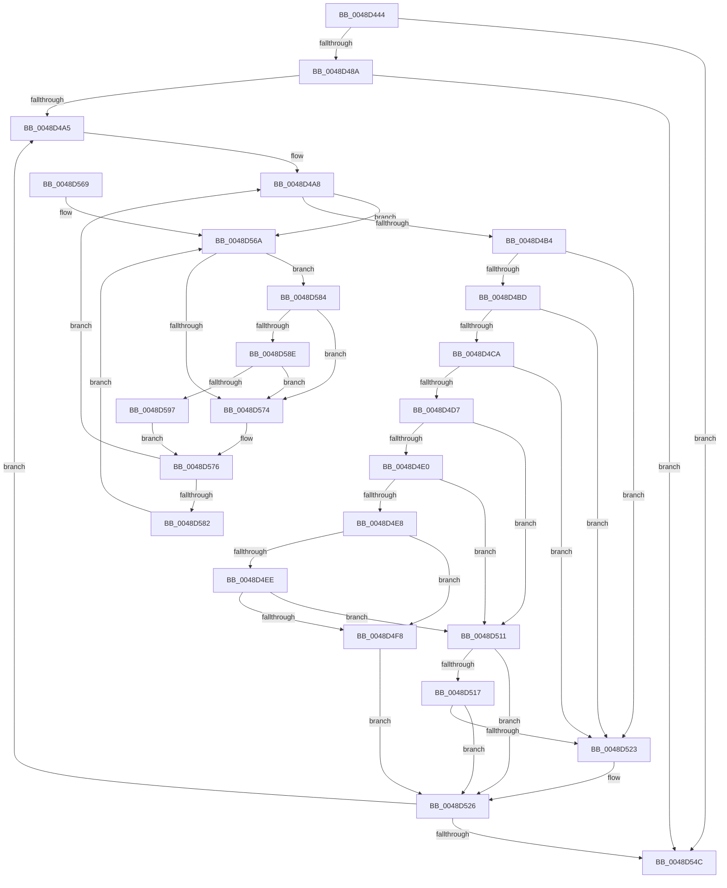

# MiPurgeSlabEntry

- RVA: `0x0048D444`–`0x0048D5A0` (길이 `348` bytes)
- VA: `0x000000014048D444`
- 실행 섹션: `.text`
- PDB 이름 있음: `예`; PDB Function 태그: `아니요`
- unwind 정보 RVA: `0x000B1424`
- 디코드: `101`개 명령, `348/348` bytes 표시
- 미해석 바이트: `0` (있으면 어셈블리에 `.byte`로 보존)

> 이 문서는 커널 이미지의 기계어와 PDB 기호를 분석해 생성했습니다. 4번과 5번은 함수 원형과 자료형을 바이너리 사용 방식에서 추정한 C 해석이며 원본 소스 복구 결과는 아닙니다.

## 1. Dependencies

- 직접 호출 지점: **6**; 고유 호출 대상: **6**
- 직접 호출자로 확인된 함수: **2**
- RIP 상대 이미지 참조: **3**

### Outgoing calls
- `0x0048D4CD` → [MiGetPfnSlabType](../28/MiGetPfnSlabType_function_0028E2D0.md) (function, `0x0028E2D0`)
- `0x0048D4FD` → [MiUnlinkPageFromListEx](../28/MiUnlinkPageFromListEx_function_00287590.md) (function, `0x00287590`)
- `0x0048D507` → [MiDiscardTransitionPteEx](../37/MiDiscardTransitionPteEx_function_00375954.md) (function, `0x00375954`)
- `0x0048D51A` → [MiIsFreeSlabPage](../4F/MiIsFreeSlabPage_function_004FCDE4.md) (function, `0x004FCDE4`)
- `0x0048D58E` → [KiCheckVpBackingLongSpinWaitHypercall](../30/KiCheckVpBackingLongSpinWaitHypercall_function_0030F490.md) (function, `0x0030F490`)
- `0x0048D599` → [HvlNotifyLongSpinWait](../30/HvlNotifyLongSpinWait_function_0030F460.md) (function, `0x0030F460`)

### Direct callers
- [MiPurgeSlabEntries](MiPurgeSlabEntries_function_0048D258.md) at `0x0048D38C`
- [MiEstablishDefragSlabEntries](../68/MiEstablishDefragSlabEntries_function_0068E0EC.md) at `0x0068E37A`
- [MiEstablishDefragSlabEntries](../68/MiEstablishDefragSlabEntries_function_0068E0EC.md) at `0x0068E39F`

### Static image references
- `0x0048D4B4` → RVA `0x00E2DCE0` (`.data`; read)
- `0x0048D56C` → RVA `0x00FC52AC` (`ALMOSTRO`; reference)
- `0x0048D584` → RVA `0x00FC6AB8` (`ALMOSTRO`; read)

## 2. Other-region calls and transfers

- 다른 실행 섹션으로 향하는 call: **0**
- 별도 외부 분기/꼬리 이동을 확인하지 못했습니다.

## 3. Assembly (complete function range)

```asm
0048D444  48 89 5C 24 10                  mov qword ptr [rsp + 0x10], rbx
0048D449  48 89 6C 24 18                  mov qword ptr [rsp + 0x18], rbp
0048D44E  48 89 74 24 20                  mov qword ptr [rsp + 0x20], rsi
0048D453  57                              push rdi
0048D454  41 54                           push r12
0048D456  41 55                           push r13
0048D458  41 56                           push r14
0048D45A  41 57                           push r15
0048D45C  48 83 EC 20                     sub rsp, 0x20
0048D460  48 8D 04 49                     lea rax, [rcx + rcx*2]
0048D464  45 8B E1                        mov r12d, r9d
0048D467  48 03 C0                        add rax, rax
0048D46A  49 8B E8                        mov rbp, r8
0048D46D  4C 8B F1                        mov r14, rcx
0048D470  48 B9 00 00 00 00 00 DE FF FF   movabs rcx, 0xffffde0000000000
0048D47A  45 33 ED                        xor r13d, r13d
0048D47D  48 8D 34 C1                     lea rsi, [rcx + rax*8]
0048D481  4D 85 C0                        test r8, r8
0048D484  0F 84 C2 00 00 00               je 0x14048d54c
0048D48A  48 8D 5E 18                     lea rbx, [rsi + 0x18]
0048D48E  48 B9 28 00 00 00 00 DE FF FF   movabs rcx, 0xffffde0000000028
0048D498  4C 8D 3C C1                     lea r15, [rcx + rax*8]
0048D49C  4C 3B F2                        cmp r14, rdx
0048D49F  0F 87 A7 00 00 00               ja 0x14048d54c
0048D4A5  41 8B FD                        mov edi, r13d
0048D4A8  F0 48 0F BA 2B 3F               lock bts qword ptr [rbx], 0x3f
0048D4AE  0F 82 B6 00 00 00               jb 0x14048d56a
0048D4B4  4C 3B 35 25 08 9A 00            cmp r14, qword ptr [rip + 0x9a0825]
0048D4BB  77 66                           ja 0x14048d523
0048D4BD  49 8B 07                        mov rax, qword ptr [r15]
0048D4C0  48 C1 E8 36                     shr rax, 0x36
0048D4C4  0F BA E0 00                     bt eax, 0
0048D4C8  73 59                           jae 0x14048d523
0048D4CA  48 8B CE                        mov rcx, rsi
0048D4CD  E8 FE 0D E0 FF                  call 0x14028e2d0
0048D4D2  83 F8 09                        cmp eax, 9
0048D4D5  74 4C                           je 0x14048d523
0048D4D7  8A 43 0A                        mov al, byte ptr [rbx + 0xa]
0048D4DA  24 07                           and al, 7
0048D4DC  3C 02                           cmp al, 2
0048D4DE  75 31                           jne 0x14048d511
0048D4E0  8B 43 08                        mov eax, dword ptr [rbx + 8]
0048D4E3  66 85 C0                        test ax, ax
0048D4E6  75 29                           jne 0x14048d511
0048D4E8  41 F6 C4 02                     test r12b, 2
0048D4EC  75 0A                           jne 0x14048d4f8
0048D4EE  8B 43 08                        mov eax, dword ptr [rbx + 8]
0048D4F1  C1 E8 18                        shr eax, 0x18
0048D4F4  A8 08                           test al, 8
0048D4F6  74 19                           je 0x14048d511
0048D4F8  33 D2                           xor edx, edx
0048D4FA  48 8B CE                        mov rcx, rsi
0048D4FD  E8 8E A0 DF FF                  call 0x140287590
0048D502  33 D2                           xor edx, edx
0048D504  48 8B CE                        mov rcx, rsi
0048D507  E8 48 84 EE FF                  call 0x140375954
0048D50C  48 FF CD                        dec rbp
0048D50F  EB 15                           jmp 0x14048d526
0048D511  41 F6 C4 01                     test r12b, 1
0048D515  75 0F                           jne 0x14048d526
0048D517  48 8B CE                        mov rcx, rsi
0048D51A  E8 C5 F8 06 00                  call 0x1404fcde4
0048D51F  85 C0                           test eax, eax
0048D521  75 03                           jne 0x14048d526
0048D523  49 8B ED                        mov rbp, r13
0048D526  48 B8 FF FF FF FF FF FF FF 7F   movabs rax, 0x7fffffffffffffff
0048D530  F0 48 21 03                     lock and qword ptr [rbx], rax
0048D534  48 83 C6 30                     add rsi, 0x30
0048D538  48 83 C3 30                     add rbx, 0x30
0048D53C  49 FF C6                        inc r14
0048D53F  49 83 C7 30                     add r15, 0x30
0048D543  48 85 ED                        test rbp, rbp
0048D546  0F 85 59 FF FF FF               jne 0x14048d4a5
0048D54C  48 8B 5C 24 58                  mov rbx, qword ptr [rsp + 0x58]
0048D551  48 8B 6C 24 60                  mov rbp, qword ptr [rsp + 0x60]
0048D556  48 8B 74 24 68                  mov rsi, qword ptr [rsp + 0x68]
0048D55B  48 83 C4 20                     add rsp, 0x20
0048D55F  41 5F                           pop r15
0048D561  41 5E                           pop r14
0048D563  41 5D                           pop r13
0048D565  41 5C                           pop r12
0048D567  5F                              pop rdi
0048D568  C3                              ret
0048D569  CC                              int3
0048D56A  FF C7                           inc edi
0048D56C  85 3D 3A 7D B3 00               test dword ptr [rip + 0xb37d3a], edi
0048D572  74 10                           je 0x14048d584
0048D574  F3 90                           pause
0048D576  48 8B 03                        mov rax, qword ptr [rbx]
0048D579  48 85 C0                        test rax, rax
0048D57C  0F 89 26 FF FF FF               jns 0x14048d4a8
0048D582  EB E6                           jmp 0x14048d56a
0048D584  8B 05 2E 95 B3 00               mov eax, dword ptr [rip + 0xb3952e]
0048D58A  A8 40                           test al, 0x40
0048D58C  74 E6                           je 0x14048d574
0048D58E  E8 FD 1E E8 FF                  call 0x14030f490
0048D593  84 C0                           test al, al
0048D595  74 DD                           je 0x14048d574
0048D597  8B CF                           mov ecx, edi
0048D599  E8 C2 1E E8 FF                  call 0x14030f460
0048D59E  EB D6                           jmp 0x14048d576
```

## 4. C-style interpretation (structured pseudocode)

```c
__int64 __fastcall MiPurgeSlabEntry(__int64 a1, __int64 a2, __int64 a3, int a4)
{
    __int64 result;
    __int64 v_r13;
    __int64 v_r14;
    __int64 v_r15;
    __int64 v_rbp;
    __int64 v_rbx;
    __int64 v_rdi;
    __int64 v_rsi;
    __int64 v_rsp;
    unsigned __int64 v_stack_p10;
    unsigned __int64 v_stack_p18;
    unsigned __int64 v_stack_p20;

    v_stack_p10 = v_rbx;
    v_stack_p18 = v_rbp;
    v_stack_p20 = v_rsi;
    v_rsp = (v_rsp) - (32);
    result = (a1 + a1 * 2) + (a1 + a1 * 2);
    v_r13 = 0;
    if (a3 == 0) goto loc_0048D54C;
    if (a1 > a2) goto loc_0048D54C;
loc_0048D4A5:
loc_0048D4A8:
    if (a1 < a2) goto loc_0048D56A;
    if (a1 > (*(unsigned __int64 *)(v_rip + 10094629))) goto loc_0048D523;
    result = (*(unsigned __int64 *)(a1 + result * 8)) >> (54);
    if (condition_is_above_or_equal) goto loc_0048D523;
    result = MiGetPfnSlabType(a1 + result * 8, a2, a3, a4);
    if (((unsigned int)(result)) == 9) goto loc_0048D523;
    result = (unsigned __int8)((*(unsigned __int8 *)(a1 + result * 8 + 24 + 10)) & (7));
    if (((unsigned __int8)(result)) != 2) goto loc_0048D511;
    if ((unsigned __int16)((unsigned int)(*(unsigned int *)(a1 + result * 8 + 24 + 8))) != 0) goto loc_0048D511;
    if ((((unsigned __int8)((unsigned int)(a4))) & (2)) != 0) goto loc_0048D4F8;
    result = (unsigned int)(((unsigned int)(*(unsigned int *)(a1 + result * 8 + 24 + 8))) >> (24));
    if ((((unsigned __int8)(result)) & (8)) == 0) goto loc_0048D511;
loc_0048D4F8:
    a2 = 0;
    result = MiUnlinkPageFromListEx(a1 + result * 8, a2, a3, a4);
    a2 = 0;
    result = MiDiscardTransitionPteEx(a1 + result * 8, a2, a3, a4);
    v_rbp = (a3) - 1;
    goto loc_0048D526;
loc_0048D511:
    if ((((unsigned __int8)((unsigned int)(a4))) & (1)) != 0) goto loc_0048D526;
    result = MiIsFreeSlabPage(a1 + result * 8, a2, a3, a4);
    if ((unsigned int)(result) == 0) {
        v_rbp = 0;
    }
    v_rsi = (a1 + result * 8) + (48);
    v_rbx = (a1 + result * 8 + 24) + (48);
    v_r14 = (a1) + 1;
    v_r15 = (a1 + result * 8) + (48);
    if (v_rbp != 0) goto loc_0048D4A5;
loc_0048D54C:
    v_rsp = (v_rsp) + (32);
    return result;
loc_0048D56A:
    v_rdi = (unsigned int)((0) + 1);
    if (((*(unsigned int *)(v_rip + 11763002)) & ((unsigned int)(v_rdi))) == 0) goto loc_0048D584;
loc_0048D574:
loc_0048D576:
    if (!sign_flag) goto loc_0048D4A8;
    goto loc_0048D56A;
loc_0048D584:
    if ((((unsigned __int8)((unsigned int)(*(unsigned int *)(v_rip + 11769134)))) & (64)) == 0) goto loc_0048D574;
    result = KiCheckVpBackingLongSpinWaitHypercall(a1 + result * 8, a2, a3, a4);
    if ((unsigned __int8)(result) == 0) goto loc_0048D574;
    result = HvlNotifyLongSpinWait((unsigned int)((unsigned int)(v_rdi)), a2, a3, a4);
    goto loc_0048D576;
}
```

## 5. (Beta) C Style

```c
int64_t MiPurgeSlabEntry(void *Arg1, int64_t Arg2, int64_t Arg3, int32_t Arg4)
{
    uint8_t *arg1 = (uint8_t *)Arg1;

    int64_t result;
    int64_t local_r13;
    int64_t local_r14;
    int64_t local_r15;
    int64_t local_rbp;
    int64_t local_rbx;
    int64_t local_rdi;
    int64_t local_rsi;
    int64_t local_rsp;
    uint64_t v_stack_p10;
    uint64_t v_stack_p18;
    uint64_t v_stack_p20;

    v_stack_p10 = local_rbx;
    v_stack_p18 = local_rbp;
    v_stack_p20 = local_rsi;
    local_rsp = (local_rsp) - (32);
    result = (Arg1 + Arg1 * 2) + (Arg1 + Arg1 * 2);
    local_r13 = 0;
    if (Arg3 == 0) goto loc_0048D54C;
    if (Arg1 > Arg2) goto loc_0048D54C;
loc_0048D4A5:
loc_0048D4A8:
    if (Arg1 < Arg2) goto loc_0048D56A;
    if (Arg1 > (*(uint64_t *)(v_rip + 0x9A0825))) goto loc_0048D523;
    result = (*(uint64_t *)(arg1 + result * 8)) >> (54);
    if (condition_is_above_or_equal) goto loc_0048D523;
    result = MiGetPfnSlabType(Arg1 + result * 8, Arg2, Arg3, Arg4);
    if (((uint32_t)(result)) == 9) goto loc_0048D523;
    result = (uint8_t)((*(uint8_t *)(arg1 + result * 8 + 0x18 + 0xA)) & (7));
    if (((uint8_t)(result)) != 2) goto loc_0048D511;
    if ((uint16_t)((uint32_t)(*(uint32_t *)(arg1 + result * 8 + 0x18 + 0x8))) != 0) goto loc_0048D511;
    if ((((uint8_t)((uint32_t)(Arg4))) & (2)) != 0) goto loc_0048D4F8;
    result = (uint32_t)(((uint32_t)(*(uint32_t *)(arg1 + result * 8 + 0x18 + 0x8))) >> (24));
    if ((((uint8_t)(result)) & (8)) == 0) goto loc_0048D511;
loc_0048D4F8:
    Arg2 = 0;
    result = MiUnlinkPageFromListEx(Arg1 + result * 8, Arg2, Arg3, Arg4);
    Arg2 = 0;
    result = MiDiscardTransitionPteEx(Arg1 + result * 8, Arg2, Arg3, Arg4);
    local_rbp = (Arg3) - 1;
    goto loc_0048D526;
loc_0048D511:
    if ((((uint8_t)((uint32_t)(Arg4))) & (1)) != 0) goto loc_0048D526;
    result = MiIsFreeSlabPage(Arg1 + result * 8, Arg2, Arg3, Arg4);
    if ((uint32_t)(result) == 0) {
        local_rbp = 0;
    }
    local_rsi = (Arg1 + result * 8) + (48);
    local_rbx = (Arg1 + result * 8 + 24) + (48);
    local_r14 = (Arg1) + 1;
    local_r15 = (Arg1 + result * 8) + (48);
    if (local_rbp != 0) goto loc_0048D4A5;
loc_0048D54C:
    local_rsp = (local_rsp) + (32);
    return result;
loc_0048D56A:
    local_rdi = (uint32_t)((0) + 1);
    if (((*(uint32_t *)(v_rip + 0xB37D3A)) & ((uint32_t)(local_rdi))) == 0) goto loc_0048D584;
loc_0048D574:
loc_0048D576:
    if (!sign_flag) goto loc_0048D4A8;
    goto loc_0048D56A;
loc_0048D584:
    if ((((uint8_t)((uint32_t)(*(uint32_t *)(v_rip + 0xB3952E)))) & (64)) == 0) goto loc_0048D574;
    result = KiCheckVpBackingLongSpinWaitHypercall(Arg1 + result * 8, Arg2, Arg3, Arg4);
    if ((uint8_t)(result) == 0) goto loc_0048D574;
    result = HvlNotifyLongSpinWait((uint32_t)((uint32_t)(local_rdi)), Arg2, Arg3, Arg4);
    goto loc_0048D576;
}
```

### 관측된 메모리 오프셋

구조체 형식이 확인되지 않은 접근은 인자 기준의 오프셋으로만 기록했습니다.

| 기준 인자 | 오프셋 표현 | 폭 (bit) | 접근 |
|---|---:|---:|---|
| `Arg1` | `+ 0x0 + rcx*2` | `64` | `R` |

## 6. Execution-region graph

[열기: 2D/3D 그래프와 함수 탐색 컨트롤 패널](../../../control-panel.html?section=text&rva=0x0048D444&view=graph)

- 2D 그래프는 위에서 아래로 흐르고, 3D 그래프는 빈 공간을 드래그해 회전합니다. Shift+드래그는 이동, 휠은 확대·축소, 함수 노드 선택은 대상 보고서 이동입니다.

### Static fallback


