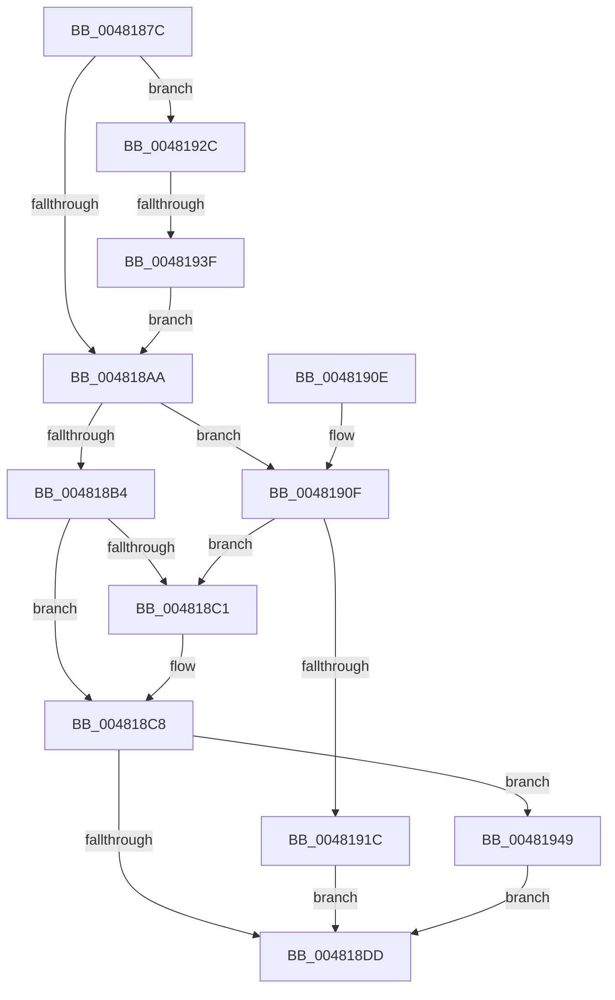

# MiQueuePageFileExtension

- RVA: `0x0048187C`–`0x00481951` (길이 `213` bytes)
- VA: `0x000000014048187C`
- 실행 섹션: `.text`
- PDB 이름 있음: `예`; PDB Function 태그: `예`
- unwind 정보 RVA: `0x0007198C`
- 디코드: `57`개 명령, `213/213` bytes 표시
- 미해석 바이트: `0` (있으면 어셈블리에 `.byte`로 보존)

> 이 문서는 커널 이미지의 기계어와 PDB 기호를 분석해 생성했습니다. 4번과 5번은 함수 원형과 자료형을 바이너리 사용 방식에서 추정한 C 해석이며 원본 소스 복구 결과는 아닙니다.

## 1. Dependencies

- 직접 호출 지점: **3**; 고유 호출 대상: **3**
- 직접 호출자로 확인된 함수: **3**
- RIP 상대 이미지 참조: **0**

### Outgoing calls
- `0x004818E7` → [MiReleaseSpinLockExclusive](../24/MiReleaseSpinLockExclusive_function_002482C0.md) (function, `0x002482C0`)
- `0x004818F4` → [KeSetEvent](../33/KeSetEvent_function_0033F310.md) (function, `0x0033F310`)
- `0x0048193F` → [ExAcquireSpinLockExclusiveAtDpcLevel](../24/ExAcquireSpinLockExclusiveAtDpcLevel_function_00248E80.md) (function, `0x00248E80`)

### Direct callers
- [MiContractPagingFiles](MiContractPagingFiles_function_0048177C.md) at `0x00481833`
- [MiContractWsSwapPageFileWorker](../68/MiContractWsSwapPageFileWorker_function_0068B860.md) at `0x0068B8F0`
- [sub_006F421A](../6F/Unknown_function_006F421A.md) at `0x006F42F6`

### Static image references
- 디코드된 RIP-relative 메모리 참조가 없습니다.

## 2. Other-region calls and transfers

- 다른 실행 섹션으로 향하는 call: **0**
- call이 아닌 외부 분기/꼬리 이동: **1**
  - `0x00481939` → [sub_006F5238](../6F/Unknown_function_006F5238.md) (`tail-transfer`)

## 3. Assembly (complete function range)

```asm
0048187C  48 89 5C 24 08                  mov qword ptr [rsp + 8], rbx
00481881  48 89 6C 24 10                  mov qword ptr [rsp + 0x10], rbp
00481886  48 89 74 24 18                  mov qword ptr [rsp + 0x18], rsi
0048188B  57                              push rdi
0048188C  48 83 EC 20                     sub rsp, 0x20
00481890  48 8B 59 18                     mov rbx, qword ptr [rcx + 0x18]
00481894  40 8A F2                        mov sil, dl
00481897  48 8B F9                        mov rdi, rcx
0048189A  48 8D AB 70 07 00 00            lea rbp, [rbx + 0x770]
004818A1  80 FA 11                        cmp dl, 0x11
004818A4  0F 84 82 00 00 00               je 0x14048192c
004818AA  F6 47 4F 08                     test byte ptr [rdi + 0x4f], 8
004818AE  48 8D 4F 08                     lea rcx, [rdi + 8]
004818B2  75 5B                           jne 0x14048190f
004818B4  48 8D 45 38                     lea rax, [rbp + 0x38]
004818B8  48 8B 50 08                     mov rdx, qword ptr [rax + 8]
004818BC  48 39 02                        cmp qword ptr [rdx], rax
004818BF  74 07                           je 0x1404818c8
004818C1  B9 03 00 00 00                  mov ecx, 3
004818C6  CD 29                           int 0x29
004818C8  48 89 01                        mov qword ptr [rcx], rax
004818CB  48 89 51 08                     mov qword ptr [rcx + 8], rdx
004818CF  48 89 0A                        mov qword ptr [rdx], rcx
004818D2  48 89 48 08                     mov qword ptr [rax + 8], rcx
004818D6  48 83 7F 20 FF                  cmp qword ptr [rdi + 0x20], -1
004818DB  75 6C                           jne 0x140481949
004818DD  48 8D 8B C0 06 00 00            lea rcx, [rbx + 0x6c0]
004818E4  40 8A D6                        mov dl, sil
004818E7  E8 D4 69 DC FF                  call 0x1402482c0
004818EC  45 33 C0                        xor r8d, r8d
004818EF  33 D2                           xor edx, edx
004818F1  48 8B CD                        mov rcx, rbp
004818F4  E8 17 DA EB FF                  call 0x14033f310
004818F9  48 8B 5C 24 30                  mov rbx, qword ptr [rsp + 0x30]
004818FE  48 8B 6C 24 38                  mov rbp, qword ptr [rsp + 0x38]
00481903  48 8B 74 24 40                  mov rsi, qword ptr [rsp + 0x40]
00481908  48 83 C4 20                     add rsp, 0x20
0048190C  5F                              pop rdi
0048190D  C3                              ret
0048190E  CC                              int3
0048190F  48 8D 45 28                     lea rax, [rbp + 0x28]
00481913  48 8B 50 08                     mov rdx, qword ptr [rax + 8]
00481917  48 39 02                        cmp qword ptr [rdx], rax
0048191A  75 A5                           jne 0x1404818c1
0048191C  48 89 01                        mov qword ptr [rcx], rax
0048191F  48 89 51 08                     mov qword ptr [rcx + 8], rdx
00481923  48 89 0A                        mov qword ptr [rdx], rcx
00481926  48 89 48 08                     mov qword ptr [rax + 8], rcx
0048192A  EB B1                           jmp 0x1404818dd
0048192C  44 0F 20 C0                     mov rax, cr8
00481930  48 8D 8B C0 06 00 00            lea rcx, [rbx + 0x6c0]
00481937  3C 02                           cmp al, 2
00481939  0F 85 F9 38 27 00               jne 0x1406f5238
0048193F  E8 3C 75 DC FF                  call 0x140248e80
00481944  E9 61 FF FF FF                  jmp 0x1404818aa
00481949  FF 83 9C 09 00 00               inc dword ptr [rbx + 0x99c]
0048194F  EB 8C                           jmp 0x1404818dd
```

## 4. C-style interpretation (structured pseudocode)

```c
__int64 __fastcall MiQueuePageFileExtension(__int64 a1, unsigned __int8 a2, int a3)
{
    __int64 result;
    __int64 v_rsp;
    unsigned __int64 v_stack_p10;
    unsigned __int64 v_stack_p18;
    unsigned __int64 v_stack_p8;

    v_stack_p8 = v_rbx;
    v_stack_p10 = v_rbp;
    v_stack_p18 = v_rsi;
    v_rsp = (v_rsp) - (32);
    if (a2 == 17) goto loc_0048192C;
loc_004818AA:
    if (((*(unsigned __int8 *)(a1 + 79)) & (8)) != 0) goto loc_0048190F;
    if ((*(unsigned __int64 *)(*(unsigned __int64 *)(*(unsigned __int64 *)(a1 + 24) + 1904 + 56 + 8))) != (*(unsigned __int64 *)(a1 + 24) + 1904 + 56)) {
        a1 = 3;
    }
    *(unsigned __int64 *)(a1) = *(unsigned __int64 *)(a1 + 24) + 1904 + 56;
    *(unsigned __int64 *)(a1 + 8) = *(unsigned __int64 *)(*(unsigned __int64 *)(a1 + 24) + 1904 + 56 + 8);
    *(unsigned __int64 *)(*(unsigned __int64 *)(*(unsigned __int64 *)(a1 + 24) + 1904 + 56 + 8)) = a1;
    *(unsigned __int64 *)(*(unsigned __int64 *)(a1 + 24) + 1904 + 56 + 8) = a1;
    if ((*(unsigned __int64 *)(a1 + 32)) != -1) goto loc_00481949;
loc_004818DD:
    result = MiReleaseSpinLockExclusive(*(unsigned __int64 *)(a1 + 24) + 1728, a2, a3, a4);
    a3 = 0;
    a2 = 0;
    result = KeSetEvent(*(unsigned __int64 *)(a1 + 24) + 1904, a2, a3, a4);
    v_rsp = (v_rsp) + (32);
    return result;
loc_0048190F:
    if ((*(unsigned __int64 *)(*(unsigned __int64 *)(v_stack_p10 + 40 + 8))) != (v_stack_p10 + 40)) goto loc_004818C1;
    *(unsigned __int64 *)(*(unsigned __int64 *)(a1 + 24) + 1904) = v_stack_p10 + 40;
    *(unsigned __int64 *)(*(unsigned __int64 *)(a1 + 24) + 1904 + 8) = *(unsigned __int64 *)(v_stack_p10 + 40 + 8);
    *(unsigned __int64 *)(*(unsigned __int64 *)(v_stack_p10 + 40 + 8)) = *(unsigned __int64 *)(a1 + 24) + 1904;
    *(unsigned __int64 *)(v_stack_p10 + 40 + 8) = *(unsigned __int64 *)(a1 + 24) + 1904;
    goto loc_004818DD;
loc_0048192C:
    result = ExAcquireSpinLockExclusiveAtDpcLevel(v_stack_p8 + 1728, *(unsigned __int64 *)(v_stack_p10 + 40 + 8), a3, a4);
    goto loc_004818AA;
loc_00481949:
    goto loc_004818DD;
}
```

## 5. (Beta) C Style

```c
int64_t MiQueuePageFileExtension(void *Arg1, uint8_t Arg2, int32_t Arg3)
{
    uint8_t *arg1 = (uint8_t *)Arg1;

    int64_t result;
    int64_t local_rsp;
    uint64_t v_stack_p10;
    uint64_t v_stack_p18;
    uint64_t v_stack_p8;

    v_stack_p8 = local_rbx;
    v_stack_p10 = local_rbp;
    v_stack_p18 = local_rsi;
    local_rsp = (local_rsp) - (32);
    if (Arg2 == 17) goto loc_0048192C;
loc_004818AA:
    if (((*(uint8_t *)(arg1 + 0x4F)) & (8)) != 0) goto loc_0048190F;
    if ((*(uint64_t *)(*(uint64_t *)(*(uint64_t *)(arg1 + 0x18) + 0x770 + 0x38 + 0x8))) != (*(uint64_t *)(arg1 + 0x18) + 1904 + 56)) {
        Arg1 = 3;
    }
    *(uint64_t *)(arg1) = *(uint64_t *)(arg1 + 0x18) + 1904 + 56;
    *(uint64_t *)(arg1 + 0x8) = *(uint64_t *)(*(uint64_t *)(arg1 + 0x18) + 0x770 + 0x38 + 0x8);
    *(void **)(*(uint64_t *)(*(uint64_t *)(arg1 + 0x18) + 0x770 + 0x38 + 0x8)) = Arg1;
    *(void **)(*(uint64_t *)(arg1 + 0x18) + 0x770 + 0x38 + 0x8) = Arg1;
    if ((*(uint64_t *)(arg1 + 0x20)) != -1) goto loc_00481949;
loc_004818DD:
    result = MiReleaseSpinLockExclusive(*(uint64_t *)(arg1 + 0x18) + 1728, Arg2, Arg3, a4);
    Arg3 = 0;
    Arg2 = 0;
    result = KeSetEvent(*(uint64_t *)(arg1 + 0x18) + 1904, Arg2, Arg3, a4);
    local_rsp = (local_rsp) + (32);
    return result;
loc_0048190F:
    if ((*(uint64_t *)(*(uint64_t *)(v_stack_p10 + 0x28 + 0x8))) != (v_stack_p10 + 40)) goto loc_004818C1;
    *(uint64_t *)(*(uint64_t *)(arg1 + 0x18) + 0x770) = v_stack_p10 + 40;
    *(uint64_t *)(*(uint64_t *)(arg1 + 0x18) + 0x770 + 0x8) = *(uint64_t *)(v_stack_p10 + 0x28 + 0x8);
    *(uint64_t *)(*(uint64_t *)(v_stack_p10 + 0x28 + 0x8)) = *(uint64_t *)(arg1 + 0x18) + 1904;
    *(uint64_t *)(v_stack_p10 + 0x28 + 0x8) = *(uint64_t *)(arg1 + 0x18) + 1904;
    goto loc_004818DD;
loc_0048192C:
    result = ExAcquireSpinLockExclusiveAtDpcLevel(v_stack_p8 + 1728, *(uint64_t *)(v_stack_p10 + 0x28 + 0x8), Arg3, a4);
    goto loc_004818AA;
loc_00481949:
    goto loc_004818DD;
}
```

### 관측된 메모리 오프셋

구조체 형식이 확인되지 않은 접근은 인자 기준의 오프셋으로만 기록했습니다.

| 기준 인자 | 오프셋 표현 | 폭 (bit) | 접근 |
|---|---:|---:|---|
| `Arg1` | `+ 0x0` | `64` | `W` |
| `Arg1` | `+ 0x8` | `64` | `R` |
| `Arg1` | `+ 0x8` | `64` | `W` |
| `Arg1` | `+ 0x18` | `64` | `R` |
| `Arg1` | `+ 0x20` | `64` | `R` |
| `Arg1` | `+ 0x4F` | `8` | `R` |

## 6. Execution-region graph

[열기: 2D/3D 그래프와 함수 탐색 컨트롤 패널](../../../control-panel.html?section=text&rva=0x0048187C&view=graph)

- 2D 그래프는 위에서 아래로 흐르고, 3D 그래프는 빈 공간을 드래그해 회전합니다. Shift+드래그는 이동, 휠은 확대·축소, 함수 노드 선택은 대상 보고서 이동입니다.

### Static fallback


