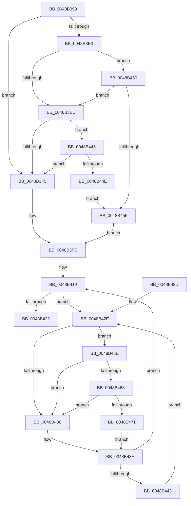

# MiRemoveSystemImagePage

- RVA: `0x0048B398`–`0x0048B47A` (길이 `226` bytes)
- VA: `0x000000014048B398`
- 실행 섹션: `.text`
- PDB 이름 있음: `예`; PDB Function 태그: `아니요`
- unwind 정보 RVA: `0x000B0524`
- 디코드: `59`개 명령, `226/226` bytes 표시
- 미해석 바이트: `0` (있으면 어셈블리에 `.byte`로 보존)

> 이 문서는 커널 이미지의 기계어와 PDB 기호를 분석해 생성했습니다. 4번과 5번은 함수 원형과 자료형을 바이너리 사용 방식에서 추정한 C 해석이며 원본 소스 복구 결과는 아닙니다.

## 1. Dependencies

- 직접 호출 지점: **3**; 고유 호출 대상: **3**
- 직접 호출자로 확인된 함수: **2**
- RIP 상대 이미지 참조: **8**

### Outgoing calls
- `0x0048B412` → [MiTerminateWsle](../23/MiTerminateWsle_function_0023EDF0.md) (function, `0x0023EDF0`)
- `0x0048B468` → [KiCheckVpBackingLongSpinWaitHypercall](../30/KiCheckVpBackingLongSpinWaitHypercall_function_0030F490.md) (function, `0x0030F490`)
- `0x0048B473` → [HvlNotifyLongSpinWait](../30/HvlNotifyLongSpinWait_function_0030F460.md) (function, `0x0030F460`)

### Direct callers
- [MiLockCode](../36/MiLockCode_function_0036F91C.md) at `0x0036FDDD`
- [sub_006E4C68](../6E/Unknown_function_006E4C68.md) at `0x006E4C7A`

### Static image references
- `0x0048B3D3` → RVA `0x00FC6B28` (`ALMOSTRO`; read)
- `0x0048B3E3` → RVA `0x00FC6CB0` (`ALMOSTRO`; read)
- `0x0048B3EC` → RVA `0x00FC6D90` (`ALMOSTRO`; read)
- `0x0048B3F5` → RVA `0x00E2D974` (`.data`; read)
- `0x0048B430` → RVA `0x00FC52AC` (`ALMOSTRO`; reference)
- `0x0048B445` → RVA `0x00FC6B98` (`ALMOSTRO`; read)
- `0x0048B455` → RVA `0x00E2D970` (`.data`; read)
- `0x0048B45E` → RVA `0x00FC6AB8` (`ALMOSTRO`; read)

## 2. Other-region calls and transfers

- 다른 실행 섹션으로 향하는 call: **0**
- 별도 외부 분기/꼬리 이동을 확인하지 못했습니다.

## 3. Assembly (complete function range)

```asm
0048B398  48 89 5C 24 08                  mov qword ptr [rsp + 8], rbx
0048B39D  57                              push rdi
0048B39E  48 83 EC 30                     sub rsp, 0x30
0048B3A2  83 64 24 48 00                  and dword ptr [rsp + 0x48], 0
0048B3A7  49 8B F8                        mov rdi, r8
0048B3AA  41 80 48 23 08                  or byte ptr [r8 + 0x23], 8
0048B3AF  48 B8 FF FF FF FF FF FF FF 7F   movabs rax, 0x7fffffffffffffff
0048B3B9  F0 49 21 40 18                  lock and qword ptr [r8 + 0x18], rax
0048B3BE  48 C1 E2 19                     shl rdx, 0x19
0048B3C2  48 B8 00 00 00 00 80 F6 FF FF   movabs rax, 0xfffff68000000000
0048B3CC  48 C1 E0 19                     shl rax, 0x19
0048B3D0  48 2B D0                        sub rdx, rax
0048B3D3  48 8B 05 4E B7 B3 00            mov rax, qword ptr [rip + 0xb3b74e]
0048B3DA  48 C1 FA 10                     sar rdx, 0x10
0048B3DE  48 85 C0                        test rax, rax
0048B3E1  74 12                           je 0x14048b3f5
0048B3E3  48 3B 15 C6 B8 B3 00            cmp rdx, qword ptr [rip + 0xb3b8c6]
0048B3EA  72 64                           jb 0x14048b450
0048B3EC  48 3B 15 9D B9 B3 00            cmp rdx, qword ptr [rip + 0xb3b99d]
0048B3F3  72 50                           jb 0x14048b445
0048B3F5  48 8D 05 78 25 9A 00            lea rax, [rip + 0x9a2578]
0048B3FC  F0 FF 08                        lock dec dword ptr [rax]
0048B3FF  41 B9 01 00 00 00               mov r9d, 1
0048B405  48 8D 44 24 48                  lea rax, [rsp + 0x48]
0048B40A  45 33 C0                        xor r8d, r8d
0048B40D  48 89 44 24 20                  mov qword ptr [rsp + 0x20], rax
0048B412  E8 D9 39 DB FF                  call 0x14023edf0
0048B417  33 DB                           xor ebx, ebx
0048B419  F0 48 0F BA 6F 18 3F            lock bts qword ptr [rdi + 0x18], 0x3f
0048B420  72 0C                           jb 0x14048b42e
0048B422  48 8B 5C 24 40                  mov rbx, qword ptr [rsp + 0x40]
0048B427  48 83 C4 30                     add rsp, 0x30
0048B42B  5F                              pop rdi
0048B42C  C3                              ret
0048B42D  CC                              int3
0048B42E  FF C3                           inc ebx
0048B430  85 1D 76 9E B3 00               test dword ptr [rip + 0xb39e76], ebx
0048B436  74 26                           je 0x14048b45e
0048B438  F3 90                           pause
0048B43A  48 8B 47 18                     mov rax, qword ptr [rdi + 0x18]
0048B43E  48 85 C0                        test rax, rax
0048B441  79 D6                           jns 0x14048b419
0048B443  EB E9                           jmp 0x14048b42e
0048B445  48 3B 15 4C B7 B3 00            cmp rdx, qword ptr [rip + 0xb3b74c]
0048B44C  72 A7                           jb 0x14048b3f5
0048B44E  EB 05                           jmp 0x14048b455
0048B450  48 3B D0                        cmp rdx, rax
0048B453  72 97                           jb 0x14048b3ec
0048B455  48 8D 05 14 25 9A 00            lea rax, [rip + 0x9a2514]
0048B45C  EB 9E                           jmp 0x14048b3fc
0048B45E  8B 05 54 B6 B3 00               mov eax, dword ptr [rip + 0xb3b654]
0048B464  A8 40                           test al, 0x40
0048B466  74 D0                           je 0x14048b438
0048B468  E8 23 40 E8 FF                  call 0x14030f490
0048B46D  84 C0                           test al, al
0048B46F  74 C7                           je 0x14048b438
0048B471  8B CB                           mov ecx, ebx
0048B473  E8 E8 3F E8 FF                  call 0x14030f460
0048B478  EB C0                           jmp 0x14048b43a
```

## 4. C-style interpretation (structured pseudocode)

```c
__int64 __fastcall MiRemoveSystemImagePage(__int64 a1, __int64 a2, __int64 a3)
{
    __int64 result;
    __int64 v_rbx;
    __int64 v_rsp;
    unsigned __int64 v_stack_m18;
    unsigned int v_stack_p10;
    unsigned __int64 v_stack_p8;

    v_stack_p8 = v_rbx;
    v_rsp = (v_rsp) - (48);
    a2 = (a2) << (25);
    result = (result) << (25);
    a2 = (a2) - (result);
    a2 = (a2) >> (16);
    if (*(unsigned __int64 *)(v_rip + 11777870) == 0) goto loc_0048B3F5;
    if (a2 < (*(unsigned __int64 *)(v_rip + 11778246))) goto loc_0048B450;
loc_0048B3EC:
    if (a2 < (*(unsigned __int64 *)(v_rip + 11778461))) goto loc_0048B445;
loc_0048B3F5:
loc_0048B3FC:
    a3 = 0;
    v_stack_m18 = v_stack_p10;
    result = MiTerminateWsle(a1, a2, a3, 1);
    v_rbx = 0;
loc_0048B419:
    if (condition_is_below) goto loc_0048B42E;
    v_rsp = (v_rsp) + (48);
    return result;
loc_0048B42E:
    v_rbx = (unsigned int)((v_stack_p8) + 1);
    if (((*(unsigned int *)(v_rip + 11771510)) & ((unsigned int)(v_rbx))) == 0) goto loc_0048B45E;
loc_0048B438:
loc_0048B43A:
    if (!sign_flag) goto loc_0048B419;
    goto loc_0048B42E;
loc_0048B445:
    if (a2 < (*(unsigned __int64 *)(v_rip + 11777868))) goto loc_0048B3F5;
    goto loc_0048B455;
loc_0048B450:
    if (a2 < (*(unsigned __int64 *)(a3 + 24))) goto loc_0048B3EC;
loc_0048B455:
    goto loc_0048B3FC;
loc_0048B45E:
    if ((((unsigned __int8)((unsigned int)(*(unsigned int *)(v_rip + 11777620)))) & (64)) == 0) goto loc_0048B438;
    result = KiCheckVpBackingLongSpinWaitHypercall(a1, a2, a3, 1);
    if ((unsigned __int8)(result) == 0) goto loc_0048B438;
    result = HvlNotifyLongSpinWait((unsigned int)((unsigned int)(v_rbx)), a2, a3, 1);
    goto loc_0048B43A;
}
```

## 5. (Beta) C Style

```c
int64_t MiRemoveSystemImagePage(int64_t Arg1, int64_t Arg2, void *Arg3)
{
    uint8_t *arg3 = (uint8_t *)Arg3;

    int64_t result;
    int64_t local_rbx;
    int64_t local_rsp;
    uint64_t v_stack_m18;
    uint32_t v_stack_p10;
    uint64_t v_stack_p8;

    v_stack_p8 = local_rbx;
    local_rsp = (local_rsp) - (48);
    Arg2 = (Arg2) << (25);
    result = (result) << (25);
    Arg2 = (Arg2) - (result);
    Arg2 = (Arg2) >> (16);
    if (*(uint64_t *)(v_rip + 0xB3B74E) == 0) goto loc_0048B3F5;
    if (Arg2 < (*(uint64_t *)(v_rip + 0xB3B8C6))) goto loc_0048B450;
loc_0048B3EC:
    if (Arg2 < (*(uint64_t *)(v_rip + 0xB3B99D))) goto loc_0048B445;
loc_0048B3F5:
loc_0048B3FC:
    Arg3 = 0;
    v_stack_m18 = v_stack_p10;
    result = MiTerminateWsle(Arg1, Arg2, Arg3, 1);
    local_rbx = 0;
loc_0048B419:
    if (condition_is_below) goto loc_0048B42E;
    local_rsp = (local_rsp) + (48);
    return result;
loc_0048B42E:
    local_rbx = (uint32_t)((v_stack_p8) + 1);
    if (((*(uint32_t *)(v_rip + 0xB39E76)) & ((uint32_t)(local_rbx))) == 0) goto loc_0048B45E;
loc_0048B438:
loc_0048B43A:
    if (!sign_flag) goto loc_0048B419;
    goto loc_0048B42E;
loc_0048B445:
    if (Arg2 < (*(uint64_t *)(v_rip + 0xB3B74C))) goto loc_0048B3F5;
    goto loc_0048B455;
loc_0048B450:
    if (Arg2 < (*(uint64_t *)(arg3 + 0x18))) goto loc_0048B3EC;
loc_0048B455:
    goto loc_0048B3FC;
loc_0048B45E:
    if ((((uint8_t)((uint32_t)(*(uint32_t *)(v_rip + 0xB3B654)))) & (64)) == 0) goto loc_0048B438;
    result = KiCheckVpBackingLongSpinWaitHypercall(Arg1, Arg2, Arg3, 1);
    if ((uint8_t)(result) == 0) goto loc_0048B438;
    result = HvlNotifyLongSpinWait((uint32_t)((uint32_t)(local_rbx)), Arg2, Arg3, 1);
    goto loc_0048B43A;
}
```

### 관측된 메모리 오프셋

구조체 형식이 확인되지 않은 접근은 인자 기준의 오프셋으로만 기록했습니다.

| 기준 인자 | 오프셋 표현 | 폭 (bit) | 접근 |
|---|---:|---:|---|
| `Arg3` | `+ 0x18` | `64` | `R` |
| `Arg3` | `+ 0x18` | `64` | `R/W` |
| `Arg3` | `+ 0x23` | `8` | `R/W` |

## 6. Execution-region graph

[열기: 2D/3D 그래프와 함수 탐색 컨트롤 패널](../../../control-panel.html?section=text&rva=0x0048B398&view=graph)

- 2D 그래프는 위에서 아래로 흐르고, 3D 그래프는 빈 공간을 드래그해 회전합니다. Shift+드래그는 이동, 휠은 확대·축소, 함수 노드 선택은 대상 보고서 이동입니다.

### Static fallback


