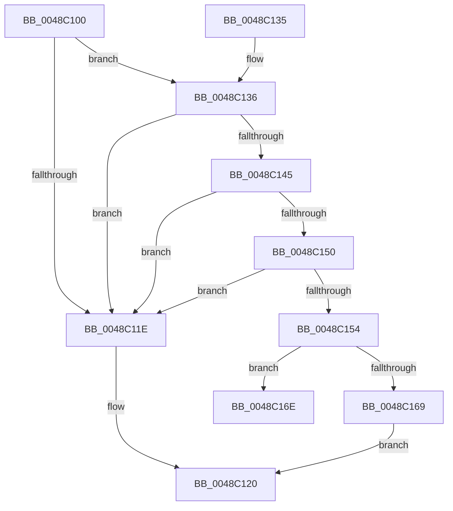

# MiRetryNonPagedAllocation

- RVA: `0x0048C100`–`0x0048C17F` (길이 `127` bytes)
- VA: `0x000000014048C100`
- 실행 섹션: `.text`
- PDB 이름 있음: `예`; PDB Function 태그: `예`
- unwind 정보 RVA: `0x00075F88`
- 디코드: `36`개 명령, `127/127` bytes 표시
- 미해석 바이트: `0` (있으면 어셈블리에 `.byte`로 보존)

> 이 문서는 커널 이미지의 기계어와 PDB 기호를 분석해 생성했습니다. 4번과 5번은 함수 원형과 자료형을 바이너리 사용 방식에서 추정한 C 해석이며 원본 소스 복구 결과는 아닙니다.

## 1. Dependencies

- 직접 호출 지점: **2**; 고유 호출 대상: **2**
- 직접 호출자로 확인된 함수: **1**
- RIP 상대 이미지 참조: **2**

### Outgoing calls
- `0x0048C145` → [KeAreInterruptsEnabled](../2F/KeAreInterruptsEnabled_function_002F8060.md) (function, `0x002F8060`)
- `0x0048C160` → [MiSufficientAvailablePages](../36/MiSufficientAvailablePages_function_0036D0B0.md) (function, `0x0036D0B0`)

### Direct callers
- [MiGetPoolPages](../32/MiGetPoolPages_function_00327D3C.md) at `0x00327E5F`
- [MiGetPoolPages](../32/MiGetPoolPages_function_00327D3C.md) at `0x00327EC3`

### Static image references
- `0x0048C159` → RVA `0x00E38D00` (`.data`; read)
- `0x0048C16E` → RVA `0x00011C80` (`.rdata`; read)

## 2. Other-region calls and transfers

- 다른 실행 섹션으로 향하는 call: **0**
- call이 아닌 외부 분기/꼬리 이동: **1**
  - `0x0048C17A` → [sub_006F639E](../6F/Unknown_function_006F639E.md) (`tail-transfer`)

## 3. Assembly (complete function range)

```asm
0048C100  48 89 5C 24 08                  mov qword ptr [rsp + 8], rbx
0048C105  48 89 6C 24 10                  mov qword ptr [rsp + 0x10], rbp
0048C10A  48 89 74 24 18                  mov qword ptr [rsp + 0x18], rsi
0048C10F  57                              push rdi
0048C110  48 83 EC 30                     sub rsp, 0x30
0048C114  8B F9                           mov edi, ecx
0048C116  44 0F 20 C0                     mov rax, cr8
0048C11A  3C 01                           cmp al, 1
0048C11C  76 18                           jbe 0x14048c136
0048C11E  33 C0                           xor eax, eax
0048C120  48 8B 5C 24 40                  mov rbx, qword ptr [rsp + 0x40]
0048C125  48 8B 6C 24 48                  mov rbp, qword ptr [rsp + 0x48]
0048C12A  48 8B 74 24 50                  mov rsi, qword ptr [rsp + 0x50]
0048C12F  48 83 C4 30                     add rsp, 0x30
0048C133  5F                              pop rdi
0048C134  C3                              ret
0048C135  CC                              int3
0048C136  65 8B 04 25 3C 3A 00 00         mov eax, dword ptr gs:[0x3a3c]
0048C13E  A9 01 00 01 00                  test eax, 0x10001
0048C143  75 D9                           jne 0x14048c11e
0048C145  E8 16 BF E6 FF                  call 0x1402f8060
0048C14A  33 DB                           xor ebx, ebx
0048C14C  84 C0                           test al, al
0048C14E  74 CE                           je 0x14048c11e
0048C150  85 FF                           test edi, edi
0048C152  75 CA                           jne 0x14048c11e
0048C154  BA A0 00 00 00                  mov edx, 0xa0
0048C159  48 8D 0D A0 CB 9A 00            lea rcx, [rip + 0x9acba0]
0048C160  E8 4B 0F EE FF                  call 0x14036d0b0
0048C165  85 C0                           test eax, eax
0048C167  74 05                           je 0x14048c16e
0048C169  8D 43 01                        lea eax, [rbx + 1]
0048C16C  EB B2                           jmp 0x14048c120
0048C16E  48 8D 35 0B 5B B8 FF            lea rsi, [rip - 0x47a4f5]
0048C175  BF 01 00 00 00                  mov edi, 1
0048C17A  E9 1F A2 26 00                  jmp 0x1406f639e
```

## 4. C-style interpretation (structured pseudocode)

```c
__int64 __fastcall MiRetryNonPagedAllocation(int a1)
{
    __int64 result;
    __int64 v_rbx;
    __int64 v_rsp;
    unsigned __int64 v_stack_p10;
    unsigned __int64 v_stack_p18;
    unsigned __int64 v_stack_p8;

    v_stack_p8 = v_rbx;
    v_stack_p10 = v_rbp;
    v_stack_p18 = v_rsi;
    v_rsp = (v_rsp) - (48);
    if (((unsigned __int8)(v_cr8)) <= 1) goto loc_0048C136;
loc_0048C11E:
    result = 0;
loc_0048C120:
    v_rsp = (v_rsp) + (48);
    return result;
loc_0048C136:
    if ((((unsigned int)((unsigned int)(*(unsigned int *)(gs_base + (0 + 14908))))) & (0x10001ULL)) != 0) goto loc_0048C11E;
    result = KeAreInterruptsEnabled(a1, a2, a3, a4);
    v_rbx = 0;
    if ((unsigned __int8)(result) == 0) goto loc_0048C11E;
    if ((unsigned int)((unsigned int)(a1)) != 0) goto loc_0048C11E;
    result = MiSufficientAvailablePages(v_rip + 10144672, 160, a3, a4);
    if ((unsigned int)(result) == 0) goto loc_0048C16E;
    goto loc_0048C120;
loc_0048C16E:
}
```

## 5. (Beta) C Style

```c
int64_t MiRetryNonPagedAllocation(int32_t Arg1)
{
    int64_t result;
    int64_t local_rbx;
    int64_t local_rsp;
    uint64_t v_stack_p10;
    uint64_t v_stack_p18;
    uint64_t v_stack_p8;

    v_stack_p8 = local_rbx;
    v_stack_p10 = local_rbp;
    v_stack_p18 = local_rsi;
    local_rsp = (local_rsp) - (48);
    if (((uint8_t)(v_cr8)) <= 1) goto loc_0048C136;
loc_0048C11E:
    result = 0;
loc_0048C120:
    local_rsp = (local_rsp) + (48);
    return result;
loc_0048C136:
    if ((((uint32_t)((uint32_t)(*(uint32_t *)(gs_base + (0 + 0x3A3C))))) & (0x10001ULL)) != 0) goto loc_0048C11E;
    result = KeAreInterruptsEnabled(Arg1, a2, a3, a4);
    local_rbx = 0;
    if ((uint8_t)(result) == 0) goto loc_0048C11E;
    if ((uint32_t)((uint32_t)(Arg1)) != 0) goto loc_0048C11E;
    result = MiSufficientAvailablePages(v_rip + 10144672, 160, a3, a4);
    if ((uint32_t)(result) == 0) goto loc_0048C16E;
    goto loc_0048C120;
loc_0048C16E:
}
```

## 6. Execution-region graph

[열기: 2D/3D 그래프와 함수 탐색 컨트롤 패널](../../../control-panel.html?section=text&rva=0x0048C100&view=graph)

- 2D 그래프는 위에서 아래로 흐르고, 3D 그래프는 빈 공간을 드래그해 회전합니다. Shift+드래그는 이동, 휠은 확대·축소, 함수 노드 선택은 대상 보고서 이동입니다.

### Static fallback


