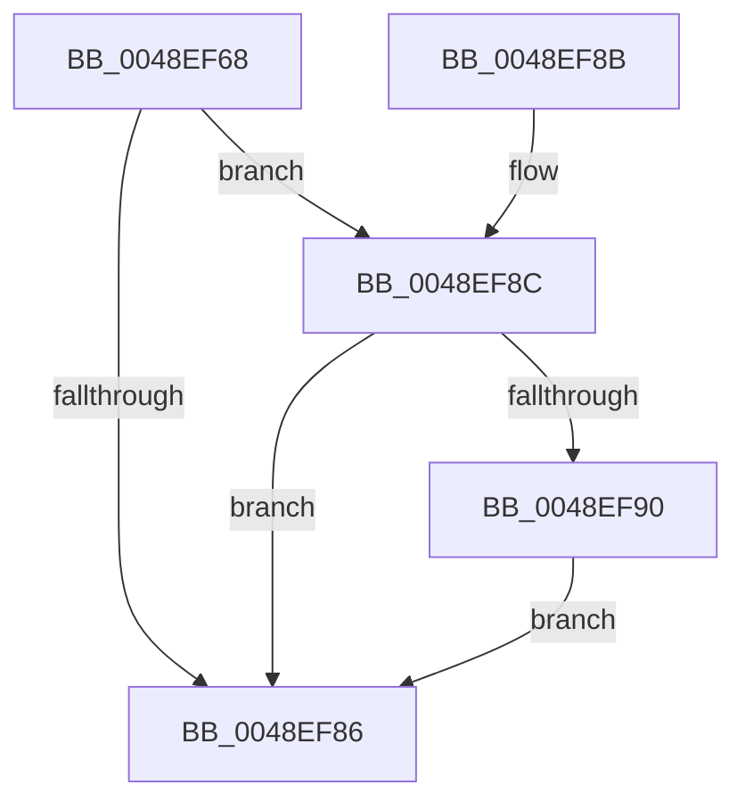

# MiStoreDecrementOutstandingWrites

- RVA: `0x0048EF68`–`0x0048EF9C` (길이 `52` bytes)
- VA: `0x000000014048EF68`
- 실행 섹션: `.text`
- PDB 이름 있음: `예`; PDB Function 태그: `아니요`
- unwind 정보 RVA: `0x000704D0`
- 디코드: `16`개 명령, `52/52` bytes 표시
- 미해석 바이트: `0` (있으면 어셈블리에 `.byte`로 보존)

> 이 문서는 커널 이미지의 기계어와 PDB 기호를 분석해 생성했습니다. 4번과 5번은 함수 원형과 자료형을 바이너리 사용 방식에서 추정한 C 해석이며 원본 소스 복구 결과는 아닙니다.

## 1. Dependencies

- 직접 호출 지점: **1**; 고유 호출 대상: **1**
- 직접 호출자로 확인된 함수: **3**
- RIP 상대 이미지 참조: **0**

### Outgoing calls
- `0x0048EF95` → [KeSetEvent](../33/KeSetEvent_function_0033F310.md) (function, `0x0033F310`)

### Direct callers
- [MiStoreWriteModifiedPages](../2B/MiStoreWriteModifiedPages_function_002B46C4.md) at `0x002B50E9`
- [MiWriteComplete](../40/MiWriteComplete_function_004069B0.md) at `0x00406D35`
- [MiStoreRundownWritesApc](../69/MiStoreRundownWritesApc_function_006930A0.md) at `0x006930D9`

### Static image references
- 디코드된 RIP-relative 메모리 참조가 없습니다.

## 2. Other-region calls and transfers

- 다른 실행 섹션으로 향하는 call: **0**
- 별도 외부 분기/꼬리 이동을 확인하지 못했습니다.

## 3. Assembly (complete function range)

```asm
0048EF68  48 83 EC 28                     sub rsp, 0x28
0048EF6C  8B 81 CC 04 00 00               mov eax, dword ptr [rcx + 0x4cc]
0048EF72  FF C8                           dec eax
0048EF74  89 81 CC 04 00 00               mov dword ptr [rcx + 0x4cc], eax
0048EF7A  48 8B 89 18 05 00 00            mov rcx, qword ptr [rcx + 0x518]
0048EF81  48 85 C9                        test rcx, rcx
0048EF84  75 06                           jne 0x14048ef8c
0048EF86  48 83 C4 28                     add rsp, 0x28
0048EF8A  C3                              ret
0048EF8B  CC                              int3
0048EF8C  85 C0                           test eax, eax
0048EF8E  75 F6                           jne 0x14048ef86
0048EF90  45 33 C0                        xor r8d, r8d
0048EF93  33 D2                           xor edx, edx
0048EF95  E8 76 03 EB FF                  call 0x14033f310
0048EF9A  EB EA                           jmp 0x14048ef86
```

## 4. C-style interpretation (structured pseudocode)

```c
__int64 __fastcall MiStoreDecrementOutstandingWrites(__int64 a1, int a2, int a3)
{
    __int64 result;
    __int64 v_rsp;

    v_rsp = (v_rsp) - (40);
    result = (unsigned int)(((unsigned int)(*(unsigned int *)(a1 + 1228))) - 1);
    *(unsigned int *)(a1 + 1228) = (unsigned int)(result);
    if (*(unsigned __int64 *)(a1 + 1304) != 0) goto loc_0048EF8C;
loc_0048EF86:
    v_rsp = (v_rsp) + (40);
    return result;
loc_0048EF8C:
    if ((unsigned int)(result) != 0) goto loc_0048EF86;
    a3 = 0;
    a2 = 0;
    result = KeSetEvent(*(unsigned __int64 *)(a1 + 1304), a2, a3, a4);
    goto loc_0048EF86;
}
```

## 5. (Beta) C Style

```c
int64_t MiStoreDecrementOutstandingWrites(void *Arg1, int32_t Arg2, int32_t Arg3)
{
    uint8_t *arg1 = (uint8_t *)Arg1;

    int64_t result;
    int64_t local_rsp;

    local_rsp = (local_rsp) - (40);
    result = (uint32_t)(((uint32_t)(*(uint32_t *)(arg1 + 0x4CC))) - 1);
    *(uint32_t *)(arg1 + 0x4CC) = (uint32_t)(result);
    if (*(uint64_t *)(arg1 + 0x518) != 0) goto loc_0048EF8C;
loc_0048EF86:
    local_rsp = (local_rsp) + (40);
    return result;
loc_0048EF8C:
    if ((uint32_t)(result) != 0) goto loc_0048EF86;
    Arg3 = 0;
    Arg2 = 0;
    result = KeSetEvent(*(uint64_t *)(arg1 + 0x518), Arg2, Arg3, a4);
    goto loc_0048EF86;
}
```

### 관측된 메모리 오프셋

구조체 형식이 확인되지 않은 접근은 인자 기준의 오프셋으로만 기록했습니다.

| 기준 인자 | 오프셋 표현 | 폭 (bit) | 접근 |
|---|---:|---:|---|
| `Arg1` | `+ 0x4CC` | `32` | `R` |
| `Arg1` | `+ 0x4CC` | `32` | `W` |
| `Arg1` | `+ 0x518` | `64` | `R` |

## 6. Execution-region graph

[열기: 2D/3D 그래프와 함수 탐색 컨트롤 패널](../../../control-panel.html?section=text&rva=0x0048EF68&view=graph)

- 2D 그래프는 위에서 아래로 흐르고, 3D 그래프는 빈 공간을 드래그해 회전합니다. Shift+드래그는 이동, 휠은 확대·축소, 함수 노드 선택은 대상 보고서 이동입니다.

### Static fallback


