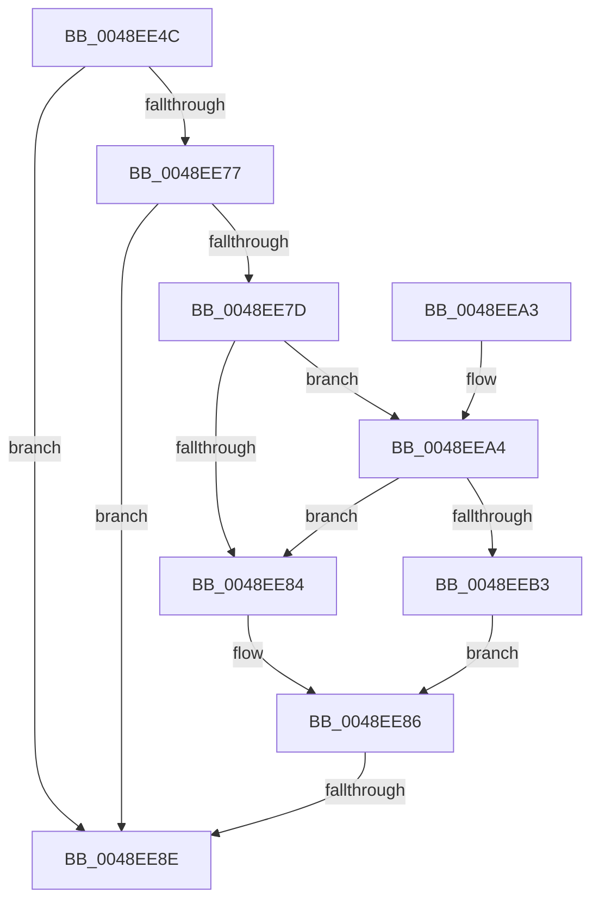

# MiStoreLogWriteIssueFailure

- RVA: `0x0048EE4C`–`0x0048EEB7` (길이 `107` bytes)
- VA: `0x000000014048EE4C`
- 실행 섹션: `.text`
- PDB 이름 있음: `예`; PDB Function 태그: `예`
- unwind 정보 RVA: `0x000B299C`
- 디코드: `31`개 명령, `107/107` bytes 표시
- 미해석 바이트: `0` (있으면 어셈블리에 `.byte`로 보존)

> 이 문서는 커널 이미지의 기계어와 PDB 기호를 분석해 생성했습니다. 4번과 5번은 함수 원형과 자료형을 바이너리 사용 방식에서 추정한 C 해석이며 원본 소스 복구 결과는 아닙니다.

## 1. Dependencies

- 직접 호출 지점: **1**; 고유 호출 대상: **1**
- 직접 호출자로 확인된 함수: **1**
- RIP 상대 이미지 참조: **2**

### Outgoing calls
- `0x0048EE95` → [_security_check_cookie](../6A/_security_check_cookie_function_006AC640.md) (function, `0x006AC640`)

### Direct callers
- [MiStoreWriteModifiedPages](../2B/MiStoreWriteModifiedPages_function_002B46C4.md) at `0x002B5200`

### Static image references
- `0x0048EE5A` → RVA `0x00E0A740` (`.data`; read)
- `0x0048EE68` → RVA `0x00E37618` (`.data`; read)

## 2. Other-region calls and transfers

- 다른 실행 섹션으로 향하는 call: **0**
- call이 아닌 외부 분기/꼬리 이동: **1**
  - `0x0048EE88` → [sub_006F6CE0](../6F/Unknown_function_006F6CE0.md) (`tail-transfer`)

## 3. Assembly (complete function range)

```asm
0048EE4C  40 55                           push rbp
0048EE4E  48 8D 6C 24 A9                  lea rbp, [rsp - 0x57]
0048EE53  48 81 EC E0 00 00 00            sub rsp, 0xe0
0048EE5A  48 8B 05 DF B8 97 00            mov rax, qword ptr [rip + 0x97b8df]
0048EE61  48 33 C4                        xor rax, rsp
0048EE64  48 89 45 47                     mov qword ptr [rbp + 0x47], rax
0048EE68  4C 8B 15 A9 87 9A 00            mov r10, qword ptr [rip + 0x9a87a9]
0048EE6F  44 8B D9                        mov r11d, ecx
0048EE72  4D 85 D2                        test r10, r10
0048EE75  74 17                           je 0x14048ee8e
0048EE77  41 83 3A 05                     cmp dword ptr [r10], 5
0048EE7B  76 11                           jbe 0x14048ee8e
0048EE7D  41 F6 42 10 02                  test byte ptr [r10 + 0x10], 2
0048EE82  75 20                           jne 0x14048eea4
0048EE84  32 C0                           xor al, al
0048EE86  84 C0                           test al, al
0048EE88  0F 85 52 7E 26 00               jne 0x1406f6ce0
0048EE8E  48 8B 4D 47                     mov rcx, qword ptr [rbp + 0x47]
0048EE92  48 33 CC                        xor rcx, rsp
0048EE95  E8 A6 D7 21 00                  call 0x1406ac640
0048EE9A  48 81 C4 E0 00 00 00            add rsp, 0xe0
0048EEA1  5D                              pop rbp
0048EEA2  C3                              ret
0048EEA3  CC                              int3
0048EEA4  49 8B 4A 18                     mov rcx, qword ptr [r10 + 0x18]
0048EEA8  48 8B C1                        mov rax, rcx
0048EEAB  83 E0 02                        and eax, 2
0048EEAE  48 3B C1                        cmp rax, rcx
0048EEB1  75 D1                           jne 0x14048ee84
0048EEB3  B0 01                           mov al, 1
0048EEB5  EB CF                           jmp 0x14048ee86
```

## 4. C-style interpretation (structured pseudocode)

```c
__int64 __fastcall MiStoreLogWriteIssueFailure(int a1)
{
    __int64 result;
    __int64 v_rsp;
    unsigned __int64 v_stack_m18;
    unsigned __int64 v_stack_m5F;

    v_rsp = (v_rsp) - (224);
    result = (*(unsigned __int64 *)(v_rip + 9943263)) ^ (v_rsp);
    v_stack_m18 = result;
    if (*(unsigned __int64 *)(v_rip + 10127273) == 0) goto loc_0048EE8E;
    if ((*(unsigned int *)(*(unsigned __int64 *)(v_rip + 10127273))) <= 5) goto loc_0048EE8E;
    if (((*(unsigned __int8 *)(*(unsigned __int64 *)(v_rip + 10127273) + 16)) & (2)) != 0) goto loc_0048EEA4;
loc_0048EE84:
    result = 0;
loc_0048EE86:
loc_0048EE8E:
    a1 = (v_stack_m18) ^ (v_rsp);
    result = _security_check_cookie(a1, a2, a3, a4);
    v_rsp = (v_rsp) + (224);
    return result;
loc_0048EEA4:
    result = (unsigned int)((*(unsigned __int64 *)(*(unsigned __int64 *)(v_rip + 10127273) + 24)) & (2));
    if (result != (*(unsigned __int64 *)(*(unsigned __int64 *)(v_rip + 10127273) + 24))) goto loc_0048EE84;
    goto loc_0048EE86;
}
```

## 5. (Beta) C Style

```c
int64_t MiStoreLogWriteIssueFailure(int32_t Arg1)
{
    int64_t result;
    int64_t local_rsp;
    uint64_t v_stack_m18;
    uint64_t v_stack_m5F;

    local_rsp = (local_rsp) - (224);
    result = (*(uint64_t *)(v_rip + 0x97B8DF)) ^ (local_rsp);
    v_stack_m18 = result;
    if (*(uint64_t *)(v_rip + 0x9A87A9) == 0) goto loc_0048EE8E;
    if ((*(uint32_t *)(*(uint64_t *)(v_rip + 0x9A87A9))) <= 5) goto loc_0048EE8E;
    if (((*(uint8_t *)(*(uint64_t *)(v_rip + 0x9A87A9) + 0x10)) & (2)) != 0) goto loc_0048EEA4;
loc_0048EE84:
    result = 0;
loc_0048EE86:
loc_0048EE8E:
    Arg1 = (v_stack_m18) ^ (local_rsp);
    result = _security_check_cookie(Arg1, a2, a3, a4);
    local_rsp = (local_rsp) + (224);
    return result;
loc_0048EEA4:
    result = (uint32_t)((*(uint64_t *)(*(uint64_t *)(v_rip + 0x9A87A9) + 0x18)) & (2));
    if (result != (*(uint64_t *)(*(uint64_t *)(v_rip + 0x9A87A9) + 0x18))) goto loc_0048EE84;
    goto loc_0048EE86;
}
```

## 6. Execution-region graph

[열기: 2D/3D 그래프와 함수 탐색 컨트롤 패널](../../../control-panel.html?section=text&rva=0x0048EE4C&view=graph)

- 2D 그래프는 위에서 아래로 흐르고, 3D 그래프는 빈 공간을 드래그해 회전합니다. Shift+드래그는 이동, 휠은 확대·축소, 함수 노드 선택은 대상 보고서 이동입니다.

### Static fallback


