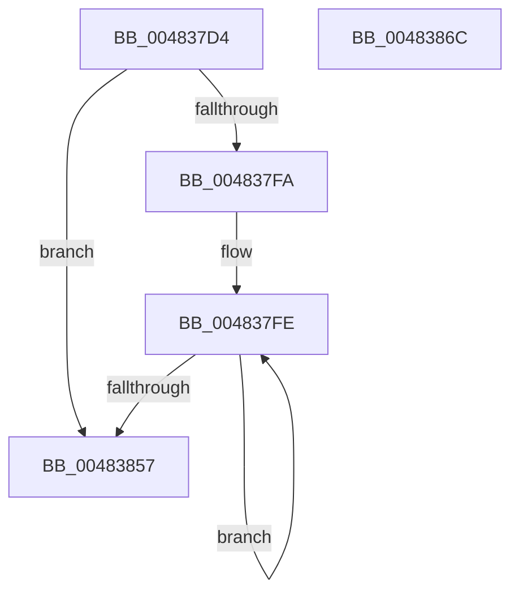

# MiUpdateKernelShadowStackOwnerData

- RVA: `0x004837D4`–`0x0048386D` (길이 `153` bytes)
- VA: `0x00000001404837D4`
- 실행 섹션: `.text`
- PDB 이름 있음: `예`; PDB Function 태그: `아니요`
- unwind 정보 RVA: `0x0005C954`
- 디코드: `40`개 명령, `153/153` bytes 표시
- 미해석 바이트: `0` (있으면 어셈블리에 `.byte`로 보존)

> 이 문서는 커널 이미지의 기계어와 PDB 기호를 분석해 생성했습니다. 4번과 5번은 함수 원형과 자료형을 바이너리 사용 방식에서 추정한 C 해석이며 원본 소스 복구 결과는 아닙니다.

## 1. Dependencies

- 직접 호출 지점: **1**; 고유 호출 대상: **1**
- 직접 호출자로 확인된 함수: **1**
- RIP 상대 이미지 참조: **0**

### Outgoing calls
- `0x0048382D` → [MiValidateKernelShadowStackPage](../33/MiValidateKernelShadowStackPage_function_00338D98.md) (function, `0x00338D98`)

### Direct callers
- [sub_0033827F](../33/Unknown_function_0033827F.md) at `0x00338420`

### Static image references
- 디코드된 RIP-relative 메모리 참조가 없습니다.

## 2. Other-region calls and transfers

- 다른 실행 섹션으로 향하는 call: **0**
- 별도 외부 분기/꼬리 이동을 확인하지 못했습니다.

## 3. Assembly (complete function range)

```asm
004837D4  48 89 5C 24 08                  mov qword ptr [rsp + 8], rbx
004837D9  48 89 6C 24 10                  mov qword ptr [rsp + 0x10], rbp
004837DE  48 89 74 24 18                  mov qword ptr [rsp + 0x18], rsi
004837E3  57                              push rdi
004837E4  48 83 EC 20                     sub rsp, 0x20
004837E8  48 8D 79 08                     lea rdi, [rcx + 8]
004837EC  8B C2                           mov eax, edx
004837EE  49 8B F1                        mov rsi, r9
004837F1  48 8D 2C C7                     lea rbp, [rdi + rax*8]
004837F5  48 3B FD                        cmp rdi, rbp
004837F8  73 5D                           jae 0x140483857
004837FA  48 C1 EE 03                     shr rsi, 3
004837FE  48 8B 07                        mov rax, qword ptr [rdi]
00483801  48 B9 FF FF FF FF FF 00 00 00   movabs rcx, 0xffffffffff
0048380B  48 C1 E8 0C                     shr rax, 0xc
0048380F  48 23 C1                        and rax, rcx
00483812  48 8D 1C 40                     lea rbx, [rax + rax*2]
00483816  48 C1 E3 04                     shl rbx, 4
0048381A  48 B8 00 00 00 00 00 DE FF FF   movabs rax, 0xffffde0000000000
00483824  48 03 D8                        add rbx, rax
00483827  48 8B CF                        mov rcx, rdi
0048382A  48 8B D3                        mov rdx, rbx
0048382D  E8 66 55 EB FF                  call 0x140338d98
00483832  48 8B 03                        mov rax, qword ptr [rbx]
00483835  48 8B CE                        mov rcx, rsi
00483838  48 33 C8                        xor rcx, rax
0048383B  48 83 C7 08                     add rdi, 8
0048383F  48 B8 01 00 00 00 00 F0 FF FF   movabs rax, 0xfffff00000000001
00483849  48 23 C8                        and rcx, rax
0048384C  48 33 CE                        xor rcx, rsi
0048384F  48 89 0B                        mov qword ptr [rbx], rcx
00483852  48 3B FD                        cmp rdi, rbp
00483855  72 A7                           jb 0x1404837fe
00483857  48 8B 5C 24 30                  mov rbx, qword ptr [rsp + 0x30]
0048385C  48 8B 6C 24 38                  mov rbp, qword ptr [rsp + 0x38]
00483861  48 8B 74 24 40                  mov rsi, qword ptr [rsp + 0x40]
00483866  48 83 C4 20                     add rsp, 0x20
0048386A  5F                              pop rdi
0048386B  C3                              ret
0048386C  CC                              int3
```

## 4. C-style interpretation (structured pseudocode)

```c
__int64 __fastcall MiUpdateKernelShadowStackOwnerData(__int64 a1, int a2, __int64 a3, __int64 a4)
{
    __int64 result;
    __int64 v_rbx;
    __int64 v_rdi;
    __int64 v_rsi;
    __int64 v_rsp;
    unsigned __int64 v_stack_p10;
    unsigned __int64 v_stack_p18;
    unsigned __int64 v_stack_p8;

    v_stack_p8 = v_rbx;
    v_stack_p10 = v_rbp;
    v_stack_p18 = v_rsi;
    v_rsp = (v_rsp) - (32);
    if ((a1 + 8) >= (a1 + 8 + (unsigned int)(a2) * 8)) goto loc_00483857;
    v_rsi = (a4) >> (3);
loc_004837FE:
    result = (*(unsigned __int64 *)(a1 + 8)) >> (12);
    result = (result) & (a1);
    v_rbx = (result + result * 2) << (4);
    v_rbx = (v_rbx) + (result);
    result = MiValidateKernelShadowStackPage(a1 + 8, v_rbx, a3, a4);
    a1 = (v_rsi) ^ (*(unsigned __int64 *)(v_rbx));
    v_rdi = (a1 + 8) + (8);
    a1 = (a1) & (*(unsigned __int64 *)(v_rbx));
    a1 = (a1) ^ (v_rsi);
    *(unsigned __int64 *)(v_rbx) = a1;
    if (v_rdi < (a1 + 8 + (unsigned int)(a2) * 8)) goto loc_004837FE;
loc_00483857:
    v_rsp = (v_rsp) + (32);
    return *(unsigned __int64 *)(v_rbx);
}
```

## 5. (Beta) C Style

```c
int64_t MiUpdateKernelShadowStackOwnerData(void *Arg1, int32_t Arg2, int64_t Arg3, int64_t Arg4)
{
    uint8_t *arg1 = (uint8_t *)Arg1;

    int64_t result;
    int64_t local_rbx;
    int64_t local_rdi;
    int64_t local_rsi;
    int64_t local_rsp;
    uint64_t v_stack_p10;
    uint64_t v_stack_p18;
    uint64_t v_stack_p8;

    v_stack_p8 = local_rbx;
    v_stack_p10 = local_rbp;
    v_stack_p18 = local_rsi;
    local_rsp = (local_rsp) - (32);
    if ((Arg1 + 8) >= (Arg1 + 8 + (uint32_t)(Arg2) * 8)) goto loc_00483857;
    local_rsi = (Arg4) >> (3);
loc_004837FE:
    result = (*(uint64_t *)(arg1 + 0x8)) >> (12);
    result = (result) & (Arg1);
    local_rbx = (result + result * 2) << (4);
    local_rbx = (local_rbx) + (result);
    result = MiValidateKernelShadowStackPage(Arg1 + 8, local_rbx, Arg3, Arg4);
    Arg1 = (local_rsi) ^ (*(uint64_t *)(local_rbx));
    local_rdi = (Arg1 + 8) + (8);
    Arg1 = (Arg1) & (*(uint64_t *)(local_rbx));
    Arg1 = (Arg1) ^ (local_rsi);
    *(void **)(local_rbx) = Arg1;
    if (local_rdi < (Arg1 + 8 + (uint32_t)(Arg2) * 8)) goto loc_004837FE;
loc_00483857:
    local_rsp = (local_rsp) + (32);
    return *(uint64_t *)(local_rbx);
}
```

### 관측된 메모리 오프셋

구조체 형식이 확인되지 않은 접근은 인자 기준의 오프셋으로만 기록했습니다.

| 기준 인자 | 오프셋 표현 | 폭 (bit) | 접근 |
|---|---:|---:|---|
| `Arg1` | `+ 0x0 + rax*8` | `64` | `R` |
| `Arg1` | `+ 0x8` | `64` | `R` |

## 6. Execution-region graph

[열기: 2D/3D 그래프와 함수 탐색 컨트롤 패널](../../../control-panel.html?section=text&rva=0x004837D4&view=graph)

- 2D 그래프는 위에서 아래로 흐르고, 3D 그래프는 빈 공간을 드래그해 회전합니다. Shift+드래그는 이동, 휠은 확대·축소, 함수 노드 선택은 대상 보고서 이동입니다.

### Static fallback


