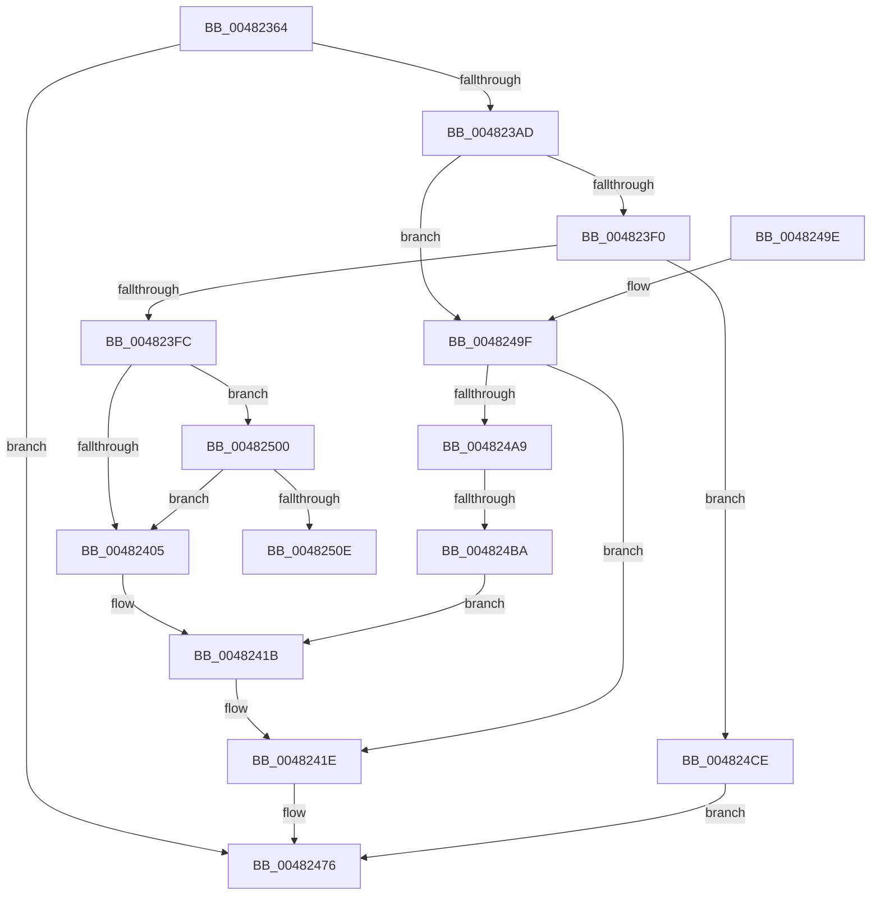

# MiUpdatePageAttributeStamp

- RVA: `0x00482364`–`0x00482521` (길이 `445` bytes)
- VA: `0x0000000140482364`
- 실행 섹션: `.text`
- PDB 이름 있음: `예`; PDB Function 태그: `예`
- unwind 정보 RVA: `0x000AEDC8`
- 디코드: `107`개 명령, `445/445` bytes 표시
- 미해석 바이트: `0` (있으면 어셈블리에 `.byte`로 보존)

> 이 문서는 커널 이미지의 기계어와 PDB 기호를 분석해 생성했습니다. 4번과 5번은 함수 원형과 자료형을 바이너리 사용 방식에서 추정한 C 해석이며 원본 소스 복구 결과는 아닙니다.

## 1. Dependencies

- 직접 호출 지점: **8**; 고유 호출 대상: **8**
- 직접 호출자로 확인된 함수: **1**
- RIP 상대 이미지 참조: **3**

### Outgoing calls
- `0x00482399` → [memset](../6C/memset_function_006C6C40.md) (function, `0x006C6C40`)
- `0x004823DB` → [MiGetPfnSlabType](../28/MiGetPfnSlabType_function_0028E2D0.md) (function, `0x0028E2D0`)
- `0x00482408` → [MiGetPfnPriority](../32/MiGetPfnPriority_function_003226F0.md) (function, `0x003226F0`)
- `0x00482437` → [MiAcquirePageListLock](../27/MiAcquirePageListLock_function_0027C450.md) (function, `0x0027C450`)
- `0x00482471` → [MiReleasePageListLock](../2B/MiReleasePageListLock_function_002B1050.md) (function, `0x002B1050`)
- `0x00482481` → [_security_check_cookie](../6A/_security_check_cookie_function_006AC640.md) (function, `0x006AC640`)
- `0x004824BA` → [MI_NODE_FROM_PFN](../2B/MI_NODE_FROM_PFN_function_002B0F30.md) (function, `0x002B0F30`)
- `0x00482516` → [MiGetSlabAllocatorRepurposedStandbyList](../2A/MiGetSlabAllocatorRepurposedStandbyList_function_002AF428.md) (function, `0x002AF428`)

### Direct callers
- [MiCopyHeaderIfResident](MiCopyHeaderIfResident_function_00482184.md) at `0x0048232B`

### Static image references
- `0x00482379` → RVA `0x00E0A740` (`.data`; read)
- `0x004823B1` → RVA `0x00E30088` (`.data`; read)
- `0x00482441` → RVA `0x00FCF080` (`CACHEALI`; read)

## 2. Other-region calls and transfers

- 다른 실행 섹션으로 향하는 call: **0**
- call이 아닌 외부 분기/꼬리 이동: **2**
  - `0x004824B4` → [sub_006F5292](../6F/Unknown_function_006F5292.md) (`tail-transfer`)
  - `0x0048251C` → [sub_006F5292 + 0xB](../6F/Unknown_function_006F5292.md) (`tail-transfer`)

## 3. Assembly (complete function range)

```asm
00482364  48 89 5C 24 10                  mov qword ptr [rsp + 0x10], rbx
00482369  48 89 6C 24 18                  mov qword ptr [rsp + 0x18], rbp
0048236E  56                              push rsi
0048236F  57                              push rdi
00482370  41 56                           push r14
00482372  48 81 EC B0 00 00 00            sub rsp, 0xb0
00482379  48 8B 05 C0 83 98 00            mov rax, qword ptr [rip + 0x9883c0]
00482380  48 33 C4                        xor rax, rsp
00482383  48 89 84 24 A0 00 00 00         mov qword ptr [rsp + 0xa0], rax
0048238B  33 D2                           xor edx, edx
0048238D  48 8B D9                        mov rbx, rcx
00482390  48 8D 4C 24 30                  lea rcx, [rsp + 0x30]
00482395  44 8D 42 68                     lea r8d, [rdx + 0x68]
00482399  E8 A2 48 24 00                  call 0x1406c6c40
0048239E  8B 43 20                        mov eax, dword ptr [rbx + 0x20]
004823A1  45 33 F6                        xor r14d, r14d
004823A4  66 85 C0                        test ax, ax
004823A7  0F 85 C9 00 00 00               jne 0x140482476
004823AD  48 8B 43 28                     mov rax, qword ptr [rbx + 0x28]
004823B1  48 8B 0D D0 DC 9A 00            mov rcx, qword ptr [rip + 0x9adcd0]
004823B8  44 0F B6 43 22                  movzx r8d, byte ptr [rbx + 0x22]
004823BD  48 C1 E8 2B                     shr rax, 0x2b
004823C1  25 FF 03 00 00                  and eax, 0x3ff
004823C6  48 8B 34 C1                     mov rsi, qword ptr [rcx + rax*8]
004823CA  41 8B C0                        mov eax, r8d
004823CD  83 E0 07                        and eax, 7
004823D0  48 8B CB                        mov rcx, rbx
004823D3  48 8B BC C6 E0 1B 00 00         mov rdi, qword ptr [rsi + rax*8 + 0x1be0]
004823DB  E8 F0 BE E0 FF                  call 0x14028e2d0
004823E0  41 80 E0 07                     and r8b, 7
004823E4  8B E8                           mov ebp, eax
004823E6  41 80 F8 02                     cmp r8b, 2
004823EA  0F 85 AF 00 00 00               jne 0x14048249f
004823F0  48 0F BA 63 28 35               bt qword ptr [rbx + 0x28], 0x35
004823F6  0F 82 D2 00 00 00               jb 0x1404824ce
004823FC  83 F8 09                        cmp eax, 9
004823FF  0F 8C FB 00 00 00               jl 0x140482500
00482405  48 8B CB                        mov rcx, rbx
00482408  E8 E3 02 EA FF                  call 0x1403226f0
0048240D  44 8B D0                        mov r10d, eax
00482410  49 6B FA 58                     imul rdi, r10, 0x58
00482414  48 81 C7 C0 0C 00 00            add rdi, 0xcc0
0048241B  48 03 FE                        add rdi, rsi
0048241E  48 8D 44 24 30                  lea rax, [rsp + 0x30]
00482423  41 B9 01 00 00 00               mov r9d, 1
00482429  44 8B C5                        mov r8d, ebp
0048242C  48 89 44 24 20                  mov qword ptr [rsp + 0x20], rax
00482431  48 8B D3                        mov rdx, rbx
00482434  48 8B CF                        mov rcx, rdi
00482437  E8 14 A0 DF FF                  call 0x14027c450
0048243C  F0 44 09 34 24                  lock or dword ptr [rsp], r14d
00482441  8B 15 39 CC B4 00               mov edx, dword ptr [rip + 0xb4cc39]
00482447  48 8B 43 18                     mov rax, qword ptr [rbx + 0x18]
0048244B  48 C1 E2 3B                     shl rdx, 0x3b
0048244F  48 8B CA                        mov rcx, rdx
00482452  48 33 C8                        xor rcx, rax
00482455  48 B8 FF FF FF FF FF FF FF C7   movabs rax, 0xc7ffffffffffffff
0048245F  48 23 C8                        and rcx, rax
00482462  48 33 CA                        xor rcx, rdx
00482465  48 8D 54 24 30                  lea rdx, [rsp + 0x30]
0048246A  48 89 4B 18                     mov qword ptr [rbx + 0x18], rcx
0048246E  48 8B CF                        mov rcx, rdi
00482471  E8 DA EB E2 FF                  call 0x1402b1050
00482476  48 8B 8C 24 A0 00 00 00         mov rcx, qword ptr [rsp + 0xa0]
0048247E  48 33 CC                        xor rcx, rsp
00482481  E8 BA A1 22 00                  call 0x1406ac640
00482486  4C 8D 9C 24 B0 00 00 00         lea r11, [rsp + 0xb0]
0048248E  49 8B 5B 28                     mov rbx, qword ptr [r11 + 0x28]
00482492  49 8B 6B 30                     mov rbp, qword ptr [r11 + 0x30]
00482496  49 8B E3                        mov rsp, r11
00482499  41 5E                           pop r14
0048249B  5F                              pop rdi
0048249C  5E                              pop rsi
0048249D  C3                              ret
0048249E  CC                              int3
0048249F  83 7F 0C 03                     cmp dword ptr [rdi + 0xc], 3
004824A3  0F 85 75 FF FF FF               jne 0x14048241e
004824A9  8B 43 10                        mov eax, dword ptr [rbx + 0x10]
004824AC  48 8B CB                        mov rcx, rbx
004824AF  48 0F BA E0 0A                  bt rax, 0xa
004824B4  0F 83 D8 2D 27 00               jae 0x1406f5292
004824BA  E8 71 EA E2 FF                  call 0x1402b0f30
004824BF  8B C0                           mov eax, eax
004824C1  48 83 C0 40                     add rax, 0x40
004824C5  48 6B F8 58                     imul rdi, rax, 0x58
004824C9  E9 4D FF FF FF                  jmp 0x14048241b
004824CE  F0 44 09 34 24                  lock or dword ptr [rsp], r14d
004824D3  8B 15 A7 CB B4 00               mov edx, dword ptr [rip + 0xb4cba7]
004824D9  48 8B 43 18                     mov rax, qword ptr [rbx + 0x18]
004824DD  48 C1 E2 3B                     shl rdx, 0x3b
004824E1  48 8B CA                        mov rcx, rdx
004824E4  48 33 C8                        xor rcx, rax
004824E7  48 B8 FF FF FF FF FF FF FF C7   movabs rax, 0xc7ffffffffffffff
004824F1  48 23 C8                        and rcx, rax
004824F4  48 33 CA                        xor rcx, rdx
004824F7  48 89 4B 18                     mov qword ptr [rbx + 0x18], rcx
004824FB  E9 76 FF FF FF                  jmp 0x140482476
00482500  8B 43 20                        mov eax, dword ptr [rbx + 0x20]
00482503  C1 E8 18                        shr eax, 0x18
00482506  A8 08                           test al, 8
00482508  0F 84 F7 FE FF FF               je 0x140482405
0048250E  45 33 C0                        xor r8d, r8d
00482511  8B D5                           mov edx, ebp
00482513  48 8B CB                        mov rcx, rbx
00482516  E8 0D CF E2 FF                  call 0x1402af428
0048251B  90                              nop
0048251C  E9 7C 2D 27 00                  jmp 0x1406f529d
```

## 4. C-style interpretation (structured pseudocode)

```c
__int64 __fastcall MiUpdatePageAttributeStamp(__int64 a1, int a2)
{
    __int64 result;
    __int64 v_r14;
    __int64 v_rdi;
    __int64 v_rsp;
    unsigned __int64 v_stack_m18;
    unsigned __int64 v_stack_m28;
    unsigned __int64 v_stack_m98;
    unsigned __int64 v_stack_mA8;
    unsigned int v_stack_mB0;
    unsigned int v_stack_mC8;
    unsigned __int64 v_stack_p10;
    unsigned __int64 v_stack_p18;

    v_stack_p10 = v_rbx;
    v_stack_p18 = v_rbp;
    v_rsp = (v_rsp) - (176);
    result = (*(unsigned __int64 *)(v_rip + 9995200)) ^ (v_rsp);
    v_stack_m28 = result;
    a2 = 0;
    result = memset(v_stack_m98, a2, a2 + 104, a4);
    v_r14 = 0;
    if ((unsigned __int16)((unsigned int)(*(unsigned int *)(a1 + 32))) != 0) goto loc_00482476;
    result = (*(unsigned __int64 *)(a1 + 40)) >> (43);
    result = (unsigned int)((result) & (0x3FFULL));
    result = (unsigned int)(((unsigned int)((unsigned int)(*(unsigned __int8 *)(a1 + 34)))) & (7));
    result = MiGetPfnSlabType(a1, a2, *(unsigned __int8 *)(a1 + 34), a4);
    a3 = (unsigned __int8)((*(unsigned __int8 *)(a1 + 34)) & (7));
    if (((unsigned __int8)(a3)) != 2) goto loc_0048249F;
    if (((unsigned __int8)(a3)) < 2) goto loc_004824CE;
    if (((unsigned int)(result)) < 9) goto loc_00482500;
loc_00482405:
    result = MiGetPfnPriority(a1, a2, a3, a4);
    v_rdi = (*(unsigned __int64 *)(*(unsigned __int64 *)(*(unsigned __int64 *)(v_rip + 10149072) + result * 8) + result * 8 + 7136)) * ((unsigned int)((unsigned int)(result)));
    v_rdi = (v_rdi) + (0xCC0ULL);
loc_0048241B:
    v_rdi = (v_rdi) + (*(unsigned __int64 *)(*(unsigned __int64 *)(v_rip + 10149072) + result * 8));
loc_0048241E:
    v_stack_mA8 = v_stack_m98;
    result = MiAcquirePageListLock(v_rdi, a1, (unsigned int)((unsigned int)((unsigned int)((unsigned int)(result)))), 1);
    a2 = ((unsigned int)(*(unsigned int *)(v_rip + 11848761))) << (59);
    a1 = (a2) ^ (*(unsigned __int64 *)(a1 + 24));
    a1 = (a1) & (*(unsigned __int64 *)(a1 + 24));
    a1 = (a1) ^ (a2);
    *(unsigned __int64 *)(a1 + 24) = a1;
    result = MiReleasePageListLock(v_rdi, v_stack_m98, (unsigned int)((unsigned int)((unsigned int)((unsigned int)(result)))), 1);
loc_00482476:
    a1 = (v_stack_m28) ^ (v_rsp);
    result = _security_check_cookie(a1, v_stack_m98, (unsigned int)((unsigned int)((unsigned int)((unsigned int)(result)))), 1);
    return result;
loc_0048249F:
    if ((*(unsigned int *)(v_rdi + 12)) != 3) goto loc_0048241E;
    result = MI_NODE_FROM_PFN(*(unsigned __int64 *)(v_stack_m18 + 40), v_stack_m98, (unsigned int)((unsigned int)((unsigned int)((unsigned int)(result)))), 1);
    result = ((unsigned int)((unsigned int)(result))) + (64);
    v_rdi = (v_rdi) * (result);
    goto loc_0048241B;
loc_004824CE:
    a2 = ((unsigned int)(*(unsigned int *)(v_rip + 11848615))) << (59);
    a1 = (a2) ^ (*(unsigned __int64 *)(*(unsigned __int64 *)(v_stack_m18 + 40) + 24));
    a1 = (a1) & (*(unsigned __int64 *)(*(unsigned __int64 *)(v_stack_m18 + 40) + 24));
    a1 = (a1) ^ (a2);
    *(unsigned __int64 *)(*(unsigned __int64 *)(v_stack_m18 + 40) + 24) = a1;
    goto loc_00482476;
loc_00482500:
    result = (unsigned int)(((unsigned int)(*(unsigned int *)(*(unsigned __int64 *)(v_stack_m18 + 40) + 32))) >> (24));
    if ((((unsigned __int8)(result)) & (8)) == 0) goto loc_00482405;
    a3 = 0;
    result = MiGetSlabAllocatorRepurposedStandbyList(*(unsigned __int64 *)(v_stack_m18 + 40), (unsigned int)((unsigned int)(*(unsigned __int64 *)(v_stack_m18 + 48))), a3, 1);
}
```

## 5. (Beta) C Style

```c
int64_t MiUpdatePageAttributeStamp(void *Arg1, int32_t Arg2)
{
    uint8_t *arg1 = (uint8_t *)Arg1;

    int64_t result;
    int64_t local_r14;
    int64_t local_rdi;
    int64_t local_rsp;
    uint64_t v_stack_m18;
    uint64_t v_stack_m28;
    uint64_t v_stack_m98;
    uint64_t v_stack_mA8;
    uint32_t v_stack_mB0;
    uint32_t v_stack_mC8;
    uint64_t v_stack_p10;
    uint64_t v_stack_p18;

    v_stack_p10 = local_rbx;
    v_stack_p18 = local_rbp;
    local_rsp = (local_rsp) - (176);
    result = (*(uint64_t *)(v_rip + 0x9883C0)) ^ (local_rsp);
    v_stack_m28 = result;
    Arg2 = 0;
    result = memset(v_stack_m98, Arg2, Arg2 + 104, a4);
    local_r14 = 0;
    if ((uint16_t)((uint32_t)(*(uint32_t *)(arg1 + 0x20))) != 0) goto loc_00482476;
    result = (*(uint64_t *)(arg1 + 0x28)) >> (43);
    result = (uint32_t)((result) & (0x3FFULL));
    result = (uint32_t)(((uint32_t)((uint32_t)(*(uint8_t *)(arg1 + 0x22)))) & (7));
    result = MiGetPfnSlabType(Arg1, Arg2, *(uint8_t *)(arg1 + 0x22), a4);
    a3 = (uint8_t)((*(uint8_t *)(arg1 + 0x22)) & (7));
    if (((uint8_t)(a3)) != 2) goto loc_0048249F;
    if (((uint8_t)(a3)) < 2) goto loc_004824CE;
    if (((uint32_t)(result)) < 9) goto loc_00482500;
loc_00482405:
    result = MiGetPfnPriority(Arg1, Arg2, a3, a4);
    local_rdi = (*(uint64_t *)(*(uint64_t *)(*(uint64_t *)(v_rip + 0x9ADCD0) + result * 8) + result * 8 + 0x1BE0)) * ((uint32_t)((uint32_t)(result)));
    local_rdi = (local_rdi) + (0xCC0ULL);
loc_0048241B:
    local_rdi = (local_rdi) + (*(uint64_t *)(*(uint64_t *)(v_rip + 0x9ADCD0) + result * 8));
loc_0048241E:
    v_stack_mA8 = v_stack_m98;
    result = MiAcquirePageListLock(local_rdi, Arg1, (uint32_t)((uint32_t)((uint32_t)((uint32_t)(result)))), 1);
    Arg2 = ((uint32_t)(*(uint32_t *)(v_rip + 0xB4CC39))) << (59);
    Arg1 = (Arg2) ^ (*(uint64_t *)(arg1 + 0x18));
    Arg1 = (Arg1) & (*(uint64_t *)(arg1 + 0x18));
    Arg1 = (Arg1) ^ (Arg2);
    *(void **)(arg1 + 0x18) = Arg1;
    result = MiReleasePageListLock(local_rdi, v_stack_m98, (uint32_t)((uint32_t)((uint32_t)((uint32_t)(result)))), 1);
loc_00482476:
    Arg1 = (v_stack_m28) ^ (local_rsp);
    result = _security_check_cookie(Arg1, v_stack_m98, (uint32_t)((uint32_t)((uint32_t)((uint32_t)(result)))), 1);
    return result;
loc_0048249F:
    if ((*(uint32_t *)(local_rdi + 0xC)) != 3) goto loc_0048241E;
    result = MI_NODE_FROM_PFN(*(uint64_t *)(v_stack_m18 + 0x28), v_stack_m98, (uint32_t)((uint32_t)((uint32_t)((uint32_t)(result)))), 1);
    result = ((uint32_t)((uint32_t)(result))) + (64);
    local_rdi = (local_rdi) * (result);
    goto loc_0048241B;
loc_004824CE:
    Arg2 = ((uint32_t)(*(uint32_t *)(v_rip + 0xB4CBA7))) << (59);
    Arg1 = (Arg2) ^ (*(uint64_t *)(*(uint64_t *)(v_stack_m18 + 0x28) + 0x18));
    Arg1 = (Arg1) & (*(uint64_t *)(*(uint64_t *)(v_stack_m18 + 0x28) + 0x18));
    Arg1 = (Arg1) ^ (Arg2);
    *(void **)(*(uint64_t *)(v_stack_m18 + 0x28) + 0x18) = Arg1;
    goto loc_00482476;
loc_00482500:
    result = (uint32_t)(((uint32_t)(*(uint32_t *)(*(uint64_t *)(v_stack_m18 + 0x28) + 0x20))) >> (24));
    if ((((uint8_t)(result)) & (8)) == 0) goto loc_00482405;
    a3 = 0;
    result = MiGetSlabAllocatorRepurposedStandbyList(*(uint64_t *)(v_stack_m18 + 0x28), (uint32_t)((uint32_t)(*(uint64_t *)(v_stack_m18 + 0x30))), a3, 1);
}
```

### 관측된 메모리 오프셋

구조체 형식이 확인되지 않은 접근은 인자 기준의 오프셋으로만 기록했습니다.

| 기준 인자 | 오프셋 표현 | 폭 (bit) | 접근 |
|---|---:|---:|---|
| `Arg1` | `+ 0x10` | `32` | `R` |
| `Arg1` | `+ 0x18` | `64` | `R` |
| `Arg1` | `+ 0x18` | `64` | `W` |
| `Arg1` | `+ 0x20` | `32` | `R` |
| `Arg1` | `+ 0x22` | `8` | `R` |
| `Arg1` | `+ 0x28` | `64` | `R` |

## 6. Execution-region graph

[열기: 2D/3D 그래프와 함수 탐색 컨트롤 패널](../../../control-panel.html?section=text&rva=0x00482364&view=graph)

- 2D 그래프는 위에서 아래로 흐르고, 3D 그래프는 빈 공간을 드래그해 회전합니다. Shift+드래그는 이동, 휠은 확대·축소, 함수 노드 선택은 대상 보고서 이동입니다.

### Static fallback


