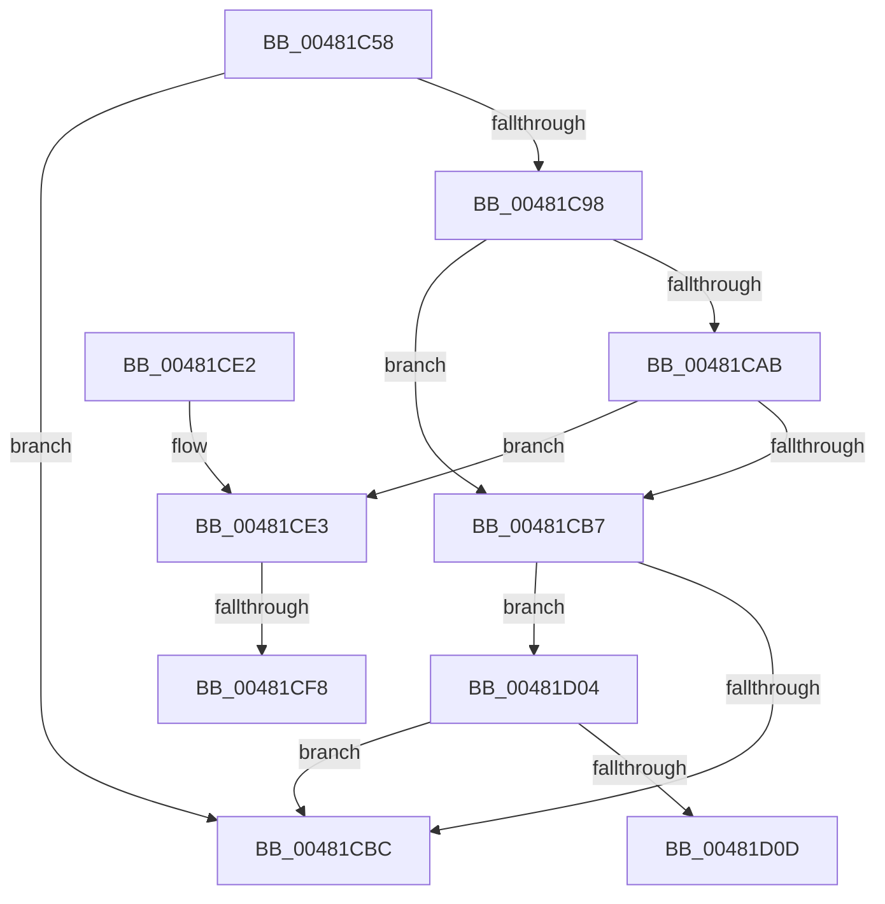

# MiWakeCommitRequest

- RVA: `0x00481C58`–`0x00481D12` (길이 `186` bytes)
- VA: `0x0000000140481C58`
- 실행 섹션: `.text`
- PDB 이름 있음: `예`; PDB Function 태그: `예`
- unwind 정보 RVA: `0x000AED68`
- 디코드: `48`개 명령, `186/186` bytes 표시
- 미해석 바이트: `0` (있으면 어셈블리에 `.byte`로 보존)

> 이 문서는 커널 이미지의 기계어와 PDB 기호를 분석해 생성했습니다. 4번과 5번은 함수 원형과 자료형을 바이너리 사용 방식에서 추정한 C 해석이며 원본 소스 복구 결과는 아닙니다.

## 1. Dependencies

- 직접 호출 지점: **2**; 고유 호출 대상: **2**
- 직접 호출자로 확인된 함수: **2**
- RIP 상대 이미지 참조: **0**

### Outgoing calls
- `0x00481C88` → [ExAcquireSpinLockExclusive](../24/ExAcquireSpinLockExclusive_function_00248690.md) (function, `0x00248690`)
- `0x00481CC2` → [MiReleaseSpinLockExclusive](../24/MiReleaseSpinLockExclusive_function_002482C0.md) (function, `0x002482C0`)

### Direct callers
- [MiRemoveUnusedSegments](../4E/MiRemoveUnusedSegments_function_004ED99C.md) at `0x004ED9DB`
- [MiDeleteCachedEntries](../67/MiDeleteCachedEntries_function_00677A28.md) at `0x00677B5E`
- [MiDeleteCachedEntries](../67/MiDeleteCachedEntries_function_00677A28.md) at `0x00677C53`

### Static image references
- 디코드된 RIP-relative 메모리 참조가 없습니다.

## 2. Other-region calls and transfers

- 다른 실행 섹션으로 향하는 call: **0**
- call이 아닌 외부 분기/꼬리 이동: **3**
  - `0x00481CF2` → [sub_006F5246](../6F/Unknown_function_006F5246.md) (`tail-transfer`)
  - `0x00481CFF` → [sub_006F5246](../6F/Unknown_function_006F5246.md) (`tail-transfer`)
  - `0x00481D0D` → [sub_006F5246](../6F/Unknown_function_006F5246.md) (`tail-transfer`)

## 3. Assembly (complete function range)

```asm
00481C58  48 8B C4                        mov rax, rsp
00481C5B  48 89 58 08                     mov qword ptr [rax + 8], rbx
00481C5F  48 89 68 10                     mov qword ptr [rax + 0x10], rbp
00481C63  48 89 70 18                     mov qword ptr [rax + 0x18], rsi
00481C67  48 89 78 20                     mov qword ptr [rax + 0x20], rdi
00481C6B  41 56                           push r14
00481C6D  48 83 EC 20                     sub rsp, 0x20
00481C71  48 8D B1 C0 06 00 00            lea rsi, [rcx + 0x6c0]
00481C78  48 8B D9                        mov rbx, rcx
00481C7B  48 8D B9 98 07 00 00            lea rdi, [rcx + 0x798]
00481C82  44 8B F2                        mov r14d, edx
00481C85  48 8B CE                        mov rcx, rsi
00481C88  E8 03 6A DC FF                  call 0x140248690
00481C8D  40 8A E8                        mov bpl, al
00481C90  48 8B 0F                        mov rcx, qword ptr [rdi]
00481C93  48 3B CF                        cmp rcx, rdi
00481C96  74 24                           je 0x140481cbc
00481C98  4C 8B 8B 40 4B 00 00            mov r9, qword ptr [rbx + 0x4b40]
00481C9F  48 8B 93 98 4C 00 00            mov rdx, qword ptr [rbx + 0x4c98]
00481CA6  4C 3B CA                        cmp r9, rdx
00481CA9  73 0C                           jae 0x140481cb7
00481CAB  4C 8B 41 18                     mov r8, qword ptr [rcx + 0x18]
00481CAF  49 2B D1                        sub rdx, r9
00481CB2  4C 3B C2                        cmp r8, rdx
00481CB5  76 2C                           jbe 0x140481ce3
00481CB7  45 85 F6                        test r14d, r14d
00481CBA  74 48                           je 0x140481d04
00481CBC  40 8A D5                        mov dl, bpl
00481CBF  48 8B CE                        mov rcx, rsi
00481CC2  E8 F9 65 DC FF                  call 0x1402482c0
00481CC7  48 8B 5C 24 30                  mov rbx, qword ptr [rsp + 0x30]
00481CCC  48 8B 6C 24 38                  mov rbp, qword ptr [rsp + 0x38]
00481CD1  48 8B 74 24 40                  mov rsi, qword ptr [rsp + 0x40]
00481CD6  48 8B 7C 24 48                  mov rdi, qword ptr [rsp + 0x48]
00481CDB  48 83 C4 20                     add rsp, 0x20
00481CDF  41 5E                           pop r14
00481CE1  C3                              ret
00481CE2  CC                              int3
00481CE3  48 8D 51 47                     lea rdx, [rcx + 0x47]
00481CE7  48 C7 41 20 01 00 00 00         mov qword ptr [rcx + 0x20], 1
00481CEF  F6 02 40                        test byte ptr [rdx], 0x40
00481CF2  0F 84 4E 35 27 00               je 0x1406f5246
00481CF8  4C 29 83 F8 0A 00 00            sub qword ptr [rbx + 0xaf8], r8
00481CFF  E9 42 35 27 00                  jmp 0x1406f5246
00481D04  48 8D 51 47                     lea rdx, [rcx + 0x47]
00481D08  F6 02 44                        test byte ptr [rdx], 0x44
00481D0B  74 AF                           je 0x140481cbc
00481D0D  E9 34 35 27 00                  jmp 0x1406f5246
```

## 4. C-style interpretation (structured pseudocode)

```c
__int64 __fastcall MiWakeCommitRequest(__int64 a1, int a2)
{
    __int64 result;
    __int64 v_rsp;
    unsigned __int64 v_stack_p10;
    unsigned __int64 v_stack_p18;
    unsigned __int64 v_stack_p20;
    unsigned __int64 v_stack_p8;

    *(unsigned __int64 *)(v_rsp + 8) = v_rbx;
    *(unsigned __int64 *)(v_rsp + 16) = v_rbp;
    *(unsigned __int64 *)(v_rsp + 24) = v_rsi;
    *(unsigned __int64 *)(v_rsp + 32) = v_rdi;
    v_rsp = (v_rsp) - (32);
    result = ExAcquireSpinLockExclusive(a1 + 1728, a2, a3, a4);
    if ((*(unsigned __int64 *)(a1 + 1944)) == (a1 + 1944)) goto loc_00481CBC;
    if ((*(unsigned __int64 *)(a1 + 19264)) >= (*(unsigned __int64 *)(a1 + 19608))) goto loc_00481CB7;
    a2 = (*(unsigned __int64 *)(a1 + 19608)) - (*(unsigned __int64 *)(a1 + 19264));
    if ((*(unsigned __int64 *)(*(unsigned __int64 *)(a1 + 1944) + 24)) <= a2) goto loc_00481CE3;
loc_00481CB7:
    if ((unsigned int)((unsigned int)(a2)) == 0) goto loc_00481D04;
loc_00481CBC:
    result = MiReleaseSpinLockExclusive(a1 + 1728, (unsigned __int8)((unsigned __int8)(result)), *(unsigned __int64 *)(*(unsigned __int64 *)(a1 + 1944) + 24), *(unsigned __int64 *)(a1 + 19264));
    v_rsp = (v_rsp) + (32);
    return result;
loc_00481CE3:
    *(unsigned __int64 *)(a1 + 1728 + 32) = 1;
loc_00481D04:
    if (((*(unsigned __int8 *)(a1 + 1728 + 71)) & (68)) == 0) goto loc_00481CBC;
}
```

## 5. (Beta) C Style

```c
int64_t MiWakeCommitRequest(void *Arg1, int32_t Arg2)
{
    uint8_t *arg1 = (uint8_t *)Arg1;

    int64_t result;
    int64_t local_rsp;
    uint64_t v_stack_p10;
    uint64_t v_stack_p18;
    uint64_t v_stack_p20;
    uint64_t v_stack_p8;

    *(uint64_t *)(local_rsp + 0x8) = local_rbx;
    *(uint64_t *)(local_rsp + 0x10) = local_rbp;
    *(uint64_t *)(local_rsp + 0x18) = local_rsi;
    *(uint64_t *)(local_rsp + 0x20) = local_rdi;
    local_rsp = (local_rsp) - (32);
    result = ExAcquireSpinLockExclusive(Arg1 + 1728, Arg2, a3, a4);
    if ((*(uint64_t *)(arg1 + 0x798)) == (Arg1 + 1944)) goto loc_00481CBC;
    if ((*(uint64_t *)(arg1 + 0x4B40)) >= (*(uint64_t *)(arg1 + 0x4C98))) goto loc_00481CB7;
    Arg2 = (*(uint64_t *)(arg1 + 0x4C98)) - (*(uint64_t *)(arg1 + 0x4B40));
    if ((*(uint64_t *)(*(uint64_t *)(arg1 + 0x798) + 0x18)) <= Arg2) goto loc_00481CE3;
loc_00481CB7:
    if ((uint32_t)((uint32_t)(Arg2)) == 0) goto loc_00481D04;
loc_00481CBC:
    result = MiReleaseSpinLockExclusive(Arg1 + 1728, (uint8_t)((uint8_t)(result)), *(uint64_t *)(*(uint64_t *)(arg1 + 0x798) + 0x18), *(uint64_t *)(arg1 + 0x4B40));
    local_rsp = (local_rsp) + (32);
    return result;
loc_00481CE3:
    *(uint64_t *)(arg1 + 0x6C0 + 0x20) = 1;
loc_00481D04:
    if (((*(uint8_t *)(arg1 + 0x6C0 + 0x47)) & (68)) == 0) goto loc_00481CBC;
}
```

### 관측된 메모리 오프셋

구조체 형식이 확인되지 않은 접근은 인자 기준의 오프셋으로만 기록했습니다.

| 기준 인자 | 오프셋 표현 | 폭 (bit) | 접근 |
|---|---:|---:|---|
| `Arg1` | `+ 0x0` | `64` | `R` |
| `Arg1` | `+ 0x6C0` | `64` | `R` |
| `Arg1` | `+ 0x798` | `64` | `R` |
| `Arg1` | `+ 0xAF8` | `64` | `R/W` |
| `Arg1` | `+ 0x4B40` | `64` | `R` |
| `Arg1` | `+ 0x4C98` | `64` | `R` |

## 6. Execution-region graph

[열기: 2D/3D 그래프와 함수 탐색 컨트롤 패널](../../../control-panel.html?section=text&rva=0x00481C58&view=graph)

- 2D 그래프는 위에서 아래로 흐르고, 3D 그래프는 빈 공간을 드래그해 회전합니다. Shift+드래그는 이동, 휠은 확대·축소, 함수 노드 선택은 대상 보고서 이동입니다.

### Static fallback


