# MmEnforceWorkingSetLimit

- RVA: `0x004881E0`–`0x004883CC` (길이 `492` bytes)
- VA: `0x00000001404881E0`
- 실행 섹션: `.text`
- PDB 이름 있음: `예`; PDB Function 태그: `아니요`
- unwind 정보 RVA: `0x000AFCB0`
- 디코드: `122`개 명령, `492/492` bytes 표시
- 미해석 바이트: `0` (있으면 어셈블리에 `.byte`로 보존)

> 이 문서는 커널 이미지의 기계어와 PDB 기호를 분석해 생성했습니다. 4번과 5번은 함수 원형과 자료형을 바이너리 사용 방식에서 추정한 C 해석이며 원본 소스 복구 결과는 아닙니다.

## 1. Dependencies

- 직접 호출 지점: **7**; 고유 호출 대상: **7**
- 직접 호출자로 확인된 함수: **4**
- RIP 상대 이미지 참조: **2**

### Outgoing calls
- `0x00488267` → [MiLockWorkingSetExclusive](../32/MiLockWorkingSetExclusive_function_003238A0.md) (function, `0x003238A0`)
- `0x00488276` → [ExAcquireSpinLockExclusiveAtDpcLevel](../24/ExAcquireSpinLockExclusiveAtDpcLevel_function_00248E80.md) (function, `0x00248E80`)
- `0x004882F1` → [ExReleaseSpinLockExclusiveFromDpcLevel](../24/ExReleaseSpinLockExclusiveFromDpcLevel_function_002497E0.md) (function, `0x002497E0`)
- `0x004882FC` → [MiUnlockWorkingSetExclusive](../27/MiUnlockWorkingSetExclusive_function_0027EC70.md) (function, `0x0027EC70`)
- `0x00488313` → [_security_check_cookie](../6A/_security_check_cookie_function_006AC640.md) (function, `0x006AC640`)
- `0x00488351` → [KiStackAttachProcess](../21/KiStackAttachProcess_function_00216820.md) (function, `0x00216820`)
- `0x004883C2` → [KiUnstackDetachProcess](../21/KiUnstackDetachProcess_function_00217D30.md) (function, `0x00217D30`)

### Direct callers
- [PspAddProcessToWorkingSetChangeList](../../page/78/PspAddProcessToWorkingSetChangeList_function_00784B38.md) at `0x00784BE7`
- [PspApplyWorkingSetLimits](../../page/78/PspApplyWorkingSetLimits_function_00784C00.md) at `0x00784CCE`
- [PspApplyWorkingSetLimitsToProcess](../../page/87/PspApplyWorkingSetLimitsToProcess_function_0087DE9C.md) at `0x0087DFA1`
- [PspSetQuotaLimits](../../page/9B/PspSetQuotaLimits_function_009BA8A8.md) at `0x009BAD82`

### Static image references
- `0x004881F8` → RVA `0x00E0A740` (`.data`; read)
- `0x0048826C` → RVA `0x00E374C0` (`.data`; read)

## 2. Other-region calls and transfers

- 다른 실행 섹션으로 향하는 call: **0**
- 별도 외부 분기/꼬리 이동을 확인하지 못했습니다.

## 3. Assembly (complete function range)

```asm
004881E0  48 89 5C 24 10                  mov qword ptr [rsp + 0x10], rbx
004881E5  48 89 6C 24 18                  mov qword ptr [rsp + 0x18], rbp
004881EA  48 89 74 24 20                  mov qword ptr [rsp + 0x20], rsi
004881EF  57                              push rdi
004881F0  41 56                           push r14
004881F2  41 57                           push r15
004881F4  48 83 EC 60                     sub rsp, 0x60
004881F8  48 8B 05 41 25 98 00            mov rax, qword ptr [rip + 0x982541]
004881FF  48 33 C4                        xor rax, rsp
00488202  48 89 44 24 58                  mov qword ptr [rsp + 0x58], rax
00488207  83 64 24 20 00                  and dword ptr [rsp + 0x20], 0
0048820C  48 8D B1 00 04 00 00            lea rsi, [rcx + 0x400]
00488213  0F B6 7C 24 20                  movzx edi, byte ptr [rsp + 0x20]
00488218  33 ED                           xor ebp, ebp
0048821A  0F 57 C0                        xorps xmm0, xmm0
0048821D  8B C2                           mov eax, edx
0048821F  83 E0 04                        and eax, 4
00488222  41 BF 80 00 00 00               mov r15d, 0x80
00488228  8B DA                           mov ebx, edx
0048822A  41 0F 45 FF                     cmovne edi, r15d
0048822E  83 E3 F7                        and ebx, 0xfffffff7
00488231  85 C0                           test eax, eax
00488233  0F 11 44 24 28                  movups xmmword ptr [rsp + 0x28], xmm0
00488238  0F 44 DA                        cmove ebx, edx
0048823B  0F 11 44 24 38                  movups xmmword ptr [rsp + 0x38], xmm0
00488240  0F 11 44 24 48                  movups xmmword ptr [rsp + 0x48], xmm0
00488245  F6 C3 01                        test bl, 1
00488248  0F 85 E5 00 00 00               jne 0x140488333
0048824E  65 48 8B 04 25 88 01 00 00      mov rax, qword ptr gs:[0x188]
00488257  48 39 88 B8 00 00 00            cmp qword ptr [rax + 0xb8], rcx
0048825E  0F 85 E1 00 00 00               jne 0x140488345
00488264  48 8B CE                        mov rcx, rsi
00488267  E8 34 B6 E9 FF                  call 0x1403238a0
0048826C  48 8D 0D 4D F2 9A 00            lea rcx, [rip + 0x9af24d]
00488273  44 8A F0                        mov r14b, al
00488276  E8 05 0C DC FF                  call 0x140248e80
0048827B  8B 8E B8 00 00 00               mov ecx, dword ptr [rsi + 0xb8]
00488281  44 8B C3                        mov r8d, ebx
00488284  89 4C 24 20                     mov dword ptr [rsp + 0x20], ecx
00488288  41 83 E0 08                     and r8d, 8
0048828C  0F 85 C9 00 00 00               jne 0x14048835b
00488292  33 D2                           xor edx, edx
00488294  45 85 C0                        test r8d, r8d
00488297  0F 95 C2                        setne dl
0048829A  F6 C3 02                        test bl, 2
0048829D  74 0C                           je 0x1404882ab
0048829F  80 E1 BF                        and cl, 0xbf
004882A2  BA 01 00 00 00                  mov edx, 1
004882A7  88 4C 24 20                     mov byte ptr [rsp + 0x20], cl
004882AB  41 84 CF                        test r15b, cl
004882AE  0F 85 B3 00 00 00               jne 0x140488367
004882B4  F6 C1 40                        test cl, 0x40
004882B7  0F 85 B2 00 00 00               jne 0x14048836f
004882BD  41 84 FF                        test r15b, dil
004882C0  0F 85 B2 00 00 00               jne 0x140488378
004882C6  33 FF                           xor edi, edi
004882C8  F6 C3 04                        test bl, 4
004882CB  0F 85 CD 00 00 00               jne 0x14048839e
004882D1  F6 C3 01                        test bl, 1
004882D4  0F 85 D5 00 00 00               jne 0x1404883af
004882DA  85 D2                           test edx, edx
004882DC  74 0C                           je 0x1404882ea
004882DE  0F B7 44 24 20                  movzx eax, word ptr [rsp + 0x20]
004882E3  66 89 86 B8 00 00 00            mov word ptr [rsi + 0xb8], ax
004882EA  48 8D 0D CF F1 9A 00            lea rcx, [rip + 0x9af1cf]
004882F1  E8 EA 14 DC FF                  call 0x1402497e0
004882F6  41 8A D6                        mov dl, r14b
004882F9  48 8B CE                        mov rcx, rsi
004882FC  E8 6F 69 DF FF                  call 0x14027ec70
00488301  85 ED                           test ebp, ebp
00488303  0F 85 B2 00 00 00               jne 0x1404883bb
00488309  8B C7                           mov eax, edi
0048830B  48 8B 4C 24 58                  mov rcx, qword ptr [rsp + 0x58]
00488310  48 33 CC                        xor rcx, rsp
00488313  E8 28 43 22 00                  call 0x1406ac640
00488318  4C 8D 5C 24 60                  lea r11, [rsp + 0x60]
0048831D  49 8B 5B 28                     mov rbx, qword ptr [r11 + 0x28]
00488321  49 8B 6B 30                     mov rbp, qword ptr [r11 + 0x30]
00488325  49 8B 73 38                     mov rsi, qword ptr [r11 + 0x38]
00488329  49 8B E3                        mov rsp, r11
0048832C  41 5F                           pop r15
0048832E  41 5E                           pop r14
00488330  5F                              pop rdi
00488331  C3                              ret
00488332  CC                              int3
00488333  83 E3 FD                        and ebx, 0xfffffffd
00488336  F7 D8                           neg eax
00488338  1A C0                           sbb al, al
0048833A  41 22 C7                        and al, r15b
0048833D  8D 78 40                        lea edi, [rax + 0x40]
00488340  E9 09 FF FF FF                  jmp 0x14048824e
00488345  4C 8D 44 24 28                  lea r8, [rsp + 0x28]
0048834A  33 D2                           xor edx, edx
0048834C  BD 01 00 00 00                  mov ebp, 1
00488351  E8 CA E4 D8 FF                  call 0x140216820
00488356  E9 09 FF FF FF                  jmp 0x140488264
0048835B  80 E1 7F                        and cl, 0x7f
0048835E  88 4C 24 20                     mov byte ptr [rsp + 0x20], cl
00488362  E9 2B FF FF FF                  jmp 0x140488292
00488367  41 0A FF                        or dil, r15b
0048836A  E9 45 FF FF FF                  jmp 0x1404882b4
0048836F  40 80 CF 40                     or dil, 0x40
00488373  E9 45 FF FF FF                  jmp 0x1404882bd
00488378  40 F6 C7 40                     test dil, 0x40
0048837C  0F 84 44 FF FF FF               je 0x1404882c6
00488382  48 8B 46 70                     mov rax, qword ptr [rsi + 0x70]
00488386  48 83 C0 06                     add rax, 6
0048838A  48 3B 46 78                     cmp rax, qword ptr [rsi + 0x78]
0048838E  0F 82 32 FF FF FF               jb 0x1404882c6
00488394  BF 4C 00 00 C0                  mov edi, 0xc000004c
00488399  E9 3C FF FF FF                  jmp 0x1404882da
0048839E  41 0A CF                        or cl, r15b
004883A1  BA 01 00 00 00                  mov edx, 1
004883A6  88 4C 24 20                     mov byte ptr [rsp + 0x20], cl
004883AA  E9 22 FF FF FF                  jmp 0x1404882d1
004883AF  80 C9 40                        or cl, 0x40
004883B2  88 4C 24 20                     mov byte ptr [rsp + 0x20], cl
004883B6  E9 23 FF FF FF                  jmp 0x1404882de
004883BB  33 D2                           xor edx, edx
004883BD  48 8D 4C 24 28                  lea rcx, [rsp + 0x28]
004883C2  E8 69 F9 D8 FF                  call 0x140217d30
004883C7  E9 3D FF FF FF                  jmp 0x140488309
```

## 4. C-style interpretation (structured pseudocode)

```c
__int64 __fastcall MmEnforceWorkingSetLimit(__int64 a1, int a2)
{
    __int64 result;
    __int64 v_rbp;
    __int64 v_rbx;
    __int64 v_rdi;
    __int64 v_rsp;
    unsigned __int64 v_stack_m18;
    unsigned __int64 v_stack_m20;
    unsigned __int64 v_stack_m30;
    unsigned __int64 v_stack_m38;
    unsigned __int64 v_stack_m40;
    unsigned __int64 v_stack_m50;
    unsigned int v_stack_m58;
    unsigned __int64 v_stack_p10;
    unsigned __int64 v_stack_p18;
    unsigned __int64 v_stack_p20;

    v_stack_p10 = v_rbx;
    v_stack_p18 = v_rbp;
    v_stack_p20 = v_rsi;
    v_rsp = (v_rsp) - (96);
    result = (*(unsigned __int64 *)(v_rip + 9971009)) ^ (v_rsp);
    v_stack_m20 = result;
    v_rbp = 0;
    result = (unsigned int)(((unsigned int)(a2)) & (4));
    v_rdi = v_stack_m58;
    if (condition_is_not_equal) { v_rdi = 128; }
    v_rbx = (unsigned int)(((unsigned int)(a2)) & (0xFFFFFFF7ULL));
    v_stack_m50 = v_xmm0;
    if ((unsigned int)(result) == 0) { v_rbx = a2; }
    v_stack_m40 = v_xmm0;
    v_stack_m30 = v_xmm0;
    if ((((unsigned __int8)(v_rbx)) & (1)) != 0) goto loc_00488333;
loc_0048824E:
    if ((*(unsigned __int64 *)(*(unsigned __int64 *)(gs_base + (0 + 392)) + 184)) != a1) goto loc_00488345;
loc_00488264:
    result = MiLockWorkingSetExclusive(a1 + 1024, a2, a3, a4);
    result = ExAcquireSpinLockExclusiveAtDpcLevel(v_rip + 10154573, a2, a3, a4);
    v_stack_m58 = (unsigned int)((unsigned int)(*(unsigned int *)(a1 + 1024 + 184)));
    a3 = (unsigned int)(((unsigned int)((unsigned int)(v_rbx))) & (8));
    if (condition_is_not_equal) goto loc_0048835B;
loc_00488292:
    a2 = 0;
    a2 = ((unsigned int)(a3) != 0) ? 1 : 0;
    if ((((unsigned __int8)(v_rbx)) & (2)) != 0) {
        a1 = (unsigned __int8)(((unsigned int)(*(unsigned int *)(a1 + 1024 + 184))) & (191));
        a2 = 1;
        v_stack_m58 = (unsigned __int8)(a1);
    }
    if (((128) & ((unsigned __int8)(a1))) != 0) goto loc_00488367;
loc_004882B4:
    if ((((unsigned __int8)(a1)) & (64)) != 0) goto loc_0048836F;
loc_004882BD:
    if (((128) & ((unsigned __int8)(v_rdi))) != 0) goto loc_00488378;
loc_004882C6:
    v_rdi = 0;
    if ((((unsigned __int8)(v_rbx)) & (4)) != 0) goto loc_0048839E;
loc_004882D1:
    if ((((unsigned __int8)(v_rbx)) & (1)) != 0) goto loc_004883AF;
loc_004882DA:
    if (a2 != 0) {
        result = v_stack_m58;
        *(unsigned __int16 *)(a1 + 1024 + 184) = (unsigned __int16)(result);
    }
    result = ExReleaseSpinLockExclusiveFromDpcLevel(v_rip + 10154447, a2, a3, a4);
    result = MiUnlockWorkingSetExclusive(a1 + 1024, (unsigned __int8)((unsigned __int8)(result)), a3, a4);
    if (0 != 0) goto loc_004883BB;
loc_00488309:
    a1 = (v_stack_m20) ^ (v_rsp);
    result = _security_check_cookie(a1, (unsigned __int8)((unsigned __int8)(result)), a3, a4);
    return result;
loc_00488333:
    v_rbx = (unsigned int)((*(unsigned __int64 *)(v_stack_m18 + 40)) & (0xFFFFFFFDULL));
    result = (unsigned int)(-(result));
    result = (unsigned __int8)((result) & (128));
    goto loc_0048824E;
loc_00488345:
    a2 = 0;
    result = KiStackAttachProcess(a1, a2, v_stack_m38, a4);
    goto loc_00488264;
loc_0048835B:
    a1 = (unsigned __int8)((a1) & (127));
    v_stack_m40 = (unsigned __int8)(a1);
    goto loc_00488292;
loc_00488367:
    v_rdi = (unsigned __int8)((result + 64) | (128));
    goto loc_004882B4;
loc_0048836F:
    v_rdi = (unsigned __int8)((v_rdi) | (64));
    goto loc_004882BD;
loc_00488378:
    if ((((unsigned __int8)(v_rdi)) & (64)) == 0) goto loc_004882C6;
    result = (*(unsigned __int64 *)(*(unsigned __int64 *)(v_stack_m18 + 56) + 112)) + (6);
    if (result < (*(unsigned __int64 *)(*(unsigned __int64 *)(v_stack_m18 + 56) + 120))) goto loc_004882C6;
    goto loc_004882DA;
loc_0048839E:
    a1 = (unsigned __int8)((a1) | (128));
    v_stack_m40 = (unsigned __int8)(a1);
    goto loc_004882D1;
loc_004883AF:
    a1 = (unsigned __int8)((a1) | (64));
    v_stack_m40 = (unsigned __int8)(a1);
    goto loc_004882DE;
loc_004883BB:
    a2 = 0;
    result = KiUnstackDetachProcess(v_stack_m38, a2, v_stack_m38, a4);
    goto loc_00488309;
}
```

## 5. (Beta) C Style

```c
int64_t MmEnforceWorkingSetLimit(void *Arg1, int32_t Arg2)
{
    uint8_t *arg1 = (uint8_t *)Arg1;

    int64_t result;
    int64_t local_rbp;
    int64_t local_rbx;
    int64_t local_rdi;
    int64_t local_rsp;
    uint64_t v_stack_m18;
    uint64_t v_stack_m20;
    uint64_t v_stack_m30;
    uint64_t v_stack_m38;
    uint64_t v_stack_m40;
    uint64_t v_stack_m50;
    uint32_t v_stack_m58;
    uint64_t v_stack_p10;
    uint64_t v_stack_p18;
    uint64_t v_stack_p20;

    v_stack_p10 = local_rbx;
    v_stack_p18 = local_rbp;
    v_stack_p20 = local_rsi;
    local_rsp = (local_rsp) - (96);
    result = (*(uint64_t *)(v_rip + 0x982541)) ^ (local_rsp);
    v_stack_m20 = result;
    local_rbp = 0;
    result = (uint32_t)(((uint32_t)(Arg2)) & (4));
    local_rdi = v_stack_m58;
    if (condition_is_not_equal) { local_rdi = 128; }
    local_rbx = (uint32_t)(((uint32_t)(Arg2)) & (0xFFFFFFF7ULL));
    v_stack_m50 = v_xmm0;
    if ((uint32_t)(result) == 0) { local_rbx = Arg2; }
    v_stack_m40 = v_xmm0;
    v_stack_m30 = v_xmm0;
    if ((((uint8_t)(local_rbx)) & (1)) != 0) goto loc_00488333;
loc_0048824E:
    if ((*(uint64_t *)(*(uint64_t *)(gs_base + (0 + 0x188)) + 0xB8)) != Arg1) goto loc_00488345;
loc_00488264:
    result = MiLockWorkingSetExclusive(Arg1 + 1024, Arg2, a3, a4);
    result = ExAcquireSpinLockExclusiveAtDpcLevel(v_rip + 10154573, Arg2, a3, a4);
    v_stack_m58 = (uint32_t)((uint32_t)(*(uint32_t *)(arg1 + 0x400 + 0xB8)));
    a3 = (uint32_t)(((uint32_t)((uint32_t)(local_rbx))) & (8));
    if (condition_is_not_equal) goto loc_0048835B;
loc_00488292:
    Arg2 = 0;
    Arg2 = ((uint32_t)(a3) != 0) ? 1 : 0;
    if ((((uint8_t)(local_rbx)) & (2)) != 0) {
        Arg1 = (uint8_t)(((uint32_t)(*(uint32_t *)(arg1 + 0x400 + 0xB8))) & (191));
        Arg2 = 1;
        v_stack_m58 = (uint8_t)(Arg1);
    }
    if (((128) & ((uint8_t)(Arg1))) != 0) goto loc_00488367;
loc_004882B4:
    if ((((uint8_t)(Arg1)) & (64)) != 0) goto loc_0048836F;
loc_004882BD:
    if (((128) & ((uint8_t)(local_rdi))) != 0) goto loc_00488378;
loc_004882C6:
    local_rdi = 0;
    if ((((uint8_t)(local_rbx)) & (4)) != 0) goto loc_0048839E;
loc_004882D1:
    if ((((uint8_t)(local_rbx)) & (1)) != 0) goto loc_004883AF;
loc_004882DA:
    if (Arg2 != 0) {
        result = v_stack_m58;
        *(uint16_t *)(arg1 + 0x400 + 0xB8) = (uint16_t)(result);
    }
    result = ExReleaseSpinLockExclusiveFromDpcLevel(v_rip + 10154447, Arg2, a3, a4);
    result = MiUnlockWorkingSetExclusive(Arg1 + 1024, (uint8_t)((uint8_t)(result)), a3, a4);
    if (0 != 0) goto loc_004883BB;
loc_00488309:
    Arg1 = (v_stack_m20) ^ (local_rsp);
    result = _security_check_cookie(Arg1, (uint8_t)((uint8_t)(result)), a3, a4);
    return result;
loc_00488333:
    local_rbx = (uint32_t)((*(uint64_t *)(v_stack_m18 + 0x28)) & (0xFFFFFFFDULL));
    result = (uint32_t)(-(result));
    result = (uint8_t)((result) & (128));
    goto loc_0048824E;
loc_00488345:
    Arg2 = 0;
    result = KiStackAttachProcess(Arg1, Arg2, v_stack_m38, a4);
    goto loc_00488264;
loc_0048835B:
    Arg1 = (uint8_t)((Arg1) & (127));
    v_stack_m40 = (uint8_t)(Arg1);
    goto loc_00488292;
loc_00488367:
    local_rdi = (uint8_t)((result + 64) | (128));
    goto loc_004882B4;
loc_0048836F:
    local_rdi = (uint8_t)((local_rdi) | (64));
    goto loc_004882BD;
loc_00488378:
    if ((((uint8_t)(local_rdi)) & (64)) == 0) goto loc_004882C6;
    result = (*(uint64_t *)(*(uint64_t *)(v_stack_m18 + 0x38) + 0x70)) + (6);
    if (result < (*(uint64_t *)(*(uint64_t *)(v_stack_m18 + 0x38) + 0x78))) goto loc_004882C6;
    goto loc_004882DA;
loc_0048839E:
    Arg1 = (uint8_t)((Arg1) | (128));
    v_stack_m40 = (uint8_t)(Arg1);
    goto loc_004882D1;
loc_004883AF:
    Arg1 = (uint8_t)((Arg1) | (64));
    v_stack_m40 = (uint8_t)(Arg1);
    goto loc_004882DE;
loc_004883BB:
    Arg2 = 0;
    result = KiUnstackDetachProcess(v_stack_m38, Arg2, v_stack_m38, a4);
    goto loc_00488309;
}
```

### 관측된 메모리 오프셋

구조체 형식이 확인되지 않은 접근은 인자 기준의 오프셋으로만 기록했습니다.

| 기준 인자 | 오프셋 표현 | 폭 (bit) | 접근 |
|---|---:|---:|---|
| `Arg1` | `+ 0x70` | `64` | `R` |
| `Arg1` | `+ 0x78` | `64` | `R` |
| `Arg1` | `+ 0xB8` | `16` | `W` |
| `Arg1` | `+ 0xB8` | `32` | `R` |
| `Arg1` | `+ 0x400` | `64` | `R` |

## 6. Execution-region graph

[열기: 2D/3D 그래프와 함수 탐색 컨트롤 패널](../../../control-panel.html?section=text&rva=0x004881E0&view=graph)

- 2D 그래프는 위에서 아래로 흐르고, 3D 그래프는 빈 공간을 드래그해 회전합니다. Shift+드래그는 이동, 휠은 확대·축소, 함수 노드 선택은 대상 보고서 이동입니다.

### Static fallback

```mermaid
flowchart TD
  bb_004881E0[BB_004881E0]
  bb_0048824E[BB_0048824E]
  bb_00488264[BB_00488264]
  bb_00488292[BB_00488292]
  bb_0048829F[BB_0048829F]
  bb_004882AB[BB_004882AB]
  bb_004882B4[BB_004882B4]
  bb_004882BD[BB_004882BD]
  bb_004882C6[BB_004882C6]
  bb_004882D1[BB_004882D1]
  bb_004882DA[BB_004882DA]
  bb_004882DE[BB_004882DE]
  bb_004882EA[BB_004882EA]
  bb_00488309[BB_00488309]
  bb_00488332[BB_00488332]
  bb_00488333[BB_00488333]
  bb_00488345[BB_00488345]
  bb_0048835B[BB_0048835B]
  bb_00488367[BB_00488367]
  bb_0048836F[BB_0048836F]
  bb_00488378[BB_00488378]
  bb_00488382[BB_00488382]
  bb_00488394[BB_00488394]
  bb_0048839E[BB_0048839E]
  bb_004883AF[BB_004883AF]
  bb_004883BB[BB_004883BB]
  bb_004881E0 -->|branch| bb_00488333
  bb_004881E0 -->|fallthrough| bb_0048824E
  bb_0048824E -->|branch| bb_00488345
  bb_0048824E -->|fallthrough| bb_00488264
  bb_00488264 -->|branch| bb_0048835B
  bb_00488264 -->|fallthrough| bb_00488292
  bb_00488292 -->|branch| bb_004882AB
  bb_00488292 -->|fallthrough| bb_0048829F
  bb_0048829F -->|flow| bb_004882AB
  bb_004882AB -->|branch| bb_00488367
  bb_004882AB -->|fallthrough| bb_004882B4
  bb_004882B4 -->|branch| bb_0048836F
  bb_004882B4 -->|fallthrough| bb_004882BD
  bb_004882BD -->|branch| bb_00488378
  bb_004882BD -->|fallthrough| bb_004882C6
  bb_004882C6 -->|branch| bb_0048839E
  bb_004882C6 -->|fallthrough| bb_004882D1
  bb_004882D1 -->|branch| bb_004883AF
  bb_004882D1 -->|fallthrough| bb_004882DA
  bb_004882DA -->|branch| bb_004882EA
  bb_004882DA -->|fallthrough| bb_004882DE
  bb_004882DE -->|flow| bb_004882EA
  bb_004882EA -->|branch| bb_004883BB
  bb_004882EA -->|fallthrough| bb_00488309
  bb_00488332 -->|flow| bb_00488333
  bb_00488333 -->|branch| bb_0048824E
  bb_00488345 -->|branch| bb_00488264
  bb_0048835B -->|branch| bb_00488292
  bb_00488367 -->|branch| bb_004882B4
  bb_0048836F -->|branch| bb_004882BD
  bb_00488378 -->|branch| bb_004882C6
  bb_00488378 -->|fallthrough| bb_00488382
  bb_00488382 -->|branch| bb_004882C6
  bb_00488382 -->|fallthrough| bb_00488394
  bb_00488394 -->|branch| bb_004882DA
  bb_0048839E -->|branch| bb_004882D1
  bb_004883AF -->|branch| bb_004882DE
  bb_004883BB -->|branch| bb_00488309
```


