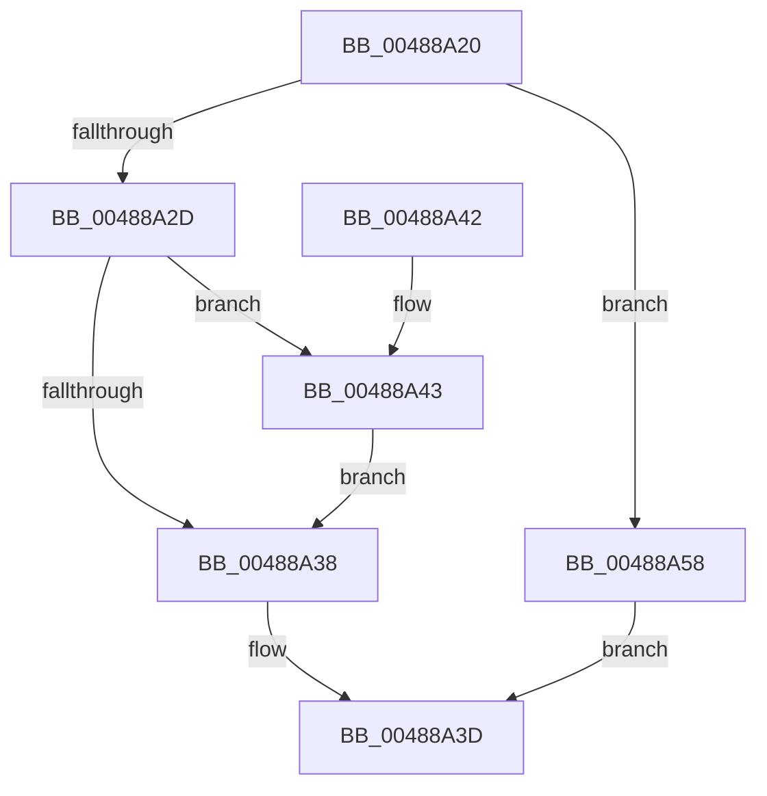

# MmMapIoSpace

- RVA: `0x00488A20`–`0x00488A5C` (길이 `60` bytes)
- VA: `0x0000000140488A20`
- 실행 섹션: `.text`
- PDB 이름 있음: `예`; PDB Function 태그: `아니요`
- unwind 정보 RVA: `0x0005E0D8`
- 디코드: `18`개 명령, `60/60` bytes 표시
- 미해석 바이트: `0` (있으면 어셈블리에 `.byte`로 보존)

> 이 문서는 커널 이미지의 기계어와 PDB 기호를 분석해 생성했습니다. 4번과 5번은 함수 원형과 자료형을 바이너리 사용 방식에서 추정한 C 해석이며 원본 소스 복구 결과는 아닙니다.

## 1. Dependencies

- 직접 호출 지점: **1**; 고유 호출 대상: **1**
- 직접 호출자로 확인된 함수: **1**
- RIP 상대 이미지 참조: **0**

### Outgoing calls
- `0x00488A38` → [MmMapIoSpaceEx](../32/MmMapIoSpaceEx_function_00327830.md) (function, `0x00327830`)

### Direct callers
- [DifMmMapIoSpaceWrapper](../63/DifMmMapIoSpaceWrapper_function_00635BE0.md) at `0x00635CC5`

### Static image references
- 디코드된 RIP-relative 메모리 참조가 없습니다.

## 2. Other-region calls and transfers

- 다른 실행 섹션으로 향하는 call: **0**
- 별도 외부 분기/꼬리 이동을 확인하지 못했습니다.

## 3. Assembly (complete function range)

```asm
00488A20  48 83 EC 28                     sub rsp, 0x28
00488A24  41 0F B6 C0                     movzx eax, r8b
00488A28  83 F8 06                        cmp eax, 6
00488A2B  73 2B                           jae 0x140488a58
00488A2D  41 B8 40 00 00 00               mov r8d, 0x40
00488A33  83 F8 01                        cmp eax, 1
00488A36  75 0B                           jne 0x140488a43
00488A38  E8 F3 ED E9 FF                  call 0x140327830
00488A3D  48 83 C4 28                     add rsp, 0x28
00488A41  C3                              ret
00488A42  CC                              int3
00488A43  83 F8 02                        cmp eax, 2
00488A46  41 B8 40 02 00 00               mov r8d, 0x240
00488A4C  41 B9 04 04 00 00               mov r9d, 0x404
00488A52  45 0F 44 C1                     cmove r8d, r9d
00488A56  EB E0                           jmp 0x140488a38
00488A58  33 C0                           xor eax, eax
00488A5A  EB E1                           jmp 0x140488a3d
```

## 4. C-style interpretation (structured pseudocode)

```c
__int64 __fastcall MmMapIoSpace(__int64 a1, __int64 a2, unsigned __int8 a3)
{
    __int64 result;
    __int64 v_rsp;

    v_rsp = (v_rsp) - (40);
    if (a3 >= 6) goto loc_00488A58;
    if (a3 != 1) goto loc_00488A43;
loc_00488A38:
    result = MmMapIoSpaceEx(a1, a2, 64, a4);
loc_00488A3D:
    v_rsp = (v_rsp) + (40);
    return result;
loc_00488A43:
    a3 = 576;
    if (((unsigned int)(result)) == 2) { a3 = (unsigned int)((unsigned int)(0x404ULL)); }
    goto loc_00488A38;
loc_00488A58:
    result = 0;
    goto loc_00488A3D;
}
```

## 5. (Beta) C Style

```c
int64_t MmMapIoSpace(int64_t Arg1, int64_t Arg2, uint8_t Arg3)
{
    int64_t result;
    int64_t local_rsp;

    local_rsp = (local_rsp) - (40);
    if (Arg3 >= 6) goto loc_00488A58;
    if (Arg3 != 1) goto loc_00488A43;
loc_00488A38:
    result = MmMapIoSpaceEx(Arg1, Arg2, 64, a4);
loc_00488A3D:
    local_rsp = (local_rsp) + (40);
    return result;
loc_00488A43:
    Arg3 = 576;
    if (((uint32_t)(result)) == 2) { Arg3 = (uint32_t)((uint32_t)(0x404ULL)); }
    goto loc_00488A38;
loc_00488A58:
    result = 0;
    goto loc_00488A3D;
}
```

## 6. Execution-region graph

[열기: 2D/3D 그래프와 함수 탐색 컨트롤 패널](../../../control-panel.html?section=text&rva=0x00488A20&view=graph)

- 2D 그래프는 위에서 아래로 흐르고, 3D 그래프는 빈 공간을 드래그해 회전합니다. Shift+드래그는 이동, 휠은 확대·축소, 함수 노드 선택은 대상 보고서 이동입니다.

### Static fallback


