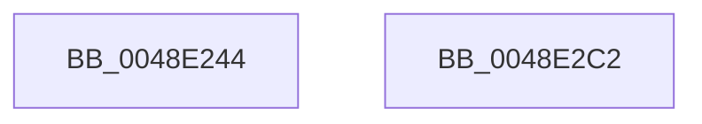

# MmMapViewOfSectionEx

- RVA: `0x0048E244`–`0x0048E2C3` (길이 `127` bytes)
- VA: `0x000000014048E244`
- 실행 섹션: `.text`
- PDB 이름 있음: `예`; PDB Function 태그: `아니요`
- unwind 정보 RVA: `0x0006C9B8`
- 디코드: `26`개 명령, `127/127` bytes 표시
- 미해석 바이트: `0` (있으면 어셈블리에 `.byte`로 보존)

> 이 문서는 커널 이미지의 기계어와 PDB 기호를 분석해 생성했습니다. 4번과 5번은 함수 원형과 자료형을 바이너리 사용 방식에서 추정한 C 해석이며 원본 소스 복구 결과는 아닙니다.

## 1. Dependencies

- 직접 호출 지점: **1**; 고유 호출 대상: **1**
- 직접 호출자로 확인된 함수: **5**
- RIP 상대 이미지 참조: **0**

### Outgoing calls
- `0x0048E2B8` → [MiMapViewOfSectionExCommon](../../page/9A/MiMapViewOfSectionExCommon_function_009A1C60.md) (function, `0x009A1C60`)

### Direct callers
- [VmMapSectionExecuteNoAcg](../../page/7A/VmMapSectionExecuteNoAcg_function_007ACDC0.md) at `0x007ACE59`
- [MiMapProcessExecutable](../../page/8C/MiMapProcessExecutable_function_008CFDB4.md) at `0x008CFE67`
- [PspMapSystemDll](../../page/8D/PspMapSystemDll_function_008D6908.md) at `0x008D6A20`
- [MiMapSecurePureReserveView](../../page/A4/MiMapSecurePureReserveView_function_00A49114.md) at `0x00A491B5`
- [MiMapImageForEnclaveUse](../../page/AB/MiMapImageForEnclaveUse_function_00AB213C.md) at `0x00AB22D2`

### Static image references
- 디코드된 RIP-relative 메모리 참조가 없습니다.

## 2. Other-region calls and transfers

- 다른 실행 섹션으로 향하는 call: **1**
  - `0x0048E2B8` → [MiMapViewOfSectionExCommon](../../page/9A/MiMapViewOfSectionExCommon_function_009A1C60.md) (`.text` → `PAGE`)
- 별도 외부 분기/꼬리 이동을 확인하지 못했습니다.

## 3. Assembly (complete function range)

```asm
0048E244  4C 8B DC                        mov r11, rsp
0048E247  48 83 EC 78                     sub rsp, 0x78
0048E24B  8B 84 24 E0 00 00 00            mov eax, dword ptr [rsp + 0xe0]
0048E252  89 44 24 68                     mov dword ptr [rsp + 0x68], eax
0048E256  48 8B 84 24 D0 00 00 00         mov rax, qword ptr [rsp + 0xd0]
0048E25E  C6 44 24 60 00                  mov byte ptr [rsp + 0x60], 0
0048E263  49 89 43 E0                     mov qword ptr [r11 - 0x20], rax
0048E267  8B 84 24 C8 00 00 00            mov eax, dword ptr [rsp + 0xc8]
0048E26E  89 44 24 50                     mov dword ptr [rsp + 0x50], eax
0048E272  8B 84 24 C0 00 00 00            mov eax, dword ptr [rsp + 0xc0]
0048E279  89 44 24 48                     mov dword ptr [rsp + 0x48], eax
0048E27D  48 8B 84 24 B8 00 00 00         mov rax, qword ptr [rsp + 0xb8]
0048E285  49 89 43 C8                     mov qword ptr [r11 - 0x38], rax
0048E289  8B 84 24 B0 00 00 00            mov eax, dword ptr [rsp + 0xb0]
0048E290  89 44 24 38                     mov dword ptr [rsp + 0x38], eax
0048E294  8B 84 24 A8 00 00 00            mov eax, dword ptr [rsp + 0xa8]
0048E29B  89 44 24 30                     mov dword ptr [rsp + 0x30], eax
0048E29F  48 8B 84 24 A0 00 00 00         mov rax, qword ptr [rsp + 0xa0]
0048E2A7  49 89 43 B0                     mov qword ptr [r11 - 0x50], rax
0048E2AB  4D 89 4B A8                     mov qword ptr [r11 - 0x58], r9
0048E2AF  4D 8B C8                        mov r9, r8
0048E2B2  41 B8 01 00 00 00               mov r8d, 1
0048E2B8  E8 A3 39 51 00                  call 0x1409a1c60
0048E2BD  48 83 C4 78                     add rsp, 0x78
0048E2C1  C3                              ret
0048E2C2  CC                              int3
```

## 4. C-style interpretation (structured pseudocode)

```c
__int64 __fastcall MmMapViewOfSectionEx(__int64 a1, __int64 a2, __int64 a3, __int64 a4, __int64 a5, unsigned int a6, unsigned int a7, __int64 a8, unsigned int a9, unsigned int a10, __int64 a11, __int64 a12, unsigned int a13)
{
    __int64 result;
    __int64 v_rsp;
    unsigned int v_stack_m10;
    unsigned __int8 v_stack_m18;
    unsigned int v_stack_m28;
    unsigned int v_stack_m30;
    unsigned int v_stack_m40;
    unsigned int v_stack_m48;

    v_rsp = (v_rsp) - (120);
    v_stack_m10 = (unsigned int)((unsigned int)(a13));
    v_stack_m18 = 0;
    *(unsigned __int64 *)(v_rsp - 32) = a11;
    v_stack_m28 = (unsigned int)((unsigned int)(a10));
    v_stack_m30 = (unsigned int)((unsigned int)(a9));
    *(unsigned __int64 *)(v_rsp - 56) = a8;
    v_stack_m40 = (unsigned int)((unsigned int)(a7));
    v_stack_m48 = (unsigned int)((unsigned int)(a6));
    *(unsigned __int64 *)(v_rsp - 80) = a5;
    *(unsigned __int64 *)(v_rsp - 88) = a4;
    result = MiMapViewOfSectionExCommon(a1, a2, 1, a3);
    v_rsp = (v_rsp) + (120);
    return result;
}
```

## 5. (Beta) C Style

```c
int64_t MmMapViewOfSectionEx(int64_t Arg1, int64_t Arg2, int64_t Arg3, int64_t Arg4, int64_t Arg5, uint32_t Arg6, uint32_t Arg7, int64_t Arg8, uint32_t Arg9, uint32_t Arg10, int64_t Arg11, uint64_t Arg12, uint32_t Arg13)
{
    int64_t result;
    int64_t local_rsp;
    uint32_t v_stack_m10;
    uint8_t v_stack_m18;
    uint32_t v_stack_m28;
    uint32_t v_stack_m30;
    uint32_t v_stack_m40;
    uint32_t v_stack_m48;

    local_rsp = (local_rsp) - (120);
    v_stack_m10 = (uint32_t)((uint32_t)(Arg13));
    v_stack_m18 = 0;
    *(uint64_t *)(local_rsp - 0x20) = Arg11;
    v_stack_m28 = (uint32_t)((uint32_t)(Arg10));
    v_stack_m30 = (uint32_t)((uint32_t)(Arg9));
    *(uint64_t *)(local_rsp - 0x38) = Arg8;
    v_stack_m40 = (uint32_t)((uint32_t)(Arg7));
    v_stack_m48 = (uint32_t)((uint32_t)(Arg6));
    *(uint64_t *)(local_rsp - 0x50) = Arg5;
    *(uint64_t *)(local_rsp - 0x58) = Arg4;
    result = MiMapViewOfSectionExCommon(Arg1, Arg2, 1, Arg3);
    local_rsp = (local_rsp) + (120);
    return result;
}
```

## 6. Execution-region graph

[열기: 2D/3D 그래프와 함수 탐색 컨트롤 패널](../../../control-panel.html?section=text&rva=0x0048E244&view=graph)

- 2D 그래프는 위에서 아래로 흐르고, 3D 그래프는 빈 공간을 드래그해 회전합니다. Shift+드래그는 이동, 휠은 확대·축소, 함수 노드 선택은 대상 보고서 이동입니다.

### Static fallback


