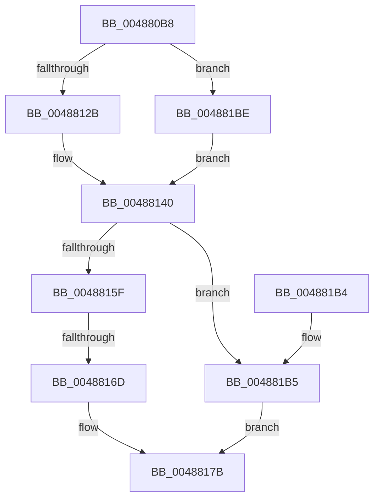

# MmQueryCommitReleaseState

- RVA: `0x004880B8`–`0x004881D8` (길이 `288` bytes)
- VA: `0x00000001404880B8`
- 실행 섹션: `.text`
- PDB 이름 있음: `예`; PDB Function 태그: `예`
- unwind 정보 RVA: `0x000AFC7C`
- 디코드: `77`개 명령, `288/288` bytes 표시
- 미해석 바이트: `0` (있으면 어셈블리에 `.byte`로 보존)

> 이 문서는 커널 이미지의 기계어와 PDB 기호를 분석해 생성했습니다. 4번과 5번은 함수 원형과 자료형을 바이너리 사용 방식에서 추정한 C 해석이며 원본 소스 복구 결과는 아닙니다.

## 1. Dependencies

- 직접 호출 지점: **1**; 고유 호출 대상: **1**
- 직접 호출자로 확인된 함수: **1**
- RIP 상대 이미지 참조: **5**

### Outgoing calls
- `0x0048819B` → [_security_check_cookie](../6A/_security_check_cookie_function_006AC640.md) (function, `0x006AC640`)

### Direct callers
- [NtQueryInformationProcess](../../page/9A/NtQueryInformationProcess_function_009AA250.md) at `0x009AC07B`

### Static image references
- `0x004880CC` → RVA `0x00E0A740` (`.data`; read)
- `0x0048812B` → RVA `0x00E38860` (`.data`; read)
- `0x00488132` → RVA `0x00E38850` (`.data`; read)
- `0x00488139` → RVA `0x00E38848` (`.data`; read)
- `0x00488148` → RVA `0x00FC5250` (`ALMOSTRO`; read)

## 2. Other-region calls and transfers

- 다른 실행 섹션으로 향하는 call: **0**
- call이 아닌 외부 분기/꼬리 이동: **1**
  - `0x00488167` → [sub_006F5914](../6F/Unknown_function_006F5914.md) (`tail-transfer`)

## 3. Assembly (complete function range)

```asm
004880B8  40 53                           push rbx
004880BA  55                              push rbp
004880BB  56                              push rsi
004880BC  57                              push rdi
004880BD  41 54                           push r12
004880BF  41 55                           push r13
004880C1  41 56                           push r14
004880C3  41 57                           push r15
004880C5  48 81 EC 98 00 00 00            sub rsp, 0x98
004880CC  48 8B 05 6D 26 98 00            mov rax, qword ptr [rip + 0x98266d]
004880D3  48 33 C4                        xor rax, rsp
004880D6  48 89 84 24 80 00 00 00         mov qword ptr [rsp + 0x80], rax
004880DE  4C 8B 94 24 00 01 00 00         mov r10, qword ptr [rsp + 0x100]
004880E6  48 8D B9 00 04 00 00            lea rdi, [rcx + 0x400]
004880ED  8B 87 B8 00 00 00               mov eax, dword ptr [rdi + 0xb8]
004880F3  0F 57 C0                        xorps xmm0, xmm0
004880F6  24 0F                           and al, 0xf
004880F8  4C 89 4C 24 38                  mov qword ptr [rsp + 0x38], r9
004880FD  4C 89 44 24 30                  mov qword ptr [rsp + 0x30], r8
00488102  48 8B D9                        mov rbx, rcx
00488105  48 89 54 24 28                  mov qword ptr [rsp + 0x28], rdx
0048810A  48 89 4C 24 48                  mov qword ptr [rsp + 0x48], rcx
0048810F  4C 89 54 24 40                  mov qword ptr [rsp + 0x40], r10
00488114  0F 11 44 24 50                  movups xmmword ptr [rsp + 0x50], xmm0
00488119  0F 11 44 24 60                  movups xmmword ptr [rsp + 0x60], xmm0
0048811E  0F 11 44 24 70                  movups xmmword ptr [rsp + 0x70], xmm0
00488123  3C 01                           cmp al, 1
00488125  0F 85 93 00 00 00               jne 0x1404881be
0048812B  4C 8D 35 2E 07 9B 00            lea r14, [rip + 0x9b072e]
00488132  4C 8D 3D 17 07 9B 00            lea r15, [rip + 0x9b0717]
00488139  48 8D 2D 08 07 9B 00            lea rbp, [rip + 0x9b0708]
00488140  8B 87 B8 00 00 00               mov eax, dword ptr [rdi + 0xb8]
00488146  33 F6                           xor esi, esi
00488148  83 3D 01 D1 B3 00 01            cmp dword ptr [rip + 0xb3d101], 1
0048814F  44 8B E6                        mov r12d, esi
00488152  48 8B 6D 00                     mov rbp, qword ptr [rbp]
00488156  44 8B EE                        mov r13d, esi
00488159  89 44 24 20                     mov dword ptr [rsp + 0x20], eax
0048815D  74 56                           je 0x1404881b5
0048815F  C1 E8 18                        shr eax, 0x18
00488162  90                              nop
00488163  24 30                           and al, 0x30
00488165  3C 20                           cmp al, 0x20
00488167  0F 84 A7 D7 26 00               je 0x1406f5914
0048816D  8A 4C 24 23                     mov cl, byte ptr [rsp + 0x23]
00488171  8A C1                           mov al, cl
00488173  24 30                           and al, 0x30
00488175  3C 20                           cmp al, 0x20
00488177  48 0F 42 EE                     cmovb rbp, rsi
0048817B  80 E1 30                        and cl, 0x30
0048817E  80 F9 10                        cmp cl, 0x10
00488181  40 0F 93 C6                     setae sil
00488185  89 32                           mov dword ptr [rdx], esi
00488187  49 89 28                        mov qword ptr [r8], rbp
0048818A  4D 89 21                        mov qword ptr [r9], r12
0048818D  4D 89 2A                        mov qword ptr [r10], r13
00488190  48 8B 8C 24 80 00 00 00         mov rcx, qword ptr [rsp + 0x80]
00488198  48 33 CC                        xor rcx, rsp
0048819B  E8 A0 44 22 00                  call 0x1406ac640
004881A0  48 81 C4 98 00 00 00            add rsp, 0x98
004881A7  41 5F                           pop r15
004881A9  41 5E                           pop r14
004881AB  41 5D                           pop r13
004881AD  41 5C                           pop r12
004881AF  5F                              pop rdi
004881B0  5E                              pop rsi
004881B1  5D                              pop rbp
004881B2  5B                              pop rbx
004881B3  C3                              ret
004881B4  CC                              int3
004881B5  8A 4C 24 23                     mov cl, byte ptr [rsp + 0x23]
004881B9  48 8B EE                        mov rbp, rsi
004881BC  EB BD                           jmp 0x14048817b
004881BE  4C 8D B7 E0 00 00 00            lea r14, [rdi + 0xe0]
004881C5  4C 8D BF D0 00 00 00            lea r15, [rdi + 0xd0]
004881CC  48 8D AF C8 00 00 00            lea rbp, [rdi + 0xc8]
004881D3  E9 68 FF FF FF                  jmp 0x140488140
```

## 4. C-style interpretation (structured pseudocode)

```c
__int64 __fastcall MmQueryCommitReleaseState(__int64 a1, __int64 a2, __int64 a3, __int64 a4, __int64 a5)
{
    __int64 result;
    __int64 v_rbp;
    __int64 v_rsi;
    __int64 v_rsp;
    unsigned __int64 v_stack_m58;
    unsigned __int64 v_stack_m68;
    unsigned __int64 v_stack_m78;
    unsigned __int64 v_stack_m88;
    unsigned __int64 v_stack_m90;
    unsigned __int64 v_stack_m98;
    unsigned __int64 v_stack_mA0;
    unsigned __int64 v_stack_mA8;
    unsigned __int64 v_stack_mB0;
    unsigned __int8 v_stack_mB5;
    unsigned int v_stack_mB8;
    unsigned __int8 v_stack_p23;

    v_rsp = (v_rsp) - (152);
    result = (*(unsigned __int64 *)(v_rip + 9971309)) ^ (v_rsp);
    v_stack_m58 = result;
    result = (unsigned __int8)(((unsigned int)(*(unsigned int *)(a1 + 1024 + 184))) & (15));
    v_stack_mA0 = a4;
    v_stack_mA8 = a3;
    v_stack_mB0 = a2;
    v_stack_m90 = a1;
    v_stack_m98 = a5;
    v_stack_m88 = v_xmm0;
    v_stack_m78 = v_xmm0;
    v_stack_m68 = v_xmm0;
    if (((unsigned __int8)(result)) != 1) goto loc_004881BE;
loc_00488140:
    v_rsi = 0;
    v_stack_mB8 = (unsigned int)((unsigned int)(*(unsigned int *)(a1 + 1024 + 184)));
    if ((*(unsigned int *)(v_rip + 11784449)) == 1) goto loc_004881B5;
    result = (unsigned int)(((unsigned int)(*(unsigned int *)(a1 + 1024 + 184))) >> (24));
    result = (unsigned __int8)((result) & (48));
    result = (unsigned __int8)(((unsigned __int8)(v_stack_mB5)) & (48));
    v_rbp = *(unsigned __int64 *)(v_rip + 10159880);
    if (((unsigned __int8)(result)) < 32) { v_rbp = 0; }
loc_0048817B:
    a1 = (unsigned __int8)((v_stack_mB5) & (48));
    v_rsi = (((unsigned __int8)(a1)) >= 16) ? 1 : 0;
    *(unsigned int *)(a2) = (unsigned int)(v_rsi);
    *(unsigned __int64 *)(a3) = v_rbp;
    *(unsigned __int64 *)(a4) = 0;
    *(unsigned __int64 *)(a5) = 0;
    a1 = (v_stack_m58) ^ (v_rsp);
    result = _security_check_cookie(a1, a2, a3, a4);
    v_rsp = (v_rsp) + (152);
    return result;
loc_004881B5:
    goto loc_0048817B;
loc_004881BE:
    goto loc_00488140;
}
```

## 5. (Beta) C Style

```c
int64_t MmQueryCommitReleaseState(void *Arg1, void *Arg2, void *Arg3, void *Arg4, void *Arg5)
{
    uint8_t *arg1 = (uint8_t *)Arg1;
    uint8_t *arg2 = (uint8_t *)Arg2;
    uint8_t *arg3 = (uint8_t *)Arg3;
    uint8_t *arg4 = (uint8_t *)Arg4;
    uint8_t *arg5 = (uint8_t *)Arg5;

    int64_t result;
    int64_t local_rbp;
    int64_t local_rsi;
    int64_t local_rsp;
    uint64_t v_stack_m58;
    uint64_t v_stack_m68;
    uint64_t v_stack_m78;
    uint64_t v_stack_m88;
    uint64_t v_stack_m90;
    uint64_t v_stack_m98;
    uint64_t v_stack_mA0;
    uint64_t v_stack_mA8;
    uint64_t v_stack_mB0;
    uint8_t v_stack_mB5;
    uint32_t v_stack_mB8;
    uint8_t v_stack_p23;

    local_rsp = (local_rsp) - (152);
    result = (*(uint64_t *)(v_rip + 0x98266D)) ^ (local_rsp);
    v_stack_m58 = result;
    result = (uint8_t)(((uint32_t)(*(uint32_t *)(arg1 + 0x400 + 0xB8))) & (15));
    v_stack_mA0 = Arg4;
    v_stack_mA8 = Arg3;
    v_stack_mB0 = Arg2;
    v_stack_m90 = Arg1;
    v_stack_m98 = Arg5;
    v_stack_m88 = v_xmm0;
    v_stack_m78 = v_xmm0;
    v_stack_m68 = v_xmm0;
    if (((uint8_t)(result)) != 1) goto loc_004881BE;
loc_00488140:
    local_rsi = 0;
    v_stack_mB8 = (uint32_t)((uint32_t)(*(uint32_t *)(arg1 + 0x400 + 0xB8)));
    if ((*(uint32_t *)(v_rip + 0xB3D101)) == 1) goto loc_004881B5;
    result = (uint32_t)(((uint32_t)(*(uint32_t *)(arg1 + 0x400 + 0xB8))) >> (24));
    result = (uint8_t)((result) & (48));
    result = (uint8_t)(((uint8_t)(v_stack_mB5)) & (48));
    local_rbp = *(uint64_t *)(v_rip + 0x9B0708);
    if (((uint8_t)(result)) < 32) { local_rbp = 0; }
loc_0048817B:
    Arg1 = (uint8_t)((v_stack_mB5) & (48));
    local_rsi = (((uint8_t)(Arg1)) >= 16) ? 1 : 0;
    *(uint32_t *)(arg2) = (uint32_t)(local_rsi);
    *(uint64_t *)(arg3) = local_rbp;
    *(uint64_t *)(arg4) = 0;
    *(uint64_t *)(arg5) = 0;
    Arg1 = (v_stack_m58) ^ (local_rsp);
    result = _security_check_cookie(Arg1, Arg2, Arg3, Arg4);
    local_rsp = (local_rsp) + (152);
    return result;
loc_004881B5:
    goto loc_0048817B;
loc_004881BE:
    goto loc_00488140;
}
```

### 관측된 메모리 오프셋

구조체 형식이 확인되지 않은 접근은 인자 기준의 오프셋으로만 기록했습니다.

| 기준 인자 | 오프셋 표현 | 폭 (bit) | 접근 |
|---|---:|---:|---|
| `Arg1` | `+ 0xB8` | `32` | `R` |
| `Arg1` | `+ 0xC8` | `64` | `R` |
| `Arg1` | `+ 0xD0` | `64` | `R` |
| `Arg1` | `+ 0xE0` | `64` | `R` |
| `Arg1` | `+ 0x400` | `64` | `R` |
| `Arg2` | `+ 0x0` | `32` | `W` |
| `Arg3` | `+ 0x0` | `64` | `W` |
| `Arg4` | `+ 0x0` | `64` | `W` |
| `Arg5` | `+ 0x0` | `64` | `W` |

## 6. Execution-region graph

[열기: 2D/3D 그래프와 함수 탐색 컨트롤 패널](../../../control-panel.html?section=text&rva=0x004880B8&view=graph)

- 2D 그래프는 위에서 아래로 흐르고, 3D 그래프는 빈 공간을 드래그해 회전합니다. Shift+드래그는 이동, 휠은 확대·축소, 함수 노드 선택은 대상 보고서 이동입니다.

### Static fallback


