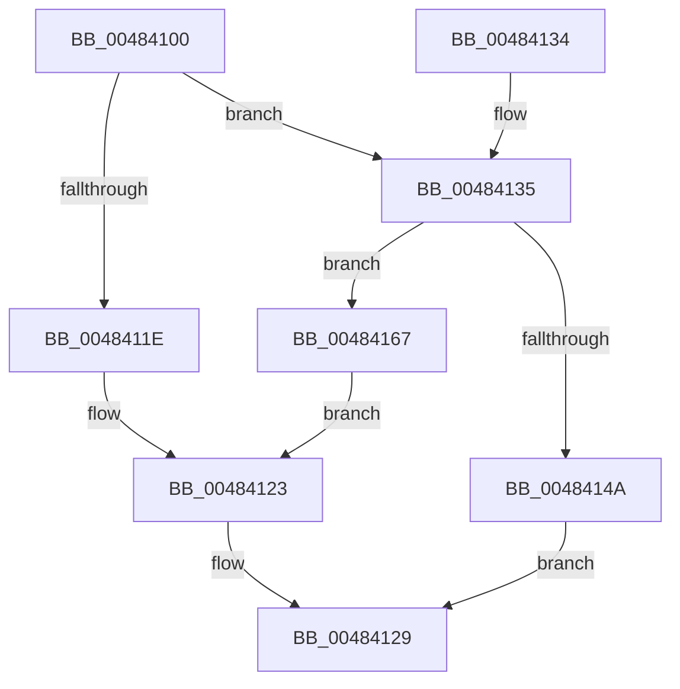

# PfFbBufferListAllocateTemporary

- RVA: `0x00484100`–`0x0048416E` (길이 `110` bytes)
- VA: `0x0000000140484100`
- 실행 섹션: `.text`
- PDB 이름 있음: `예`; PDB Function 태그: `아니요`
- unwind 정보 RVA: `0x00070760`
- 디코드: `34`개 명령, `110/110` bytes 표시
- 미해석 바이트: `0` (있으면 어셈블리에 `.byte`로 보존)

> 이 문서는 커널 이미지의 기계어와 PDB 기호를 분석해 생성했습니다. 4번과 5번은 함수 원형과 자료형을 바이너리 사용 방식에서 추정한 C 해석이며 원본 소스 복구 결과는 아닙니다.

## 1. Dependencies

- 직접 호출 지점: **2**; 고유 호출 대상: **2**
- 직접 호출자로 확인된 함수: **2**
- RIP 상대 이미지 참조: **0**

### Outgoing calls
- `0x00484140` → [ExAllocatePool2](../../poolcode/B8/ExAllocatePool2_function_00B820F0.md) (function, `0x00B820F0`)
- `0x0048415E` → [PfFbBufferListInsertInFree](PfFbBufferListInsertInFree_function_00484210.md) (function, `0x00484210`)

### Direct callers
- [PfpEventHandleOutOfBuffers](PfpEventHandleOutOfBuffers_function_004840D0.md) at `0x004840E4`
- [PfpSectInfoHandleOutOfBuffers](../../page/75/PfpSectInfoHandleOutOfBuffers_function_00751C50.md) at `0x00751C5C`

### Static image references
- 디코드된 RIP-relative 메모리 참조가 없습니다.

## 2. Other-region calls and transfers

- 다른 실행 섹션으로 향하는 call: **1**
  - `0x00484140` → [ExAllocatePool2](../../poolcode/B8/ExAllocatePool2_function_00B820F0.md) (`.text` → `POOLCODE`)
- 별도 외부 분기/꼬리 이동을 확인하지 못했습니다.

## 3. Assembly (complete function range)

```asm
00484100  48 89 5C 24 08                  mov qword ptr [rsp + 8], rbx
00484105  57                              push rdi
00484106  48 83 EC 30                     sub rsp, 0x30
0048410A  48 63 DA                        movsxd rbx, edx
0048410D  48 8B F9                        mov rdi, rcx
00484110  8B C3                           mov eax, ebx
00484112  F0 0F C1 41 70                  lock xadd dword ptr [rcx + 0x70], eax
00484117  03 C3                           add eax, ebx
00484119  3B 41 58                        cmp eax, dword ptr [rcx + 0x58]
0048411C  7E 17                           jle 0x140484135
0048411E  B8 2D 01 00 C0                  mov eax, 0xc000012d
00484123  F7 DB                           neg ebx
00484125  F0 01 5F 70                     lock add dword ptr [rdi + 0x70], ebx
00484129  48 8B 5C 24 40                  mov rbx, qword ptr [rsp + 0x40]
0048412E  48 83 C4 30                     add rsp, 0x30
00484132  5F                              pop rdi
00484133  C3                              ret
00484134  CC                              int3
00484135  44 8B 41 44                     mov r8d, dword ptr [rcx + 0x44]
00484139  48 8B D3                        mov rdx, rbx
0048413C  48 8B 49 48                     mov rcx, qword ptr [rcx + 0x48]
00484140  E8 AB DF 6F 00                  call 0x140b820f0
00484145  48 85 C0                        test rax, rax
00484148  74 1D                           je 0x140484167
0048414A  83 64 24 20 00                  and dword ptr [rsp + 0x20], 0
0048414F  41 B9 01 00 00 00               mov r9d, 1
00484155  44 8B C3                        mov r8d, ebx
00484158  48 8B D0                        mov rdx, rax
0048415B  48 8B CF                        mov rcx, rdi
0048415E  E8 AD 00 00 00                  call 0x140484210
00484163  33 C0                           xor eax, eax
00484165  EB C2                           jmp 0x140484129
00484167  B8 9A 00 00 C0                  mov eax, 0xc000009a
0048416C  EB B5                           jmp 0x140484123
```

## 4. C-style interpretation (structured pseudocode)

```c
__int64 __fastcall PfFbBufferListAllocateTemporary(__int64 a1, int a2)
{
    __int64 result;
    __int64 v_rbx;
    __int64 v_rsp;
    unsigned int v_stack_p20;
    unsigned __int64 v_stack_p8;

    v_stack_p8 = v_rbx;
    v_rsp = (v_rsp) - (48);
    result = (unsigned int)(((unsigned int)((unsigned int)((int)(a2)))) + ((unsigned int)((int)(a2))));
    if (((unsigned int)(result)) <= (*(unsigned int *)(a1 + 88))) goto loc_00484135;
loc_00484123:
    v_rbx = (unsigned int)(-((int)(a2)));
loc_00484129:
    v_rsp = (v_rsp) + (48);
    return (unsigned int)(0xC000012DULL);
loc_00484135:
    result = ExAllocatePool2(*(unsigned __int64 *)(a1 + 72), v_stack_p8, (unsigned int)(*(unsigned int *)(a1 + 68)), a4);
    if (result == 0) goto loc_00484167;
    result = PfFbBufferListInsertInFree(a1, result, (unsigned int)((unsigned int)(v_stack_p8)), 1);
    result = 0;
    goto loc_00484129;
loc_00484167:
    goto loc_00484123;
}
```

## 5. (Beta) C Style

```c
int64_t PfFbBufferListAllocateTemporary(void *Arg1, int32_t Arg2)
{
    uint8_t *arg1 = (uint8_t *)Arg1;

    int64_t result;
    int64_t local_rbx;
    int64_t local_rsp;
    uint32_t v_stack_p20;
    uint64_t v_stack_p8;

    v_stack_p8 = local_rbx;
    local_rsp = (local_rsp) - (48);
    result = (uint32_t)(((uint32_t)((uint32_t)((int32_t)(Arg2)))) + ((uint32_t)((int32_t)(Arg2))));
    if (((uint32_t)(result)) <= (*(uint32_t *)(arg1 + 0x58))) goto loc_00484135;
loc_00484123:
    local_rbx = (uint32_t)(-((int32_t)(Arg2)));
loc_00484129:
    local_rsp = (local_rsp) + (48);
    return (uint32_t)(0xC000012DULL);
loc_00484135:
    result = ExAllocatePool2(*(uint64_t *)(arg1 + 0x48), v_stack_p8, (uint32_t)(*(uint32_t *)(arg1 + 0x44)), a4);
    if (result == 0) goto loc_00484167;
    result = PfFbBufferListInsertInFree(Arg1, result, (uint32_t)((uint32_t)(v_stack_p8)), 1);
    result = 0;
    goto loc_00484129;
loc_00484167:
    goto loc_00484123;
}
```

### 관측된 메모리 오프셋

구조체 형식이 확인되지 않은 접근은 인자 기준의 오프셋으로만 기록했습니다.

| 기준 인자 | 오프셋 표현 | 폭 (bit) | 접근 |
|---|---:|---:|---|
| `Arg1` | `+ 0x44` | `32` | `R` |
| `Arg1` | `+ 0x48` | `64` | `R` |
| `Arg1` | `+ 0x58` | `32` | `R` |
| `Arg1` | `+ 0x70` | `32` | `R/W` |

## 6. Execution-region graph

[열기: 2D/3D 그래프와 함수 탐색 컨트롤 패널](../../../control-panel.html?section=text&rva=0x00484100&view=graph)

- 2D 그래프는 위에서 아래로 흐르고, 3D 그래프는 빈 공간을 드래그해 회전합니다. Shift+드래그는 이동, 휠은 확대·축소, 함수 노드 선택은 대상 보고서 이동입니다.

### Static fallback


