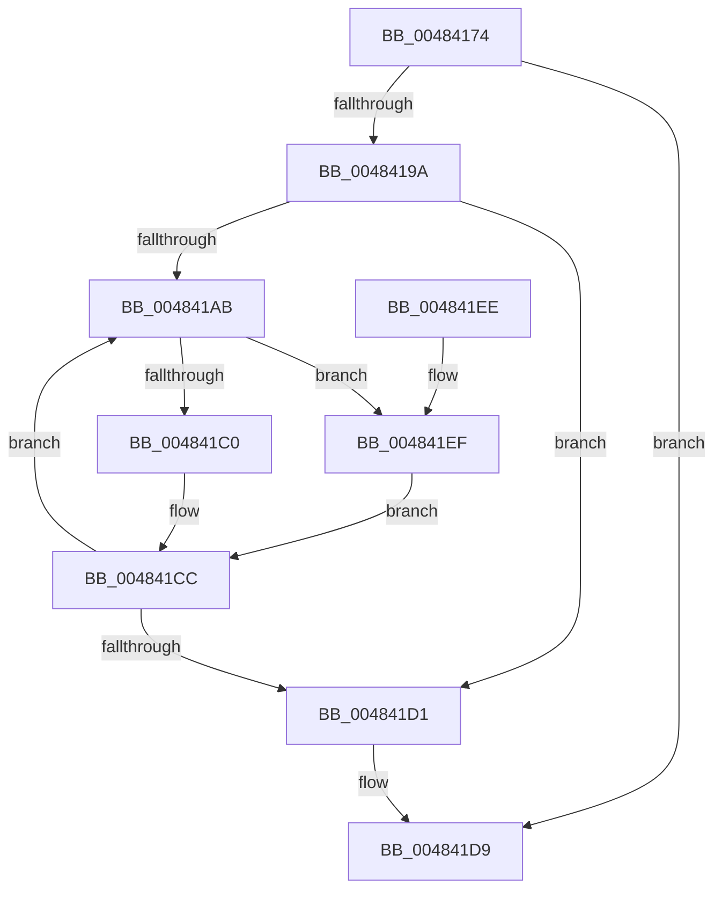

# PfFbBufferListFlushStandby

- RVA: `0x00484174`–`0x00484209` (길이 `149` bytes)
- VA: `0x0000000140484174`
- 실행 섹션: `.text`
- PDB 이름 있음: `예`; PDB Function 태그: `아니요`
- unwind 정보 RVA: `0x000AF160`
- 디코드: `44`개 명령, `149/149` bytes 표시
- 미해석 바이트: `0` (있으면 어셈블리에 `.byte`로 보존)

> 이 문서는 커널 이미지의 기계어와 PDB 기호를 분석해 생성했습니다. 4번과 5번은 함수 원형과 자료형을 바이너리 사용 방식에서 추정한 C 해석이며 원본 소스 복구 결과는 아닙니다.

## 1. Dependencies

- 직접 호출 지점: **6**; 고유 호출 대상: **5**
- 직접 호출자로 확인된 함수: **3**
- RIP 상대 이미지 참조: **0**

### Outgoing calls
- `0x00484191` → [ExAcquireRundownProtection](../21/ExAcquireRundownProtection_function_00216620.md) (function, `0x00216620`)
- `0x0048419E` → [ExpInterlockedFlushSList](../6B/ExpInterlockedFlushSList_function_006BA5F0.md) (function, `0x006BA5F0`)
- `0x004841B4` → [ExAcquireRundownProtection](../21/ExAcquireRundownProtection_function_00216620.md) (function, `0x00216620`)
- `0x004841C7` → [guard_dispatch_icall](../6B/guard_dispatch_icall_function_006BAAD0.md) (function, `0x006BAAD0`)
- `0x004841D4` → [ExReleaseRundownProtection](../34/ExReleaseRundownProtection_function_00349E80.md) (function, `0x00349E80`)
- `0x00484202` → [PfFbBufferListInsertInFree](PfFbBufferListInsertInFree_function_00484210.md) (function, `0x00484210`)

### Direct callers
- [PfSnEndTrace](../../page/8B/PfSnEndTrace_function_008B04A8.md) at `0x008B0682`
- [PfGetCompletedTrace](../../page/90/PfGetCompletedTrace_function_00902950.md) at `0x00902D10`
- [PfpFlushEventBuffers](../../page/97/PfpFlushEventBuffers_function_0097BD4C.md) at `0x0097BD75`

### Static image references
- 디코드된 RIP-relative 메모리 참조가 없습니다.

## 2. Other-region calls and transfers

- 다른 실행 섹션으로 향하는 call: **0**
- 별도 외부 분기/꼬리 이동을 확인하지 못했습니다.

## 3. Assembly (complete function range)

```asm
00484174  48 89 5C 24 08                  mov qword ptr [rsp + 8], rbx
00484179  48 89 6C 24 10                  mov qword ptr [rsp + 0x10], rbp
0048417E  48 89 74 24 18                  mov qword ptr [rsp + 0x18], rsi
00484183  57                              push rdi
00484184  48 83 EC 30                     sub rsp, 0x30
00484188  48 8B E9                        mov rbp, rcx
0048418B  48 8B DA                        mov rbx, rdx
0048418E  48 8B CA                        mov rcx, rdx
00484191  E8 8A 24 D9 FF                  call 0x140216620
00484196  84 C0                           test al, al
00484198  74 3F                           je 0x1404841d9
0048419A  48 8D 4B 20                     lea rcx, [rbx + 0x20]
0048419E  E8 4D 64 23 00                  call 0x1406ba5f0
004841A3  48 8B F8                        mov rdi, rax
004841A6  48 85 C0                        test rax, rax
004841A9  74 26                           je 0x1404841d1
004841AB  48 8B F7                        mov rsi, rdi
004841AE  48 8B CB                        mov rcx, rbx
004841B1  48 8B 3F                        mov rdi, qword ptr [rdi]
004841B4  E8 67 24 D9 FF                  call 0x140216620
004841B9  48 8B D6                        mov rdx, rsi
004841BC  84 C0                           test al, al
004841BE  74 2F                           je 0x1404841ef
004841C0  48 8B 43 68                     mov rax, qword ptr [rbx + 0x68]
004841C4  48 8B CD                        mov rcx, rbp
004841C7  E8 04 69 23 00                  call 0x1406baad0
004841CC  48 85 FF                        test rdi, rdi
004841CF  75 DA                           jne 0x1404841ab
004841D1  48 8B CB                        mov rcx, rbx
004841D4  E8 A7 5C EC FF                  call 0x140349e80
004841D9  48 8B 5C 24 40                  mov rbx, qword ptr [rsp + 0x40]
004841DE  48 8B 6C 24 48                  mov rbp, qword ptr [rsp + 0x48]
004841E3  48 8B 74 24 50                  mov rsi, qword ptr [rsp + 0x50]
004841E8  48 83 C4 30                     add rsp, 0x30
004841EC  5F                              pop rdi
004841ED  C3                              ret
004841EE  CC                              int3
004841EF  44 8B 46 20                     mov r8d, dword ptr [rsi + 0x20]
004841F3  48 8B CB                        mov rcx, rbx
004841F6  83 64 24 20 00                  and dword ptr [rsp + 0x20], 0
004841FB  44 2B C6                        sub r8d, esi
004841FE  44 8B 4E 2C                     mov r9d, dword ptr [rsi + 0x2c]
00484202  E8 09 00 00 00                  call 0x140484210
00484207  EB C3                           jmp 0x1404841cc
```

## 4. C-style interpretation (structured pseudocode)

```c
__int64 __fastcall PfFbBufferListFlushStandby(__int64 a1, __int64 a2)
{
    __int64 result;
    __int64 v_rsp;
    unsigned __int64 v_stack_p10;
    unsigned __int64 v_stack_p18;
    unsigned int v_stack_p20;
    unsigned __int64 v_stack_p8;

    v_stack_p8 = v_rbx;
    v_stack_p10 = v_rbp;
    v_stack_p18 = v_rsi;
    v_rsp = (v_rsp) - (48);
    result = ExAcquireRundownProtection(a2, a2, a3, a4);
    if ((unsigned __int8)(result) == 0) goto loc_004841D9;
    result = ExpInterlockedFlushSList(a2 + 32, a2, a3, a4);
    if (result == 0) goto loc_004841D1;
loc_004841AB:
    result = ExAcquireRundownProtection(a2, a2, a3, a4);
    if ((unsigned __int8)(result) == 0) goto loc_004841EF;
    result = guard_dispatch_icall(a1, result, a3, a4);
loc_004841CC:
    if (*(unsigned __int64 *)(result) != 0) goto loc_004841AB;
loc_004841D1:
    result = ExReleaseRundownProtection(a2, result, a3, a4);
loc_004841D9:
    v_rsp = (v_rsp) + (48);
    return result;
loc_004841EF:
    a3 = (unsigned int)(((unsigned int)(*(unsigned int *)(v_stack_p18 + 32))) - ((unsigned int)(v_stack_p18)));
    result = PfFbBufferListInsertInFree(v_stack_p8, result, a3, (unsigned int)(*(unsigned int *)(v_stack_p18 + 44)));
    goto loc_004841CC;
}
```

## 5. (Beta) C Style

```c
int64_t PfFbBufferListFlushStandby(int64_t Arg1, void *Arg2)
{
    uint8_t *arg2 = (uint8_t *)Arg2;

    int64_t result;
    int64_t local_rsp;
    uint64_t v_stack_p10;
    uint64_t v_stack_p18;
    uint32_t v_stack_p20;
    uint64_t v_stack_p8;

    v_stack_p8 = local_rbx;
    v_stack_p10 = local_rbp;
    v_stack_p18 = local_rsi;
    local_rsp = (local_rsp) - (48);
    result = ExAcquireRundownProtection(Arg2, Arg2, a3, a4);
    if ((uint8_t)(result) == 0) goto loc_004841D9;
    result = ExpInterlockedFlushSList(Arg2 + 32, Arg2, a3, a4);
    if (result == 0) goto loc_004841D1;
loc_004841AB:
    result = ExAcquireRundownProtection(Arg2, Arg2, a3, a4);
    if ((uint8_t)(result) == 0) goto loc_004841EF;
    result = guard_dispatch_icall(Arg1, result, a3, a4);
loc_004841CC:
    if (*(uint64_t *)(result) != 0) goto loc_004841AB;
loc_004841D1:
    result = ExReleaseRundownProtection(Arg2, result, a3, a4);
loc_004841D9:
    local_rsp = (local_rsp) + (48);
    return result;
loc_004841EF:
    a3 = (uint32_t)(((uint32_t)(*(uint32_t *)(v_stack_p18 + 0x20))) - ((uint32_t)(v_stack_p18)));
    result = PfFbBufferListInsertInFree(v_stack_p8, result, a3, (uint32_t)(*(uint32_t *)(v_stack_p18 + 0x2C)));
    goto loc_004841CC;
}
```

### 관측된 메모리 오프셋

구조체 형식이 확인되지 않은 접근은 인자 기준의 오프셋으로만 기록했습니다.

| 기준 인자 | 오프셋 표현 | 폭 (bit) | 접근 |
|---|---:|---:|---|
| `Arg2` | `+ 0x20` | `64` | `R` |
| `Arg2` | `+ 0x68` | `64` | `R` |

## 6. Execution-region graph

[열기: 2D/3D 그래프와 함수 탐색 컨트롤 패널](../../../control-panel.html?section=text&rva=0x00484174&view=graph)

- 2D 그래프는 위에서 아래로 흐르고, 3D 그래프는 빈 공간을 드래그해 회전합니다. Shift+드래그는 이동, 휠은 확대·축소, 함수 노드 선택은 대상 보고서 이동입니다.

### Static fallback


