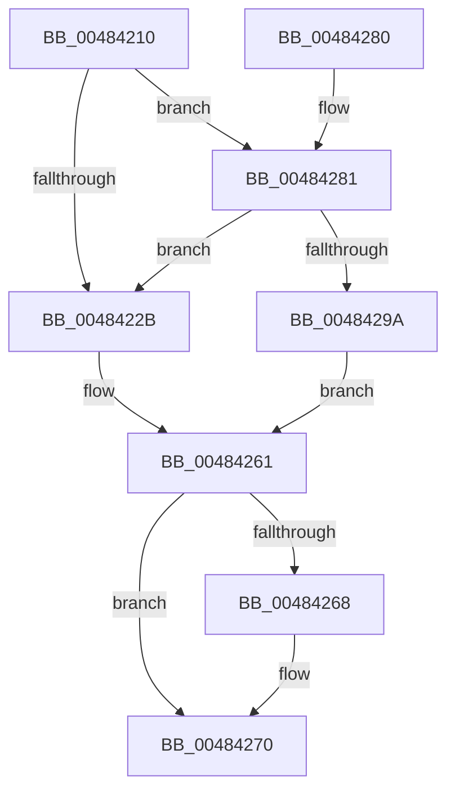

# PfFbBufferListInsertInFree

- RVA: `0x00484210`–`0x004842AF` (길이 `159` bytes)
- VA: `0x0000000140484210`
- 실행 섹션: `.text`
- PDB 이름 있음: `예`; PDB Function 태그: `아니요`
- unwind 정보 RVA: `0x000A828C`
- 디코드: `46`개 명령, `159/159` bytes 표시
- 미해석 바이트: `0` (있으면 어셈블리에 `.byte`로 보존)

> 이 문서는 커널 이미지의 기계어와 PDB 기호를 분석해 생성했습니다. 4번과 5번은 함수 원형과 자료형을 바이너리 사용 방식에서 추정한 C 해석이며 원본 소스 복구 결과는 아닙니다.

## 1. Dependencies

- 직접 호출 지점: **4**; 고유 호출 대상: **4**
- 직접 호출자로 확인된 함수: **7**
- RIP 상대 이미지 참조: **1**

### Outgoing calls
- `0x00484250` → [memset](../6C/memset_function_006C6C40.md) (function, `0x006C6C40`)
- `0x0048425C` → [ExpInterlockedPushEntrySList](../6B/ExpInterlockedPushEntrySList_function_006BA5B0.md) (function, `0x006BA5B0`)
- `0x0048426B` → [ExReleaseRundownProtection](../34/ExReleaseRundownProtection_function_00349E80.md) (function, `0x00349E80`)
- `0x004842A8` → [ExFreePoolWithTag](../../poolcode/B8/ExFreePoolWithTag_function_00B82870.md) (function, `0x00B82870`)

### Direct callers
- [PfFbBufferListAllocateTemporary](PfFbBufferListAllocateTemporary_function_00484100.md) at `0x0048415E`
- [PfFbBufferListFlushStandby](PfFbBufferListFlushStandby_function_00484174.md) at `0x00484202`
- [PfTFullEventListAdd](../49/PfTFullEventListAdd_function_00494B50.md) at `0x00494BAD`
- [PfFbBufferListAllocate](../5C/PfFbBufferListAllocate_function_005CE1EC.md) at `0x005CE28B`
- [PfTCleanup](../../page/75/PfTCleanup_function_00751208.md) at `0x0075137C`
- [PfpFlushEventBuffers](../../page/97/PfpFlushEventBuffers_function_0097BD4C.md) at `0x0097BE00`
- [PfpRepurposeNameLoggingTrace](../../page/AA/PfpRepurposeNameLoggingTrace_function_00AA3C34.md) at `0x00AA3C4F`

### Static image references
- `0x0048428D` → RVA `0x00FC6A80` (`ALMOSTRO`; read)

## 2. Other-region calls and transfers

- 다른 실행 섹션으로 향하는 call: **1**
  - `0x004842A8` → [ExFreePoolWithTag](../../poolcode/B8/ExFreePoolWithTag_function_00B82870.md) (`.text` → `POOLCODE`)
- 별도 외부 분기/꼬리 이동을 확인하지 못했습니다.

## 3. Assembly (complete function range)

```asm
00484210  48 89 5C 24 08                  mov qword ptr [rsp + 8], rbx
00484215  48 89 74 24 10                  mov qword ptr [rsp + 0x10], rsi
0048421A  57                              push rdi
0048421B  48 83 EC 20                     sub rsp, 0x20
0048421F  48 8B FA                        mov rdi, rdx
00484222  48 8B D9                        mov rbx, rcx
00484225  41 F6 C1 01                     test r9b, 1
00484229  75 56                           jne 0x140484281
0048422B  4D 63 C0                        movsxd r8, r8d
0048422E  4C 03 C7                        add r8, rdi
00484231  48 89 5A 10                     mov qword ptr [rdx + 0x10], rbx
00484235  4C 89 42 20                     mov qword ptr [rdx + 0x20], r8
00484239  8B 49 50                        mov ecx, dword ptr [rcx + 0x50]
0048423C  83 62 28 00                     and dword ptr [rdx + 0x28], 0
00484240  48 03 CF                        add rcx, rdi
00484243  48 89 4A 18                     mov qword ptr [rdx + 0x18], rcx
00484247  4C 2B C1                        sub r8, rcx
0048424A  44 89 4A 2C                     mov dword ptr [rdx + 0x2c], r9d
0048424E  33 D2                           xor edx, edx
00484250  E8 EB 29 24 00                  call 0x1406c6c40
00484255  48 8B D7                        mov rdx, rdi
00484258  48 8D 4B 10                     lea rcx, [rbx + 0x10]
0048425C  E8 4F 63 23 00                  call 0x1406ba5b0
00484261  83 7C 24 50 00                  cmp dword ptr [rsp + 0x50], 0
00484266  74 08                           je 0x140484270
00484268  48 8B CB                        mov rcx, rbx
0048426B  E8 10 5C EC FF                  call 0x140349e80
00484270  48 8B 5C 24 30                  mov rbx, qword ptr [rsp + 0x30]
00484275  48 8B 74 24 38                  mov rsi, qword ptr [rsp + 0x38]
0048427A  48 83 C4 20                     add rsp, 0x20
0048427E  5F                              pop rdi
0048427F  C3                              ret
00484280  CC                              int3
00484281  0F B7 41 10                     movzx eax, word ptr [rcx + 0x10]
00484285  44 0F B7 51 20                  movzx r10d, word ptr [rcx + 0x20]
0048428A  44 03 D0                        add r10d, eax
0048428D  8B 05 ED 27 B4 00               mov eax, dword ptr [rip + 0xb427ed]
00484293  FF C0                           inc eax
00484295  44 3B D0                        cmp r10d, eax
00484298  72 91                           jb 0x14048422b
0048429A  41 F7 D8                        neg r8d
0048429D  F0 44 01 41 70                  lock add dword ptr [rcx + 0x70], r8d
004842A2  8B 51 44                        mov edx, dword ptr [rcx + 0x44]
004842A5  48 8B CF                        mov rcx, rdi
004842A8  E8 C3 E5 6F 00                  call 0x140b82870
004842AD  EB B2                           jmp 0x140484261
```

## 4. C-style interpretation (structured pseudocode)

```c
__int64 __fastcall PfFbBufferListInsertInFree(__int64 a1, __int64 a2, int a3, int a4, unsigned int a5)
{
    __int64 result;
    __int64 v_r10;
    __int64 v_rsp;
    unsigned __int64 v_stack_p10;
    unsigned __int64 v_stack_p8;

    v_stack_p8 = v_rbx;
    v_stack_p10 = v_rsi;
    v_rsp = (v_rsp) - (32);
    if ((((unsigned __int8)(a4)) & (1)) != 0) goto loc_00484281;
loc_0048422B:
    a3 = ((int)(a3)) + (a2);
    *(unsigned __int64 *)(a2 + 16) = a1;
    *(unsigned __int64 *)(a2 + 32) = a3;
    a1 = ((unsigned int)(*(unsigned int *)(a1 + 80))) + (a2);
    *(unsigned __int64 *)(a2 + 24) = a1;
    a3 = (a3) - (a1);
    *(unsigned int *)(a2 + 44) = a4;
    a2 = 0;
    result = memset(a1, a2, a3, a4);
    result = ExpInterlockedPushEntrySList(a1 + 16, 0, a3, a4);
loc_00484261:
    if (a5 != 0) {
        a1 = a1;
        result = ExReleaseRundownProtection(a1, 0, a3, a4);
    }
    v_rsp = (v_rsp) + (32);
    return result;
loc_00484281:
    v_r10 = (unsigned int)((*(unsigned __int16 *)(a1 + 32)) + ((unsigned int)(*(unsigned __int16 *)(a1 + 16))));
    result = (unsigned int)(((unsigned int)(*(unsigned int *)(v_rip + 11806701))) + 1);
    if (((unsigned int)(v_r10)) < ((unsigned int)(result))) goto loc_0048422B;
    a3 = (unsigned int)(-(a3));
    result = ExFreePoolWithTag(0, (unsigned int)(*(unsigned int *)(a1 + 68)), a3, a4);
    goto loc_00484261;
}
```

## 5. (Beta) C Style

```c
int64_t PfFbBufferListInsertInFree(void *Arg1, void *Arg2, int32_t Arg3, int32_t Arg4, uint32_t Arg5)
{
    uint8_t *arg1 = (uint8_t *)Arg1;
    uint8_t *arg2 = (uint8_t *)Arg2;

    int64_t result;
    int64_t local_r10;
    int64_t local_rsp;
    uint64_t v_stack_p10;
    uint64_t v_stack_p8;

    v_stack_p8 = local_rbx;
    v_stack_p10 = local_rsi;
    local_rsp = (local_rsp) - (32);
    if ((((uint8_t)(Arg4)) & (1)) != 0) goto loc_00484281;
loc_0048422B:
    Arg3 = ((int32_t)(Arg3)) + (Arg2);
    *(void **)(arg2 + 0x10) = Arg1;
    *(uint64_t *)(arg2 + 0x20) = Arg3;
    Arg1 = ((uint32_t)(*(uint32_t *)(arg1 + 0x50))) + (Arg2);
    *(void **)(arg2 + 0x18) = Arg1;
    Arg3 = (Arg3) - (Arg1);
    *(uint32_t *)(arg2 + 0x2C) = Arg4;
    Arg2 = 0;
    result = memset(Arg1, Arg2, Arg3, Arg4);
    result = ExpInterlockedPushEntrySList(Arg1 + 16, 0, Arg3, Arg4);
loc_00484261:
    if (Arg5 != 0) {
        Arg1 = Arg1;
        result = ExReleaseRundownProtection(Arg1, 0, Arg3, Arg4);
    }
    local_rsp = (local_rsp) + (32);
    return result;
loc_00484281:
    local_r10 = (uint32_t)((*(uint16_t *)(arg1 + 0x20)) + ((uint32_t)(*(uint16_t *)(arg1 + 0x10))));
    result = (uint32_t)(((uint32_t)(*(uint32_t *)(v_rip + 0xB427ED))) + 1);
    if (((uint32_t)(local_r10)) < ((uint32_t)(result))) goto loc_0048422B;
    Arg3 = (uint32_t)(-(Arg3));
    result = ExFreePoolWithTag(0, (uint32_t)(*(uint32_t *)(arg1 + 0x44)), Arg3, Arg4);
    goto loc_00484261;
}
```

### 관측된 메모리 오프셋

구조체 형식이 확인되지 않은 접근은 인자 기준의 오프셋으로만 기록했습니다.

| 기준 인자 | 오프셋 표현 | 폭 (bit) | 접근 |
|---|---:|---:|---|
| `Arg1` | `+ 0x10` | `16` | `R` |
| `Arg1` | `+ 0x10` | `64` | `R` |
| `Arg1` | `+ 0x20` | `16` | `R` |
| `Arg1` | `+ 0x44` | `32` | `R` |
| `Arg1` | `+ 0x50` | `32` | `R` |
| `Arg1` | `+ 0x70` | `32` | `R/W` |
| `Arg2` | `+ 0x10` | `64` | `W` |
| `Arg2` | `+ 0x18` | `64` | `W` |
| `Arg2` | `+ 0x20` | `64` | `W` |
| `Arg2` | `+ 0x28` | `32` | `R/W` |
| `Arg2` | `+ 0x2C` | `32` | `W` |

## 6. Execution-region graph

[열기: 2D/3D 그래프와 함수 탐색 컨트롤 패널](../../../control-panel.html?section=text&rva=0x00484210&view=graph)

- 2D 그래프는 위에서 아래로 흐르고, 3D 그래프는 빈 공간을 드래그해 회전합니다. Shift+드래그는 이동, 휠은 확대·축소, 함수 노드 선택은 대상 보고서 이동입니다.

### Static fallback


