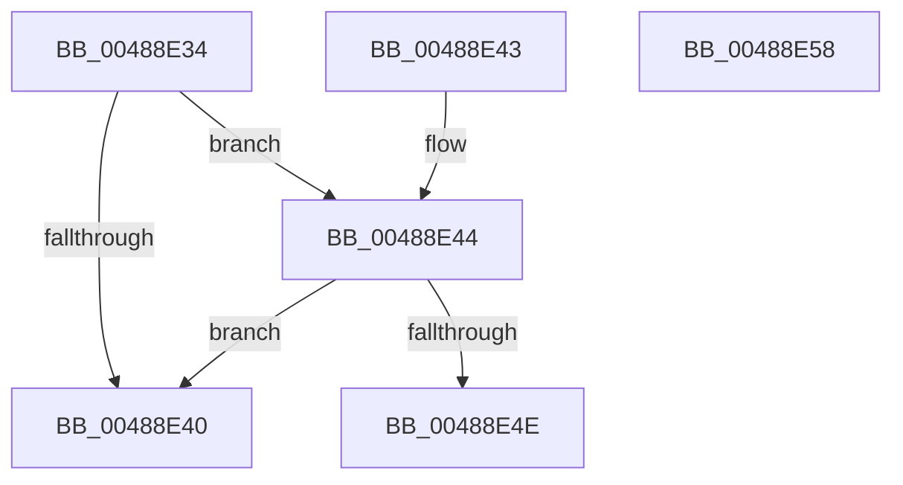

# PfIsProcessExitingInNonSystemPartition

- RVA: `0x00488E34`–`0x00488E59` (길이 `37` bytes)
- VA: `0x0000000140488E34`
- 실행 섹션: `.text`
- PDB 이름 있음: `예`; PDB Function 태그: `아니요`
- unwind 정보 RVA: `0x000DB714`
- 디코드: `13`개 명령, `37/37` bytes 표시
- 미해석 바이트: `0` (있으면 어셈블리에 `.byte`로 보존)

> 이 문서는 커널 이미지의 기계어와 PDB 기호를 분석해 생성했습니다. 4번과 5번은 함수 원형과 자료형을 바이너리 사용 방식에서 추정한 C 해석이며 원본 소스 복구 결과는 아닙니다.

## 1. Dependencies

- 직접 호출 지점: **0**; 고유 호출 대상: **0**
- 직접 호출자로 확인된 함수: **3**
- RIP 상대 이미지 참조: **1**

### Outgoing calls
- 직접 디코드된 call 명령이 없습니다.

### Direct callers
- [MiQueuePageAccessLog](../34/MiQueuePageAccessLog_function_00348EB0.md) at `0x00348F35`
- [MiQueuePageAccessLog](../34/MiQueuePageAccessLog_function_00348EB0.md) at `0x0034901E`
- [PfpReturnAccessBuffer](PfpReturnAccessBuffer_function_00488A80.md) at `0x00488AF2`
- [PfpReturnAccessBuffer](PfpReturnAccessBuffer_function_00488A80.md) at `0x00488BAF`
- [MiAllocatePfnRepurposeLogDispatch](MiAllocatePfnRepurposeLogDispatch_function_00488BD0.md) at `0x00488D1B`
- [MiAllocatePfnRepurposeLogDispatch](MiAllocatePfnRepurposeLogDispatch_function_00488BD0.md) at `0x00488E22`

### Static image references
- `0x00488E37` → RVA `0x00FC6EA0` (`ALMOSTRO`; read)

## 2. Other-region calls and transfers

- 다른 실행 섹션으로 향하는 call: **0**
- 별도 외부 분기/꼬리 이동을 확인하지 못했습니다.

## 3. Assembly (complete function range)

```asm
00488E34  4C 8B 01                        mov r8, qword ptr [rcx]
00488E37  4C 3B 05 62 E0 B3 00            cmp r8, qword ptr [rip + 0xb3e062]
00488E3E  75 04                           jne 0x140488e44
00488E40  32 C0                           xor al, al
00488E42  C3                              ret
00488E43  CC                              int3
00488E44  8B 82 F4 01 00 00               mov eax, dword ptr [rdx + 0x1f4]
00488E4A  A8 04                           test al, 4
00488E4C  74 F2                           je 0x140488e40
00488E4E  41 8B 80 88 00 00 00            mov eax, dword ptr [r8 + 0x88]
00488E55  24 01                           and al, 1
00488E57  C3                              ret
00488E58  CC                              int3
```

## 4. C-style interpretation (structured pseudocode)

```c
__int64 __fastcall PfIsProcessExitingInNonSystemPartition(__int64 a1, __int64 a2)
{
    __int64 result;

    if ((*(unsigned __int64 *)(a1)) != (*(unsigned __int64 *)(v_rip + 11788386))) goto loc_00488E44;
loc_00488E40:
    result = 0;
    return result;
loc_00488E44:
    if ((((unsigned __int8)((unsigned int)(*(unsigned int *)(a2 + 500)))) & (4)) == 0) goto loc_00488E40;
    result = (unsigned __int8)(((unsigned int)(*(unsigned int *)(*(unsigned __int64 *)(a1) + 136))) & (1));
    return result;
}
```

## 5. (Beta) C Style

```c
int64_t PfIsProcessExitingInNonSystemPartition(void *Arg1, void *Arg2)
{
    uint8_t *arg1 = (uint8_t *)Arg1;
    uint8_t *arg2 = (uint8_t *)Arg2;

    int64_t result;

    if ((*(uint64_t *)(arg1)) != (*(uint64_t *)(v_rip + 0xB3E062))) goto loc_00488E44;
loc_00488E40:
    result = 0;
    return result;
loc_00488E44:
    if ((((uint8_t)((uint32_t)(*(uint32_t *)(arg2 + 0x1F4)))) & (4)) == 0) goto loc_00488E40;
    result = (uint8_t)(((uint32_t)(*(uint32_t *)(*(uint64_t *)(arg1) + 0x88))) & (1));
    return result;
}
```

### 관측된 메모리 오프셋

구조체 형식이 확인되지 않은 접근은 인자 기준의 오프셋으로만 기록했습니다.

| 기준 인자 | 오프셋 표현 | 폭 (bit) | 접근 |
|---|---:|---:|---|
| `Arg1` | `+ 0x0` | `64` | `R` |
| `Arg2` | `+ 0x1F4` | `32` | `R` |

## 6. Execution-region graph

[열기: 2D/3D 그래프와 함수 탐색 컨트롤 패널](../../../control-panel.html?section=text&rva=0x00488E34&view=graph)

- 2D 그래프는 위에서 아래로 흐르고, 3D 그래프는 빈 공간을 드래그해 회전합니다. Shift+드래그는 이동, 휠은 확대·축소, 함수 노드 선택은 대상 보고서 이동입니다.

### Static fallback


