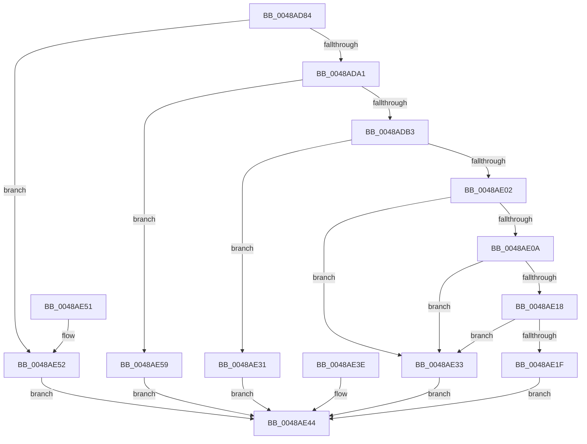

# PfSnGetAppVersion

- RVA: `0x0048AD84`–`0x0048AE60` (길이 `220` bytes)
- VA: `0x000000014048AD84`
- 실행 섹션: `.text`
- PDB 이름 있음: `예`; PDB Function 태그: `아니요`
- unwind 정보 RVA: `0x000B02A4`
- 디코드: `61`개 명령, `220/220` bytes 표시
- 미해석 바이트: `0` (있으면 어셈블리에 `.byte`로 보존)

> 이 문서는 커널 이미지의 기계어와 PDB 기호를 분석해 생성했습니다. 4번과 5번은 함수 원형과 자료형을 바이너리 사용 방식에서 추정한 C 해석이며 원본 소스 복구 결과는 아닙니다.

## 1. Dependencies

- 직접 호출 지점: **1**; 고유 호출 대상: **1**
- 직접 호출자로 확인된 함수: **1**
- RIP 상대 이미지 참조: **0**

### Outgoing calls
- `0x0048ADF3` → [LdrResSearchResource](../../page/98/LdrResSearchResource_function_0098F7A0.md) (function, `0x0098F7A0`)

### Direct callers
- [PfSnBeginAppLaunch](../../page/95/PfSnBeginAppLaunch_function_0095EC44.md) at `0x0095EE05`

### Static image references
- 디코드된 RIP-relative 메모리 참조가 없습니다.

## 2. Other-region calls and transfers

- 다른 실행 섹션으로 향하는 call: **1**
  - `0x0048ADF3` → [LdrResSearchResource](../../page/98/LdrResSearchResource_function_0098F7A0.md) (`.text` → `PAGE`)
- 별도 외부 분기/꼬리 이동을 확인하지 못했습니다.

## 3. Assembly (complete function range)

```asm
0048AD84  4C 8B DC                        mov r11, rsp
0048AD87  49 89 5B 10                     mov qword ptr [r11 + 0x10], rbx
0048AD8B  57                              push rdi
0048AD8C  48 83 EC 60                     sub rsp, 0x60
0048AD90  48 8B DA                        mov rbx, rdx
0048AD93  8B 81 FC 05 00 00               mov eax, dword ptr [rcx + 0x5fc]
0048AD99  A8 01                           test al, 1
0048AD9B  0F 85 B1 00 00 00               jne 0x14048ae52
0048ADA1  48 8B 89 B0 02 00 00            mov rcx, qword ptr [rcx + 0x2b0]
0048ADA8  33 FF                           xor edi, edi
0048ADAA  48 85 C9                        test rcx, rcx
0048ADAD  0F 84 A6 00 00 00               je 0x14048ae59
0048ADB3  49 C7 43 E0 10 00 00 00         mov qword ptr [r11 - 0x20], 0x10
0048ADBB  49 C7 43 E8 01 00 00 00         mov qword ptr [r11 - 0x18], 1
0048ADC3  49 89 7B F0                     mov qword ptr [r11 - 0x10], rdi
0048ADC7  49 89 7B 08                     mov qword ptr [r11 + 8], rdi
0048ADCB  49 89 7B 18                     mov qword ptr [r11 + 0x18], rdi
0048ADCF  49 89 7B D0                     mov qword ptr [r11 - 0x30], rdi
0048ADD3  49 89 7B C8                     mov qword ptr [r11 - 0x38], rdi
0048ADD7  49 8D 43 08                     lea rax, [r11 + 8]
0048ADDB  49 89 43 C0                     mov qword ptr [r11 - 0x40], rax
0048ADDF  49 8D 43 18                     lea rax, [r11 + 0x18]
0048ADE3  49 89 43 B8                     mov qword ptr [r11 - 0x48], rax
0048ADE7  44 8D 4F 30                     lea r9d, [rdi + 0x30]
0048ADEB  44 8D 47 03                     lea r8d, [rdi + 3]
0048ADEF  49 8D 53 E0                     lea rdx, [r11 - 0x20]
0048ADF3  E8 A8 49 50 00                  call 0x14098f7a0
0048ADF8  8B C8                           mov ecx, eax
0048ADFA  89 44 24 40                     mov dword ptr [rsp + 0x40], eax
0048ADFE  85 C0                           test eax, eax
0048AE00  78 2F                           js 0x14048ae31
0048AE02  48 83 7C 24 70 5C               cmp qword ptr [rsp + 0x70], 0x5c
0048AE08  72 29                           jb 0x14048ae33
0048AE0A  48 8B 94 24 80 00 00 00         mov rdx, qword ptr [rsp + 0x80]
0048AE12  66 39 7A 04                     cmp word ptr [rdx + 4], di
0048AE16  75 1B                           jne 0x14048ae33
0048AE18  66 83 7A 02 34                  cmp word ptr [rdx + 2], 0x34
0048AE1D  75 14                           jne 0x14048ae33
0048AE1F  33 C0                           xor eax, eax
0048AE21  48 89 03                        mov qword ptr [rbx], rax
0048AE24  8B 42 34                        mov eax, dword ptr [rdx + 0x34]
0048AE27  89 03                           mov dword ptr [rbx], eax
0048AE29  8B 42 30                        mov eax, dword ptr [rdx + 0x30]
0048AE2C  89 43 04                        mov dword ptr [rbx + 4], eax
0048AE2F  EB 13                           jmp 0x14048ae44
0048AE31  EB 11                           jmp 0x14048ae44
0048AE33  B9 0D 00 00 C0                  mov ecx, 0xc000000d
0048AE38  89 4C 24 40                     mov dword ptr [rsp + 0x40], ecx
0048AE3C  EB 06                           jmp 0x14048ae44
0048AE3E  8B C8                           mov ecx, eax
0048AE40  89 44 24 40                     mov dword ptr [rsp + 0x40], eax
0048AE44  8B C1                           mov eax, ecx
0048AE46  48 8B 5C 24 78                  mov rbx, qword ptr [rsp + 0x78]
0048AE4B  48 83 C4 60                     add rsp, 0x60
0048AE4F  5F                              pop rdi
0048AE50  C3                              ret
0048AE51  CC                              int3
0048AE52  B9 08 00 00 C0                  mov ecx, 0xc0000008
0048AE57  EB EB                           jmp 0x14048ae44
0048AE59  B9 0D 00 00 C0                  mov ecx, 0xc000000d
0048AE5E  EB E4                           jmp 0x14048ae44
```

## 4. C-style interpretation (structured pseudocode)

```c
__int64 __fastcall PfSnGetAppVersion(__int64 a1, __int64 a2)
{
    __int64 result;
    __int64 v_rdi;
    __int64 v_rsp;
    unsigned int v_stack_m28;
    unsigned __int64 v_stack_p10;
    unsigned __int64 v_stack_p18;
    unsigned __int64 v_stack_p8;

    *(unsigned __int64 *)(v_rsp + 16) = v_rbx;
    v_rsp = (v_rsp) - (96);
    if ((((unsigned __int8)((unsigned int)(*(unsigned int *)(a1 + 1532)))) & (1)) != 0) goto loc_0048AE52;
    v_rdi = 0;
    if (*(unsigned __int64 *)(a1 + 688) == 0) goto loc_0048AE59;
    *(unsigned __int64 *)(v_rsp - 32) = 16;
    *(unsigned __int64 *)(v_rsp - 24) = 1;
    *(unsigned __int64 *)(v_rsp - 16) = 0;
    *(unsigned __int64 *)(v_rsp + 8) = 0;
    *(unsigned __int64 *)(v_rsp + 24) = 0;
    *(unsigned __int64 *)(v_rsp - 48) = 0;
    *(unsigned __int64 *)(v_rsp - 56) = 0;
    *(unsigned __int64 *)(v_rsp - 64) = v_rsp + 8;
    *(unsigned __int64 *)(v_rsp - 72) = v_rsp + 24;
    result = LdrResSearchResource(*(unsigned __int64 *)(a1 + 688), v_rsp - 32, v_rdi + 3, v_rdi + 48);
    v_stack_m28 = (unsigned int)(result);
    if (sign_flag) goto loc_0048AE31;
    if (v_stack_p8 < 92) goto loc_0048AE33;
    if ((*(unsigned __int16 *)(v_stack_p18 + 4)) != 0) goto loc_0048AE33;
    if ((*(unsigned __int16 *)(v_stack_p18 + 2)) != 52) goto loc_0048AE33;
    result = 0;
    *(unsigned __int64 *)(a2) = 0;
    *(unsigned int *)(a2) = (unsigned int)((unsigned int)(*(unsigned int *)(v_stack_p18 + 52)));
    *(unsigned int *)(a2 + 4) = (unsigned int)((unsigned int)(*(unsigned int *)(v_stack_p18 + 48)));
    goto loc_0048AE44;
loc_0048AE31:
    goto loc_0048AE44;
loc_0048AE33:
    v_stack_m28 = (unsigned int)((unsigned int)(0xC000000DULL));
    goto loc_0048AE44;
loc_0048AE44:
    v_rsp = (v_rsp) + (96);
    return (unsigned int)((unsigned int)((unsigned int)(0xC000000DULL)));
loc_0048AE52:
    goto loc_0048AE44;
loc_0048AE59:
    goto loc_0048AE44;
}
```

## 5. (Beta) C Style

```c
int64_t PfSnGetAppVersion(void *Arg1, void *Arg2)
{
    uint8_t *arg1 = (uint8_t *)Arg1;
    uint8_t *arg2 = (uint8_t *)Arg2;

    int64_t result;
    int64_t local_rdi;
    int64_t local_rsp;
    uint32_t v_stack_m28;
    uint64_t v_stack_p10;
    uint64_t v_stack_p18;
    uint64_t v_stack_p8;

    *(uint64_t *)(local_rsp + 0x10) = local_rbx;
    local_rsp = (local_rsp) - (96);
    if ((((uint8_t)((uint32_t)(*(uint32_t *)(arg1 + 0x5FC)))) & (1)) != 0) goto loc_0048AE52;
    local_rdi = 0;
    if (*(uint64_t *)(arg1 + 0x2B0) == 0) goto loc_0048AE59;
    *(uint64_t *)(local_rsp - 0x20) = 16;
    *(uint64_t *)(local_rsp - 0x18) = 1;
    *(uint64_t *)(local_rsp - 0x10) = 0;
    *(uint64_t *)(local_rsp + 0x8) = 0;
    *(uint64_t *)(local_rsp + 0x18) = 0;
    *(uint64_t *)(local_rsp - 0x30) = 0;
    *(uint64_t *)(local_rsp - 0x38) = 0;
    *(uint64_t *)(local_rsp - 0x40) = local_rsp + 8;
    *(uint64_t *)(local_rsp - 0x48) = local_rsp + 24;
    result = LdrResSearchResource(*(uint64_t *)(arg1 + 0x2B0), local_rsp - 32, local_rdi + 3, local_rdi + 48);
    v_stack_m28 = (uint32_t)(result);
    if (sign_flag) goto loc_0048AE31;
    if (v_stack_p8 < 92) goto loc_0048AE33;
    if ((*(uint16_t *)(v_stack_p18 + 0x4)) != 0) goto loc_0048AE33;
    if ((*(uint16_t *)(v_stack_p18 + 0x2)) != 52) goto loc_0048AE33;
    result = 0;
    *(uint64_t *)(arg2) = 0;
    *(uint32_t *)(arg2) = (uint32_t)((uint32_t)(*(uint32_t *)(v_stack_p18 + 0x34)));
    *(uint32_t *)(arg2 + 0x4) = (uint32_t)((uint32_t)(*(uint32_t *)(v_stack_p18 + 0x30)));
    goto loc_0048AE44;
loc_0048AE31:
    goto loc_0048AE44;
loc_0048AE33:
    v_stack_m28 = (uint32_t)((uint32_t)(0xC000000DULL));
    goto loc_0048AE44;
loc_0048AE44:
    local_rsp = (local_rsp) + (96);
    return (uint32_t)((uint32_t)((uint32_t)(0xC000000DULL)));
loc_0048AE52:
    goto loc_0048AE44;
loc_0048AE59:
    goto loc_0048AE44;
}
```

### 관측된 메모리 오프셋

구조체 형식이 확인되지 않은 접근은 인자 기준의 오프셋으로만 기록했습니다.

| 기준 인자 | 오프셋 표현 | 폭 (bit) | 접근 |
|---|---:|---:|---|
| `Arg1` | `+ 0x2B0` | `64` | `R` |
| `Arg1` | `+ 0x5FC` | `32` | `R` |
| `Arg2` | `+ 0x0` | `32` | `W` |
| `Arg2` | `+ 0x0` | `64` | `W` |
| `Arg2` | `+ 0x4` | `32` | `W` |

## 6. Execution-region graph

[열기: 2D/3D 그래프와 함수 탐색 컨트롤 패널](../../../control-panel.html?section=text&rva=0x0048AD84&view=graph)

- 2D 그래프는 위에서 아래로 흐르고, 3D 그래프는 빈 공간을 드래그해 회전합니다. Shift+드래그는 이동, 휠은 확대·축소, 함수 노드 선택은 대상 보고서 이동입니다.

### Static fallback


