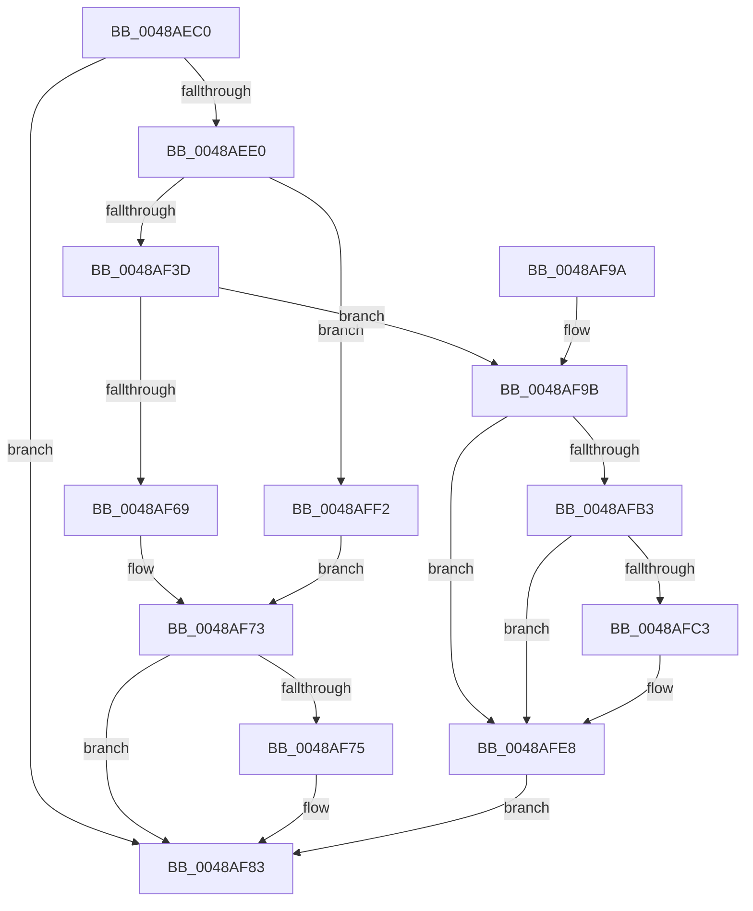

# PfSnTraceTimerRoutine

- RVA: `0x0048AEC0`–`0x0048B006` (길이 `326` bytes)
- VA: `0x000000014048AEC0`
- 실행 섹션: `.text`
- PDB 이름 있음: `예`; PDB Function 태그: `아니요`
- unwind 정보 RVA: `0x000B02DC`
- 디코드: `74`개 명령, `326/326` bytes 표시
- 미해석 바이트: `0` (있으면 어셈블리에 `.byte`로 보존)

> 이 문서는 커널 이미지의 기계어와 PDB 기호를 분석해 생성했습니다. 4번과 5번은 함수 원형과 자료형을 바이너리 사용 방식에서 추정한 C 해석이며 원본 소스 복구 결과는 아닙니다.

## 1. Dependencies

- 직접 호출 지점: **7**; 고유 호출 대상: **7**
- 직접 호출자로 확인된 함수: **1**
- RIP 상대 이미지 참조: **1**

### Outgoing calls
- `0x0048AF30` → [PfSnTraceGetLogEntry](../34/PfSnTraceGetLogEntry_function_003437A0.md) (function, `0x003437A0`)
- `0x0048AF7E` → [ExQueueWorkItem](../2F/ExQueueWorkItem_function_002F9520.md) (function, `0x002F9520`)
- `0x0048AF8A` → [ExReleaseRundownProtection](../34/ExReleaseRundownProtection_function_00349E80.md) (function, `0x00349E80`)
- `0x0048AFA5` → [KeAcquireSpinLockAtDpcLevel](../20/KeAcquireSpinLockAtDpcLevel_function_00208430.md) (function, `0x00208430`)
- `0x0048AFBA` → [ExAcquireRundownProtection](../21/ExAcquireRundownProtection_function_00216620.md) (function, `0x00216620`)
- `0x0048AFE3` → [KiSetTimerEx](../23/KiSetTimerEx_function_00232CB0.md) (function, `0x00232CB0`)
- `0x0048AFEB` → [KxReleaseSpinLock](../20/KxReleaseSpinLock_function_00206670.md) (function, `0x00206670`)

### Direct callers
- [KiProcessExpiredTimerList](../23/KiProcessExpiredTimerList_function_00234200.md) at `0x0023449B`

### Static image references
- `0x0048AF5B` → RVA `0x00E670A4` (`.data`; read)

## 2. Other-region calls and transfers

- 다른 실행 섹션으로 향하는 call: **0**
- 별도 외부 분기/꼬리 이동을 확인하지 못했습니다.

## 3. Assembly (complete function range)

```asm
0048AEC0  48 89 5C 24 08                  mov qword ptr [rsp + 8], rbx
0048AEC5  57                              push rdi
0048AEC6  48 83 EC 30                     sub rsp, 0x30
0048AECA  48 83 64 24 48 00               and qword ptr [rsp + 0x48], 0
0048AED0  48 8B DA                        mov rbx, rdx
0048AED3  83 BA 90 01 00 00 00            cmp dword ptr [rdx + 0x190], 0
0048AEDA  0F 85 A3 00 00 00               jne 0x14048af83
0048AEE0  8B 82 4C 01 00 00               mov eax, dword ptr [rdx + 0x14c]
0048AEE6  BF 01 00 00 00                  mov edi, 1
0048AEEB  44 8B 82 54 01 00 00            mov r8d, dword ptr [rdx + 0x154]
0048AEF2  41 3B C0                        cmp eax, r8d
0048AEF5  44 0F 4E C0                     cmovle r8d, eax
0048AEF9  8B 82 44 01 00 00               mov eax, dword ptr [rdx + 0x144]
0048AEFF  41 3B C0                        cmp eax, r8d
0048AF02  41 8B C8                        mov ecx, r8d
0048AF05  41 0F 4F C0                     cmovg eax, r8d
0048AF09  2B C8                           sub ecx, eax
0048AF0B  48 63 82 48 01 00 00            movsxd rax, dword ptr [rdx + 0x148]
0048AF12  89 8C 82 1C 01 00 00            mov dword ptr [rdx + rax*4 + 0x11c], ecx
0048AF19  48 8B CB                        mov rcx, rbx
0048AF1C  01 BA 48 01 00 00               add dword ptr [rdx + 0x148], edi
0048AF22  44 89 82 44 01 00 00            mov dword ptr [rdx + 0x144], r8d
0048AF29  4C 8D 44 24 48                  lea r8, [rsp + 0x48]
0048AF2E  8B D7                           mov edx, edi
0048AF30  E8 6B 88 EB FF                  call 0x1403437a0
0048AF35  85 C0                           test eax, eax
0048AF37  0F 88 B5 00 00 00               js 0x14048aff2
0048AF3D  48 8B 4C 24 48                  mov rcx, qword ptr [rsp + 0x48]
0048AF42  8D 57 03                        lea edx, [rdi + 3]
0048AF45  48 83 21 0F                     and qword ptr [rcx], 0xf
0048AF49  48 83 61 08 00                  and qword ptr [rcx + 8], 0
0048AF4E  48 8B 01                        mov rax, qword ptr [rcx]
0048AF51  48 83 E0 F4                     and rax, 0xfffffffffffffff4
0048AF55  48 0B C2                        or rax, rdx
0048AF58  48 89 01                        mov qword ptr [rcx], rax
0048AF5B  8B 05 43 C1 9D 00               mov eax, dword ptr [rip + 0x9dc143]
0048AF61  39 83 48 01 00 00               cmp dword ptr [rbx + 0x148], eax
0048AF67  7C 32                           jl 0x14048af9b
0048AF69  33 C0                           xor eax, eax
0048AF6B  F0 0F B1 93 90 01 00 00         lock cmpxchg dword ptr [rbx + 0x190], edx
0048AF73  75 0E                           jne 0x14048af83
0048AF75  48 8D 8B 70 01 00 00            lea rcx, [rbx + 0x170]
0048AF7C  8B D7                           mov edx, edi
0048AF7E  E8 9D E5 E6 FF                  call 0x1402f9520
0048AF83  48 8D 8B 68 01 00 00            lea rcx, [rbx + 0x168]
0048AF8A  E8 F1 EE EB FF                  call 0x140349e80
0048AF8F  48 8B 5C 24 40                  mov rbx, qword ptr [rsp + 0x40]
0048AF94  48 83 C4 30                     add rsp, 0x30
0048AF98  5F                              pop rdi
0048AF99  C3                              ret
0048AF9A  CC                              int3
0048AF9B  48 8D BB 10 01 00 00            lea rdi, [rbx + 0x110]
0048AFA2  48 8B CF                        mov rcx, rdi
0048AFA5  E8 86 D4 D7 FF                  call 0x140208430
0048AFAA  83 BB 90 01 00 00 00            cmp dword ptr [rbx + 0x190], 0
0048AFB1  75 35                           jne 0x14048afe8
0048AFB3  48 8D 8B 68 01 00 00            lea rcx, [rbx + 0x168]
0048AFBA  E8 61 B6 D8 FF                  call 0x140216620
0048AFBF  84 C0                           test al, al
0048AFC1  74 25                           je 0x14048afe8
0048AFC3  48 8B 93 C8 00 00 00            mov rdx, qword ptr [rbx + 0xc8]
0048AFCA  48 8D 83 D0 00 00 00            lea rax, [rbx + 0xd0]
0048AFD1  48 8D 8B 88 00 00 00            lea rcx, [rbx + 0x88]
0048AFD8  48 89 44 24 20                  mov qword ptr [rsp + 0x20], rax
0048AFDD  45 33 C9                        xor r9d, r9d
0048AFE0  45 33 C0                        xor r8d, r8d
0048AFE3  E8 C8 7C DA FF                  call 0x140232cb0
0048AFE8  48 8B CF                        mov rcx, rdi
0048AFEB  E8 80 B6 D7 FF                  call 0x140206670
0048AFF0  EB 91                           jmp 0x14048af83
0048AFF2  B9 0A 00 00 00                  mov ecx, 0xa
0048AFF7  33 C0                           xor eax, eax
0048AFF9  F0 0F B1 8B 90 01 00 00         lock cmpxchg dword ptr [rbx + 0x190], ecx
0048B001  E9 6D FF FF FF                  jmp 0x14048af73
```

## 4. C-style interpretation (structured pseudocode)

```c
__int64 __fastcall PfSnTraceTimerRoutine(__int64 a1, __int64 a2, __int64 a3, int a4)
{
    __int64 result;
    __int64 v_rsp;
    unsigned __int64 v_stack_p10;
    unsigned __int64 v_stack_p20;
    unsigned __int64 v_stack_p8;

    v_stack_p8 = v_rbx;
    v_rsp = (v_rsp) - (48);
    if ((*(unsigned int *)(a2 + 400)) != 0) goto loc_0048AF83;
    a3 = (unsigned int)(*(unsigned int *)(a2 + 340));
    if (((unsigned int)((unsigned int)(*(unsigned int *)(a2 + 332)))) <= ((unsigned int)((unsigned int)(*(unsigned int *)(a2 + 340))))) { a3 = (unsigned int)((unsigned int)(*(unsigned int *)(a2 + 332))); }
    result = (unsigned int)(*(unsigned int *)(a2 + 324));
    if (((unsigned int)((unsigned int)(*(unsigned int *)(a2 + 324)))) > ((unsigned int)(a3))) { result = (unsigned int)(a3); }
    a1 = (unsigned int)(((unsigned int)((unsigned int)(a3))) - ((unsigned int)(result)));
    *(unsigned int *)(a2 + (int)(*(unsigned int *)(a2 + 328)) * 4 + 284) = (unsigned int)(a1);
    *(unsigned int *)(a2 + 324) = (unsigned int)(a3);
    result = PfSnTraceGetLogEntry(a2, 1, v_stack_p10, a4);
    if (sign_flag) goto loc_0048AFF2;
    result = (*(unsigned __int64 *)(v_stack_p10)) & (-12);
    result = (result) | (1 + 3);
    *(unsigned __int64 *)(v_stack_p10) = result;
    if ((*(unsigned int *)(a2 + 328)) < ((unsigned int)((unsigned int)(*(unsigned int *)(v_rip + 10338627))))) goto loc_0048AF9B;
    result = 0;
loc_0048AF73:
    if (!(condition_is_not_equal)) {
        a1 = a2 + 368;
        a2 = 1;
        result = ExQueueWorkItem(a1, a2, v_stack_p10, a4);
    }
    result = ExReleaseRundownProtection(a2 + 360, a2, v_stack_p10, a4);
    v_rsp = (v_rsp) + (48);
    return result;
loc_0048AF9B:
    result = KeAcquireSpinLockAtDpcLevel(v_stack_p8 + 272, a2, v_stack_p10, a4);
    if ((*(unsigned int *)(v_stack_p8 + 400)) != 0) goto loc_0048AFE8;
    result = ExAcquireRundownProtection(v_stack_p8 + 360, a2, v_stack_p10, a4);
    if ((unsigned __int8)(result) != 0) {
        a2 = *(unsigned __int64 *)(v_stack_p8 + 200);
        result = v_stack_p8 + 208;
        a1 = v_stack_p8 + 136;
        v_stack_p20 = result;
        a4 = 0;
        a3 = 0;
        result = KiSetTimerEx(a1, a2, a3, a4);
    }
    result = KxReleaseSpinLock(v_stack_p8 + 272, a2, a3, a4);
    goto loc_0048AF83;
loc_0048AFF2:
    result = 0;
    goto loc_0048AF73;
}
```

## 5. (Beta) C Style

```c
int64_t PfSnTraceTimerRoutine(int64_t Arg1, void *Arg2, int64_t Arg3, int32_t Arg4)
{
    uint8_t *arg2 = (uint8_t *)Arg2;

    int64_t result;
    int64_t local_rsp;
    uint64_t v_stack_p10;
    uint64_t v_stack_p20;
    uint64_t v_stack_p8;

    v_stack_p8 = local_rbx;
    local_rsp = (local_rsp) - (48);
    if ((*(uint32_t *)(arg2 + 0x190)) != 0) goto loc_0048AF83;
    Arg3 = (uint32_t)(*(uint32_t *)(arg2 + 0x154));
    if (((uint32_t)((uint32_t)(*(uint32_t *)(arg2 + 0x14C)))) <= ((uint32_t)((uint32_t)(*(uint32_t *)(arg2 + 0x154))))) { Arg3 = (uint32_t)((uint32_t)(*(uint32_t *)(arg2 + 0x14C))); }
    result = (uint32_t)(*(uint32_t *)(arg2 + 0x144));
    if (((uint32_t)((uint32_t)(*(uint32_t *)(arg2 + 0x144)))) > ((uint32_t)(Arg3))) { result = (uint32_t)(Arg3); }
    Arg1 = (uint32_t)(((uint32_t)((uint32_t)(Arg3))) - ((uint32_t)(result)));
    *(uint32_t *)(arg2 + (int32_t)(*(uint32_t *)(arg2 + 0x148)) * 4 + 0x11C) = (uint32_t)(Arg1);
    *(uint32_t *)(arg2 + 0x144) = (uint32_t)(Arg3);
    result = PfSnTraceGetLogEntry(Arg2, 1, v_stack_p10, Arg4);
    if (sign_flag) goto loc_0048AFF2;
    result = (*(uint64_t *)(v_stack_p10)) & (-12);
    result = (result) | (1 + 3);
    *(uint64_t *)(v_stack_p10) = result;
    if ((*(uint32_t *)(arg2 + 0x148)) < ((uint32_t)((uint32_t)(*(uint32_t *)(v_rip + 0x9DC143))))) goto loc_0048AF9B;
    result = 0;
loc_0048AF73:
    if (!(condition_is_not_equal)) {
        Arg1 = Arg2 + 368;
        Arg2 = 1;
        result = ExQueueWorkItem(Arg1, Arg2, v_stack_p10, Arg4);
    }
    result = ExReleaseRundownProtection(Arg2 + 360, Arg2, v_stack_p10, Arg4);
    local_rsp = (local_rsp) + (48);
    return result;
loc_0048AF9B:
    result = KeAcquireSpinLockAtDpcLevel(v_stack_p8 + 272, Arg2, v_stack_p10, Arg4);
    if ((*(uint32_t *)(v_stack_p8 + 0x190)) != 0) goto loc_0048AFE8;
    result = ExAcquireRundownProtection(v_stack_p8 + 360, Arg2, v_stack_p10, Arg4);
    if ((uint8_t)(result) != 0) {
        Arg2 = *(uint64_t *)(v_stack_p8 + 0xC8);
        result = v_stack_p8 + 208;
        Arg1 = v_stack_p8 + 136;
        v_stack_p20 = result;
        Arg4 = 0;
        Arg3 = 0;
        result = KiSetTimerEx(Arg1, Arg2, Arg3, Arg4);
    }
    result = KxReleaseSpinLock(v_stack_p8 + 272, Arg2, Arg3, Arg4);
    goto loc_0048AF83;
loc_0048AFF2:
    result = 0;
    goto loc_0048AF73;
}
```

### 관측된 메모리 오프셋

구조체 형식이 확인되지 않은 접근은 인자 기준의 오프셋으로만 기록했습니다.

| 기준 인자 | 오프셋 표현 | 폭 (bit) | 접근 |
|---|---:|---:|---|
| `Arg2` | `+ 0x88` | `64` | `R` |
| `Arg2` | `+ 0xC8` | `64` | `R` |
| `Arg2` | `+ 0xD0` | `64` | `R` |
| `Arg2` | `+ 0x110` | `64` | `R` |
| `Arg2` | `+ 0x11C + rax*4` | `32` | `W` |
| `Arg2` | `+ 0x144` | `32` | `R` |
| `Arg2` | `+ 0x144` | `32` | `W` |
| `Arg2` | `+ 0x148` | `32` | `R` |
| `Arg2` | `+ 0x148` | `32` | `R/W` |
| `Arg2` | `+ 0x14C` | `32` | `R` |
| `Arg2` | `+ 0x154` | `32` | `R` |
| `Arg2` | `+ 0x168` | `64` | `R` |
| `Arg2` | `+ 0x170` | `64` | `R` |
| `Arg2` | `+ 0x190` | `32` | `R` |

## 6. Execution-region graph

[열기: 2D/3D 그래프와 함수 탐색 컨트롤 패널](../../../control-panel.html?section=text&rva=0x0048AEC0&view=graph)

- 2D 그래프는 위에서 아래로 흐르고, 3D 그래프는 빈 공간을 드래그해 회전합니다. Shift+드래그는 이동, 휠은 확대·축소, 함수 노드 선택은 대상 보고서 이동입니다.

### Static fallback


