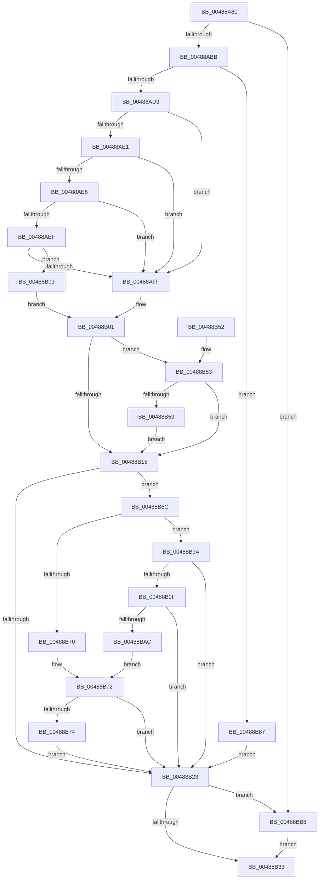

# PfpReturnAccessBuffer

- RVA: `0x00488A80`–`0x00488BC7` (길이 `327` bytes)
- VA: `0x0000000140488A80`
- 실행 섹션: `.text`
- PDB 이름 있음: `예`; PDB Function 태그: `아니요`
- unwind 정보 RVA: `0x000AFDD0`
- 디코드: `90`개 명령, `327/327` bytes 표시
- 미해석 바이트: `0` (있으면 어셈블리에 `.byte`로 보존)

> 이 문서는 커널 이미지의 기계어와 PDB 기호를 분석해 생성했습니다. 4번과 5번은 함수 원형과 자료형을 바이너리 사용 방식에서 추정한 C 해석이며 원본 소스 복구 결과는 아닙니다.

## 1. Dependencies

- 직접 호출 지점: **10**; 고유 호출 대상: **7**
- 직접 호출자로 확인된 함수: **2**
- RIP 상대 이미지 참조: **0**

### Outgoing calls
- `0x00488AAE` → [ExAcquireRundownProtection](../21/ExAcquireRundownProtection_function_00216620.md) (function, `0x00216620`)
- `0x00488AD3` → [Feature_PrefetchQueueWorkerProactivelyForProcessExit__private_IsEnabledDeviceUsageNoInline](../34/Feature_PrefetchQueueWorkerProactivelyForProcessExit__private_IsEnabledDeviceUsageNoInline_function_0034A690.md) (function, `0x0034A690`)
- `0x00488AF2` → [PfIsProcessExitingInNonSystemPartition](PfIsProcessExitingInNonSystemPartition_function_00488E34.md) (function, `0x00488E34`)
- `0x00488B07` → [ExpInterlockedPushEntrySList](../6B/ExpInterlockedPushEntrySList_function_006BA5B0.md) (function, `0x006BA5B0`)
- `0x00488B15` → [Feature_PrefetchQueueWorkerProactivelyForProcessExit__private_IsEnabledDeviceUsageNoInline](../34/Feature_PrefetchQueueWorkerProactivelyForProcessExit__private_IsEnabledDeviceUsageNoInline_function_0034A690.md) (function, `0x0034A690`)
- `0x00488B26` → [ExReleaseRundownProtection](../34/ExReleaseRundownProtection_function_00349E80.md) (function, `0x00349E80`)
- `0x00488B65` → [KeSetEvent](../33/KeSetEvent_function_0033F310.md) (function, `0x0033F310`)
- `0x00488B80` → [KeSetEvent](../33/KeSetEvent_function_0033F310.md) (function, `0x0033F310`)
- `0x00488BAF` → [PfIsProcessExitingInNonSystemPartition](PfIsProcessExitingInNonSystemPartition_function_00488E34.md) (function, `0x00488E34`)
- `0x00488BBD` → [MmFreeAccessPfnBuffer](../47/MmFreeAccessPfnBuffer_function_004751BC.md) (function, `0x004751BC`)

### Direct callers
- [sub_0097C0F8](../../page/97/Unknown_function_0097C0F8.md) at `0x0097C2A5`
- [sub_0097C3DE](../../page/97/Unknown_function_0097C3DE.md) at `0x0097C401`

### Static image references
- 디코드된 RIP-relative 메모리 참조가 없습니다.

## 2. Other-region calls and transfers

- 다른 실행 섹션으로 향하는 call: **0**
- 별도 외부 분기/꼬리 이동을 확인하지 못했습니다.

## 3. Assembly (complete function range)

```asm
00488A80  48 8B C4                        mov rax, rsp
00488A83  48 89 58 08                     mov qword ptr [rax + 8], rbx
00488A87  48 89 68 10                     mov qword ptr [rax + 0x10], rbp
00488A8B  48 89 70 18                     mov qword ptr [rax + 0x18], rsi
00488A8F  48 89 78 20                     mov qword ptr [rax + 0x20], rdi
00488A93  41 54                           push r12
00488A95  41 56                           push r14
00488A97  41 57                           push r15
00488A99  48 83 EC 20                     sub rsp, 0x20
00488A9D  48 8B 59 20                     mov rbx, qword ptr [rcx + 0x20]
00488AA1  48 8B FA                        mov rdi, rdx
00488AA4  4C 8D A3 D8 02 00 00            lea r12, [rbx + 0x2d8]
00488AAB  49 8B CC                        mov rcx, r12
00488AAE  E8 6D DB D8 FF                  call 0x140216620
00488AB3  84 C0                           test al, al
00488AB5  0F 84 FD 00 00 00               je 0x140488bb8
00488ABB  4C 8D BB 00 03 00 00            lea r15, [rbx + 0x300]
00488AC2  45 0F B7 37                     movzx r14d, word ptr [r15]
00488AC6  44 3B B3 F8 02 00 00            cmp r14d, dword ptr [rbx + 0x2f8]
00488ACD  0F 83 B4 00 00 00               jae 0x140488b87
00488AD3  E8 B8 1B EC FF                  call 0x14034a690
00488AD8  BE 01 00 00 00                  mov esi, 1
00488ADD  85 C0                           test eax, eax
00488ADF  74 1E                           je 0x140488aff
00488AE1  39 77 08                        cmp dword ptr [rdi + 8], esi
00488AE4  7F 19                           jg 0x140488aff
00488AE6  48 8B 57 38                     mov rdx, qword ptr [rdi + 0x38]
00488AEA  48 85 D2                        test rdx, rdx
00488AED  74 10                           je 0x140488aff
00488AEF  48 8B CB                        mov rcx, rbx
00488AF2  E8 3D 03 00 00                  call 0x140488e34
00488AF7  84 C0                           test al, al
00488AF9  0F 85 94 00 00 00               jne 0x140488b93
00488AFF  33 ED                           xor ebp, ebp
00488B01  48 8B D7                        mov rdx, rdi
00488B04  49 8B CF                        mov rcx, r15
00488B07  E8 A4 1A 23 00                  call 0x1406ba5b0
00488B0C  83 BB E4 02 00 00 00            cmp dword ptr [rbx + 0x2e4], 0
00488B13  74 3E                           je 0x140488b53
00488B15  E8 76 1B EC FF                  call 0x14034a690
00488B1A  83 BB E4 02 00 00 00            cmp dword ptr [rbx + 0x2e4], 0
00488B21  74 49                           je 0x140488b6c
00488B23  49 8B CC                        mov rcx, r12
00488B26  E8 55 13 EC FF                  call 0x140349e80
00488B2B  85 F6                           test esi, esi
00488B2D  0F 84 85 00 00 00               je 0x140488bb8
00488B33  48 8B 5C 24 40                  mov rbx, qword ptr [rsp + 0x40]
00488B38  48 8B 6C 24 48                  mov rbp, qword ptr [rsp + 0x48]
00488B3D  48 8B 74 24 50                  mov rsi, qword ptr [rsp + 0x50]
00488B42  48 8B 7C 24 58                  mov rdi, qword ptr [rsp + 0x58]
00488B47  48 83 C4 20                     add rsp, 0x20
00488B4B  41 5F                           pop r15
00488B4D  41 5E                           pop r14
00488B4F  41 5C                           pop r12
00488B51  C3                              ret
00488B52  CC                              int3
00488B53  41 83 FE 08                     cmp r14d, 8
00488B57  72 BC                           jb 0x140488b15
00488B59  48 8D 8B E0 02 00 00            lea rcx, [rbx + 0x2e0]
00488B60  45 33 C0                        xor r8d, r8d
00488B63  33 D2                           xor edx, edx
00488B65  E8 A6 67 EB FF                  call 0x14033f310
00488B6A  EB A9                           jmp 0x140488b15
00488B6C  85 C0                           test eax, eax
00488B6E  74 2A                           je 0x140488b9a
00488B70  85 ED                           test ebp, ebp
00488B72  74 AF                           je 0x140488b23
00488B74  45 33 C0                        xor r8d, r8d
00488B77  48 8D 8B E0 02 00 00            lea rcx, [rbx + 0x2e0]
00488B7E  33 D2                           xor edx, edx
00488B80  E8 8B 67 EB FF                  call 0x14033f310
00488B85  EB 9C                           jmp 0x140488b23
00488B87  F0 83 83 B0 02 00 00 64         lock add dword ptr [rbx + 0x2b0], 0x64
00488B8F  33 F6                           xor esi, esi
00488B91  EB 90                           jmp 0x140488b23
00488B93  8B EE                           mov ebp, esi
00488B95  E9 67 FF FF FF                  jmp 0x140488b01
00488B9A  39 77 08                        cmp dword ptr [rdi + 8], esi
00488B9D  7F 84                           jg 0x140488b23
00488B9F  48 8B 57 38                     mov rdx, qword ptr [rdi + 0x38]
00488BA3  48 85 D2                        test rdx, rdx
00488BA6  0F 84 77 FF FF FF               je 0x140488b23
00488BAC  48 8B CB                        mov rcx, rbx
00488BAF  E8 80 02 00 00                  call 0x140488e34
00488BB4  84 C0                           test al, al
00488BB6  EB BA                           jmp 0x140488b72
00488BB8  33 D2                           xor edx, edx
00488BBA  48 8B CF                        mov rcx, rdi
00488BBD  E8 FA C5 FE FF                  call 0x1404751bc
00488BC2  E9 6C FF FF FF                  jmp 0x140488b33
```

## 4. C-style interpretation (structured pseudocode)

```c
__int64 __fastcall PfpReturnAccessBuffer(__int64 a1, __int64 a2, int a3)
{
    __int64 result;
    __int64 v_rbp;
    __int64 v_rsi;
    __int64 v_rsp;
    unsigned __int64 v_stack_p10;
    unsigned __int64 v_stack_p18;
    unsigned __int64 v_stack_p20;
    unsigned __int64 v_stack_p8;

    *(unsigned __int64 *)(v_rsp + 8) = v_rbx;
    *(unsigned __int64 *)(v_rsp + 16) = v_rbp;
    *(unsigned __int64 *)(v_rsp + 24) = v_rsi;
    *(unsigned __int64 *)(v_rsp + 32) = v_rdi;
    v_rsp = (v_rsp) - (32);
    result = ExAcquireRundownProtection(*(unsigned __int64 *)(a1 + 32) + 728, a2, a3, a4);
    if ((unsigned __int8)(result) == 0) goto loc_00488BB8;
    if (((unsigned int)(*(unsigned __int16 *)(*(unsigned __int64 *)(a1 + 32) + 768))) >= (*(unsigned int *)(*(unsigned __int64 *)(a1 + 32) + 760))) goto loc_00488B87;
    result = Feature_PrefetchQueueWorkerProactivelyForProcessExit__private_IsEnabledDeviceUsageNoInline(*(unsigned __int64 *)(a1 + 32) + 728, a2, a3, a4);
    if ((unsigned int)(result) == 0) goto loc_00488AFF;
    if ((*(unsigned int *)(a2 + 8)) > 1) goto loc_00488AFF;
    if (*(unsigned __int64 *)(a2 + 56) == 0) goto loc_00488AFF;
    result = PfIsProcessExitingInNonSystemPartition(*(unsigned __int64 *)(a1 + 32), *(unsigned __int64 *)(a2 + 56), a3, a4);
    if ((unsigned __int8)(result) != 0) goto loc_00488B93;
loc_00488AFF:
    v_rbp = 0;
loc_00488B01:
    result = ExpInterlockedPushEntrySList(*(unsigned __int64 *)(a1 + 32) + 768, a2, a3, a4);
    if ((*(unsigned int *)(*(unsigned __int64 *)(a1 + 32) + 740)) == 0) goto loc_00488B53;
loc_00488B15:
    result = Feature_PrefetchQueueWorkerProactivelyForProcessExit__private_IsEnabledDeviceUsageNoInline(*(unsigned __int64 *)(a1 + 32) + 768, a2, a3, a4);
    if ((*(unsigned int *)(*(unsigned __int64 *)(a1 + 32) + 740)) == 0) goto loc_00488B6C;
loc_00488B23:
    result = ExReleaseRundownProtection(*(unsigned __int64 *)(a1 + 32) + 728, a2, a3, a4);
    if (1 == 0) goto loc_00488BB8;
loc_00488B33:
    v_rsp = (v_rsp) + (32);
    return result;
loc_00488B53:
    if (((unsigned int)(*(unsigned __int16 *)(*(unsigned __int64 *)(a1 + 32) + 768))) < 8) goto loc_00488B15;
    a3 = 0;
    a2 = 0;
    result = KeSetEvent(v_stack_p8 + 736, a2, a3, a4);
    goto loc_00488B15;
loc_00488B6C:
    if ((unsigned int)(result) == 0) goto loc_00488B9A;
loc_00488B72:
    if ((unsigned int)(v_stack_p10) == 0) goto loc_00488B23;
    a3 = 0;
    a2 = 0;
    result = KeSetEvent(v_stack_p8 + 736, a2, a3, a4);
    goto loc_00488B23;
loc_00488B87:
    v_rsi = 0;
    goto loc_00488B23;
loc_00488B93:
    goto loc_00488B01;
loc_00488B9A:
    if ((*(unsigned int *)(v_stack_p20 + 8)) > 0) goto loc_00488B23;
    if (*(unsigned __int64 *)(v_stack_p20 + 56) == 0) goto loc_00488B23;
    result = PfIsProcessExitingInNonSystemPartition(v_stack_p8, *(unsigned __int64 *)(v_stack_p20 + 56), a3, a4);
    goto loc_00488B72;
loc_00488BB8:
    a2 = 0;
    result = MmFreeAccessPfnBuffer(v_stack_p20, a2, a3, a4);
    goto loc_00488B33;
}
```

## 5. (Beta) C Style

```c
int64_t PfpReturnAccessBuffer(void *Arg1, void *Arg2, int32_t Arg3)
{
    uint8_t *arg1 = (uint8_t *)Arg1;
    uint8_t *arg2 = (uint8_t *)Arg2;

    int64_t result;
    int64_t local_rbp;
    int64_t local_rsi;
    int64_t local_rsp;
    uint64_t v_stack_p10;
    uint64_t v_stack_p18;
    uint64_t v_stack_p20;
    uint64_t v_stack_p8;

    *(uint64_t *)(local_rsp + 0x8) = local_rbx;
    *(uint64_t *)(local_rsp + 0x10) = local_rbp;
    *(uint64_t *)(local_rsp + 0x18) = local_rsi;
    *(uint64_t *)(local_rsp + 0x20) = local_rdi;
    local_rsp = (local_rsp) - (32);
    result = ExAcquireRundownProtection(*(uint64_t *)(arg1 + 0x20) + 728, Arg2, Arg3, a4);
    if ((uint8_t)(result) == 0) goto loc_00488BB8;
    if (((uint32_t)(*(uint16_t *)(*(uint64_t *)(arg1 + 0x20) + 0x300))) >= (*(uint32_t *)(*(uint64_t *)(arg1 + 0x20) + 0x2F8))) goto loc_00488B87;
    result = Feature_PrefetchQueueWorkerProactivelyForProcessExit__private_IsEnabledDeviceUsageNoInline(*(uint64_t *)(arg1 + 0x20) + 728, Arg2, Arg3, a4);
    if ((uint32_t)(result) == 0) goto loc_00488AFF;
    if ((*(uint32_t *)(arg2 + 0x8)) > 1) goto loc_00488AFF;
    if (*(uint64_t *)(arg2 + 0x38) == 0) goto loc_00488AFF;
    result = PfIsProcessExitingInNonSystemPartition(*(uint64_t *)(arg1 + 0x20), *(uint64_t *)(arg2 + 0x38), Arg3, a4);
    if ((uint8_t)(result) != 0) goto loc_00488B93;
loc_00488AFF:
    local_rbp = 0;
loc_00488B01:
    result = ExpInterlockedPushEntrySList(*(uint64_t *)(arg1 + 0x20) + 768, Arg2, Arg3, a4);
    if ((*(uint32_t *)(*(uint64_t *)(arg1 + 0x20) + 0x2E4)) == 0) goto loc_00488B53;
loc_00488B15:
    result = Feature_PrefetchQueueWorkerProactivelyForProcessExit__private_IsEnabledDeviceUsageNoInline(*(uint64_t *)(arg1 + 0x20) + 768, Arg2, Arg3, a4);
    if ((*(uint32_t *)(*(uint64_t *)(arg1 + 0x20) + 0x2E4)) == 0) goto loc_00488B6C;
loc_00488B23:
    result = ExReleaseRundownProtection(*(uint64_t *)(arg1 + 0x20) + 728, Arg2, Arg3, a4);
    if (1 == 0) goto loc_00488BB8;
loc_00488B33:
    local_rsp = (local_rsp) + (32);
    return result;
loc_00488B53:
    if (((uint32_t)(*(uint16_t *)(*(uint64_t *)(arg1 + 0x20) + 0x300))) < 8) goto loc_00488B15;
    Arg3 = 0;
    Arg2 = 0;
    result = KeSetEvent(v_stack_p8 + 736, Arg2, Arg3, a4);
    goto loc_00488B15;
loc_00488B6C:
    if ((uint32_t)(result) == 0) goto loc_00488B9A;
loc_00488B72:
    if ((uint32_t)(v_stack_p10) == 0) goto loc_00488B23;
    Arg3 = 0;
    Arg2 = 0;
    result = KeSetEvent(v_stack_p8 + 736, Arg2, Arg3, a4);
    goto loc_00488B23;
loc_00488B87:
    local_rsi = 0;
    goto loc_00488B23;
loc_00488B93:
    goto loc_00488B01;
loc_00488B9A:
    if ((*(uint32_t *)(v_stack_p20 + 0x8)) > 0) goto loc_00488B23;
    if (*(uint64_t *)(v_stack_p20 + 0x38) == 0) goto loc_00488B23;
    result = PfIsProcessExitingInNonSystemPartition(v_stack_p8, *(uint64_t *)(v_stack_p20 + 0x38), Arg3, a4);
    goto loc_00488B72;
loc_00488BB8:
    Arg2 = 0;
    result = MmFreeAccessPfnBuffer(v_stack_p20, Arg2, Arg3, a4);
    goto loc_00488B33;
}
```

### 관측된 메모리 오프셋

구조체 형식이 확인되지 않은 접근은 인자 기준의 오프셋으로만 기록했습니다.

| 기준 인자 | 오프셋 표현 | 폭 (bit) | 접근 |
|---|---:|---:|---|
| `Arg1` | `+ 0x20` | `64` | `R` |
| `Arg2` | `+ 0x8` | `32` | `R` |
| `Arg2` | `+ 0x38` | `64` | `R` |

## 6. Execution-region graph

[열기: 2D/3D 그래프와 함수 탐색 컨트롤 패널](../../../control-panel.html?section=text&rva=0x00488A80&view=graph)

- 2D 그래프는 위에서 아래로 흐르고, 3D 그래프는 빈 공간을 드래그해 회전합니다. Shift+드래그는 이동, 휠은 확대·축소, 함수 노드 선택은 대상 보고서 이동입니다.

### Static fallback


