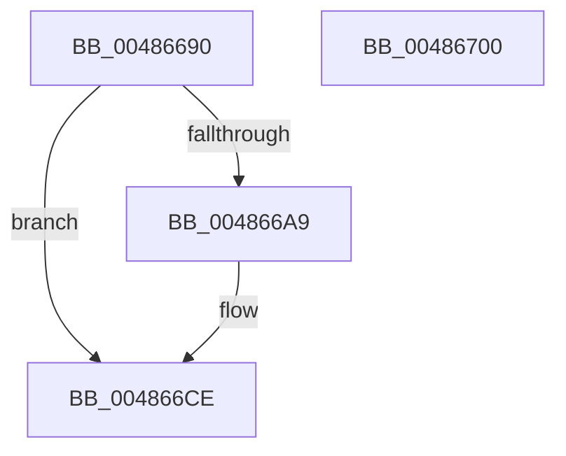

# PiUEventHashStringIntoBucket

- RVA: `0x00486690`–`0x00486701` (길이 `113` bytes)
- VA: `0x0000000140486690`
- 실행 섹션: `.text`
- PDB 이름 있음: `예`; PDB Function 태그: `아니요`
- unwind 정보 RVA: `0x0005D2F4`
- 디코드: `29`개 명령, `113/113` bytes 표시
- 미해석 바이트: `0` (있으면 어셈블리에 `.byte`로 보존)

> 이 문서는 커널 이미지의 기계어와 PDB 기호를 분석해 생성했습니다. 4번과 5번은 함수 원형과 자료형을 바이너리 사용 방식에서 추정한 C 해석이며 원본 소스 복구 결과는 아닙니다.

## 1. Dependencies

- 직접 호출 지점: **2**; 고유 호출 대상: **2**
- 직접 호출자로 확인된 함수: **4**
- RIP 상대 이미지 참조: **0**

### Outgoing calls
- `0x004866A9` → [wcslen](../50/wcslen_function_00501BA0.md) (function, `0x00501BA0`)
- `0x004866DD` → [RtlHashUnicodeString](../../page/97/RtlHashUnicodeString_function_0097A780.md) (function, `0x0097A780`)

### Direct callers
- [PiUEventNotifyTargetDeviceChange](../../page/8E/PiUEventNotifyTargetDeviceChange_function_008E65B0.md) at `0x008E6641`
- [PiUEventHandleRegistration](../../page/9C/PiUEventHandleRegistration_function_009C3304.md) at `0x009C35B3`
- [PiUEventHandleRegistration](../../page/9C/PiUEventHandleRegistration_function_009C3304.md) at `0x009C3602`
- [PiUEventHandleRegistration](../../page/9C/PiUEventHandleRegistration_function_009C3304.md) at `0x009C3645`
- [PiUEventNotifyDeviceInstancePropertyChange](../../page/9C/PiUEventNotifyDeviceInstancePropertyChange_function_009C3C04.md) at `0x009C3C41`
- [PiUEventNotifyDeviceInstanceChange](../../page/9C/PiUEventNotifyDeviceInstanceChange_function_009C3E2C.md) at `0x009C3E77`

### Static image references
- 디코드된 RIP-relative 메모리 참조가 없습니다.

## 2. Other-region calls and transfers

- 다른 실행 섹션으로 향하는 call: **1**
  - `0x004866DD` → [RtlHashUnicodeString](../../page/97/RtlHashUnicodeString_function_0097A780.md) (`.text` → `PAGE`)
- 별도 외부 분기/꼬리 이동을 확인하지 못했습니다.

## 3. Assembly (complete function range)

```asm
00486690  48 83 EC 38                     sub rsp, 0x38
00486694  83 64 24 40 00                  and dword ptr [rsp + 0x40], 0
00486699  48 83 64 24 20 00               and qword ptr [rsp + 0x20], 0
0048669F  48 89 4C 24 28                  mov qword ptr [rsp + 0x28], rcx
004866A4  48 85 C9                        test rcx, rcx
004866A7  74 25                           je 0x1404866ce
004866A9  E8 F2 B4 07 00                  call 0x140501ba0
004866AE  48 03 C0                        add rax, rax
004866B1  B9 FC FF 00 00                  mov ecx, 0xfffc
004866B6  48 3D FE FF 00 00               cmp rax, 0xfffe
004866BC  48 0F 43 C1                     cmovae rax, rcx
004866C0  66 89 44 24 20                  mov word ptr [rsp + 0x20], ax
004866C5  66 83 C0 02                     add ax, 2
004866C9  66 89 44 24 22                  mov word ptr [rsp + 0x22], ax
004866CE  4C 8D 4C 24 40                  lea r9, [rsp + 0x40]
004866D3  45 33 C0                        xor r8d, r8d
004866D6  B2 01                           mov dl, 1
004866D8  48 8D 4C 24 20                  lea rcx, [rsp + 0x20]
004866DD  E8 9E 40 4F 00                  call 0x14097a780
004866E2  44 8B 44 24 40                  mov r8d, dword ptr [rsp + 0x40]
004866E7  B8 4F EC C4 4E                  mov eax, 0x4ec4ec4f
004866EC  41 F7 E0                        mul r8d
004866EF  C1 EA 02                        shr edx, 2
004866F2  6B CA 0D                        imul ecx, edx, 0xd
004866F5  44 2B C1                        sub r8d, ecx
004866F8  41 8B C0                        mov eax, r8d
004866FB  48 83 C4 38                     add rsp, 0x38
004866FF  C3                              ret
00486700  CC                              int3
```

## 4. C-style interpretation (structured pseudocode)

```c
__int64 __fastcall PiUEventHashStringIntoBucket(__int64 a1, __int64 a2, int a3)
{
    __int64 result;
    __int64 v_rsp;
    unsigned __int64 v_stack_m10;
    unsigned __int16 v_stack_m16;
    unsigned __int64 v_stack_m18;
    unsigned int v_stack_p8;

    v_rsp = (v_rsp) - (56);
    v_stack_m10 = a1;
    if (a1 != 0) {
        result = wcslen(a1, a2, a3, a4);
        result = (result) + (result);
        a1 = 0xFFFCULL;
        if (result >= 0xFFFEULL) { result = a1; }
        v_stack_m18 = (unsigned __int16)(result);
        result = (unsigned __int16)((result) + (2));
        v_stack_m16 = (unsigned __int16)(result);
    }
    a3 = 0;
    result = RtlHashUnicodeString(v_stack_m18, 1, a3, v_stack_p8);
    a2 = (unsigned int)((1) >> (2));
    a1 = (unsigned int)((v_stack_m18) * ((unsigned int)(a2)));
    a3 = (unsigned int)(((unsigned int)(v_stack_p8)) - ((unsigned int)(a1)));
    v_rsp = (v_rsp) + (56);
    return (unsigned int)(a3);
}
```

## 5. (Beta) C Style

```c
int64_t PiUEventHashStringIntoBucket(int64_t Arg1, int64_t Arg2, int32_t Arg3)
{
    int64_t result;
    int64_t local_rsp;
    uint64_t v_stack_m10;
    uint16_t v_stack_m16;
    uint64_t v_stack_m18;
    uint32_t v_stack_p8;

    local_rsp = (local_rsp) - (56);
    v_stack_m10 = Arg1;
    if (Arg1 != 0) {
        result = wcslen(Arg1, Arg2, Arg3, a4);
        result = (result) + (result);
        Arg1 = 0xFFFCULL;
        if (result >= 0xFFFEULL) { result = Arg1; }
        v_stack_m18 = (uint16_t)(result);
        result = (uint16_t)((result) + (2));
        v_stack_m16 = (uint16_t)(result);
    }
    Arg3 = 0;
    result = RtlHashUnicodeString(v_stack_m18, 1, Arg3, v_stack_p8);
    Arg2 = (uint32_t)((1) >> (2));
    Arg1 = (uint32_t)((v_stack_m18) * ((uint32_t)(Arg2)));
    Arg3 = (uint32_t)(((uint32_t)(v_stack_p8)) - ((uint32_t)(Arg1)));
    local_rsp = (local_rsp) + (56);
    return (uint32_t)(Arg3);
}
```

## 6. Execution-region graph

[열기: 2D/3D 그래프와 함수 탐색 컨트롤 패널](../../../control-panel.html?section=text&rva=0x00486690&view=graph)

- 2D 그래프는 위에서 아래로 흐르고, 3D 그래프는 빈 공간을 드래그해 회전합니다. Shift+드래그는 이동, 휠은 확대·축소, 함수 노드 선택은 대상 보고서 이동입니다.

### Static fallback


