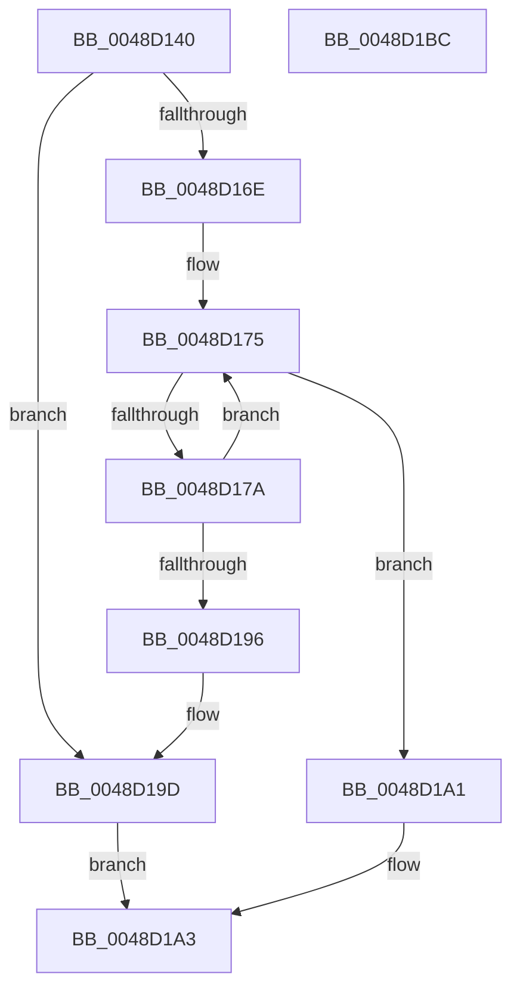

# PipDependencyGraphDepthFirstSearch

- RVA: `0x0048D140`–`0x0048D1BD` (길이 `125` bytes)
- VA: `0x000000014048D140`
- 실행 섹션: `.text`
- PDB 이름 있음: `예`; PDB Function 태그: `아니요`
- unwind 정보 RVA: `0x00060300`
- 디코드: `42`개 명령, `125/125` bytes 표시
- 미해석 바이트: `0` (있으면 어셈블리에 `.byte`로 보존)

> 이 문서는 커널 이미지의 기계어와 PDB 기호를 분석해 생성했습니다. 4번과 5번은 함수 원형과 자료형을 바이너리 사용 방식에서 추정한 C 해석이며 원본 소스 복구 결과는 아닙니다.

## 1. Dependencies

- 직접 호출 지점: **1**; 고유 호출 대상: **1**
- 직접 호출자로 확인된 함수: **2**
- RIP 상대 이미지 참조: **0**

### Outgoing calls
- `0x0048D18D` → [PipDependencyGraphDepthFirstSearch](PipDependencyGraphDepthFirstSearch_function_0048D140.md) (function, `0x0048D140`)

### Direct callers
- [PipFindDependencyNodePath](PipFindDependencyNodePath_function_0048D0AC.md) at `0x0048D0F3`
- [PipDependencyGraphDepthFirstSearch](PipDependencyGraphDepthFirstSearch_function_0048D140.md) at `0x0048D18D`

### Static image references
- 디코드된 RIP-relative 메모리 참조가 없습니다.

## 2. Other-region calls and transfers

- 다른 실행 섹션으로 향하는 call: **0**
- 별도 외부 분기/꼬리 이동을 확인하지 못했습니다.

## 3. Assembly (complete function range)

```asm
0048D140  48 89 5C 24 08                  mov qword ptr [rsp + 8], rbx
0048D145  48 89 6C 24 10                  mov qword ptr [rsp + 0x10], rbp
0048D14A  48 89 74 24 18                  mov qword ptr [rsp + 0x18], rsi
0048D14F  57                              push rdi
0048D150  41 56                           push r14
0048D152  41 57                           push r15
0048D154  48 83 EC 20                     sub rsp, 0x20
0048D158  41 83 20 00                     and dword ptr [r8], 0
0048D15C  49 8B F1                        mov rsi, r9
0048D15F  41 83 21 00                     and dword ptr [r9], 0
0048D163  49 8B D8                        mov rbx, r8
0048D166  4C 8B FA                        mov r15, rdx
0048D169  48 3B CA                        cmp rcx, rdx
0048D16C  74 2F                           je 0x14048d19d
0048D16E  4C 8D 71 10                     lea r14, [rcx + 0x10]
0048D172  49 8B 3E                        mov rdi, qword ptr [r14]
0048D175  49 3B FE                        cmp rdi, r14
0048D178  74 27                           je 0x14048d1a1
0048D17A  48 8B EF                        mov rbp, rdi
0048D17D  4C 8B CE                        mov r9, rsi
0048D180  48 8B 3F                        mov rdi, qword ptr [rdi]
0048D183  4C 8B C3                        mov r8, rbx
0048D186  49 8B D7                        mov rdx, r15
0048D189  48 8B 4D 20                     mov rcx, qword ptr [rbp + 0x20]
0048D18D  E8 AE FF FF FF                  call 0x14048d140
0048D192  84 C0                           test al, al
0048D194  74 DF                           je 0x14048d175
0048D196  8B 45 30                        mov eax, dword ptr [rbp + 0x30]
0048D199  FF 03                           inc dword ptr [rbx]
0048D19B  89 06                           mov dword ptr [rsi], eax
0048D19D  B0 01                           mov al, 1
0048D19F  EB 02                           jmp 0x14048d1a3
0048D1A1  32 C0                           xor al, al
0048D1A3  48 8B 5C 24 40                  mov rbx, qword ptr [rsp + 0x40]
0048D1A8  48 8B 6C 24 48                  mov rbp, qword ptr [rsp + 0x48]
0048D1AD  48 8B 74 24 50                  mov rsi, qword ptr [rsp + 0x50]
0048D1B2  48 83 C4 20                     add rsp, 0x20
0048D1B6  41 5F                           pop r15
0048D1B8  41 5E                           pop r14
0048D1BA  5F                              pop rdi
0048D1BB  C3                              ret
0048D1BC  CC                              int3
```

## 4. C-style interpretation (structured pseudocode)

```c
__int64 __fastcall PipDependencyGraphDepthFirstSearch(__int64 a1, __int64 a2, __int64 a3, __int64 a4)
{
    __int64 result;
    __int64 v_rsp;
    unsigned __int64 v_stack_p10;
    unsigned __int64 v_stack_p18;
    unsigned __int64 v_stack_p8;

    v_stack_p8 = v_rbx;
    v_stack_p10 = v_rbp;
    v_stack_p18 = v_rsi;
    v_rsp = (v_rsp) - (32);
    if (a1 == a2) goto loc_0048D19D;
loc_0048D175:
    if ((*(unsigned __int64 *)(a1 + 16)) == (a1 + 16)) goto loc_0048D1A1;
    result = PipDependencyGraphDepthFirstSearch(*(unsigned __int64 *)(*(unsigned __int64 *)(a1 + 16) + 32), a2, a3, a4);
    if ((unsigned __int8)(result) == 0) goto loc_0048D175;
    *(unsigned int *)(a4) = (unsigned int)((unsigned int)(*(unsigned int *)(*(unsigned __int64 *)(a1 + 16) + 48)));
loc_0048D19D:
    goto loc_0048D1A3;
loc_0048D1A1:
    result = 0;
loc_0048D1A3:
    v_rsp = (v_rsp) + (32);
    return result;
}
```

## 5. (Beta) C Style

```c
int64_t PipDependencyGraphDepthFirstSearch(int64_t Arg1, int64_t Arg2, void *Arg3, void *Arg4)
{
    uint8_t *arg3 = (uint8_t *)Arg3;
    uint8_t *arg4 = (uint8_t *)Arg4;

    int64_t result;
    int64_t local_rsp;
    uint64_t v_stack_p10;
    uint64_t v_stack_p18;
    uint64_t v_stack_p8;

    v_stack_p8 = local_rbx;
    v_stack_p10 = local_rbp;
    v_stack_p18 = local_rsi;
    local_rsp = (local_rsp) - (32);
    if (Arg1 == Arg2) goto loc_0048D19D;
loc_0048D175:
    if ((*(uint64_t *)(Arg1 + 0x10)) == (Arg1 + 16)) goto loc_0048D1A1;
    result = PipDependencyGraphDepthFirstSearch(*(uint64_t *)(*(uint64_t *)(Arg1 + 0x10) + 0x20), Arg2, Arg3, Arg4);
    if ((uint8_t)(result) == 0) goto loc_0048D175;
    *(uint32_t *)(arg4) = (uint32_t)((uint32_t)(*(uint32_t *)(*(uint64_t *)(Arg1 + 0x10) + 0x30)));
loc_0048D19D:
    goto loc_0048D1A3;
loc_0048D1A1:
    result = 0;
loc_0048D1A3:
    local_rsp = (local_rsp) + (32);
    return result;
}
```

### 관측된 메모리 오프셋

구조체 형식이 확인되지 않은 접근은 인자 기준의 오프셋으로만 기록했습니다.

| 기준 인자 | 오프셋 표현 | 폭 (bit) | 접근 |
|---|---:|---:|---|
| `Arg3` | `+ 0x0` | `32` | `R/W` |
| `Arg4` | `+ 0x0` | `32` | `R/W` |
| `Arg4` | `+ 0x0` | `32` | `W` |

## 6. Execution-region graph

[열기: 2D/3D 그래프와 함수 탐색 컨트롤 패널](../../../control-panel.html?section=text&rva=0x0048D140&view=graph)

- 2D 그래프는 위에서 아래로 흐르고, 3D 그래프는 빈 공간을 드래그해 회전합니다. Shift+드래그는 이동, 휠은 확대·축소, 함수 노드 선택은 대상 보고서 이동입니다.

### Static fallback


