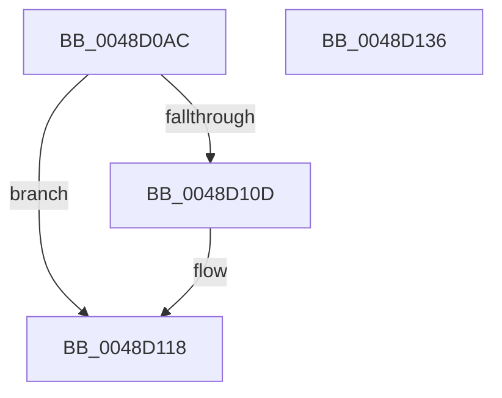

# PipFindDependencyNodePath

- RVA: `0x0048D0AC`–`0x0048D137` (길이 `139` bytes)
- VA: `0x000000014048D0AC`
- 실행 섹션: `.text`
- PDB 이름 있음: `예`; PDB Function 태그: `아니요`
- unwind 정보 RVA: `0x0005D7BC`
- 디코드: `38`개 명령, `139/139` bytes 표시
- 미해석 바이트: `0` (있으면 어셈블리에 `.byte`로 보존)

> 이 문서는 커널 이미지의 기계어와 PDB 기호를 분석해 생성했습니다. 4번과 5번은 함수 원형과 자료형을 바이너리 사용 방식에서 추정한 C 해석이며 원본 소스 복구 결과는 아닙니다.

## 1. Dependencies

- 직접 호출 지점: **3**; 고유 호출 대상: **3**
- 직접 호출자로 확인된 함수: **1**
- RIP 상대 이미지 참조: **1**

### Outgoing calls
- `0x0048D0DD` → [KeAcquireSpinLockRaiseToDpc](../20/KeAcquireSpinLockRaiseToDpc_function_00208470.md) (function, `0x00208470`)
- `0x0048D0F3` → [PipDependencyGraphDepthFirstSearch](PipDependencyGraphDepthFirstSearch_function_0048D140.md) (function, `0x0048D140`)
- `0x0048D102` → [KeReleaseSpinLock](../39/KeReleaseSpinLock_function_00392BA0.md) (function, `0x00392BA0`)

### Direct callers
- [IoTestDependency](IoTestDependency_function_0048D050.md) at `0x0048D096`

### Static image references
- `0x0048D0CA` → RVA `0x00F8CF08` (`.data`; read)

## 2. Other-region calls and transfers

- 다른 실행 섹션으로 향하는 call: **0**
- 별도 외부 분기/꼬리 이동을 확인하지 못했습니다.

## 3. Assembly (complete function range)

```asm
0048D0AC  48 8B C4                        mov rax, rsp
0048D0AF  48 89 58 08                     mov qword ptr [rax + 8], rbx
0048D0B3  48 89 68 10                     mov qword ptr [rax + 0x10], rbp
0048D0B7  48 89 70 18                     mov qword ptr [rax + 0x18], rsi
0048D0BB  48 89 78 20                     mov qword ptr [rax + 0x20], rdi
0048D0BF  41 56                           push r14
0048D0C1  48 83 EC 30                     sub rsp, 0x30
0048D0C5  48 8B F1                        mov rsi, rcx
0048D0C8  33 ED                           xor ebp, ebp
0048D0CA  48 8D 0D 37 FE AF 00            lea rcx, [rip + 0xaffe37]
0048D0D1  89 68 E8                        mov dword ptr [rax - 0x18], ebp
0048D0D4  49 8B D9                        mov rbx, r9
0048D0D7  4D 8B F0                        mov r14, r8
0048D0DA  48 8B FA                        mov rdi, rdx
0048D0DD  E8 8E B3 D7 FF                  call 0x140208470
0048D0E2  4C 8B CB                        mov r9, rbx
0048D0E5  4C 8D 44 24 20                  lea r8, [rsp + 0x20]
0048D0EA  48 8B D7                        mov rdx, rdi
0048D0ED  48 8B CE                        mov rcx, rsi
0048D0F0  44 8A D0                        mov r10b, al
0048D0F3  E8 48 00 00 00                  call 0x14048d140
0048D0F8  41 8A D2                        mov dl, r10b
0048D0FB  48 8D 0D 06 FE AF 00            lea rcx, [rip + 0xaffe06]
0048D102  E8 99 5A F0 FF                  call 0x140392ba0
0048D107  39 6C 24 20                     cmp dword ptr [rsp + 0x20], ebp
0048D10B  74 0B                           je 0x14048d118
0048D10D  83 7C 24 20 01                  cmp dword ptr [rsp + 0x20], 1
0048D112  40 0F 95 C5                     setne bpl
0048D116  FF C5                           inc ebp
0048D118  48 8B 5C 24 40                  mov rbx, qword ptr [rsp + 0x40]
0048D11D  48 8B 74 24 50                  mov rsi, qword ptr [rsp + 0x50]
0048D122  48 8B 7C 24 58                  mov rdi, qword ptr [rsp + 0x58]
0048D127  41 89 2E                        mov dword ptr [r14], ebp
0048D12A  48 8B 6C 24 48                  mov rbp, qword ptr [rsp + 0x48]
0048D12F  48 83 C4 30                     add rsp, 0x30
0048D133  41 5E                           pop r14
0048D135  C3                              ret
0048D136  CC                              int3
```

## 4. C-style interpretation (structured pseudocode)

```c
__int64 __fastcall PipFindDependencyNodePath(__int64 a1, __int64 a2, __int64 a3, __int64 a4)
{
    __int64 result;
    __int64 v_rbp;
    __int64 v_rsp;
    unsigned __int64 v_stack_m18;
    unsigned __int64 v_stack_p10;
    unsigned __int64 v_stack_p18;
    unsigned __int64 v_stack_p20;
    unsigned __int64 v_stack_p8;

    *(unsigned __int64 *)(v_rsp + 8) = v_rbx;
    *(unsigned __int64 *)(v_rsp + 16) = v_rbp;
    *(unsigned __int64 *)(v_rsp + 24) = v_rsi;
    *(unsigned __int64 *)(v_rsp + 32) = v_rdi;
    v_rsp = (v_rsp) - (48);
    v_rbp = 0;
    *(unsigned int *)(v_rsp - 24) = 0;
    result = KeAcquireSpinLockRaiseToDpc(v_rip + 11533879, a2, a3, a4);
    result = PipDependencyGraphDepthFirstSearch(a1, a2, v_stack_m18, a4);
    result = KeReleaseSpinLock(v_rip + 11533830, (unsigned __int8)((unsigned __int8)(result)), v_stack_m18, a4);
    if (v_stack_m18 != 0) {
        v_rbp = (v_stack_m18 != 1) ? 1 : 0;
        v_rbp = (unsigned int)((v_rbp) + 1);
    }
    *(unsigned int *)(a3) = (unsigned int)(v_rbp);
    v_rsp = (v_rsp) + (48);
    return result;
}
```

## 5. (Beta) C Style

```c
int64_t PipFindDependencyNodePath(int64_t Arg1, int64_t Arg2, void *Arg3, int64_t Arg4)
{
    uint8_t *arg3 = (uint8_t *)Arg3;

    int64_t result;
    int64_t local_rbp;
    int64_t local_rsp;
    uint64_t v_stack_m18;
    uint64_t v_stack_p10;
    uint64_t v_stack_p18;
    uint64_t v_stack_p20;
    uint64_t v_stack_p8;

    *(uint64_t *)(local_rsp + 0x8) = local_rbx;
    *(uint64_t *)(local_rsp + 0x10) = local_rbp;
    *(uint64_t *)(local_rsp + 0x18) = local_rsi;
    *(uint64_t *)(local_rsp + 0x20) = local_rdi;
    local_rsp = (local_rsp) - (48);
    local_rbp = 0;
    *(uint32_t *)(local_rsp - 0x18) = 0;
    result = KeAcquireSpinLockRaiseToDpc(v_rip + 11533879, Arg2, Arg3, Arg4);
    result = PipDependencyGraphDepthFirstSearch(Arg1, Arg2, v_stack_m18, Arg4);
    result = KeReleaseSpinLock(v_rip + 11533830, (uint8_t)((uint8_t)(result)), v_stack_m18, Arg4);
    if (v_stack_m18 != 0) {
        local_rbp = (v_stack_m18 != 1) ? 1 : 0;
        local_rbp = (uint32_t)((local_rbp) + 1);
    }
    *(uint32_t *)(arg3) = (uint32_t)(local_rbp);
    local_rsp = (local_rsp) + (48);
    return result;
}
```

### 관측된 메모리 오프셋

구조체 형식이 확인되지 않은 접근은 인자 기준의 오프셋으로만 기록했습니다.

| 기준 인자 | 오프셋 표현 | 폭 (bit) | 접근 |
|---|---:|---:|---|
| `Arg3` | `+ 0x0` | `32` | `W` |

## 6. Execution-region graph

[열기: 2D/3D 그래프와 함수 탐색 컨트롤 패널](../../../control-panel.html?section=text&rva=0x0048D0AC&view=graph)

- 2D 그래프는 위에서 아래로 흐르고, 3D 그래프는 빈 공간을 드래그해 회전합니다. Shift+드래그는 이동, 휠은 확대·축소, 함수 노드 선택은 대상 보고서 이동입니다.

### Static fallback


