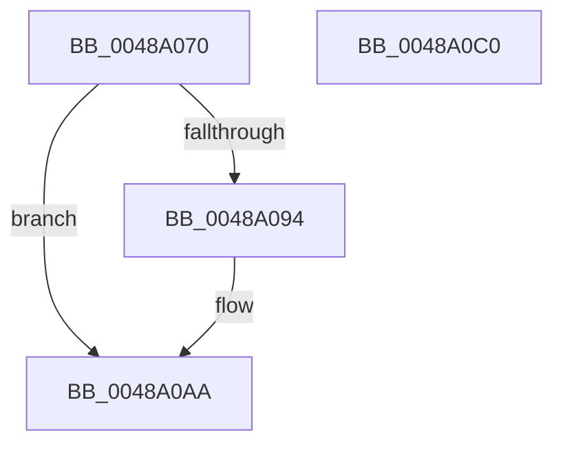

# PnpDeviceCompletionQueueIsEmpty

- RVA: `0x0048A070`–`0x0048A0C1` (길이 `81` bytes)
- VA: `0x000000014048A070`
- 실행 섹션: `.text`
- PDB 이름 있음: `예`; PDB Function 태그: `아니요`
- unwind 정보 RVA: `0x0005CF00`
- 디코드: `20`개 명령, `81/81` bytes 표시
- 미해석 바이트: `0` (있으면 어셈블리에 `.byte`로 보존)

> 이 문서는 커널 이미지의 기계어와 PDB 기호를 분석해 생성했습니다. 4번과 5번은 함수 원형과 자료형을 바이너리 사용 방식에서 추정한 C 해석이며 원본 소스 복구 결과는 아닙니다.

## 1. Dependencies

- 직접 호출 지점: **2**; 고유 호출 대상: **2**
- 직접 호출자로 확인된 함수: **2**
- RIP 상대 이미지 참조: **3**

### Outgoing calls
- `0x0048A07F` → [KeAcquireSpinLockRaiseToDpc](../20/KeAcquireSpinLockRaiseToDpc_function_00208470.md) (function, `0x00208470`)
- `0x0048A0B3` → [KeReleaseSpinLock](../39/KeReleaseSpinLock_function_00392BA0.md) (function, `0x00392BA0`)

### Direct callers
- [PipProcessDevNodeTree](../../page/8F/PipProcessDevNodeTree_function_008F9068.md) at `0x008F9232`
- [PipProcessDevNodeTree](../../page/8F/PipProcessDevNodeTree_function_008F9068.md) at `0x008F9266`
- [PipProcessDevNodeTree](../../page/8F/PipProcessDevNodeTree_function_008F9068.md) at `0x008F93F5`
- [PipProcessDevNodeTree](../../page/8F/PipProcessDevNodeTree_function_008F9068.md) at `0x008F95E7`
- [PipProcessDevNodeTree](../../page/8F/PipProcessDevNodeTree_function_008F9068.md) at `0x008F9761`
- [PipProcessDevNodeTree](../../page/8F/PipProcessDevNodeTree_function_008F9068.md) at `0x008F97AF`
- [PnpDeviceCompletionProcessCompletedRequests](../../page/8F/PnpDeviceCompletionProcessCompletedRequests_function_008FC0D0.md) at `0x008FC0F6`
- [PnpDeviceCompletionProcessCompletedRequests](../../page/8F/PnpDeviceCompletionProcessCompletedRequests_function_008FC0D0.md) at `0x008FC143`

### Static image references
- `0x0048A076` → RVA `0x00F8C348` (`.data`; read)
- `0x0048A084` → RVA `0x00F8C300` (`.data`; read)
- `0x0048A094` → RVA `0x00F8C318` (`.data`; read)

## 2. Other-region calls and transfers

- 다른 실행 섹션으로 향하는 call: **0**
- 별도 외부 분기/꼬리 이동을 확인하지 못했습니다.

## 3. Assembly (complete function range)

```asm
0048A070  40 53                           push rbx
0048A072  48 83 EC 20                     sub rsp, 0x20
0048A076  48 8D 0D CB 22 B0 00            lea rcx, [rip + 0xb022cb]
0048A07D  33 DB                           xor ebx, ebx
0048A07F  E8 EC E3 D7 FF                  call 0x140208470
0048A084  48 8D 15 75 22 B0 00            lea rdx, [rip + 0xb02275]
0048A08B  48 39 15 6E 22 B0 00            cmp qword ptr [rip + 0xb0226e], rdx
0048A092  75 16                           jne 0x14048a0aa
0048A094  48 8D 15 7D 22 B0 00            lea rdx, [rip + 0xb0227d]
0048A09B  48 39 15 76 22 B0 00            cmp qword ptr [rip + 0xb02276], rdx
0048A0A2  44 8D 43 01                     lea r8d, [rbx + 1]
0048A0A6  41 0F 44 D8                     cmove ebx, r8d
0048A0AA  8A D0                           mov dl, al
0048A0AC  48 8D 0D 95 22 B0 00            lea rcx, [rip + 0xb02295]
0048A0B3  E8 E8 8A F0 FF                  call 0x140392ba0
0048A0B8  8B C3                           mov eax, ebx
0048A0BA  48 83 C4 20                     add rsp, 0x20
0048A0BE  5B                              pop rbx
0048A0BF  C3                              ret
0048A0C0  CC                              int3
```

## 4. C-style interpretation (structured pseudocode)

```c
__int64 __fastcall PnpDeviceCompletionQueueIsEmpty(void)
{
    __int64 result;
    __int64 v_rbx;
    __int64 v_rsp;

    v_rsp = (v_rsp) - (32);
    v_rbx = 0;
    result = KeAcquireSpinLockRaiseToDpc(v_rip + 11543243, a2, a3, a4);
    if ((*(unsigned __int64 *)(v_rip + 11543150)) == (v_rip + 11543157)) {
        a2 = v_rip + 11543165;
        a3 = v_rbx + 1;
        if ((*(unsigned __int64 *)(v_rip + 11543158)) == a2) { v_rbx = (unsigned int)(a3); }
    }
    result = KeReleaseSpinLock(v_rip + 11543189, (unsigned __int8)(result), a3, a4);
    v_rsp = (v_rsp) + (32);
    return (unsigned int)((unsigned int)(v_rbx));
}
```

## 5. (Beta) C Style

```c
void PnpDeviceCompletionQueueIsEmpty(void)
{
    int64_t result;
    int64_t local_rbx;
    int64_t local_rsp;

    local_rsp = (local_rsp) - (32);
    local_rbx = 0;
    result = KeAcquireSpinLockRaiseToDpc(v_rip + 11543243, a2, a3, a4);
    if ((*(uint64_t *)(v_rip + 0xB0226E)) == (v_rip + 11543157)) {
        a2 = v_rip + 11543165;
        a3 = local_rbx + 1;
        if ((*(uint64_t *)(v_rip + 0xB02276)) == a2) { local_rbx = (uint32_t)(a3); }
    }
    result = KeReleaseSpinLock(v_rip + 11543189, (uint8_t)(result), a3, a4);
    local_rsp = (local_rsp) + (32);
    return (uint32_t)((uint32_t)(local_rbx));
}
```

## 6. Execution-region graph

[열기: 2D/3D 그래프와 함수 탐색 컨트롤 패널](../../../control-panel.html?section=text&rva=0x0048A070&view=graph)

- 2D 그래프는 위에서 아래로 흐르고, 3D 그래프는 빈 공간을 드래그해 회전합니다. Shift+드래그는 이동, 휠은 확대·축소, 함수 노드 선택은 대상 보고서 이동입니다.

### Static fallback


