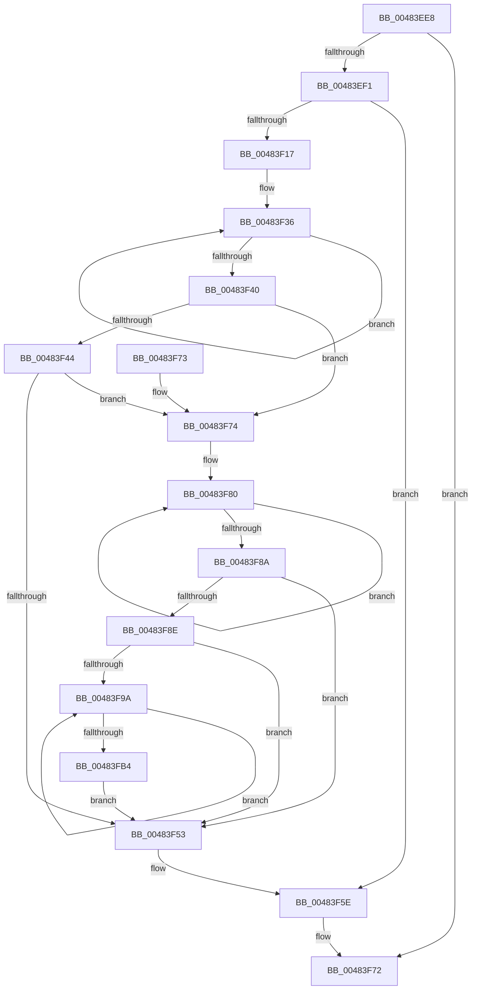

# PoFxIdleDevice

- RVA: `0x00483EE8`–`0x00483FB6` (길이 `206` bytes)
- VA: `0x0000000140483EE8`
- 실행 섹션: `.text`
- PDB 이름 있음: `예`; PDB Function 태그: `아니요`
- unwind 정보 RVA: `0x000AEFC0`
- 디코드: `61`개 명령, `206/206` bytes 표시
- 미해석 바이트: `0` (있으면 어셈블리에 `.byte`로 보존)

> 이 문서는 커널 이미지의 기계어와 PDB 기호를 분석해 생성했습니다. 4번과 5번은 함수 원형과 자료형을 바이너리 사용 방식에서 추정한 C 해석이며 원본 소스 복구 결과는 아닙니다.

## 1. Dependencies

- 직접 호출 지점: **3**; 고유 호출 대상: **3**
- 직접 호출자로 확인된 함수: **17**
- RIP 상대 이미지 참조: **0**

### Outgoing calls
- `0x00483F1E` → [ExAcquireSpinLockExclusive](../24/ExAcquireSpinLockExclusive_function_00248690.md) (function, `0x00248690`)
- `0x00483F59` → [ExReleaseSpinLockExclusive](../2C/ExReleaseSpinLockExclusive_function_002C0EF0.md) (function, `0x002C0EF0`)
- `0x00483FA5` → [PoFxIdleComponent](../2C/PoFxIdleComponent_function_002C01A0.md) (function, `0x002C01A0`)

### Direct callers
- [PopCompleteDirectedPowerTransitionCallback](PopCompleteDirectedPowerTransitionCallback_function_00483AD0.md) at `0x00483B15`
- [PopFxClearDeviceConstraints](../4B/PopFxClearDeviceConstraints_function_004B05F8.md) at `0x004B0739`
- [PopFxIdleDevicesFromSx](../4B/PopFxIdleDevicesFromSx_function_004B2FB4.md) at `0x004B3058`
- [PoFxAddDeviceRelation](../5D/PoFxAddDeviceRelation_function_005D1850.md) at `0x005D19B9`
- [PoFxRemoveDeviceRelation](../5D/PoFxRemoveDeviceRelation_function_005D1EF0.md) at `0x005D20C1`
- [PopPepPlatformStateRegistered](../5D/PopPepPlatformStateRegistered_function_005DCDB8.md) at `0x005DCF1A`
- [PopPlIdleDeviceIterator](../5D/PopPlIdleDeviceIterator_function_005DDA40.md) at `0x005DDA6A`
- [PiProcessResourceRequirementsChanged](../../page/72/PiProcessResourceRequirementsChanged_function_0072D504.md) at `0x0072D633`
- [PnpCancelStopDeviceNode](../../page/73/PnpCancelStopDeviceNode_function_0073F048.md) at `0x0073F08A`
- [PipProcessRestartPhase2](../../page/74/PipProcessRestartPhase2_function_007408B8.md) at `0x00740964`
- [PipProcessDevNodeTree](../../page/8F/PipProcessDevNodeTree_function_008F9068.md) at `0x008F93B7`
- [PipEnumerateDevice](../../page/8F/PipEnumerateDevice_function_008F99E4.md) at `0x008F9B1D`
- [PiProcessQueryDeviceState](../../page/8F/PiProcessQueryDeviceState_function_008FA0F8.md) at `0x008FA24C`
- [PnpDeviceCompletionProcessCompletedRequest](../../page/8F/PnpDeviceCompletionProcessCompletedRequest_function_008FB654.md) at `0x008FB6A8`
- [PnpDeleteLockedDeviceNodes](../../page/A0/PnpDeleteLockedDeviceNodes_function_00A09B30.md) at `0x00A09CE1`
- [PopFxUpdateVetoMaskWork](../../page/AB/PopFxUpdateVetoMaskWork_function_00AB2800.md) at `0x00AB28E3`
- [sub_00B34BF4](../../page/B3/Unknown_function_00B34BF4.md) at `0x00B34BF8`

### Static image references
- 디코드된 RIP-relative 메모리 참조가 없습니다.

## 2. Other-region calls and transfers

- 다른 실행 섹션으로 향하는 call: **0**
- 별도 외부 분기/꼬리 이동을 확인하지 못했습니다.

## 3. Assembly (complete function range)

```asm
00483EE8  48 85 C9                        test rcx, rcx
00483EEB  0F 84 81 00 00 00               je 0x140483f72
00483EF1  48 89 5C 24 08                  mov qword ptr [rsp + 8], rbx
00483EF6  48 89 6C 24 10                  mov qword ptr [rsp + 0x10], rbp
00483EFB  48 89 74 24 18                  mov qword ptr [rsp + 0x18], rsi
00483F00  57                              push rdi
00483F01  48 83 EC 20                     sub rsp, 0x20
00483F05  48 8B 81 38 01 00 00            mov rax, qword ptr [rcx + 0x138]
00483F0C  33 DB                           xor ebx, ebx
00483F0E  48 8B 78 28                     mov rdi, qword ptr [rax + 0x28]
00483F12  48 85 FF                        test rdi, rdi
00483F15  74 47                           je 0x140483f5e
00483F17  48 8D 77 58                     lea rsi, [rdi + 0x58]
00483F1B  48 8B CE                        mov rcx, rsi
00483F1E  E8 6D 47 DC FF                  call 0x140248690
00483F23  44 8B 47 78                     mov r8d, dword ptr [rdi + 0x78]
00483F27  48 8D 97 28 01 00 00            lea rdx, [rdi + 0x128]
00483F2E  40 8A E8                        mov bpl, al
00483F31  0F 0D 0A                        prefetchw byte ptr [rdx]
00483F34  8B 02                           mov eax, dword ptr [rdx]
00483F36  8B C8                           mov ecx, eax
00483F38  0B CB                           or ecx, ebx
00483F3A  F0 0F B1 0A                     lock cmpxchg dword ptr [rdx], ecx
00483F3E  75 F6                           jne 0x140483f36
00483F40  A8 04                           test al, 4
00483F42  74 30                           je 0x140483f74
00483F44  48 8B 47 50                     mov rax, qword ptr [rdi + 0x50]
00483F48  8B 88 60 03 00 00               mov ecx, dword ptr [rax + 0x360]
00483F4E  F6 C1 01                        test cl, 1
00483F51  74 21                           je 0x140483f74
00483F53  40 8A D5                        mov dl, bpl
00483F56  48 8B CE                        mov rcx, rsi
00483F59  E8 92 CF E3 FF                  call 0x1402c0ef0
00483F5E  48 8B 5C 24 30                  mov rbx, qword ptr [rsp + 0x30]
00483F63  48 8B 6C 24 38                  mov rbp, qword ptr [rsp + 0x38]
00483F68  48 8B 74 24 40                  mov rsi, qword ptr [rsp + 0x40]
00483F6D  48 83 C4 20                     add rsp, 0x20
00483F71  5F                              pop rdi
00483F72  C3                              ret
00483F73  CC                              int3
00483F74  41 8D 40 FF                     lea eax, [r8 - 1]
00483F78  89 47 78                        mov dword ptr [rdi + 0x78], eax
00483F7B  0F 0D 0A                        prefetchw byte ptr [rdx]
00483F7E  8B 02                           mov eax, dword ptr [rdx]
00483F80  8B C8                           mov ecx, eax
00483F82  0B CB                           or ecx, ebx
00483F84  F0 0F B1 0A                     lock cmpxchg dword ptr [rdx], ecx
00483F88  75 F6                           jne 0x140483f80
00483F8A  A8 04                           test al, 4
00483F8C  74 C5                           je 0x140483f53
00483F8E  48 8B 7F 50                     mov rdi, qword ptr [rdi + 0x50]
00483F92  39 9F 64 03 00 00               cmp dword ptr [rdi + 0x364], ebx
00483F98  76 B9                           jbe 0x140483f53
00483F9A  41 B8 02 00 00 00               mov r8d, 2
00483FA0  8B D3                           mov edx, ebx
00483FA2  48 8B CF                        mov rcx, rdi
00483FA5  E8 F6 C1 E3 FF                  call 0x1402c01a0
00483FAA  FF C3                           inc ebx
00483FAC  3B 9F 64 03 00 00               cmp ebx, dword ptr [rdi + 0x364]
00483FB2  72 E6                           jb 0x140483f9a
00483FB4  EB 9D                           jmp 0x140483f53
```

## 4. C-style interpretation (structured pseudocode)

```c
__int64 __fastcall PoFxIdleDevice(__int64 a1)
{
    __int64 result;
    __int64 v_rbx;
    __int64 v_rsp;
    unsigned __int64 v_stack_p10;
    unsigned __int64 v_stack_p18;
    unsigned __int64 v_stack_p8;

    if (a1 == 0) goto loc_00483F72;
    v_stack_p8 = v_rbx;
    v_stack_p10 = v_rbp;
    v_stack_p18 = v_rsi;
    v_rsp = (v_rsp) - (32);
    v_rbx = 0;
    if (*(unsigned __int64 *)(*(unsigned __int64 *)(a1 + 312) + 40) == 0) goto loc_00483F5E;
    result = ExAcquireSpinLockExclusive(*(unsigned __int64 *)(*(unsigned __int64 *)(a1 + 312) + 40) + 88, a2, a3, a4);
loc_00483F36:
    a1 = (unsigned int)(((unsigned int)((unsigned int)((unsigned int)(*(unsigned int *)(*(unsigned __int64 *)(*(unsigned __int64 *)(a1 + 312) + 40) + 296))))) | (0));
    if (condition_is_not_equal) goto loc_00483F36;
    if ((((unsigned __int8)((unsigned int)(*(unsigned int *)(*(unsigned __int64 *)(*(unsigned __int64 *)(a1 + 312) + 40) + 296)))) & (4)) == 0) goto loc_00483F74;
    if ((((unsigned __int8)((unsigned int)(*(unsigned int *)(*(unsigned __int64 *)(*(unsigned __int64 *)(*(unsigned __int64 *)(a1 + 312) + 40) + 80) + 864)))) & (1)) == 0) goto loc_00483F74;
loc_00483F53:
    result = ExReleaseSpinLockExclusive(*(unsigned __int64 *)(*(unsigned __int64 *)(a1 + 312) + 40) + 88, (unsigned __int8)((unsigned __int8)(result)), (unsigned int)(*(unsigned int *)(*(unsigned __int64 *)(*(unsigned __int64 *)(a1 + 312) + 40) + 120)), a4);
loc_00483F5E:
    v_rsp = (v_rsp) + (32);
loc_00483F72:
    return result;
loc_00483F74:
    *(unsigned int *)(*(unsigned __int64 *)(*(unsigned __int64 *)(a1 + 312) + 40) + 120) = (unsigned int)((unsigned int)(*(unsigned int *)(*(unsigned __int64 *)(*(unsigned __int64 *)(a1 + 312) + 40) + 120)) - 1);
loc_00483F80:
    a1 = (unsigned int)(((unsigned int)((unsigned int)((unsigned int)(*(unsigned int *)((unsigned __int8)((unsigned __int8)(result))))))) | ((unsigned int)(v_stack_p8)));
    if (condition_is_not_equal) goto loc_00483F80;
    if ((((unsigned __int8)((unsigned int)(*(unsigned int *)((unsigned __int8)((unsigned __int8)(result)))))) & (4)) == 0) goto loc_00483F53;
    if ((*(unsigned int *)(*(unsigned __int64 *)(*(unsigned __int64 *)(*(unsigned __int64 *)(a1 + 312) + 40) + 80) + 868)) <= ((unsigned int)(v_stack_p8))) goto loc_00483F53;
loc_00483F9A:
    result = PoFxIdleComponent(*(unsigned __int64 *)(*(unsigned __int64 *)(*(unsigned __int64 *)(a1 + 312) + 40) + 80), (unsigned int)((unsigned int)(v_stack_p8)), 2, a4);
    v_rbx = (unsigned int)((v_stack_p8) + 1);
    if (((unsigned int)(v_rbx)) < (*(unsigned int *)(*(unsigned __int64 *)(*(unsigned __int64 *)(*(unsigned __int64 *)(a1 + 312) + 40) + 80) + 868))) goto loc_00483F9A;
    goto loc_00483F53;
}
```

## 5. (Beta) C Style

```c
int64_t PoFxIdleDevice(int64_t Arg1)
{
    int64_t result;
    int64_t local_rbx;
    int64_t local_rsp;
    uint64_t v_stack_p10;
    uint64_t v_stack_p18;
    uint64_t v_stack_p8;

    if (Arg1 == 0) goto loc_00483F72;
    v_stack_p8 = local_rbx;
    v_stack_p10 = local_rbp;
    v_stack_p18 = local_rsi;
    local_rsp = (local_rsp) - (32);
    local_rbx = 0;
    if (*(uint64_t *)(*(uint64_t *)(Arg1 + 0x138) + 0x28) == 0) goto loc_00483F5E;
    result = ExAcquireSpinLockExclusive(*(uint64_t *)(*(uint64_t *)(Arg1 + 0x138) + 0x28) + 88, a2, a3, a4);
loc_00483F36:
    Arg1 = (uint32_t)(((uint32_t)((uint32_t)((uint32_t)(*(uint32_t *)(*(uint64_t *)(*(uint64_t *)(Arg1 + 0x138) + 0x28) + 0x128))))) | (0));
    if (condition_is_not_equal) goto loc_00483F36;
    if ((((uint8_t)((uint32_t)(*(uint32_t *)(*(uint64_t *)(*(uint64_t *)(Arg1 + 0x138) + 0x28) + 0x128)))) & (4)) == 0) goto loc_00483F74;
    if ((((uint8_t)((uint32_t)(*(uint32_t *)(*(uint64_t *)(*(uint64_t *)(*(uint64_t *)(Arg1 + 0x138) + 0x28) + 0x50) + 0x360)))) & (1)) == 0) goto loc_00483F74;
loc_00483F53:
    result = ExReleaseSpinLockExclusive(*(uint64_t *)(*(uint64_t *)(Arg1 + 0x138) + 0x28) + 88, (uint8_t)((uint8_t)(result)), (uint32_t)(*(uint32_t *)(*(uint64_t *)(*(uint64_t *)(Arg1 + 0x138) + 0x28) + 0x78)), a4);
loc_00483F5E:
    local_rsp = (local_rsp) + (32);
loc_00483F72:
    return result;
loc_00483F74:
    *(uint32_t *)(*(uint64_t *)(*(uint64_t *)(Arg1 + 0x138) + 0x28) + 0x78) = (uint32_t)((uint32_t)(*(uint32_t *)(*(uint64_t *)(*(uint64_t *)(Arg1 + 0x138) + 0x28) + 0x78)) - 1);
loc_00483F80:
    Arg1 = (uint32_t)(((uint32_t)((uint32_t)((uint32_t)(*(uint32_t *)((uint8_t)((uint8_t)(result))))))) | ((uint32_t)(v_stack_p8)));
    if (condition_is_not_equal) goto loc_00483F80;
    if ((((uint8_t)((uint32_t)(*(uint32_t *)((uint8_t)((uint8_t)(result)))))) & (4)) == 0) goto loc_00483F53;
    if ((*(uint32_t *)(*(uint64_t *)(*(uint64_t *)(*(uint64_t *)(Arg1 + 0x138) + 0x28) + 0x50) + 0x364)) <= ((uint32_t)(v_stack_p8))) goto loc_00483F53;
loc_00483F9A:
    result = PoFxIdleComponent(*(uint64_t *)(*(uint64_t *)(*(uint64_t *)(Arg1 + 0x138) + 0x28) + 0x50), (uint32_t)((uint32_t)(v_stack_p8)), 2, a4);
    local_rbx = (uint32_t)((v_stack_p8) + 1);
    if (((uint32_t)(local_rbx)) < (*(uint32_t *)(*(uint64_t *)(*(uint64_t *)(*(uint64_t *)(Arg1 + 0x138) + 0x28) + 0x50) + 0x364))) goto loc_00483F9A;
    goto loc_00483F53;
}
```

## 6. Execution-region graph

[열기: 2D/3D 그래프와 함수 탐색 컨트롤 패널](../../../control-panel.html?section=text&rva=0x00483EE8&view=graph)

- 2D 그래프는 위에서 아래로 흐르고, 3D 그래프는 빈 공간을 드래그해 회전합니다. Shift+드래그는 이동, 휠은 확대·축소, 함수 노드 선택은 대상 보고서 이동입니다.

### Static fallback


