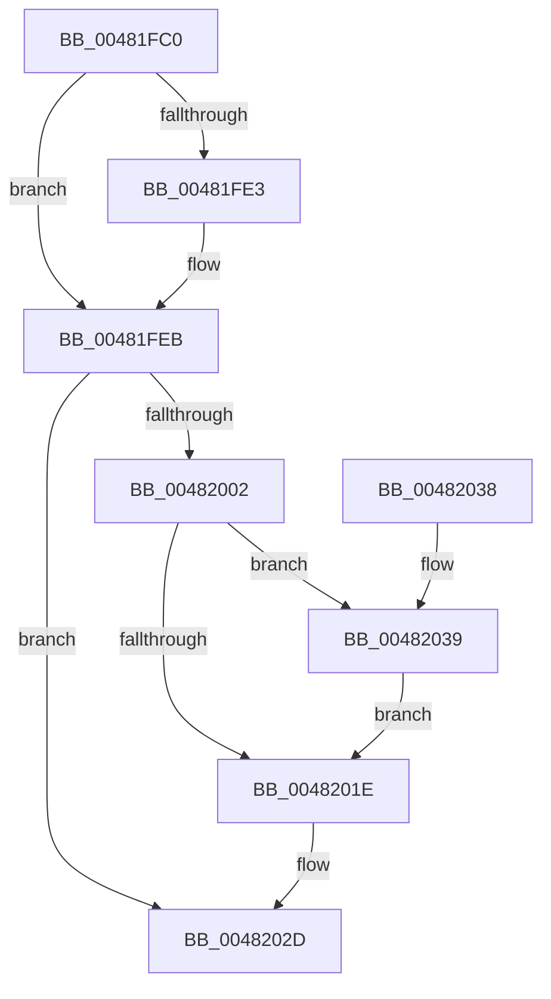

# PoNotifyMediaBuffering

- RVA: `0x00481FC0`–`0x00482047` (길이 `135` bytes)
- VA: `0x0000000140481FC0`
- 실행 섹션: `.text`
- PDB 이름 있음: `예`; PDB Function 태그: `아니요`
- unwind 정보 RVA: `0x0008A6D8`
- 디코드: `36`개 명령, `135/135` bytes 표시
- 미해석 바이트: `0` (있으면 어셈블리에 `.byte`로 보존)

> 이 문서는 커널 이미지의 기계어와 PDB 기호를 분석해 생성했습니다. 4번과 5번은 함수 원형과 자료형을 바이너리 사용 방식에서 추정한 C 해석이며 원본 소스 복구 결과는 아닙니다.

## 1. Dependencies

- 직접 호출 지점: **4**; 고유 호출 대상: **4**
- 직접 호출자로 확인된 함수: **0**
- RIP 상대 이미지 참조: **5**

### Outgoing calls
- `0x00481FD6` → [KeAcquireSpinLockAtDpcLevel](../20/KeAcquireSpinLockAtDpcLevel_function_00208430.md) (function, `0x00208430`)
- `0x00481FF9` → [KxReleaseSpinLock](../20/KxReleaseSpinLock_function_00206670.md) (function, `0x00206670`)
- `0x0048200B` → [KeQueryPriorityThread](../38/KeQueryPriorityThread_function_0038F4F0.md) (function, `0x0038F4F0`)
- `0x00482028` → [ExQueueWorkItem](../2F/ExQueueWorkItem_function_002F9520.md) (function, `0x002F9520`)

### Direct callers
- 이 함수 시작 RVA로 연결되는 직접 call은 확인되지 않았습니다. 간접 호출은 완전히 역산할 수 없습니다.

### Static image references
- `0x00481FCF` → RVA `0x00F0E140` (`.data`; read)
- `0x00481FDB` → RVA `0x00F0E148` (`.data`; read)
- `0x00481FE5` → RVA `0x00F0E148` (`.data`; write)
- `0x00481FF2` → RVA `0x00F0E149` (`.data`; write)
- `0x00482021` → RVA `0x00F0E150` (`.data`; read)

## 2. Other-region calls and transfers

- 다른 실행 섹션으로 향하는 call: **0**
- 별도 외부 분기/꼬리 이동을 확인하지 못했습니다.

## 3. Assembly (complete function range)

```asm
00481FC0  48 89 5C 24 08                  mov qword ptr [rsp + 8], rbx
00481FC5  57                              push rdi
00481FC6  48 83 EC 20                     sub rsp, 0x20
00481FCA  40 8A F9                        mov dil, cl
00481FCD  32 DB                           xor bl, bl
00481FCF  48 8D 0D 6A C1 A8 00            lea rcx, [rip + 0xa8c16a]
00481FD6  E8 55 64 D8 FF                  call 0x140208430
00481FDB  38 1D 67 C1 A8 00               cmp byte ptr [rip + 0xa8c167], bl
00481FE1  75 08                           jne 0x140481feb
00481FE3  B3 01                           mov bl, 1
00481FE5  88 1D 5D C1 A8 00               mov byte ptr [rip + 0xa8c15d], bl
00481FEB  48 8D 0D 4E C1 A8 00            lea rcx, [rip + 0xa8c14e]
00481FF2  40 88 3D 50 C1 A8 00            mov byte ptr [rip + 0xa8c150], dil
00481FF9  E8 72 46 D8 FF                  call 0x140206670
00481FFE  84 DB                           test bl, bl
00482000  74 2B                           je 0x14048202d
00482002  65 48 8B 0C 25 88 01 00 00      mov rcx, qword ptr gs:[0x188]
0048200B  E8 E0 D4 F0 FF                  call 0x14038f4f0
00482010  83 F8 1F                        cmp eax, 0x1f
00482013  8D 50 01                        lea edx, [rax + 1]
00482016  0F 4D D0                        cmovge edx, eax
00482019  40 84 FF                        test dil, dil
0048201C  74 1B                           je 0x140482039
0048201E  83 C2 20                        add edx, 0x20
00482021  48 8D 0D 28 C1 A8 00            lea rcx, [rip + 0xa8c128]
00482028  E8 F3 74 E7 FF                  call 0x1402f9520
0048202D  48 8B 5C 24 30                  mov rbx, qword ptr [rsp + 0x30]
00482032  48 83 C4 20                     add rsp, 0x20
00482036  5F                              pop rdi
00482037  C3                              ret
00482038  CC                              int3
00482039  B8 10 00 00 00                  mov eax, 0x10
0048203E  3B D0                           cmp edx, eax
00482040  0F 4F C2                        cmovg eax, edx
00482043  8B D0                           mov edx, eax
00482045  EB D7                           jmp 0x14048201e
```

## 4. C-style interpretation (structured pseudocode)

```c
__int64 __fastcall PoNotifyMediaBuffering(unsigned __int8 a1)
{
    __int64 result;
    __int64 v_rbx;
    __int64 v_rsp;
    unsigned __int64 v_stack_p8;

    v_stack_p8 = v_rbx;
    v_rsp = (v_rsp) - (32);
    v_rbx = 0;
    result = KeAcquireSpinLockAtDpcLevel(v_rip + 11059562, a2, a3, a4);
    if ((*(unsigned __int8 *)(v_rip + 11059559)) == 0) {
        v_rbx = 1;
        *(unsigned __int8 *)(v_rip + 11059549) = (unsigned __int8)(v_rbx);
    }
    *(unsigned __int8 *)(v_rip + 11059536) = a1;
    result = KxReleaseSpinLock(v_rip + 11059534, a2, a3, a4);
    if ((unsigned __int8)(v_rbx) == 0) goto loc_0048202D;
    result = KeQueryPriorityThread(*(unsigned __int64 *)(gs_base + (0 + 392)), a2, a3, a4);
    a2 = result + 1;
    if (((unsigned int)(result)) >= 31) { a2 = (unsigned int)(result); }
    if (a1 == 0) goto loc_00482039;
loc_0048201E:
    a2 = (unsigned int)((a2) + (32));
    result = ExQueueWorkItem(v_rip + 11059496, a2, a3, a4);
loc_0048202D:
    v_rsp = (v_rsp) + (32);
    return result;
loc_00482039:
    result = 16;
    if (((unsigned int)(a2)) > 16) { result = (unsigned int)(a2); }
    goto loc_0048201E;
}
```

## 5. (Beta) C Style

```c
int64_t PoNotifyMediaBuffering(uint8_t Arg1)
{
    int64_t result;
    int64_t local_rbx;
    int64_t local_rsp;
    uint64_t v_stack_p8;

    v_stack_p8 = local_rbx;
    local_rsp = (local_rsp) - (32);
    local_rbx = 0;
    result = KeAcquireSpinLockAtDpcLevel(v_rip + 11059562, a2, a3, a4);
    if ((*(uint8_t *)(v_rip + 0xA8C167)) == 0) {
        local_rbx = 1;
        *(uint8_t *)(v_rip + 0xA8C15D) = (uint8_t)(local_rbx);
    }
    *(uint8_t *)(v_rip + 0xA8C150) = Arg1;
    result = KxReleaseSpinLock(v_rip + 11059534, a2, a3, a4);
    if ((uint8_t)(local_rbx) == 0) goto loc_0048202D;
    result = KeQueryPriorityThread(*(uint64_t *)(gs_base + (0 + 0x188)), a2, a3, a4);
    a2 = result + 1;
    if (((uint32_t)(result)) >= 31) { a2 = (uint32_t)(result); }
    if (Arg1 == 0) goto loc_00482039;
loc_0048201E:
    a2 = (uint32_t)((a2) + (32));
    result = ExQueueWorkItem(v_rip + 11059496, a2, a3, a4);
loc_0048202D:
    local_rsp = (local_rsp) + (32);
    return result;
loc_00482039:
    result = 16;
    if (((uint32_t)(a2)) > 16) { result = (uint32_t)(a2); }
    goto loc_0048201E;
}
```

## 6. Execution-region graph

[열기: 2D/3D 그래프와 함수 탐색 컨트롤 패널](../../../control-panel.html?section=text&rva=0x00481FC0&view=graph)

- 2D 그래프는 위에서 아래로 흐르고, 3D 그래프는 빈 공간을 드래그해 회전합니다. Shift+드래그는 이동, 휠은 확대·축소, 함수 노드 선택은 대상 보고서 이동입니다.

### Static fallback


